# BoMesh — Business-only Knowledge Mesh

## Tài liệu tổng hợp dự án (dùng cho tiểu luận PDF và slide PowerPoint)

> **BoMesh** là nền tảng tri thức doanh nghiệp. Hệ thống kết nối các nguồn tin cậy của tổ chức, nạp và lập chỉ mục tài liệu, rồi chỉ truy xuất những bằng chứng mà người hỏi có quyền đọc. Câu trả lời của trợ lý AI luôn kèm trích dẫn về đúng đoạn trong tài liệu gốc.
>
> Nguyên tắc xuyên suốt: *"The model reasons over evidence; it does not invent a source of truth."* Mô hình chỉ suy luận trên bằng chứng; nó không phải nguồn sự thật.
>
> Tên gọi: **B**usiness-**o**nly Knowledge **Mesh**. "Bo" cũng là tên tác giả.

---

## Mục lục

1. [Tóm tắt điều hành](#1-tóm-tắt-điều-hành)
2. [Bối cảnh, vấn đề và mục tiêu](#2-bối-cảnh-vấn-đề-và-mục-tiêu)
3. [Ý tưởng cốt lõi và nguyên tắc thiết kế](#3-ý-tưởng-cốt-lõi-và-nguyên-tắc-thiết-kế)
4. [Phạm vi dự án](#4-phạm-vi-dự-án)
5. [Đối tượng người dùng (Personas) và Use cases](#5-đối-tượng-người-dùng-personas-và-use-cases)
6. [Danh mục tính năng chi tiết](#6-danh-mục-tính-năng-chi-tiết)
7. [Kiến trúc hệ thống](#7-kiến-trúc-hệ-thống)
8. [Công nghệ sử dụng](#8-công-nghệ-sử-dụng)
9. [Mô hình miền và cơ sở dữ liệu](#9-mô-hình-miền-và-cơ-sở-dữ-liệu)
10. [Thiết kế API](#10-thiết-kế-api)
11. [Xác thực, phân quyền và cách ly dữ liệu](#11-xác-thực-phân-quyền-và-cách-ly-dữ-liệu)
12. [Pipeline nạp và xử lý tài liệu (Ingestion)](#12-pipeline-nạp-và-xử-lý-tài-liệu-ingestion)
13. [Truy xuất lai (Hybrid Retrieval) và vòng lặp Agent](#13-truy-xuất-lai-hybrid-retrieval-và-vòng-lặp-agent)
14. [Trình xem tài liệu và hình học trích dẫn](#14-trình-xem-tài-liệu-và-hình-học-trích-dẫn)
15. [Sequence Diagrams](#15-sequence-diagrams)
16. [State Diagrams](#16-state-diagrams)
17. [Thiết kế UX/UI](#17-thiết-kế-uxui)
18. [Đánh giá chất lượng (Evaluation)](#18-đánh-giá-chất-lượng-evaluation)
19. [Kiểm thử, vận hành và triển khai](#19-kiểm-thử-vận-hành-và-triển-khai)
20. [Trạng thái hiện thực, hạn chế và hướng phát triển](#20-trạng-thái-hiện-thực-hạn-chế-và-hướng-phát-triển)
21. [Gợi ý cấu trúc slide PowerPoint](#21-gợi-ý-cấu-trúc-slide-powerpoint)
22. [Gợi ý cấu trúc tiểu luận PDF](#22-gợi-ý-cấu-trúc-tiểu-luận-pdf)
23. [Thuật ngữ (Glossary)](#23-thuật-ngữ-glossary)
24. [Phụ lục](#24-phụ-lục)

---

## 1. Tóm tắt điều hành

| Hạng mục | Nội dung |
|---|---|
| Tên dự án | BoMesh — Business-only Knowledge Mesh |
| Loại hệ thống | Nền tảng tri thức doanh nghiệp đa workspace (multi-tenant) với trợ lý AI dựa trên bằng chứng (grounded RAG agent) |
| Bài toán | Nhân viên cần câu trả lời đúng, có nguồn và đúng quyền truy cập, từ tri thức nội bộ đang nằm rải rác ở nhiều nơi |
| Giải pháp | Mỗi tài liệu được lưu một lần theo mô hình Item chuẩn. Quá trình xử lý gồm Docling, contextual chunking, embedding và Qdrant hybrid search. Mọi kết quả đều được kiểm tra lại quyền trong PostgreSQL. Agent gọi công cụ để tìm kiếm và trả lời kèm trích dẫn đến từng đoạn, có toạ độ trên trang |
| Nguồn tri thức | Tệp tải lên (PDF, Office, văn bản, ZIP), Confluence, Google Drive |
| Kênh sử dụng | Web (Next.js + HeroUI), Terminal (Textual TUI), Mobile (Flutter, đang chuyển đổi) |
| Backend | Python 3.12, FastAPI, SQLAlchemy async, PostgreSQL 17, Qdrant, RustFS/S3/R2, Docling, Gotenberg, OpenAI/OpenRouter |
| Chuẩn API | Google AIP: resource-oriented, `/api/v1`, 8 nhóm interface, lỗi theo `google.rpc.Status` |
| Quy mô mã nguồn (đo trên repo) | ~85.500 dòng Python (backend `bomesh` và `api`); ~96.000 dòng TypeScript/TSX (`apps/web/src`); 130 tệp test Python với 1.319 hàm test; 61 bảng trong thiết kế CSDL; 112 commit (25/07/2026 → 16/11/2026) |
| Giai đoạn | Phát triển sớm (active early development). Backend đã phục vụ hợp đồng `/api/v1`; client đang được chuyển sang API mới |

**Bốn bất biến cốt lõi** cần giữ khi mở rộng hệ thống: cách ly tenant (tenant isolation), thực thi ACL, truy vết nguồn (source lineage) và trích dẫn có căn cứ (grounded citations).

---

## 2. Bối cảnh, vấn đề và mục tiêu

### 2.1 Bối cảnh

Tri thức của doanh nghiệp hoặc trường đại học nằm rải rác ở nhiều nơi: tệp PDF và Office, wiki Confluence, Google Drive, tài liệu nội bộ của từng phòng ban. Các chatbot LLM thông thường gặp ba vấn đề khi dùng với dữ liệu này:

1. **Bịa thông tin (hallucination).** Mô hình trả lời trôi chảy nhưng không có nguồn để kiểm chứng.
2. **Rò rỉ quyền truy cập.** Hệ thống RAG đơn giản đưa mọi đoạn văn tìm được cho mô hình, kể cả đoạn mà người hỏi không được đọc.
3. **Mất truy vết.** Người dùng không biết câu trả lời lấy từ phiên bản nào, đoạn nào, trang nào của tài liệu.

### 2.2 Phát biểu vấn đề

> Cần xây dựng một nền tảng mà mỗi câu trả lời: (a) chỉ dựa trên bằng chứng người hỏi được phép đọc, (b) dẫn về đúng đoạn và đúng trang trong tài liệu gốc, (c) hoạt động trên kho tri thức nhiều nguồn, có vòng đời, kiểm duyệt và nhật ký kiểm toán.

### 2.3 Mục tiêu

| # | Mục tiêu | Cơ chế trong BoMesh |
|---|---|---|
| G1 | Trả lời có căn cứ | Agent chỉ trích dẫn bằng chứng do công cụ `knowledge_search` trả về trong lượt hỏi đó. Marker không xác định sẽ không thành trích dẫn |
| G2 | Phân quyền trước khi lộ dữ liệu | Qdrant lọc trước theo tenant và collection. PostgreSQL kiểm tra lại từng kết quả trước khi bằng chứng đến agent |
| G3 | Một nguồn sự thật | PostgreSQL giữ trạng thái nghiệp vụ, object storage giữ bytes gốc, Qdrant chỉ là bản chiếu dựng lại được |
| G4 | Quản trị tri thức | Collection, Contribution (đóng góp có duyệt), Topic, Publish/Unpublish, Revision, Audit log |
| G5 | Nạp dữ liệu bền vững | Ingestion Run tường minh, worker dùng PostgreSQL làm hàng đợi, retry an toàn, checkpoint đồng bộ nguồn |
| G6 | Trải nghiệm người dùng tối giản | Quy tắc thiết kế sản phẩm bắt buộc, HeroUI, mỗi trang một mục đích |
| G7 | Đo lường được | Bộ đánh giá retrieval, rò rỉ quyền (leak) và câu trả lời agent, có LLM judge |

---

## 3. Ý tưởng cốt lõi và nguyên tắc thiết kế

### 3.1 Năm nguyên tắc kiến trúc

1. **Bằng chứng trước câu trả lời** (Evidence before answers). Mô hình suy luận trên bằng chứng đã được cấp quyền; nó không phải nguồn sự thật.
2. **Phân quyền trước khi lộ dữ liệu** (Authorization before exposure). Quyền workspace và quyền tài nguyên được áp dụng trước khi nội dung đến retrieval, reranking hay agent.
3. **Sở hữu dữ liệu rõ ràng.** PostgreSQL sở hữu trạng thái nghiệp vụ, object storage sở hữu bytes gốc, Qdrant sở hữu bản chiếu tìm kiếm dựng lại được.
4. **Tách kho tri thức khỏi xử lý.** Upload và đồng bộ nguồn chỉ đăng ký tài liệu ở trạng thái chờ. Chỉ một **Ingestion Run** tường minh mới phân tích và lập chỉ mục.
5. **Ranh giới truyền tải mỏng.** HTTP handler chỉ kiểm tra và ánh xạ request. Service theo từng domain sở hữu use case, phân quyền, transaction và điều phối hạ tầng.

### 3.2 Hợp đồng niềm tin với người dùng (Trust contract)

1. Truy xuất chỉ diễn ra trong workspace đang hoạt động.
2. Quyền tài nguyên được áp dụng trước khi bằng chứng đến trợ lý. Nếu câu trả lời cần đến tri thức người hỏi không đọc được, trợ lý nói rõ điều đó.
3. Mỗi khẳng định có căn cứ đều liên kết đến trích dẫn, đoạn văn và toàn bộ tài liệu.
4. Người có thẩm quyền luôn thấy được truy vết nguồn, trạng thái xử lý và lịch sử kiểm toán.
5. Quản trị workspace và vận hành nền tảng là hai phạm vi quyền tách biệt.

### 3.3 Các quyết định thiết kế nổi bật (dùng cho phần "Đóng góp" của tiểu luận)

| Quyết định | Lý do / phương án bị loại |
|---|---|
| Collection và Document dùng chung một danh tính `items` và một resource `workspaces/{w}/items/{item}` | Loại phương án tách bảng hoặc resource `documents` và `collections`. Tên phẳng giúp di chuyển (move) mà không đổi tên |
| Mỗi Item có đúng một cha chuẩn (canonical parent). Hiển thị ở nơi khác chỉ là tham chiếu (item link, reading list, saved, recent, space material) | Tham chiếu không bao giờ cấp quyền và không sao chép object hay embedding |
| Bốn trạng thái độc lập của tài liệu: xoá, nội dung, xuất bản, lập chỉ mục | Tránh gộp trạng thái. Ví dụ: tài liệu có nội dung nhưng chưa tìm kiếm được |
| Duyệt đóng góp không tự khởi chạy xử lý | Xử lý luôn là một Ingestion Run tường minh, nhờ đó kiểm soát được chi phí và retry |
| Qdrant chỉ là bộ lọc trước; PostgreSQL quyết định quyền | Không cache quyền, nên thay đổi quyền có hiệu lực từ request kế tiếp |
| PostgreSQL làm hàng đợi (advisory lock), tạm tắt Temporal | Giảm số thành phần hạ tầng. Worker chết thì khoá tự nhả và worker khác tiếp quản |
| Không dùng file migration SQL. Schema được tạo từ ORM models khớp với `design.dbml` | Dự án giai đoạn sớm. Chỉ viết script nâng cấp khi cần giữ dữ liệu |
| Agent là vòng lặp model/tool thông minh, không phải pipeline RAG cứng | Mô hình tự quyết định khi nào tìm, đọc hay chạy code, trong giới hạn an toàn |
| Sandbox Docker riêng cho mỗi hội thoại | Không phụ thuộc container hay file API của nhà cung cấp mô hình, chạy được với mọi provider |

---

## 4. Phạm vi dự án

### 4.1 Trong phạm vi (In scope)

| Nhóm | Phạm vi |
|---|---|
| Danh tính | Đăng ký, đăng nhập bằng mật khẩu hoặc Google, phiên truy cập (JWT + session row), đặt lại mật khẩu |
| Workspace | Đa tenant; template ENTERPRISE / CAMPUS; vòng đời workspace; thành viên, nhóm, vai trò tuỳ chỉnh; IAM policy |
| Tri thức | Collection lồng nhau, Document, revision, link, publish/unpublish, move, merge, verify, xoá mềm/khôi phục, tìm kiếm có facet |
| Đóng góp và kiểm duyệt | Contribution (tài liệu mới hoặc phiên bản mới), phân tích tự động, duyệt/từ chối/yêu cầu sửa |
| Phân loại | Domain → Topic, quy tắc phân loại, gợi ý, đề xuất, sửa (topic corrections) |
| Thư viện cá nhân | Saved items, recent items, saved searches, reading lists, notifications, My files |
| Nạp dữ liệu | Upload, ZIP, Confluence, Google Drive; Connection (OAuth/API token); Source có lịch cron; Sync; Ingestion Run; chính sách nạp |
| Trợ lý AI | Hội thoại, streaming SSE, trích dẫn, đính kèm, sandbox xử lý tệp, artifacts, chia sẻ hội thoại, phản hồi, knowledge gaps |
| Cộng tác (module tuỳ chọn) | Spaces, tài liệu học/làm việc, thông báo, sự kiện, Requests có loại và quy tắc CEL |
| Vận hành | Health, components, incidents, audit log, tóm tắt sử dụng, long-running operations, platform console |
| Đánh giá | Bộ eval retrieval, leak và agent với LLM judge |

### 4.2 Ngoài phạm vi / chưa hỗ trợ ở giai đoạn này

- Ảnh **không** phải tri thức được lập chỉ mục; ảnh chỉ là tệp đính kèm hội thoại.
- SharePoint, Notion, Slack chỉ có trong catalog (trạng thái `UNSUPPORTED`), chưa kết nối được.
- ACL của nhà cung cấp nguồn **không** được nhập. Tài liệu từ connector kế thừa quyền của collection đích.
- Không có quyền truy cập ẩn danh hay workspace công khai.
- Phân tích nghiệp vụ (governed BI) mới dừng ở mức Overview, summarize và export. Chưa có module BI hay SQL riêng.
- Temporal có trong mã nhưng **bị tắt** ở giai đoạn này.

---

## 5. Đối tượng người dùng (Personas) và Use cases

### 5.1 Personas

| Persona | Nhu cầu chính | Trang mặc định | Phạm vi quyền |
|---|---|---|---|
| **Member** (thành viên) | Hỏi, kiểm chứng, tìm và đọc tri thức; đóng góp tài liệu; gửi yêu cầu | Home | Quyền đọc hiệu lực và vai trò trong space; có thể xin quyền truy cập tri thức bị khoá |
| **Reviewer** (người duyệt) | Như Member, cộng thêm duyệt đóng góp vào collection mình sở hữu | Home | `roles/collectionOwner` trên collection |
| **Workspace admin** | Giữ tri thức hữu ích, được kết nối và quản trị; nêu bật tri thức trên Home | Home | `roles/workspaceAdmin` |
| **Platform operator** | Vận hành workspace, tài khoản, connector, sức khoẻ dịch vụ | Platform console | `roles/platformOperator` / `roles/platformAdmin`; muốn đọc dữ liệu workspace vẫn phải là thành viên |

**Workspace demo trong prototype UX:** *Northwind Group* (Enterprise), *Finx Workspace* (ngân hàng số giả lập, bật Spaces/Work/Requests), *Trường Đại học UTE* (Campus, nội dung tiếng Việt, cấu trúc Khoa › Bộ môn › Nhóm ngành › Chuyên ngành). Dữ liệu seed backend dùng workspace `hcmute`.

### 5.2 Use case diagram (dạng flowchart)

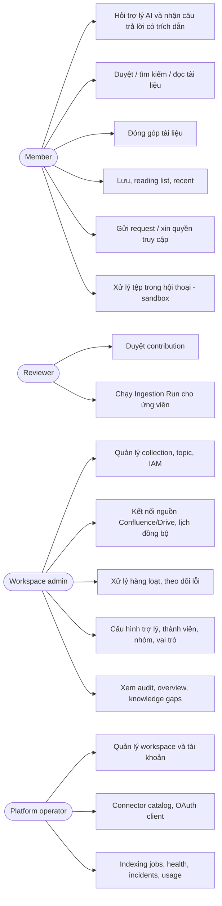

### 5.3 Hành trình người dùng chính

| Hành trình | Các bước |
|---|---|
| **Tìm câu trả lời** | Đăng nhập → chọn workspace → Home → "Ask a question" → nhập câu hỏi hoặc chọn starter → câu trả lời stream theo nhịp *say → do → say → answer* (ghi chú ngắn → hành động "Searching your knowledge" → danh sách tài liệu tìm thấy → câu trả lời có số trích dẫn) → bấm trích dẫn → preview đúng đoạn ("Passage n of m") → "Open full document" → Reader. Tài liệu bị khoá chỉ hiện trích đoạn và nút "Request access" |
| **Đóng góp tài liệu** | Knowledge → Contribute → thả tệp → **Analyzing** (trợ lý đọc tệp so với topic của workspace) → **Check the details** (tiêu đề, loại, topic kèm bằng chứng, collection, tóm tắt, cảnh báo dữ liệu cá nhân hoặc trùng lặp) → Submit for review → trạng thái *In review* |
| **Duyệt** | Reviewer → Knowledge Studio → Documents → Review → chạy xử lý ứng viên → Approve / Request changes / Reject |
| **Thiết lập tri thức (admin)** | Collections → Topics (từ khoá, đồng nghĩa) → Sources → Add source (App → Account → Content → Destination, lịch, chính sách xuất bản) → sync lần đầu → Process |
| **Xử lý hàng loạt** | Documents → All → "Not processed" → "Select all matching" → hộp thoại Process (phạm vi topic, AI context tuỳ chọn, ghi chú "nothing is published") → thanh tiến độ → lỗi chuyển sang Documents → Issues |
| **Làm việc với tệp** | Đính kèm tối đa 5 tệp, mỗi tệp 100 MB → agent chạy code trong sandbox → tệp kết quả hiện dưới dạng thẻ có Preview / Changes / History → mỗi lần sửa tạo một phiên bản mới và có thể khôi phục |
| **Onboarding** | Product tour lần đầu, mỗi người mỗi workspace một lần; xem lại qua Help → Product tour |

---

## 6. Danh mục tính năng chi tiết

### 6.1 Identity (Danh tính)

- Đăng nhập bằng email hoặc username kèm mật khẩu (băm **scrypt**), hoặc **Google Identity** (xác minh chữ ký ID token bằng JWKS của Google và kiểm tra audience).
- Phiên truy cập: bảng `access_sessions` là nguồn sự thật. JWT mang `session_id`, `user_id` và `token_version`. Access token chỉ trả về **một lần**; không có refresh token.
- Đăng xuất (thu hồi phiên), liệt kê phiên, tạm khoá hoặc kích hoạt người dùng (tạm khoá sẽ thu hồi mọi phiên).
- Đặt lại mật khẩu: token chỉ lưu dạng băm SHA-256, hết hạn sau 30 phút.
- Tuỳ chọn người dùng (preferences).

### 6.2 Workspaces và quản trị

- Workspace có vòng đời CREATING → ACTIVE ⇄ SUSPENDED → ARCHIVED, và có thể tạm dừng hoặc tiếp tục nạp dữ liệu (`:pauseIngestion` / `:resumeIngestion`).
- Template ENTERPRISE / CAMPUS. Cấu hình bật hoặc tắt module (`spaces`, `work`, `requests`), branding, loại space, loại tài liệu, chính sách xuất bản mặc định, chu kỳ xác minh lại.
- Thành viên: thêm qua email (gán vai trò ngay trong cùng lệnh), tạm khoá hoặc kích hoạt; nhóm và thành viên nhóm; vai trò tuỳ chỉnh có xoá mềm và `:undelete`.
- IAM: `:getIamPolicy`, `:setIamPolicy`, `:testIamPermissions`, `:analyzeIamPolicy`.
- Cấu hình trợ lý theo workspace: chỉ dẫn (≤ 2000 ký tự), độ dài câu trả lời (concise / balanced / detailed), năng lực (ví dụ bật xử lý tệp), lời chào, starter prompt theo vai trò hoặc nhóm.
- **Overview:** các mục cần chú ý như CONTRIBUTIONS_WAITING, PUBLISH_FAILED, REVERIFICATION_DUE, SOURCE_FAILING, CONNECTION_EXPIRED, ACCESS_REQUESTS và DOCUMENTS_WAITING_TO_PUBLISH, theo cửa sổ P1D/P7D/P30D.
- **Knowledge gaps:** suy ra từ tín hiệu câu hỏi (`RATED_UNHELPFUL` > `OUTDATED` > `NOT_COVERED`). Admin có thể bỏ qua (dismiss) hoặc đánh dấu đã xử lý (resolve).
- **Audit log:** ghi thêm vào, không sửa (append-only), theo danh mục KNOWLEDGE, FILES, SOURCES, PEOPLE, SETTINGS, SPACES, REQUESTS, SIGN_IN; hỗ trợ tóm tắt theo ngày và xuất CSV.

### 6.3 Knowledge (Tri thức)

- **Item** gồm hai loại `COLLECTION` và `DOCUMENT` trong một cây. Collection gốc là ranh giới quyền; collection con kế thừa quyền trừ khi đặt `inheritAccess=false`.
- **Personal collection "My files":** mỗi thành viên một collection, chỉ chủ sở hữu truy cập, không chia sẻ được.
- Upload hai cách: lấy signed URL rồi `:completeUpload`, hoặc multipart một lần gọi (`/upload/api/v1/...`).
- **Revision** bất biến, rollback về phiên bản cũ, metadata, loại tài liệu.
- Phương thức tuỳ chỉnh: `:publish`, `:unpublish`, `:move`, `:merge` (gộp bản trùng), `:verify` (xác minh định kỳ).
- **Item links:** hiển thị một tài liệu trong collection khác mà không đổi cha và không cấp quyền.
- **Tìm kiếm** `items:search`: lai giữa dense và BM25, có filter AIP-160, facet; mọi kết quả được kiểm tra lại quyền trong PostgreSQL.
- **Passages:** đoạn văn có `pageNumber` và `boundingBoxes` phục vụ trích dẫn.
- **Preview:** bản trình bày cho trình xem (PDF, IMAGE, TABLE, TEXT, MEDIA, ARCHIVE) và ảnh bìa (cover).
- Xoá mềm theo cả cây con; khôi phục trong 30 ngày; sau đó purge điểm Qdrant và object không còn revision nào tham chiếu.

### 6.4 Contribution và kiểm duyệt

- Loại `NEW_DOCUMENT` hoặc `NEW_REVISION`; nguồn gốc `MEMBER` hoặc `SOURCE`.
- Trạng thái: ANALYZING → IN_REVIEW ⇄ CHANGES_REQUESTED → APPROVED / REJECTED / WITHDRAWN.
- Cờ cảnh báo tự động: `duplicate`, `new_revision`, `personal_data`, `unsearchable_format`.
- Mỗi ứng viên chỉ có một contribution đang mở. Khi đang mở, ứng viên không được di chuyển, xoá hay đổi nội dung.
- Muốn duyệt `NEW_DOCUMENT` thì ứng viên phải đã được xử lý (nếu chưa: lỗi `CANDIDATE_NOT_PROCESSED`). Duyệt **không** tự khởi chạy ingestion.
- Nguồn có chính sách `REVIEW_FIRST` sinh contribution `SOURCE` cho tài liệu mới hoặc đã thay đổi.

### 6.5 Topics (Phân loại)

- Phân cấp DOMAIN → TOPIC; trạng thái PROPOSED / ACTIVE / REJECTED.
- Mỗi topic có từ khoá, từ đồng nghĩa, hướng dẫn, tối đa 5 tài liệu ví dụ, quy tắc theo collection hoặc theo nguồn.
- Các thao tác: `:accept`, `:merge`, `:reject`, `:confirmAssignments`, `:import` (CSV/XLSX), `:testClassification`, `:compileClassificationPrompt`.
- Giai đoạn CLASSIFYING trong ingestion: áp quy tắc trước; nếu không khớp thì gọi mô hình một lần trên tiêu đề và khoảng 12.000 ký tự trích đoạn. Bước này best-effort.
- Topic **không** đi vào payload chỉ mục hay nội dung chunk.

### 6.6 Library (Thư viện cá nhân)

- Home của thành viên, thông báo (`:markRead`), recent items (`:clear`), saved items, saved searches (bố cục list / table / grid).
- Reading lists: phạm vi PRIVATE / SPACE / WORKSPACE; mỗi workspace có một danh sách FEATURED; hỗ trợ `:copy`. Reading list không bao giờ cấp quyền.

### 6.7 Ingestion (Nạp dữ liệu)

- **Connector catalog:** `confluence` và `google_drive` đã hiện thực; `sharepoint`, `notion`, `slack` chỉ có trong catalog. Platform admin bật hoặc tắt connector và cấu hình OAuth client.
- **Connection:** OAuth (state được niêm phong bằng HKDF, có PKCE) hoặc API token. Thông tin xác thực mã hoá khi lưu (`BOMESH_INTEGRATION_ENCRYPTION_KEY`, 32 bytes). Các thao tác: `:test`, `:reauthorize`, `:browseResources`.
- **Source:** một phạm vi bên ngoài (page / space / site) trỏ tới đúng một collection đích, cố định từ lúc tạo. Có lịch cron 5 trường kèm IANA timezone, chính sách `AUTO_PUBLISH` hoặc `REVIEW_FIRST`, checkpoint tăng dần.
- **Sync:** MANUAL / SCHEDULED / CREATION. Sync **không bao giờ** xử lý tài liệu; checkpoint chỉ tiến khi toàn bộ lần sync thành công.
- **Ingestion Run:** chọn tài liệu theo `items[]` (tối đa 1000) hoặc theo filter. Pha xử lý: FETCHING → PARSING → (OCR) → CLASSIFYING → CHUNKING → EMBEDDING → INDEXING. Hỗ trợ `:cancel`, `:retry` và `ingestionRuns:summarize`.
- **Chính sách nạp** `ingestionPolicies/default`: MIME được phép, kích thước tối đa, OCR cho PDF scan, phân tích bảng tính.

### 6.8 Assistant (Trợ lý AI)

- Hội thoại riêng tư của chủ sở hữu. Có thể giới hạn phạm vi theo collection hoặc space. Server giữ lịch sử, client không gửi lại history.
- `:converse` trả về `text/event-stream` theo mô hình sự kiện **OpenResponses**.
- `replaceFromMessage` dùng để sửa câu hỏi hoặc thử lại; các tin nhắn sau đó bị đánh dấu superseded.
- Trích dẫn `[n]` đánh số theo **tài liệu**, kèm annotation `bomesh:document_citation`.
- Phản hồi HELPFUL / UNHELPFUL, dùng làm đầu vào cho knowledge gaps.
- **Chia sẻ hội thoại:** cho cả WORKSPACE hoặc một số người (PEOPLE); mỗi hội thoại có tối đa một share đang hoạt động; snapshot tối đa 500 tin nhắn; quyền được lọc lại khi đọc.
- **Artifacts:** các loại FILE, DRAFT, EVIDENCE_REVIEW, STUDY_GUIDE, QUIZ. Thao tác `:revise`, `:commit`, `:export` (CSV / PDF / Markdown / DOCX), `:publish`, `:rollback`.
- **Sandbox xử lý tệp:** mỗi hội thoại có một container Docker riêng, không có mạng, chạy bằng user không phải root.

### 6.9 Collaboration (Cộng tác, có thể bật/tắt theo module)

- **Spaces:** chính sách tham gia OPEN / REQUEST / INVITE; vai trò spaceLead ⊇ spaceStaff ⊇ spaceMember; tài liệu (materials, chỉ là tham chiếu), thông báo, sự kiện.
- **Requests:** các loại SERVICE / QUESTION / COLLECTION_ACCESS / SPACE_MEMBERSHIP / CONNECTOR. Trạng thái OPEN ⇄ NEEDS_INFO → APPROVED / DENIED / ANSWERED / WITHDRAWN / CLOSED. RequestType có trường động, quy tắc **CEL** (BLOCK / WARN) và SLA. Tin nhắn nội bộ chỉ nhân viên xử lý thấy.
- **Work:** Draft → In review → Approved / Changes requested; gắn với artifact loại DRAFT và EVIDENCE_REVIEW.

### 6.10 Operations và Platform

- `/health` cho biết tình trạng các phụ thuộc mà không lộ secret. Components (SERVICE / AI_MODEL): HEALTHY / DEGRADED / DOWN / NOT_CONFIGURED. Incidents: ONGOING / RESOLVED.
- Long-running operations theo `google.longrunning.Operation`, có `:cancel`. Khi khởi động, một bộ hoà giải đánh dấu các operation bị bỏ dở là UNAVAILABLE.
- Platform console: Workspaces, Users, Connectors, Indexing (By workspace, Jobs, Policies), Usage, Audit log, System health. Ngăn kéo chi tiết job chỉ hiện metadata, không hiện tên hay nội dung tài liệu.
- Header `Server-Timing: app;dur=…, db;dur=…` để đo hiệu năng; tracing Langfuse là tuỳ chọn.

---

## 7. Kiến trúc hệ thống

### 7.1 Kiến trúc logic

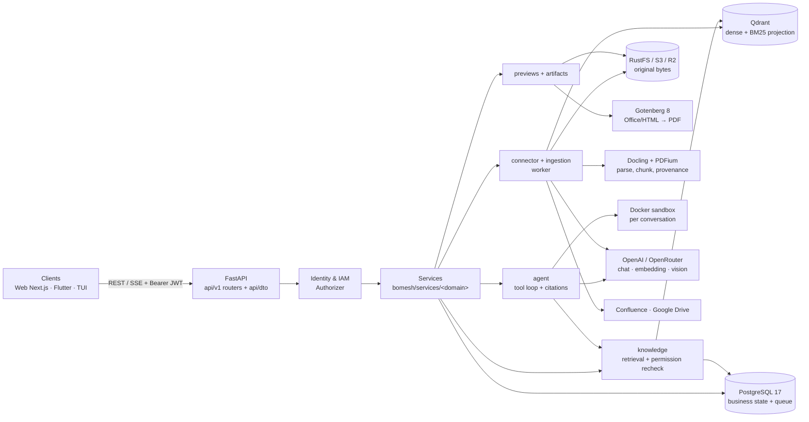

### 7.2 Phân tầng và trách nhiệm

| Tầng | Vị trí | Trách nhiệm |
|---|---|---|
| Client | `apps/web`, Flutter, `bomesh.tui` | Trình bày, trạng thái cục bộ, render stream, gọi API |
| API boundary | `backend/api/v1`, `backend/api/dto`, `backend/main.py` | Nhận diện principal, validate request, ánh xạ DTO, lỗi ổn định, truyền SSE |
| Services | `backend/bomesh/services/<domain>`: `identity`, `workspaces`, `knowledge_items`, `knowledge_curation`, `library`, `ingestion`, `conversations`, `agent_runtime`, `artifacts`, `collaboration`, `operations`, `previews`, `kernel`, `workflow` | Use case, kiểm tra quyền, ranh giới transaction, điều phối |
| Năng lực domain | `bomesh/iam`, `bomesh/knowledge`, `bomesh/agent`, `bomesh/connector`, `bomesh/document_index`, `bomesh/storage`, `bomesh/integrations` | IAM, retrieval, agent, connector, chỉ mục, lưu trữ, OAuth |
| Hạ tầng | PostgreSQL, Qdrant, S3, model providers, API của nguồn | Adapter mỏng |

Một **composition root** tạo các client hạ tầng từ cấu hình có kiểu (typed configuration) rồi inject vào service. Service nghiệp vụ không đọc biến môi trường rải rác.

### 7.3 Sở hữu dữ liệu và tính nhất quán

| Hệ thống | Sở hữu | Mô hình nhất quán |
|---|---|---|
| PostgreSQL | Danh tính, workspace, RBAC, Item, vòng đời, lineage, citation, hội thoại, lịch sử ingestion, audit | Nguồn sự thật có transaction |
| Object storage | Bytes gốc, revision của artifact, preview | Khoá object lưu trong PostgreSQL; signed URL sinh lúc đọc |
| Qdrant | Chunk ngữ cảnh, vector dense, trường BM25, payload lọc | Bản chiếu dẫn xuất, dựng lại được |
| Ingestion worker | Thực thi run, sync, lịch và bảo trì chỉ mục | Sở hữu run khi giữ advisory lock; không giữ trạng thái ngoài PostgreSQL |
| Model providers | Sinh văn bản, embedding, vision, rerank | Tính toán bên ngoài; không bao giờ là nơi quyết định quyền hay lưu trữ |

Transaction ngắn, mỗi lần một thao tác nguyên tử (`transaction_scope`). Các công việc dài như phân tích tài liệu, gọi model, ghi object hay lập chỉ mục đều chạy **ngoài** transaction, với chuyển trạng thái tường minh trước và sau.

### 7.4 Topology triển khai

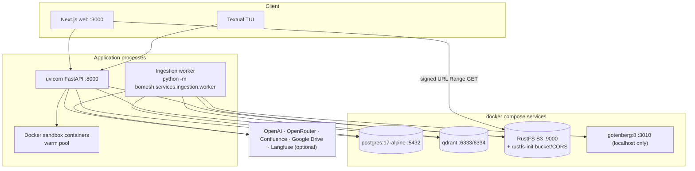

- Khi phát triển, `backend/main.py` chạy API và **giám sát** worker như một subprocess. Ở production, hai tiến trình này triển khai và mở rộng độc lập.
- Profile `minio` (tuỳ chọn) dùng để di chuyển dữ liệu từ MinIO cũ sang RustFS. Các dịch vụ Temporal trong compose đang bị comment.

---

## 8. Công nghệ sử dụng

| Lĩnh vực | Công nghệ | Vai trò |
|---|---|---|
| Ngôn ngữ backend | Python ≥ 3.12, quản lý bằng `uv` | |
| Web framework | FastAPI, uvicorn, Pydantic v2 | REST, SSE, DTO |
| ORM / DB | SQLAlchemy 2 (async), asyncpg, PostgreSQL 17 | Trạng thái nghiệp vụ, hàng đợi (advisory lock, LISTEN/NOTIFY) |
| Vector search | Qdrant (`qdrant-client`), dense 1536 chiều + sparse `qdrant/bm25` (tokenizer multilingual) | Hybrid retrieval, RRF |
| Object storage | boto3: RustFS (local), AWS S3, Cloudflare R2 | Bytes gốc, preview, artifact |
| Xử lý tài liệu | Docling (HybridChunker, VLM pipeline cho trang scan), pypdfium2, openpyxl, python-docx, Pillow, BeautifulSoup | Chuyển đổi, chunk, provenance |
| Chuyển đổi preview | Gotenberg 8 (LibreOffice/Chromium) | Office, HTML, email → PDF |
| LLM | OpenAI SDK (`/responses`), OpenRouter (chat + embeddings), giao thức OpenResponses | Agent, embedding, contextualization, rerank, vision |
| Connector | `atlassian-python-api` (Confluence), Google Drive API, OAuth | Đồng bộ nguồn |
| Lập lịch | croniter | Lịch đồng bộ Source |
| Sandbox | Docker SDK, image `python:3.12-slim` (pandas, numpy, openpyxl, xlsxwriter, matplotlib, python-docx, python-pptx, pypdf, reportlab, pillow, tabulate) | Chạy code xử lý tệp |
| Bảo mật | `cryptography` (mã hoá credential), scrypt, JWT, HKDF | |
| Quan sát | Langfuse (tuỳ chọn), structured logs, Server-Timing | |
| Workflow (tắt) | temporalio | Thiết kế thay thế, chưa nối vào hệ thống |
| Web client | Next.js 16, React 19, TypeScript, **HeroUI v3**, TanStack Query, `openapi-fetch` (type sinh từ `openapi.yaml`), pdf.js, react-markdown + KaTeX, lucide-react | Giao diện sản phẩm |
| Terminal client | Textual | TUI gọi API |
| Mobile | Flutter / Dart | Đang chuyển sang `/api/v1` (không nằm trong thư mục `apps/` hiện tại) |
| UX prototype | HTML/CSS/JS thuần (`apps/ux_preview`) | Nguồn sự thật UX |
| Kiểm thử | pytest; Node test runner (`.test.mts`) | |

---

## 9. Mô hình miền và cơ sở dữ liệu

### 9.1 Cây Item

```text
Workspace (tenants)
 ├─ Item COLLECTION (root)          ranh giới quyền; inherit_access = false
 │   ├─ Item COLLECTION (nested)    kế thừa quyền trừ khi inheritAccess = false
 │   │   └─ Item DOCUMENT
 │   ├─ Item DOCUMENT
 │   │    ├─ item_revisions/{n}     nội dung bất biến
 │   │    ├─ passages               đích trích dẫn
 │   │    └─ Item DOCUMENT          CHILD/ATTACHMENT (chỉ từ source sync)
 │   └─ item_links ┄▶ DOCUMENT ở nơi khác (không cấp quyền)
 ├─ Item COLLECTION PERSONAL ("My files", mỗi thành viên một cái, chỉ chủ sở hữu)
 └─ (ẩn) conversation_artifacts → artifacts của trợ lý
```

### 9.2 Bốn trạng thái độc lập của Document

| Trường API | Giá trị | Lưu ở | Thay đổi bởi |
|---|---|---|---|
| `state` | ACTIVE, DELETED | `items.deleted_at` | Delete / Undelete |
| `document.contentState` | PENDING, AVAILABLE, FAILED | `items.status` | Hoàn tất upload |
| `document.publicationState` | PUBLISHED, UNPUBLISHED | `items.is_published` | Publish/Unpublish, duyệt contribution, chính sách nguồn |
| `document.indexingState` | PENDING, RUNNING, SUCCEEDED, FAILED, OUTDATED, UNSUPPORTED | `item_index_states.index_status` + `processed_version` | **Chỉ** Ingestion Run |

`OUTDATED` nghĩa là tài liệu đã xử lý xong nhưng `processed_version` khác cấu hình hiện tại (parser, chunker, mô hình embedding, schema chỉ mục, mô hình contextualization).

### 9.3 Quy tắc hiển thị (Visibility rule — item_model §6)

> Một Document **đọc được** khi và chỉ khi: nó ACTIVE, mọi tổ tiên đều ACTIVE, người gọi có `items.get` trên collection quản lý nó, và (tài liệu PUBLISHED **hoặc** người gọi có `items.update` ở đó).

Quy tắc này áp dụng cho mọi bề mặt dẫn xuất: list, search, facet, count, home, share, artifact, task. PostgreSQL kiểm tra lại mỗi lần; search index chỉ là bộ lọc trước.

Các bất biến quyền khác:

- Quyền hiệu lực = quyền cấp ở workspace ∪ quyền cấp trên chuỗi collection quản lý, đi lên đến collection đầu tiên có `inheritAccess=false`. Chỉ Collection mang grant; Document không có policy riêng.
- Reviewer chỉ được xem, preview và tải xuống ứng viên của contribution **đang mở**.
- Tham chiếu (link, reading list, saved, recent, material, trích dẫn trong share) không bao giờ cấp quyền. Mục không đọc được trả lời giống hệt mục không tồn tại.
- Signed URL được cấp theo từng request, sau khi kiểm tra quyền, và có thời hạn ngắn.
- Tài liệu từ connector kế thừa quyền của collection đích.

### 9.4 Danh mục bảng (61 bảng theo `design.dbml`)

| Nhóm | Bảng |
|---|---|
| **Identity** (4) | `users`, `auth_identities`, `access_sessions`, `password_reset_tokens` |
| **Workspace & IAM** (10) | `tenants`, `roles`, `permissions`, `role_permissions`, `role_assignments`, `tenant_memberships`, `groups`, `group_memberships`, `request_idempotency`, `operations` |
| **Knowledge** (16) | `items`, `item_index_states`, `item_revisions`, `item_uploads`, `citations`, `contributions`, `topics`, `item_topics`, `topic_corrections`, `contribution_topics`, `reading_lists`, `reading_list_entries`, `item_links`, `saved_items`, `recent_items`, `saved_searches` |
| **Ingestion** (9) | `integration_connections`, `integration_credentials`, `ingestion_sources`, `ingestion_syncs`, `external_resources`, `ingestion_runs`, `ingestion_run_items`, `ingestion_policies`, `platform_connector_settings` |
| **Assistant** (12) | `conversations`, `sandbox_sessions`, `messages`, `message_items`, `artifacts`, `artifact_source_items`, `evidence_review_cells`, `conversation_shares`, `conversation_share_recipients`, `memories`, `workspace_assistant_settings`, `knowledge_gap_decisions` |
| **Collaboration** (7) | `spaces`, `space_materials`, `space_announcements`, `space_events`, `request_types`, `requests`, `request_messages` |
| **Notifications & Ops** (3) | `notifications`, `audit_logs`, `platform_health_checks` |

### 9.5 Sơ đồ ER (lõi)

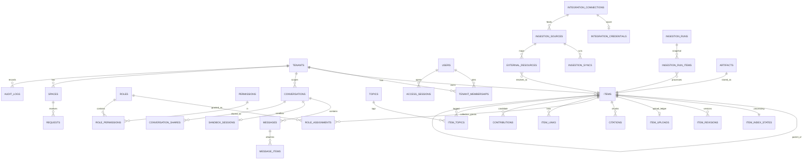

### 9.6 Nguyên tắc cơ sở dữ liệu

- **Không có file migration SQL.** `design.dbml` là bản thiết kế; `backend/bomesh/db/models/` hiện thực toàn bộ, kể cả CHECK và trigger. `make db-reset` gọi `create_all` rồi đồng bộ vai trò hệ thống.
- **Trigger** đảm bảo các ràng buộc: cùng tenant, cha còn sống, không có chu trình, Document không chứa Collection, gốc có `inherit_access=false`, tự tạo `item_index_states` cho mỗi Document, phát `pg_notify('bomesh_cover')` khi có nội dung mới.
- **ID** là `uuid` gốc. ID dẫn xuất dùng uuid5 xác định. Client có thể chọn ID qua cột `code` bất biến.
- **Xoá mềm** bằng `deleted_at`; `purgeTime = deleted_at + 30 ngày`; `etag = updated_at`.
- Giá trị tính toán, không lưu: `childCount`, `documentCount`, `Source.state`, `IngestionRun.counts`, `Member.roles`, `purgeTime`…
- Idempotency theo AIP-155 (`request_idempotency`, hiệu lực 24 giờ). Long-running operations lưu trong bảng `operations`.
- **Dirty payload:** move, publish, delete… đặt `payload_dirty_at` trong cùng transaction; Qdrant được cập nhật sau commit; một job định kỳ thử lại nếu lỗi. Không dùng bảng outbox.

---

## 10. Thiết kế API

### 10.1 Quy tắc (Google AIP)

1. **Resource-oriented:** tên resource dạng `workspaces/{workspace}/items/{item}`, collection ID ở dạng số nhiều và lowerCamelCase.
2. **Phương thức chuẩn:** Get, List, Create, Update (`PATCH` kèm `updateMask`), Delete. Mọi thao tác khác là **custom method** `POST {name}:verb` (hoặc `GET` nếu chỉ đọc). Không dùng `PUT`. Base path `/api/v1`; upload qua `/upload/api/v1`.
3. **JSON theo proto3:** field lowerCamelCase, enum UPPER_SNAKE, int64 dạng chuỗi, thời gian RFC 3339; `readOnly`/`writeOnly`. Trường `state` là output-only và chỉ đổi qua các phương thức chuyển trạng thái.
4. **List:** `pageSize` (mặc định 50, tối đa 1000), `pageToken`, `filter` AIP-160, `orderBy`, `showDeleted`. **Write:** `requestId` cho idempotency, `validateOnly`, `etag` cho kiểm soát đồng thời; `:undelete` cho tài nguyên xoá mềm. Công việc dài trả về `Operation`.
5. **Lỗi:** `google.rpc.Status` kèm `ErrorInfo.reason` (domain `bomesh.app`). Tài nguyên không đọc được trả lời y như không tồn tại. Chuyển trạng thái không hợp lệ trả về `FAILED_PRECONDITION`.
6. **Phân quyền khai báo theo method:** `x-permission: <collection>.<method>` và `x-authorization` cho quy tắc sở hữu.

| gRPC code | HTTP | Ví dụ reason |
|---|---|---|
| INVALID_ARGUMENT / FAILED_PRECONDITION / OUT_OF_RANGE | 400 | `FORMAT_NOT_ALLOWED`, `UPLOAD_INCOMPLETE`, `CANDIDATE_NOT_PROCESSED`, `LAST_ADMIN`, `MODULE_DISABLED` |
| UNAUTHENTICATED | 401 | `INVALID_CREDENTIALS` |
| PERMISSION_DENIED | 403 | `ROLE_ESCALATION` |
| NOT_FOUND | 404 | |
| ALREADY_EXISTS / ABORTED | 409 | `ETAG_MISMATCH`, `EMAIL_ALREADY_USED` |
| RESOURCE_EXHAUSTED | 429 | |
| INTERNAL / UNAVAILABLE | 500 / 503 | `AGENT_EXECUTION_FAILED` |

### 10.2 Cây resource theo 8 interface (tag)

| Tag | Resource chính | Custom method tiêu biểu |
|---|---|---|
| **Identity** | `users`, `users/{u}/preferences`, `sessions` | `users:lookup`, `:activate`, `:suspend`, `users:sendPasswordReset`, `users:resetPassword` |
| **Workspaces** | `workspaces`, `settings`, `assistant`, `overview`, `members`, `groups`, `memberships`, `roles`, `permissions`, `auditEvents`, `knowledgeGaps` | `:archive`, `:suspend`, `:pauseIngestion`, `:setIamPolicy`, `:analyzeIamPolicy`, `workspaces:summarizeUsage`, `auditEvents:export` |
| **Library** | `members/{m}/home`, `notifications`, `recentItems`, `savedItems`, `savedSearches` | `:markRead`, `recentItems:clear` |
| **Knowledge** | `items`, `items/{i}/preview`, `passages`, `revisions`, `links`, `contributions`, `topics`, `topicCorrections`, `readingLists/entries` | `items:search`, `:completeUpload`, `:publish`, `:move`, `:merge`, `:verify`, `revisions:rollback`, `contributions:approve`, `topics:testClassification` |
| **Ingestion** | `connectors`, `connections`, `sources`, `syncs`, `ingestionRuns`, `tasks`, `ingestionPolicies/default` | `connections:browseResources`, `:reauthorize`, `:test`, `syncs:pause`, `tasks:retry`, `ingestionRuns:summarize` |
| **Assistant** | `conversations`, `messages`, `shares`, `artifacts`, `artifacts/{a}/revisions` | `conversations:converse` (SSE), `messages:submitFeedback`, `shares:converse`, `artifacts:export` |
| **Collaboration** | `spaces` (`members`, `materials`, `announcements`, `events`, `requestTypes`), `requests`, `messages` | `spaces:join`, `:leave`, `requests:approve`, `:deny`, `:sendBack`, `:answer` |
| **Operations** | `operations`, `components`, `incidents`, `auditEvents` | `operations:cancel` |

Hợp đồng máy đọc được nằm ở `backend/docs_design/openapi.yaml` (~14.600 dòng). Web client sinh type TypeScript trực tiếp từ file này (`npm run api:types`). Mọi thay đổi hợp đồng đều được kiểm bằng `tests/docs_design`.

### 10.3 Quy trình phát triển contract-first

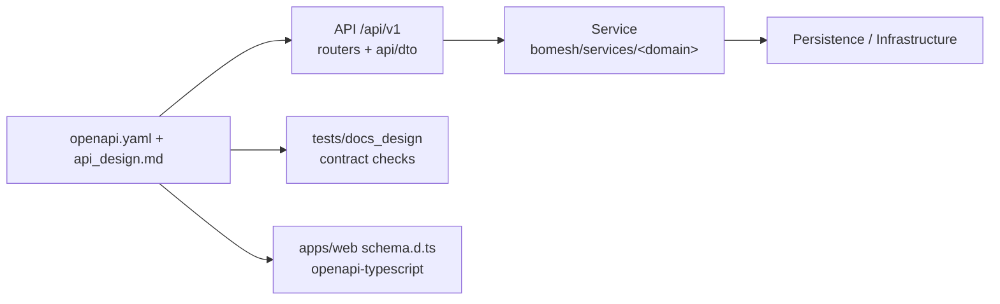

---

## 11. Xác thực, phân quyền và cách ly dữ liệu

### 11.1 Bốn mối quan tâm tách biệt

| Mối quan tâm | Câu hỏi | Cơ chế |
|---|---|---|
| Authentication | Người gọi là ai? | Bearer JWT + bảng `access_sessions` |
| Workspace RBAC | Người gọi có năng lực gì trong workspace? | `tenant_memberships` ACTIVE + `role_assignments` |
| Resource ACL | Người gọi được truy cập collection hoặc tài liệu nào? | Grant trực tiếp hoặc kế thừa trên Collection, cho user, group hoặc `workspaceMembers` |
| Platform permission | Năng lực xuyên workspace | `roles/platformOperator`, `roles/platformAdmin`; **không** ngầm cho quyền đọc dữ liệu workspace |

### 11.2 Vai trò định nghĩa sẵn (10 vai trò)

| Phạm vi | Vai trò | Ghi chú |
|---|---|---|
| Workspace | `workspaceAdmin`, `workspaceMember` | Admin có mọi quyền cấp được ở phạm vi workspace |
| Collection | `collectionViewer` ⊆ `collectionEditor` ⊆ `collectionOwner` | Owner có thêm `items.delete`, `items.setIamPolicy`, `contributions.review` |
| Space | `spaceMember` ⊆ `spaceStaff` ⊆ `spaceLead` | |
| Platform | `platformOperator`, `platformAdmin` | Operator chỉ xem metadata và tạm dừng/tiếp tục ingestion |

- Quyền được đặt tên theo kiểu IAM, `{collection}.{method}` (khoảng 250+ quyền trong `iam/catalog.py`).
- Grant ở phạm vi S chỉ trao những quyền hợp lệ ở S. Grant ở workspace lan xuống các collection và space. Mã nguồn **không** hard-code tên vai trò.

### 11.3 Quy tắc đặt IAM policy

| Quy tắc | Lỗi |
|---|---|
| Cấp vai trò có quyền mà bản thân người cấp không có | `PERMISSION_DENIED ROLE_ESCALATION` |
| Tự sửa binding của chính mình ở workspace | `FAILED_PRECONDITION SELF_MODIFICATION` |
| Xoá admin hoặc space lead cuối cùng | `LAST_ADMIN` / `LAST_SPACE_LEAD` (kiểm tra dưới khoá `FOR UPDATE`) |
| Đặt policy trên Document | `POLICY_ON_DOCUMENT` |
| Chia sẻ collection PERSONAL | `PERSONAL_COLLECTION` |
| Etag cũ | `ABORTED ETAG_MISMATCH` |
| Người nhận không phải thành viên ACTIVE | bị từ chối |

### 11.4 Thuật toán `Authorizer.require`

1. Tên quyền không có trong catalog → lỗi lập trình.
2. Quyền nằm trong tập quyền hiệu lực (platform ∪ membership ∪ group ∪ grant workspace ∪ grant trên chuỗi tổ tiên collection hoặc space) → cho qua (nếu workspace không tồn tại thì trả 404).
3. Người gọi có quyền ở phạm vi cha nhưng tài nguyên không tồn tại → 404.
4. Các trường hợp còn lại → 403 *"Permission … denied on resource … (or it might not exist)"*. Câu trả lời giống nhau dù tài nguyên có tồn tại hay không (AIP-211).

Các tra cứu được memoize trong phạm vi một request. Không có cache giữa các request, nên quyền mới có hiệu lực ngay.

### 11.5 Hai lớp lọc khi truy xuất

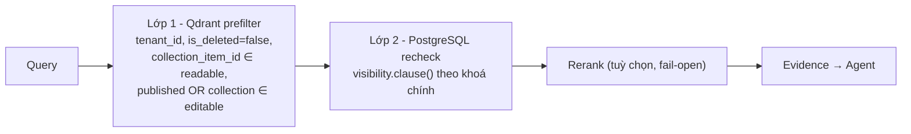

### 11.6 Bảo mật khác

- Credential của connector được mã hoá khi lưu. *Credential cho phép BoMesh đọc nguồn; ACL của Item quyết định người dùng có được lấy bằng chứng hay không.* Hai cơ chế này tách biệt có chủ đích.
- Sandbox: `network_mode=none`, `cap_drop=ALL`, `no-new-privileges`, user không phải root, giới hạn RAM/CPU/PIDs. Container đã cấp cho một hội thoại không bao giờ quay lại pool, nên dữ liệu tenant không lọt sang hội thoại khác.
- Gotenberg chỉ lắng nghe nội bộ; tắt JavaScript trong Chromium và macro trong LibreOffice; chỉ nhận bytes, không nhận URL.
- Đầu ra của công cụ được coi là *dữ liệu không tin cậy, không phải chỉ dẫn* (chống prompt injection).
- CORS allowlist được cấu hình qua `BOMESH_WEB_ORIGINS`.

---

## 12. Pipeline nạp và xử lý tài liệu (Ingestion)

### 12.1 Hai pipeline tách biệt

```text
THÊM (upload, upload ZIP, đồng bộ Source)      ← không bao giờ parse hay index
    connector khám phá + chuẩn hoá (chỉ khi sync)
        ↓
    bytes gốc → object storage (storage_key)
        ↓
    Item đăng ký hoặc cập nhật, indexingState = PENDING

XỬ LÝ (Ingestion Run: thủ công, API, theo lịch)
    bản gốc → Docling → Chunk[] có provenance
        ↓
    ngữ cảnh cấu trúc + ngữ cảnh ngữ nghĩa (tuỳ chọn, LLM)
        ↓
    dense embedding + văn bản BM25
        ↓
    thay thế điểm Qdrant xác định → SUCCEEDED (processed_version)
```

### 12.2 Định dạng hỗ trợ

| Nhóm | Định dạng | Xử lý |
|---|---|---|
| Văn bản | `.txt .md .rst .csv .tsv .json .jsonl .xml .yaml .html .log .sql`… | Docling / text |
| Office | `.docx .pptx .xlsx` | Docling backend khai báo (không gọi model) |
| PDF | `.pdf` | Lớp văn bản PDFium (~1 ms/trang). Trang scan (ít hơn 20 ký tự) được phiên âm bằng Docling VLM (`BOMESH_DOCLING_MODEL`, ~5 s/trang) |
| Ảnh | png, jpg, gif, webp, tiff… | Chỉ là tệp đính kèm hội thoại, `UNSUPPORTED` cho việc lập chỉ mục |
| Archive | `.zip` | Mỗi thành viên hợp lệ thành một Document chờ xử lý |

**Giới hạn ZIP:** kiểm tra tối đa 5.000 mục, tạo tối đa 500 tài liệu, giải nén tối đa 2 GiB, mỗi thành viên ≤ 100 MiB, tỷ lệ nén ≤ 200:1. Bỏ qua path traversal, symlink, tệp mã hoá, archive lồng nhau và tệp ẩn.

### 12.3 Các bước xử lý một tài liệu

| Pha | Mô tả |
|---|---|
| FETCHING | Đọc bản gốc từ object storage |
| PARSING | Docling / PDFium / VLM → `DoclingDocument` |
| CLASSIFYING | (Tuỳ chọn) gán topic: quy tắc trước, rồi một lần gọi LLM; best-effort |
| CHUNKING | `HybridChunker` (lặp lại header bảng), sinh `contextual_text` cho mỗi chunk; `chunk_text` gốc giữ làm văn bản bằng chứng |
| EMBEDDING | Gọi theo lô 32 qua OpenRouter (`EMBEDDING_MODEL`). Lỗi 4xx từ provider → `PROVIDER_REFUSED` và dừng run; timeout, 429, 5xx → retry |
| INDEXING | `replace_item_points` thay toàn bộ điểm của Item (ID chunk xác định, nên retry an toàn). Citation và geometry ghi vào PostgreSQL |

**Qdrant** (`INDEX_SCHEMA_VERSION = 11`): vector dense `content`, sparse `content_bm25`. Payload gồm `chunk_text`, `contextual_text`, `section_path`, `collection_item_id`, `published`, `is_deleted` và thông tin tenant. Bounding box chi tiết của trích dẫn **ở lại** PostgreSQL.

### 12.4 Worker: PostgreSQL làm hàng đợi

- Worker nhận các run QUEUED/RUNNING hoặc sync RUNNING bằng **session-level advisory lock** (`pg_try_advisory_lock`) trên một kết nối riêng.
- Các vòng lặp định kỳ:

| Vòng lặp | Chu kỳ |
|---|---|
| Nhận việc (claim) | `poll_seconds` |
| Kích hoạt lịch đến hạn | 30 s |
| Hoà giải payload | 60 s |
| Purge item đã xoá | 1 giờ |
| Quét preview | 10 phút |

- LISTEN trên `bomesh_cover` và `bomesh_preview` để tạo ảnh bìa và bản preview.
- Worker chết thì kết nối đóng, khoá được nhả; worker kế tiếp đánh dấu các task đang chạy dở là `interrupted` rồi chạy tiếp phần còn lại. Khi tắt êm (graceful shutdown), task được đưa lại hàng đợi.
- Lỗi nội dung của một tài liệu chỉ ảnh hưởng tài liệu đó; lỗi hạ tầng được retry mà không chạy lại các tài liệu đã xong.
- Temporal (`bomesh.ingestion_run`, `bomesh.source_sync`, `bomesh.maintenance`) đã được thiết kế và viết mã nhưng **chưa nối** (`[temporal-disabled]`).

### 12.5 Đồng bộ nguồn (Connector)

- Giao kèo `BaseSourceConnector`: `test_connection`, `list_scopes`, `discover_changes(checkpoint, scope)`, `next_checkpoint`, cùng `fetch_item` và `fetch_hierarchy` (tuỳ chọn). Connector **không bao giờ parse**.
- `external_resources` giữ ánh xạ duy nhất `(ingestion_source_id, external_id) → item_id`, kèm version, ETag và URL. Tài liệu không đổi version thì **không** bị xử lý lại.
- Tải nội dung song song có giới hạn (8). Collection được đăng ký theo thứ tự độ sâu; tài liệu bị xoá ở nguồn thì bị tombstone.

---

## 13. Truy xuất lai (Hybrid Retrieval) và vòng lặp Agent

### 13.1 Truy xuất

1. Công cụ `knowledge_search` nhận **1–3 truy vấn** đã chuẩn hoá và bỏ trùng.
2. Qdrant chạy dense và BM25 cho mọi truy vấn trong một request, rồi hợp nhất bằng **Reciprocal Rank Fusion** (RRF). Mặc định lấy 20 ứng viên.
3. Bộ lọc tenant, collection, tombstone và published được áp dụng ngay ở prefetch.
4. PostgreSQL kiểm tra lại quyền (`ReadAccess.recheck`). Không có cache.
5. **Rerank LLM** (tuỳ chọn, `BOMESH_RERANKING_ENABLED`, timeout 8 s) đóng vai cổng lọc liên quan: danh sách rỗng nghĩa là "không có bằng chứng phù hợp". Nếu rerank lỗi hoặc quá hạn → **fail-open** về thứ tự điểm fused, không bao giờ lộ dữ liệu sai quyền.
6. Trả về tối đa 5 bằng chứng, mỗi bằng chứng ≤ 1.600 ký tự, tổng ngữ cảnh ≤ 8.000 ký tự.

### 13.2 Vòng lặp Agent

Agent là vòng lặp **model ↔ tool** chứ không phải pipeline cố định. Sau mỗi phản hồi của mô hình, agent hoặc trả lời, hoặc gọi một công cụ đã khai báo. Kết quả công cụ được nối vào lần lấy mẫu tiếp theo.

| Giới hạn an toàn | Mặc định |
|---|---|
| Số lượt gọi mô hình tối đa | 12 |
| Số vòng tool tối đa | 8 |
| Số lần gọi tool tối đa | 6 |
| Lịch sử | 24 tin nhắn / 24.000 ký tự |
| Kết quả mỗi tool | 12.000 ký tự |
| Tổng ngữ cảnh tool | 60.000 ký tự (đẩy ra bản cũ nhất trước) |
| Độ dài câu hỏi | 4.000 ký tự |
| Timeout mỗi tool | 30 s (knowledge_search 25 s) |
| Retry lấy mẫu | 2 lần, chỉ trước khi có sự kiện đầu tiên |

**Công cụ của agent:**

| Tool | Mục đích |
|---|---|
| `knowledge_search` | Tìm trong kho tri thức (bước mặc định đầu tiên, trừ lời chào hoặc câu hỏi về chính hội thoại) |
| `read_resource` | Đọc nội dung tài nguyên đính kèm hoặc được tham chiếu |
| `inspect_resource` | Xem metadata an toàn |
| `materialize_resource` | Đưa ảnh vào làm đầu vào gốc cho mô hình |
| `run_shell` | Chạy 1–5 lệnh trong sandbox Docker (timeout ≤ 60 s) |
| `materialize_sandbox_resource` | Chép một Item được phép đọc vào thư mục home của sandbox (xlsx kèm bản CSV) |
| `export_sandbox_file` | Lưu tệp kết quả thành Artifact (kind FILE) kèm phiên bản |

**Cấu trúc đầu vào cho mô hình:** `instructions` (agent_base + `<workspace_instructions>` + `<sandbox>` + `<observations>`) → lịch sử gần nhất → `<available_resources>` → câu hỏi hiện tại → các lời gọi tool và kết quả trong lượt này. Mô hình được dặn coi đầu ra của tool là *dữ liệu không tin cậy*.

### 13.3 Trích dẫn có căn cứ

- Bằng chứng được gán `ref_N` (mỗi chunk một mã). Mô hình viết `[[cite:ref_N]]` ngay sau mỗi khẳng định.
- `CitationProjection` chuyển marker thành `[n]` hiển thị (đánh số **theo tài liệu**, theo thứ tự xuất hiện lần đầu) và phát annotation `bomesh:document_citation` chứa `passage = workspaces/{w}/items/{item}/passages/{chunk}`, tiêu đề, trích đoạn (≤ 280 ký tự) và URL gốc.
- **Marker không khớp với bằng chứng thật thì không được nối.** Renderer không bao giờ tự tạo trích dẫn.

### 13.4 Chống bịa đặt (Anti-fabrication), nhiều lớp

1. **Prompt policy:** `<no_fabrication_rule>`, `<knowledge_base_requirement>`, `<evidence_decisions>`, `<response_hierarchy>`.
2. **Grounding:** chỉ trích dẫn bằng chứng có thật trong lượt hỏi.
3. **Retrieval rỗng:** tool trả về rõ ràng *"No matching access-permitted enterprise documents were found."*
4. **Đầu ra không hợp lệ:** câu trả lời rỗng hoặc JSON tham số tool bị in ra như văn bản → báo lỗi lượt hỏi thay vì đưa ra câu trả lời bịa.

### 13.5 Streaming SSE (OpenResponses)

- Một câu trả lời tương ứng một response: một sự kiện `response.created`, sau đó các delta văn bản, annotation và hoạt động tool (với `output_index` liên tục qua các bước).
- Sự kiện kết thúc **chỉ gửi sau khi đã lưu**:

| Sự kiện | Trạng thái lưu |
|---|---|
| `response.completed` | `completed` |
| `response.incomplete` | `interrupted` |
| `response.failed` | `failed` (kèm `google.rpc.Status`) |

- Client ngắt kết nối thì phần văn bản đã sinh được lưu ở trạng thái `interrupted`.
- Giao diện hiển thị nhịp *say → do → say → answer*: ghi chú ngắn của mô hình, các hành động đã làm, tài liệu tìm thấy, rồi câu trả lời.

---

## 14. Trình xem tài liệu và hình học trích dẫn

- **Sáu loại bản trình bày:** `PDF`, `IMAGE`, `TABLE` (JSON nén gzip), `TEXT` (Markdown/Plain), `MEDIA`, `ARCHIVE`.
- Office, định dạng cũ, HTML và email được Gotenberg chuyển sang PDF; csv/xlsx thành TABLE; bmp/tiff thành WebP.
- Mỗi revision có một bản trình bày (cache bất biến `max-age=31536000, immutable`). Lỗi chuyển đổi không bao giờ thay đổi bản gốc và không ảnh hưởng chỉ mục.
- `GetItemPreview` **không bao giờ** chuyển đổi đồng bộ. Nếu chưa có bản trình bày, API gửi `pg_notify('bomesh_preview')` và trả trạng thái `PREPARING`; client hỏi lại mỗi 2 giây.
- URL trích dẫn có dạng `/doc/{item}?passage={chunk}&from={conversation}`. API trả về `pageNumber` và `boundingBoxes` (toạ độ chuẩn hoá 0–1, gốc trên-trái). Nếu không có geometry thì client tìm văn bản để đánh dấu.
- Giới hạn: TEXT 1 MiB; TABLE 50 sheet, 10.000 dòng/sheet, 1 triệu ô; nguồn trên 100 MiB thì không chuyển đổi; timeout 120 s.
- Hiệu năng: pdf.js tải lười; Range GET 1 MiB (tệp dưới 4 MiB đọc một lần); chỉ vẽ canvas trong phạm vi hai màn hình.

---

## 15. Sequence Diagrams

> Mỗi sơ đồ dưới đây dùng được trực tiếp cho một slide. Tham gia (participant) dùng tên thành phần thật trong mã nguồn.

### 15.1 Đăng nhập và tạo phiên

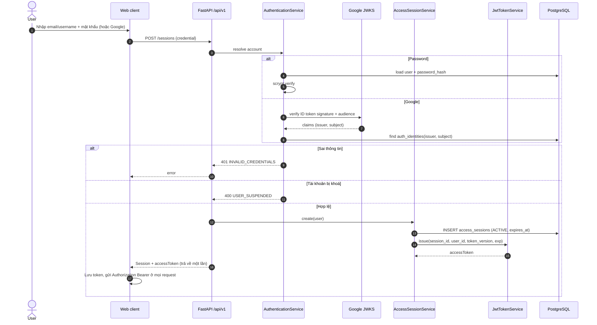

### 15.2 Một API call có kiểm tra quyền

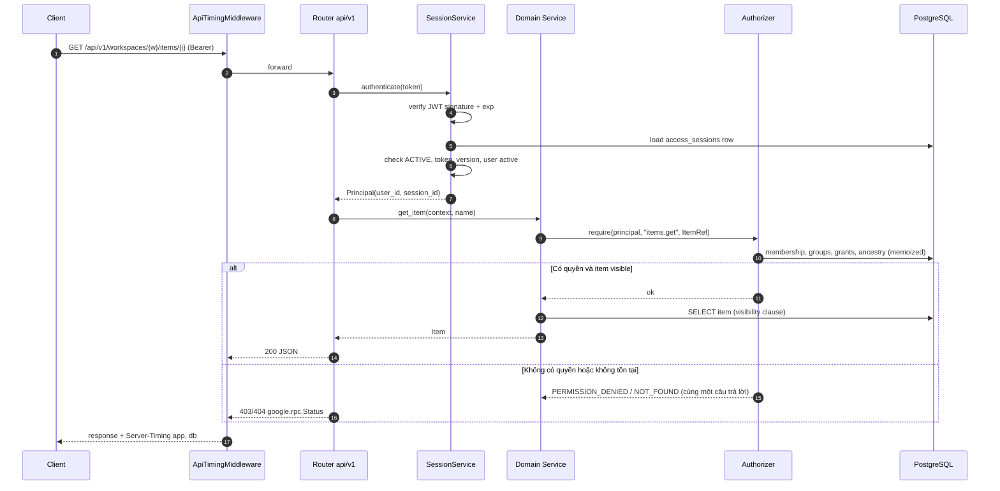

### 15.3 Cấp quyền IAM (`:setIamPolicy`)

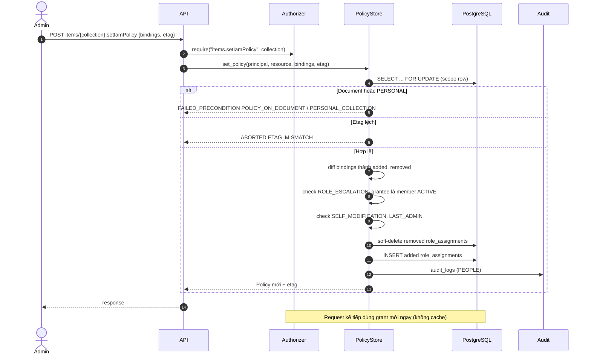

### 15.4 Upload tài liệu (signed URL)

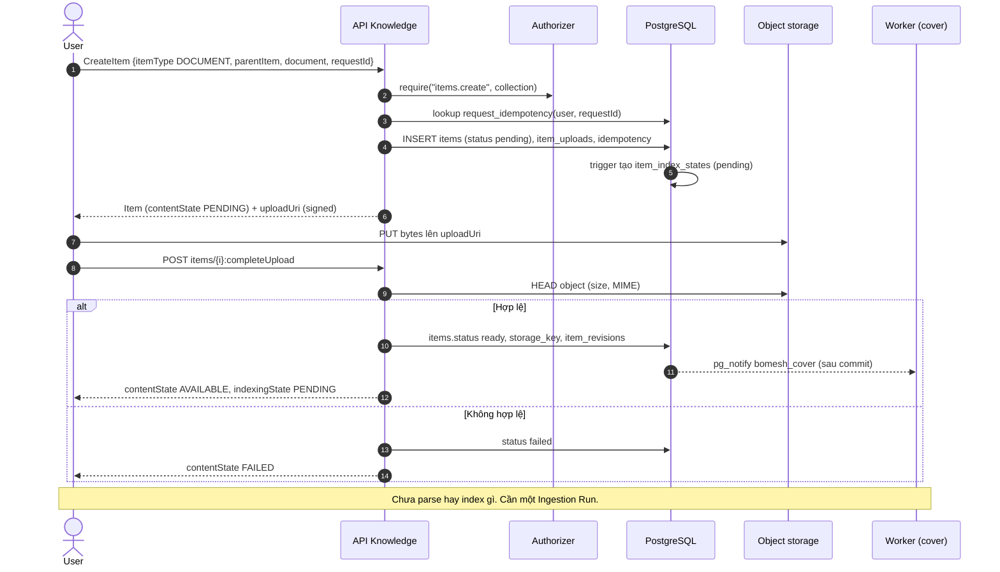

### 15.5 Ingestion Run: từ PENDING đến SUCCEEDED

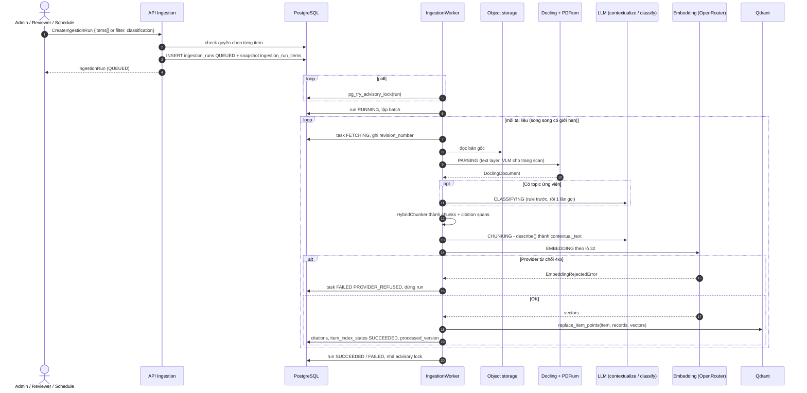

### 15.6 Đồng bộ nguồn (Confluence / Google Drive)

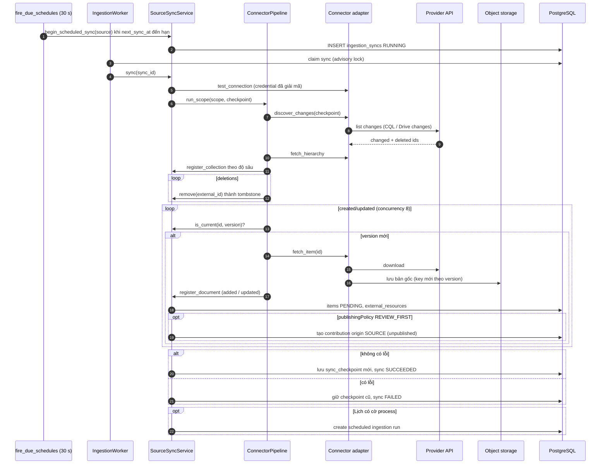

### 15.7 Kết nối nguồn qua OAuth

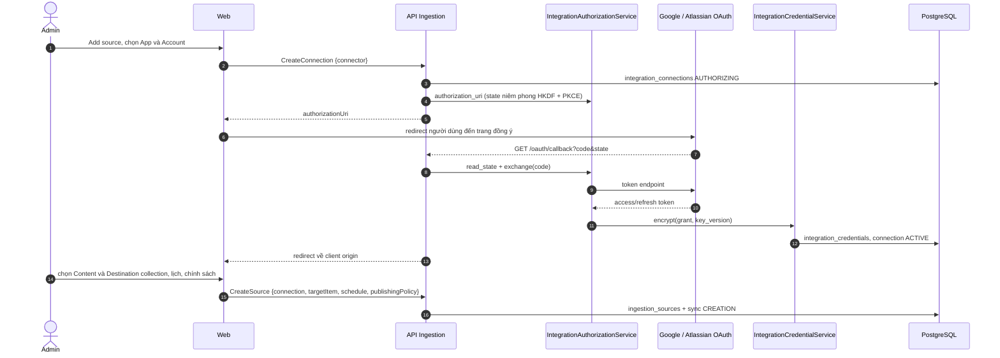

### 15.8 Đóng góp và kiểm duyệt tài liệu

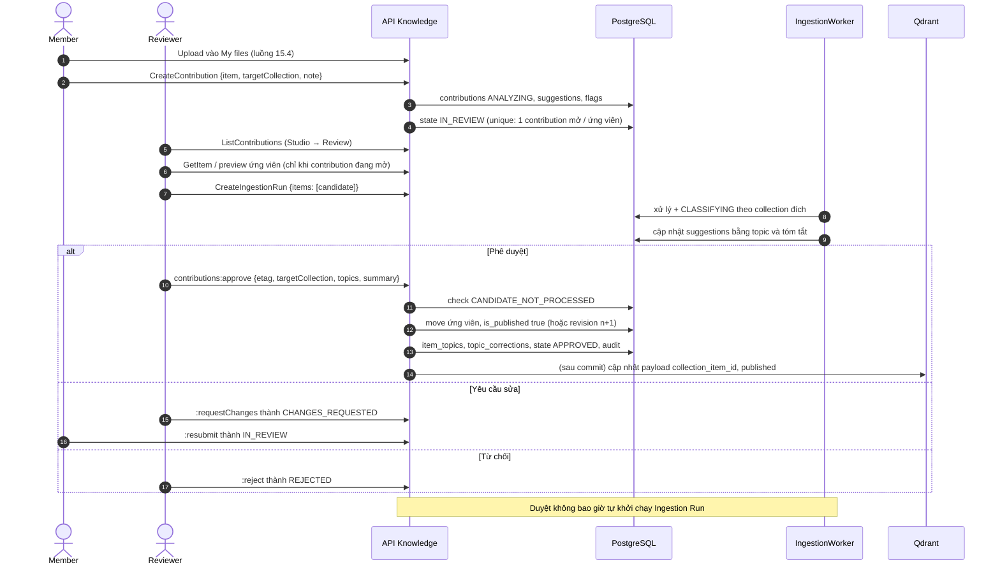

### 15.9 Hỏi trợ lý: câu trả lời stream có trích dẫn

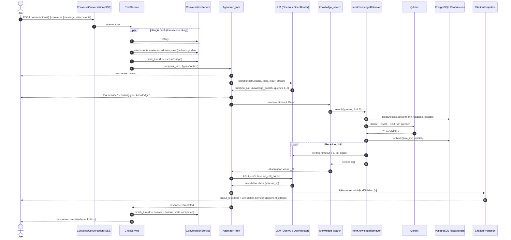

### 15.10 Vòng lặp tool trong một lượt

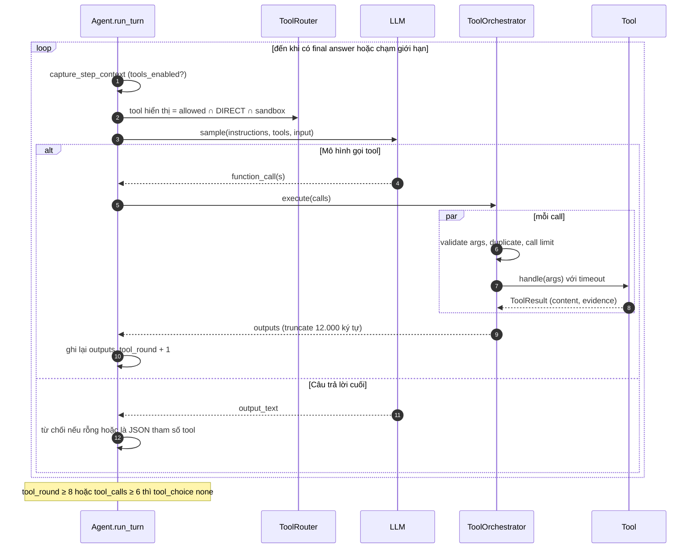

### 15.11 Xử lý tệp trong sandbox và tạo Artifact

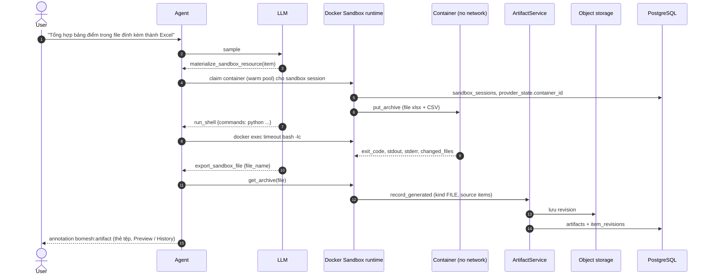

### 15.12 Mở trình xem tại vị trí trích dẫn

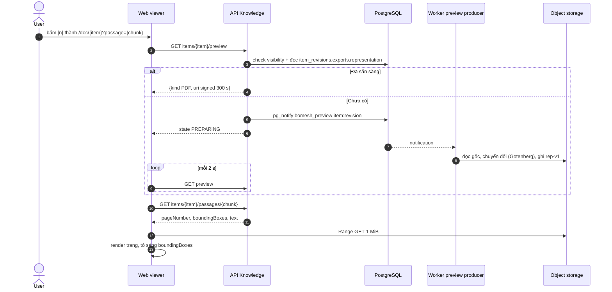

### 15.13 Xoá và khôi phục

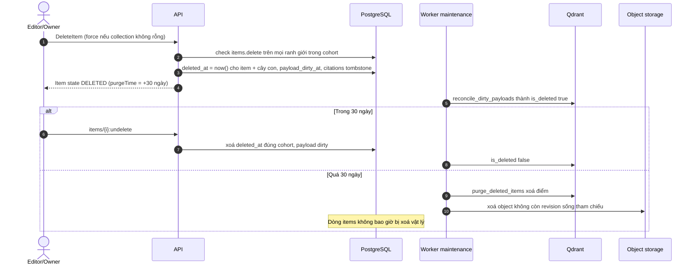

### 15.14 Chạy đánh giá (Evaluation)

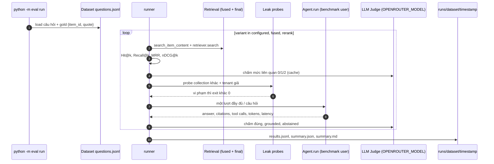

---

## 16. State Diagrams

### 16.1 Vòng đời Document (bốn chiều độc lập)

```mermaid
stateDiagram-v2
    direction LR
    state "Content" as content {
        [*] --> PENDING
        PENDING --> AVAILABLE: completeUpload hợp lệ
        PENDING --> FAILED: không hợp lệ
        FAILED --> AVAILABLE: retry
    }
    state "Indexing" as idx {
        [*] --> I_PENDING
        I_PENDING --> RUNNING: Ingestion Run
        RUNNING --> SUCCEEDED
        RUNNING --> I_FAILED
        SUCCEEDED --> OUTDATED: processing_version đổi
        OUTDATED --> RUNNING: run mới
        I_FAILED --> RUNNING: retry
        I_PENDING --> UNSUPPORTED: định dạng không index
    }
    state "Publication" as pub {
        [*] --> PUBLISHED
        PUBLISHED --> UNPUBLISHED: unpublish
        UNPUBLISHED --> PUBLISHED: publish / approve
    }
    state "Lifecycle" as life {
        [*] --> ACTIVE
        ACTIVE --> DELETED: delete
        DELETED --> ACTIVE: undelete trong 30 ngày
        DELETED --> PURGED: sau 30 ngày
    }
```

### 16.2 Contribution

```mermaid
stateDiagram-v2
    [*] --> ANALYZING
    ANALYZING --> IN_REVIEW
    IN_REVIEW --> CHANGES_REQUESTED: requestChanges
    CHANGES_REQUESTED --> IN_REVIEW: resubmit
    IN_REVIEW --> APPROVED: approve
    IN_REVIEW --> REJECTED: reject
    IN_REVIEW --> WITHDRAWN: withdraw
    CHANGES_REQUESTED --> WITHDRAWN: withdraw
    APPROVED --> [*]
    REJECTED --> [*]
    WITHDRAWN --> [*]
```

### 16.3 Ingestion Run và Task

```mermaid
stateDiagram-v2
    [*] --> QUEUED
    QUEUED --> RUNNING: worker claim (advisory lock)
    QUEUED --> CANCELLED: cancel
    RUNNING --> SUCCEEDED
    RUNNING --> FAILED
    RUNNING --> CANCELLED: cancel
    RUNNING --> RUNNING: worker chết thì worker khác resume
    FAILED --> QUEUED: retry (run mới, retry_of_run_id)
    state RUNNING {
        FETCHING --> PARSING
        PARSING --> CLASSIFYING
        CLASSIFYING --> CHUNKING
        CHUNKING --> EMBEDDING
        EMBEDDING --> INDEXING
    }
```

### 16.4 Phiên truy cập, Workspace và Request

```mermaid
stateDiagram-v2
    state "Access session" as s {
        [*] --> active
        active --> revoked: logout / suspend / reset password
        active --> expired: quá expires_at
        active --> superseded
    }
    state "Workspace" as w {
        [*] --> CREATING
        CREATING --> W_ACTIVE
        W_ACTIVE --> SUSPENDED
        SUSPENDED --> W_ACTIVE
        W_ACTIVE --> ARCHIVED
        SUSPENDED --> ARCHIVED
    }
    state "Request" as r {
        [*] --> OPEN
        OPEN --> NEEDS_INFO: sendBack
        NEEDS_INFO --> OPEN
        OPEN --> APPROVED
        OPEN --> DENIED
        OPEN --> ANSWERED
        OPEN --> WITHDRAWN
        APPROVED --> CLOSED
        ANSWERED --> CLOSED
    }
```

---

## 17. Thiết kế UX/UI

### 17.1 Nguồn sự thật UX

- `apps/ux_preview/ux-preview.html` là prototype HTML/JS **không dùng framework**, chạy với dữ liệu giả lập. Đây là nơi phải thể hiện mọi thay đổi UX **trước** khi hiện thực ở web hoặc mobile.
- Thanh công cụ prototype gồm: chọn workspace, persona, ép trạng thái (Live / Loading / Empty / Error), theme, EN/VI, Desktop / Tablet (834 px) / Phone (390 px), Journeys.

### 17.2 Quy tắc thiết kế sản phẩm (bắt buộc)

1. **Review UX trước khi làm:** xác định ý định chính → hành trình ngắn nhất → rà soát thành phần → loại bỏ phần thừa hoặc cạnh tranh → chọn pattern đơn giản nhất → kiểm tra phân cấp.
2. Mỗi trang **một mục đích**, mỗi component **một trách nhiệm**, mỗi ngữ cảnh **một hành động chính**. Hành động phụ hoặc nâng cao đặt kín đáo hoặc trong menu "More".
3. **HeroUI v3** là nguồn sự thật cho component; chỉ dùng theme token (19 theme có sẵn).
4. Thay đổi đảo ngược được thì áp dụng ngay và có Undo; chỉ hành động không đảo ngược được mới cần xác nhận (lưu trữ workspace phải gõ tên để xác nhận).
5. Các mục của một khu vực là dòng con trên sidebar, không làm thành tab. Tab chỉ dùng cho một thực thể hoặc một danh sách.
6. *"Do not optimize for the number of features visible on screen. Optimize for how effortlessly users can complete their goals."* (Đừng tối ưu số tính năng hiển thị trên màn hình; hãy tối ưu mức dễ dàng để người dùng hoàn thành mục tiêu.)

### 17.3 Kiến trúc thông tin (sidebar ba nhóm)

```mermaid
flowchart TB
    subgraph WS["Workspace"]
        H[Home - knowledge atlas]
        K[Knowledge - Browse, Saved, My files, Reading lists, Contribute]
        CH[AI Chat]
        WK[Work - module]
        RQ[Requests - module]
    end
    subgraph YW["Your work"]
        RC[Recent]
        PJ[Projects - prototype]
        SP[Spaces]
        CT[My contributions]
    end
    subgraph MG["Manage (cần quyền quản trị)"]
        OV[Overview - Knowledge health]
        ST[Knowledge Studio - Documents, Collections, Topics, Sources]
        PP[People - Members, Groups, Roles, Access requests]
        AS[Assistant]
        AC[Activity - Changes, Sign-ins]
        SE[Settings]
    end
    PC["Platform console /p - Workspaces, Users, Connectors, Indexing, Usage, Audit, Health"]
```

### 17.4 Các route đã hiện thực trong `apps/web`

| Nhóm | Route |
|---|---|
| Auth | `/signin`, `/signup`, `/password-reset`, `/password-reset/[token]`, `/workspaces` |
| Workspace | `/home`, `/knowledge`, `/knowledge/library`, `/knowledge/lists/[id]`, `/doc/[id]`, `/search`, `/chat`, `/chat/[id]`, `/chat/[id]/shares/[share]` |
| Your work | `/recent`, `/projects`, `/project/[id]`, `/spaces`, `/space/[id]`, `/contributions`, `/work`, `/work/new`, `/work/[id]`, `/requests`, `/requests/new`, `/requests/[id]` |
| Manage | `/overview`, `/studio`, `/studio/collections/[id]`, `/people`, `/assistant`, `/activity`, `/settings` |
| Platform | `/p/workspaces`, `/p/users`, `/p/connectors`, `/p/indexing`, `/p/usage`, `/p/audit`, `/p/health` |

### 17.5 Màn hình tiêu biểu (gợi ý chụp ảnh cho slide)

- **Home:** bản đồ tri thức (workspace › collection › folder › document trên canvas pan/zoom), "Find in the map", inspector "★ Read first".
- **AI Chat:** nhịp *say → do → say → answer*, các dòng tài liệu tìm thấy, câu trả lời có số trích dẫn.
- **Reader:** đọc tài liệu với ba tab Ask (câu trả lời tô sáng trên trang), About (nguồn, độ tin cậy, phiên bản, ai được xem), Related.
- **Knowledge Studio:** Documents (All / Review / Issues / Quality), Topics (Topics / Suggestions), Sources (Sources / Sync history / Accounts).
- **People:** thêm thành viên qua email, đổi vai trò inline hoặc hàng loạt có Undo, xem quyền hiệu lực.

---

## 18. Đánh giá chất lượng (Evaluation)

### 18.1 Khung đánh giá (`backend/eval`)

| Giai đoạn | Mục tiêu | Chỉ số |
|---|---|---|
| `retrieval` | Chất lượng tìm kiếm (fused và final) | Hit@k, Recall@k, Precision@k, MRR, nDCG@k, DocHit@k (k ∈ {1,3,5,10,20}); judged nDCG@10, judged precision, answer_found, false_answer |
| `leak` | An toàn phân quyền | Truy vấn sang collection khác và tenant giả không được trả về kết quả. Có bất kỳ vi phạm nào thì exit code khác 0 |
| `agent` | Chất lượng câu trả lời đầu-cuối | Đúng (0/1/2), grounded trong trích dẫn, abstained đúng hoặc sai, trích dẫn có chứa gold quote, số tool call, tokens, độ trễ |

- **Biến thể so sánh:** `configured` (theo `.env`), `fused` (tắt rerank), `rerank` (bật rerank).
- **Khớp gold:** chuẩn hoá NFC, không phân biệt hoa thường, gộp khoảng trắng. Khớp khi là chuỗi con, hoặc khi ≥ 80% token của quote xuất hiện theo đúng thứ tự.
- **LLM judge** dùng mô hình cấu hình `OPENROUTER_MODEL`, có cache theo (model, câu hỏi, đoạn).
- Kết quả ghi vào `runs/<dataset>/<timestamp>/{results.jsonl, summary.json, summary.md}`.

### 18.2 Bộ dữ liệu `ute-knowledge` (đo trên repo)

| Loại câu hỏi | Số lượng | Mục đích kiểm tra |
|---|---|---|
| `table` | 20 | Truy xuất dữ liệu bảng tính |
| `factual` | 14 | Sự kiện đơn đoạn |
| `paraphrase` | 14 | Sức mạnh dense embedding |
| `exact_code` | 12 | Sức mạnh BM25 (mã, số hiệu) |
| `multi_hop` | 10 | Kết hợp hai đoạn từ hai tài liệu |
| `unanswerable` | 9 | Khả năng từ chối trả lời đúng lúc |
| **Tổng** | **79** | |

Câu hỏi được sinh tự động (`generate.py`): luân phiên theo loại MIME, quote phải trích nguyên văn (≥ 8 từ, hoặc ≥ 3 từ với bảng), một phần câu hỏi được viết bằng ngôn ngữ khác tài liệu. Câu `unanswerable` chỉ được giữ lại khi judge xác nhận không có ứng viên nào trả lời được.

> **Ghi chú cho tiểu luận:** repo không chứa kết quả chạy (`runs/` bị gitignore). Muốn đưa số liệu vào báo cáo thì chạy `python -m eval` trên môi trường có dữ liệu và dán bảng `summary.md` vào đây.

**Hạn chế của phương pháp đánh giá (theo `evaluation.md`):** RRF có thể hoà điểm và embedding dao động giữa các lần chạy; câu hỏi được sinh bởi cùng họ mô hình với judge; leak probe kiểm tra bộ lọc của store và retriever, không kiểm tra toàn bộ service phân quyền.

---

## 19. Kiểm thử, vận hành và triển khai

### 19.1 Kiểm thử

| Nhóm | Vị trí | Nội dung |
|---|---|---|
| Contract | `tests/docs_design` | Kiểm tra `openapi.yaml` và tài liệu thiết kế |
| API v1 | `tests/v1` | Hành vi endpoint |
| Agent | `tests/bomesh/agent` | Protocol, reducer, request shaping, responses adapter, turn runtime, docker sandbox |
| Connector | `tests/bomesh/connector` | Archive, file processing, pipeline, Qdrant contract, source adapters |
| Services | `tests/bomesh/services` | Document API contract, schema PostgreSQL, preview (Gotenberg, formats) |
| Storage | `tests/bomesh/storage` | S3/RustFS round-trip (live) |
| Lõi | `tests/test_*.py` | DB models/services, embeddings, item index, knowledge search, no-fabrication flow, prompts, transports, eval metrics, health, observability |
| Web | `apps/web/tests/*.test.mts` | document preview, rendition, chat-stream, streaming-markdown |
| Khác | `tests/perf`, `tests/flutter`, `tests/navigation.test.mts` | Hiệu năng, client |

**Quy mô:** 130 tệp test Python, 1.319 hàm `test_`. Các test live (Docker, Gotenberg, RustFS, PostgreSQL) tự bỏ qua nếu môi trường không có.

```bash
uv run --project backend pytest -q tests
cd backend && uv run python -m pytest ../tests/docs_design
npm --prefix apps/web test && npm --prefix apps/web run typecheck && npm --prefix apps/web run build
npx -p @dbml/cli dbml2sql --postgres backend/docs_design/design.dbml
```

### 19.2 Khởi chạy local

```bash
uv sync --project backend
npm --prefix apps/web ci
make init                        # .env, PostgreSQL, Qdrant, RustFS, schema, seed admin, Qdrant collection
cd backend && uv run python main.py   # API :8000 + ingestion worker
bun run web                      # dev, hoặc: bun run web:prod
```

| Dịch vụ | Địa chỉ |
|---|---|
| WebUI | http://127.0.0.1:3000 |
| API / OpenAPI / Health | http://127.0.0.1:8000, `/docs`, `/health` |
| Qdrant dashboard | http://127.0.0.1:6333/dashboard |
| RustFS S3 | http://127.0.0.1:9000 |
| Gotenberg | 127.0.0.1:3010 |

Lệnh Makefile: `services`, `reset-all`, `status`, `db-init`, `db-seed`, `db-seed-accounts` (ma trận tài khoản theo vai trò cho workspace `hcmute`), `qdrant-init`, `web-dev`, `web-prod`, `storage-migrate-minio`.

### 19.3 Cấu hình (biến môi trường chính)

| Nhóm | Biến |
|---|---|
| Mô hình | `OPENROUTER_MODEL`, `OPENAI_MODEL`, `EMBEDDING_MODEL`, `BOMESH_CONTEXTUALIZATION_MODEL`, `BOMESH_DOCLING_MODEL`, `OPENAI_API_KEY`, `OPENROUTER_API_KEY` |
| Retrieval / Agent | `BOMESH_RETRIEVAL_CANDIDATE_COUNT`, `BOMESH_FINAL_RETRIEVAL_TOP_K`, `BOMESH_RERANKING_ENABLED`, `BOMESH_RERANK_TIMEOUT_SECONDS`, `BOMESH_QUERY_EMBEDDING_CACHE_SIZE`, `BOMESH_AGENT_REASONING_EFFORT`, `BOMESH_MAX_HISTORY_MESSAGES` |
| Sandbox | `BOMESH_SANDBOX_ENABLED`, `BOMESH_SANDBOX_IMAGE`, `BOMESH_SANDBOX_MEMORY`, `BOMESH_SANDBOX_CPUS`, `BOMESH_SANDBOX_WARM_POOL_SIZE`, `BOMESH_SANDBOX_IDLE_TTL_SECONDS` |
| Auth / Integrations | `BOMESH_AUTH_JWT_SECRET`, `BOMESH_INTEGRATION_ENCRYPTION_KEY`, `BOMESH_INTEGRATION_OAUTH_*`, `BOMESH_GOOGLE_OAUTH_*`, `BOMESH_ATLASSIAN_OAUTH_*` |
| Preview / Storage | `BOMESH_GOTENBERG_URL`, `BOMESH_PREVIEW_CONVERSIONS`, `BOMESH_PREVIEW_URL_SECONDS`, `RUSTFS_ACCESS_KEY`, `RUSTFS_SECRET_KEY`, `RUSTFS_CORS_ALLOWED_ORIGINS` |
| Web | `BOMESH_WEB_ORIGINS` |

**Quy tắc mô hình:** mọi lời gọi LLM, embedding hay vision chỉ dùng mô hình đã cấu hình trong `.env`. Nếu mô hình lỗi thì báo lỗi, **không tự đổi sang mô hình khác**.

### 19.4 Độ tin cậy

| Mối quan tâm | Cơ chế |
|---|---|
| Nguyên tử DB | Mỗi thao tác một `transaction_scope` |
| Xử lý đồng thời | Advisory lock theo tài liệu và theo run |
| Phục hồi run | Worker chết thì khoá nhả; worker khác resume, task dở được đánh dấu `interrupted` |
| Retry an toàn | ID xác định, lập kế hoạch idempotent, bỏ qua mục đã xong |
| Phục hồi tìm kiếm | Qdrant dựng lại được từ bản gốc qua run mới |
| An toàn dữ liệu | Bản gốc luôn là nguồn sự thật; lỗi preview hay index không làm thay đổi bản gốc |
| Streaming | Đánh số sự kiện OpenResponses tăng đơn điệu |

---

## 20. Trạng thái hiện thực, hạn chế và hướng phát triển

### 20.1 Đã hiện thực (backend)

- Hợp đồng `/api/v1` đầy đủ 8 interface; IAM với 10 vai trò định nghĩa sẵn và vai trò tuỳ chỉnh; mô hình Item hợp nhất (refactor bước 1–6 đã xong).
- Upload, ZIP, Confluence, Google Drive; worker dùng PostgreSQL làm hàng đợi; Docling, contextualization, embedding, Qdrant hybrid.
- Agent với 7 công cụ, sandbox Docker, artifacts, SSE OpenResponses, trích dẫn có geometry.
- Preview engine 6 loại; Gotenberg; ảnh bìa.
- Bộ eval retrieval, leak và agent.
- Web Next.js với hơn 40 route (Workspace, Manage, Platform).

### 20.2 Hạn chế hiện tại

| Hạn chế | Ghi chú |
|---|---|
| Mobile Flutter vẫn gọi route cũ đã bị xoá | Bước 7 của kế hoạch refactor ("cut clients over") chưa xong |
| Temporal bị tắt | Đã có mã workflow; đang chạy bằng worker PostgreSQL |
| SharePoint, Notion, Slack | Chỉ có trong catalog |
| Ảnh không được lập chỉ mục | Chỉ là tệp đính kèm hội thoại |
| Văn bản trong hình ảnh trên trang PDF có lớp văn bản | Không được đọc |
| Giới hạn tần suất đăng nhập (429) | Chưa hiện thực |
| Gửi email đặt lại mật khẩu | Chưa cấu hình mail transport |
| Projects | Chỉ có trong prototype; API chưa có resource project |
| Message chưa có `workLog`, follow-up suggestions | Theo `conversation_loop.md` |
| Governed BI | Mới có Overview, summarize, export; chưa có engine phân tích |
| Đánh giá | Câu hỏi sinh tự động; judge cùng họ mô hình |

### 20.3 Hướng phát triển

1. Hoàn tất chuyển web và mobile sang `/api/v1`.
2. Bật lại Temporal khi cần mở rộng ngang hoặc cần workflow dài.
3. Thêm connector SharePoint, Notion, Slack theo cùng giao kèo connector.
4. Lập chỉ mục ảnh và OCR hình trong PDF.
5. Module **phân tích nghiệp vụ có quản trị**: truy vấn số liệu với cùng lớp phân quyền và trích dẫn.
6. Gợi ý dự phòng khi thiếu bằng chứng; vòng lặp knowledge gap → contribution.
7. UUIDv7, rate limiting khi đăng nhập, thêm test PostgreSQL cho các ràng buộc liên dòng.
8. Mở rộng bộ eval với câu hỏi do con người viết và judge độc lập.

---

## 21. Gợi ý cấu trúc slide PowerPoint

| # | Slide | Nội dung lấy từ mục | Hình minh hoạ |
|---|---|---|---|
| 1 | Tiêu đề: BoMesh — Business-only Knowledge Mesh | §1 | Logo |
| 2 | Bối cảnh và vấn đề (hallucination, rò rỉ quyền, mất truy vết) | §2.1–2.2 | 3 icon |
| 3 | Mục tiêu G1–G7 | §2.3 | Bảng |
| 4 | Ý tưởng cốt lõi: "Evidence before answers" | §3.1–3.2 | Câu trích |
| 5 | Phạm vi trong và ngoài | §4 | Hai cột |
| 6 | Personas và use cases | §5 | Use case flowchart |
| 7 | Tính năng theo 8 interface | §6, §10.2 | Bảng tag |
| 8 | Kiến trúc logic | §7.1 | Flowchart |
| 9 | Tech stack | §8 | Bảng / logo |
| 10 | Mô hình Item và 4 trạng thái | §9.1–9.2 | Cây + bảng |
| 11 | Quy tắc hiển thị và 2 lớp lọc | §9.3, §11.5 | Flowchart |
| 12 | IAM: vai trò, policy | §11.2–11.3 | Bảng |
| 13 | Sequence: Đăng nhập + API call có quyền | §15.1–15.2 | Sequence |
| 14 | Pipeline ingestion: Thêm ≠ Xử lý | §12.1 | Sơ đồ text |
| 15 | Sequence: Ingestion Run | §15.5 | Sequence |
| 16 | Sequence: Đồng bộ nguồn | §15.6 | Sequence |
| 17 | Sequence: Đóng góp và kiểm duyệt | §15.8 | Sequence |
| 18 | Hybrid retrieval + rerank fail-open | §13.1 | Flowchart |
| 19 | Vòng lặp agent + giới hạn an toàn | §13.2, §15.10 | Sequence + bảng |
| 20 | Sequence: Hỏi và trích dẫn (slide trọng tâm) | §15.9 | Sequence |
| 21 | Trích dẫn và chống bịa đặt | §13.3–13.4 | Ảnh chụp chat |
| 22 | Trình xem tài liệu tại trích dẫn | §14, §15.12 | Ảnh chụp reader |
| 23 | Sandbox và artifacts | §15.11 | Sequence |
| 24 | ERD lõi | §9.5 | ER diagram |
| 25 | UX: quy tắc thiết kế và IA | §17 | Ảnh chụp Home / Studio |
| 26 | Đánh giá: khung và bộ dữ liệu | §18 | Bảng |
| 27 | Kiểm thử và triển khai | §7.4, §19 | Deployment diagram |
| 28 | Hạn chế và hướng phát triển | §20 | Bullet |
| 29 | Demo / Q&A | | |

---

## 22. Gợi ý cấu trúc tiểu luận PDF

1. **Chương 1 – Mở đầu:** lý do chọn đề tài, mục tiêu, đối tượng và phạm vi, phương pháp, bố cục (§2, §4).
2. **Chương 2 – Cơ sở lý thuyết:** LLM, RAG, embedding và dense retrieval, BM25, Reciprocal Rank Fusion, reranking, contextual retrieval, agent tool-calling, RBAC/IAM, Google AIP, multi-tenancy, SSE (§13, §10, §11).
3. **Chương 3 – Phân tích yêu cầu:** personas, use cases, yêu cầu chức năng (§5, §6) và phi chức năng (bảo mật, truy vết, độ tin cậy, hiệu năng: §11, §19.4).
4. **Chương 4 – Thiết kế hệ thống:** kiến trúc (§7), mô hình dữ liệu và ERD (§9), API (§10), phân quyền (§11), sequence diagram (§15), state diagram (§16), UX (§17).
5. **Chương 5 – Hiện thực:** công nghệ (§8), pipeline ingestion (§12), retrieval và agent (§13), trình xem (§14), sandbox.
6. **Chương 6 – Kiểm thử và đánh giá:** chiến lược test (§19.1), khung eval và kết quả (§18).
7. **Chương 7 – Kết luận:** kết quả đạt được, đóng góp (§3.3), hạn chế, hướng phát triển (§20).
8. **Phụ lục:** danh mục bảng (§9.4), endpoint (§24.1), biến môi trường (§19.3), hướng dẫn cài đặt (§19.2).

---

## 23. Thuật ngữ (Glossary)

| Thuật ngữ | Ý nghĩa trong BoMesh |
|---|---|
| Workspace / Tenant | Ranh giới tổ chức và ranh giới phân quyền |
| Item | Danh tính chung cho Collection và Document |
| Collection | Thùng chứa tri thức; ranh giới ACL chính |
| Document | Tài nguyên tri thức có bản gốc lưu trong object storage |
| Revision | Phiên bản nội dung bất biến của Document hoặc Artifact |
| Contribution | Đề xuất đưa tài liệu hoặc phiên bản mới vào collection, cần duyệt |
| Topic / Domain | Hệ phân loại hai cấp |
| Item link | Tham chiếu hiển thị tài liệu ở collection khác, không cấp quyền |
| Connection | Cấu hình và credential kết nối đến một nhà cung cấp |
| Source | Một phạm vi bên ngoài có checkpoint, đổ vào đúng một collection |
| Sync | Một lần đồng bộ Source (chỉ thêm, không xử lý) |
| Ingestion Run | Đơn vị xử lý tường minh trên snapshot các tài liệu |
| Projection | Dữ liệu dẫn xuất dựng lại được (chỉ mục Qdrant, preview) |
| Contextual chunk | Văn bản chunk kèm ngữ cảnh cấu trúc hoặc ngữ nghĩa để truy xuất |
| Hybrid retrieval | Dense vector + BM25 hợp nhất bằng RRF, có thể rerank |
| Evidence | Nội dung nguồn đã được cấp quyền, chuẩn bị cho mô hình suy luận |
| Citation / Passage | Ánh xạ kiểm chứng được từ câu trả lời đến đoạn tài liệu (trang, bounding box) |
| Artifact | Sản phẩm của trợ lý (tệp, bản nháp, evidence review, study guide, quiz) |
| Sandbox | Container Docker riêng cho mỗi hội thoại để chạy code |
| Tombstone | Xoá mềm, giữ danh tính, lineage và lịch sử audit |
| AIP | Google API Improvement Proposals: chuẩn thiết kế API |
| OpenResponses | Mô hình sự kiện streaming dùng chung cho các provider |
| Composition root | Nơi lắp ráp cấu hình, client hạ tầng và service |

---

## 24. Phụ lục

### 24.1 Danh mục endpoint tiêu biểu theo tag (`/api/v1`)

**Identity**
`POST /sessions` · `GET /sessions` · `GET|DELETE /sessions/{s}` · `POST /users` · `GET /users` · `GET|PATCH /users/{u}` · `/users/{u}/preferences` · `/users/{u}:activate|:suspend` · `/users:lookup` · `/users:sendPasswordReset` · `/users:resetPassword`

**Workspaces**
`POST|GET /workspaces` · `GET|PATCH /workspaces/{w}` · `:activate|:archive|:suspend|:pauseIngestion|:resumeIngestion` · `:getIamPolicy|:setIamPolicy|:testIamPermissions|:analyzeIamPolicy` · `/workspaces:summarizeUsage|:exportUsage` · `/{w}/assistant` · `/{w}/settings` · `/{w}/overview` · `/{w}/auditEvents(:export|:summarize)` · `/{w}/groups(/{g}/memberships)` · `/{w}/members(:activate|:suspend)` · `/{w}/roles(:undelete)` · `/{w}/knowledgeGaps(:dismiss|:reopen)`

**Library**
`/{w}/members/{m}/home` · `/notifications(:markRead)` · `/recentItems(:clear)` · `/savedItems` · `/savedSearches`

**Knowledge**
`/{w}/items` · `/{w}/items:search` · `/{w}/items/{i}` · `:completeUpload|:publish|:unpublish|:move|:merge|:verify|:undelete` · `:getIamPolicy|:setIamPolicy|:testIamPermissions` · `/items/{i}/preview` · `/items/{i}/passages/{p}` · `/items/{i}/revisions(:rollback)` · `/items/{i}/links` · `/{w}/contributions(:approve|:reject|:requestChanges|:resubmit|:withdraw)` · `/{w}/topics(:accept|:merge|:reject|:confirmAssignments|:import|:testClassification|:compileClassificationPrompt)` · `/{w}/topicCorrections(:dismiss)` · `/{w}/readingLists(/entries, :copy)` · `POST /upload/api/v1/workspaces/{w}/items`

**Ingestion**
`/connectors(:enable|:disable)` · `/ingestionPolicies/default` · `/{w}/connections(:browseResources|:reauthorize|:test)` · `/{w}/sources` · `/{w}/sources/{s}/syncs(:pause|:resume)` · `/{w}/ingestionRuns(:summarize)` · `/{w}/ingestionRuns/{r}/tasks(:cancel|:retry)` · `GET /oauth/callback`

**Assistant**
`/{w}/conversations` · `/{w}/conversations/{c}:converse` (SSE) · `/conversations/{c}/messages(:submitFeedback)` · `/conversations/{c}/shares(:converse|:undelete)` · `/{w}/artifacts(:revise|:commit|:export|:publish|:rollback|:undelete)` · `/artifacts/{a}/revisions`

**Collaboration**
`/{w}/spaces(:join|:leave|:getIamPolicy|:setIamPolicy|:testIamPermissions|:undelete)` · `/spaces/{s}/materials|announcements|events|members|requestTypes` · `/{w}/requests(:answer|:approve|:close|:deny|:sendBack|:withdraw)` · `/requests/{r}/messages`

**Operations**
`/operations(:cancel)` · `/components` · `/incidents` · `/auditEvents(:export)` · `GET /health`

### 24.2 Tài khoản seed (môi trường dev, workspace `hcmute`)

| Tài khoản | Vai trò |
|---|---|
| admin | platformAdmin + workspaceAdmin |
| longnh | platformAdmin |
| quantm | platformOperator |
| hapt | workspaceAdmin |
| maint | collectionOwner trên "Kho bài giảng nội bộ" |
| baohq | collectionEditor |
| anhln | collectionViewer |
| sonpt | spaceLead (khoa-cntt) |
| lannt | spaceStaff |
| 22110289 | spaceMember |
| 18110123 | không là thành viên |
| 21110567 | SUSPENDED |

### 24.3 Tài liệu nguồn trong repo

| Tệp | Nội dung |
|---|---|
| `backend/docs_design/api_design.md`, `openapi.yaml` | API chuẩn |
| `backend/docs_design/item_model.md` | Mô hình Item, quyền, workflow |
| `backend/docs_design/design.dbml`, `database_architecture.md` | Lược đồ và nguyên tắc CSDL |
| `backend/docs_design/auth_contract.md` | Xác thực và phiên |
| `backend/docs_design/conversation_loop.md` | Agent loop, sandbox, streaming |
| `backend/docs_design/document_contract.md`, `document_viewer.md` | Upload, định dạng, trình xem |
| `backend/docs_design/evaluation.md` | Đánh giá |
| `docs/architecture-overview.md`, `docs/connectors-and-indexing.md`, `docs/operations.md` | Tổng quan kiến trúc và vận hành |
| `apps/ux_preview/PRODUCT_DESIGN_RULES.md`, `apps/ux_preview/docs/*` | UX, luồng sản phẩm, danh mục màn hình |
| `ANTI_FABRICATION_FLOW.md` | Chống bịa đặt |
