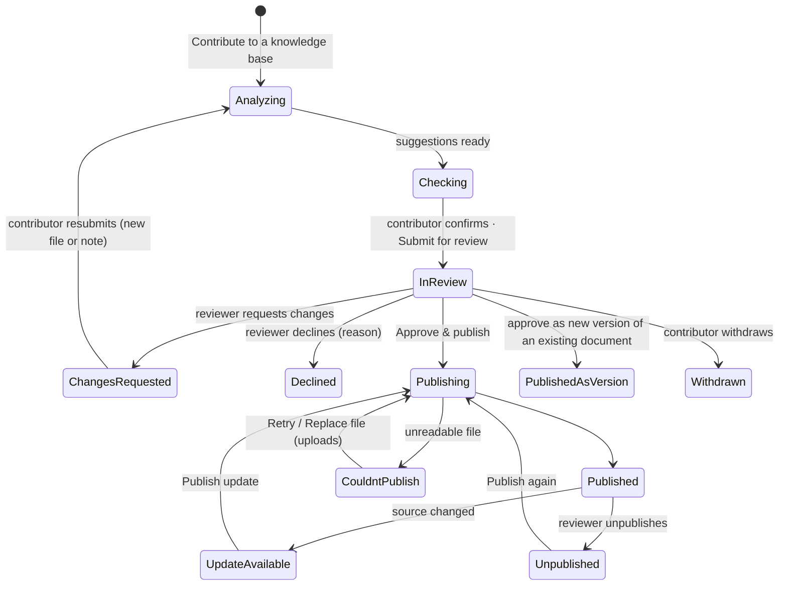
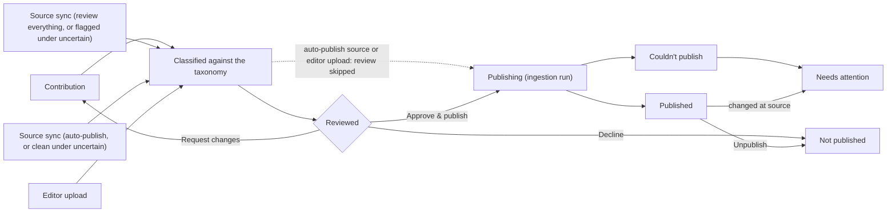

# Document lifecycle: contribute → curate → publish

How a document becomes trusted knowledge in BoMesh. This extends the Knowledge Hub ([KNOWLEDGE_HUB.md](KNOWLEDGE_HUB.md)): the Hub is where people *use* published knowledge. This document owns the **per-document lifecycle** — contribute, classify, review, publish, every state and label, the Review card, the flow strip, the Progress stepper and the taxonomy. The Knowledge Studio as a whole (Manage IA, tabs, Review queues, Library, setup order, sources and their publishing policies, first sync at scale) is in [KNOWLEDGE_STUDIO.md](KNOWLEDGE_STUDIO.md).

## Principles

1. **Sharing is easy, publishing is deliberate.** Contributing takes a file, a destination (*Contribute to a knowledge base* or *Upload to My files*) and a check of what the assistant read. Nothing anyone contributes reaches search, the Reader, collections or the assistant until a reviewer approves it.
2. **Three steps, three places.** Contribute in **Knowledge** and track in **Your work → My contributions** (contributors). Set up, classify, review and publish in **Manage › Knowledge Studio** (base owners, source admins and workspace admins). Operate indexing in the **Platform console → Indexing** (platform admins). No screen mixes two of these jobs.
3. **The assistant does the busywork; people decide.** It classifies each document against the workspace's **taxonomy** and suggests a type, topics (existing ones, or a proposed new one) with the evidence for each, the knowledge base and a summary. It also flags likely duplicates, new versions, personal data and unsearchable formats. The contributor confirms or edits before submitting; reviewers check and publish. Only workspace admins change the taxonomy.
4. **Plain words.** People see *In review, Changes requested, Declined, Approve & publish, Publishing, Published, Couldn't publish, Publish update, Needs attention, Not published*. Terms like "index", "embedding" or "pipeline" appear only in the platform console.
5. **Access never widens by accident.** A submission is visible only to its contributor and the reviewers of its target base. Approving publishes into that base, so its access rules decide who can read it, and the review screen states who that will be. Platform admins see job metadata, never titles or content.

## Lifecycle

| Label people see | `stage` · `status` | Who sees it | Next step |
| --- | --- | --- | --- |
| Analyzing → Check the details (in the dialog, before submitting) | — | Contributor | Confirm or edit, then Submit for review |
| In review | `review` | Contributor, base reviewers | Reviewer decides |
| Changes requested | `changes` | Contributor, reviewers | Contributor revises and resubmits |
| Declined | `rejected` | Contributor, reviewers | Contributor reads the reason and removes it (kept for the retention period) |
| Waiting to publish | `published` · `pending` | Reviewers | Publish now (synced files from trusted sources) |
| Publishing | `published` · `processing` | Reviewers, contributor | Automatic |
| Published | `published` · `ready` | Everyone who can read the base | Use it, or submit a new version |
| Couldn't publish | `published` · `failed` | Reviewers (contributor: "reviewers have been told") | Retry, Replace file (uploads), or Open source (password-protected synced files) |
| Update available | `published` · `outdated` | Reviewers (readers see *Review due*) | Publish update (republishes from the source; never a file picker) |
| Published as new version | `merged` | Contributor | The original now shows the new version |
| Unpublished | `unpublished` | Reviewers | Publish again (Unpublish is immediate with Undo) |

Private files (**My files**, *Upload*) skip review: only their owner can use them. *Share as knowledge…* moves a private file into review for a base without copying it.

Synced files follow their **source's publishing policy**: *Publish automatically* (trusted systems such as the regulations drive or the LMS; every sync publishes what it found), *Review only what's uncertain* (publishes clean files and holds only files flagged for personal data, a likely duplicate or a likely new version; the default above 1,000 files) or *Review everything* (untrusted or small feeds such as the university website; every new or changed file is a submission, and a changed published file becomes a *new-version* submission while the published copy keeps answering). Policies, their defaults and batches at scale: [KNOWLEDGE_STUDIO.md](KNOWLEDGE_STUDIO.md#configuring-a-source). Either way, adding a file and processing it stay separate steps, as `backend/docs_design` requires: approval or policy triggers the publishing run.

## The Studio's flow, per document

Knowledge Studio (`/studio`) — its tabs, who sees them, the landing and badge rule — is described in [KNOWLEDGE_STUDIO.md](KNOWLEDGE_STUDIO.md#information-architecture). This section owns what the work tabs show about a single document: the Review **Classification** card, the **Library** tab's flow strip, and the drawer's **Progress**.

Every document, whatever its origin, walks the same four steps. The Studio and the document drawer name them the same way.

| Origin | Classified | Reviewed |
| --- | --- | --- |
| Member contribution | The assistant's suggestions, confirmed or edited by the contributor; the reviewer checks in Review | Review → Submissions |
| Source sync, *Review everything* | The assistant's suggestions; the reviewer confirms | Review → Submissions |
| Source sync, *Review only what's uncertain* | The assistant applies its matches; a file with a risk flag is a submission like a contribution | Flagged files in Review → Submissions (Review → Sync batches, by reason, at first-sync scale); the rest skipped |
| Source sync, *Publish automatically* | The assistant applies its confident matches itself (keyword or topic-name evidence, at most two topics; marked "tagged by the assistant"). Untagged ones land in Review → Missing details (at first-sync scale, Review → Topics to confirm) | Skipped: "Not needed: {source} publishes automatically" |
| Editor upload into a base | The topics its editor gives; otherwise "No topic yet" with *Add topic* | Skipped: "Not needed: added by an editor of the knowledge base" |

- **Publishing is an ingestion run.** Approval never starts processing in the backend; the UI's *Approve & publish* is approve + an explicit ingestion run (two calls). Retry, Publish update and Publish again start runs too.
- **Who sees it after publishing is the base's audience.** The decision bar says "Publishes to {base} · {audience}", e.g. "Everyone in Finx Workspace" for a base whose general access is Everyone. Making a document public to the workspace means publishing it into such a base; there is no separate visibility flag.

**Review → Classification.** The suggestions sit in one section of the Review inspector, *Classification*: "Matched against {workspace}'s taxonomy. Check and edit before you publish." Type, topics, knowledge base (who will see it) and summary carry confidence badges (*Edited* once changed). When the contributor confirmed the details, the section reads "Confirmed by the contributor. Check before you publish.", Type and Knowledge base show *Chosen by the contributor* instead of a confidence badge, and each topic's evidence starts "confirmed by the contributor". Under the topic chips, each topic says why it matched (`topicEvidence`): matched "chargeback", "dispute" · synonym · rule: folder path contains "Chargebacks" · like example "{document}" · the title names it · like "{similar document}" · common in this knowledge base. A proposed new topic adds a quiet note ("You can publish without it.") with *Decide in Taxonomy* for admins, "A workspace admin decides." for reviewers.

**Library → the flow strip.** One segmented strip above the table is the tab's stage filter (no Lifecycle dropdown): `All n | In review › Publishing › Published | Needs attention · Not published`. Pressing a step filters to it (`life=`), pressing again clears it; counts respect the other filters (base, source, type, search), facet style. Each step has a tooltip.

| Step (`life=`) | Holds | Tooltip |
| --- | --- | --- |
| In review (`review`) | Analyzing, In review, Changes requested; sub-line "n with the contributor", and "+N in batches" for open first-sync review batches (not rows in the table; hidden while searching or filtering by type) | Being classified, waiting for a reviewer, or back with the contributor; batches are decided in Review, first-sync documents are counted in Sources |
| Publishing (`publishing`) | Publishing | Approved and being made searchable |
| Published (`published`) | Published, stored (unsearchable formats) | Searchable, and used in answers for everyone who can read its knowledge base |
| Needs attention (`attention`, danger count) | Couldn't publish, Waiting to publish, Update available | Each row shows its fix |
| Not published (`closed`) | Declined, Unpublished | Kept with their history |

Older addresses land on their group: `life=changes` → `review`; `life=rejected` and `life=unpublished` → `closed`. Rows show the knowledge base and first topics under the title; columns and filters: [KNOWLEDGE_STUDIO.md](KNOWLEDGE_STUDIO.md#library-the-registry). Fixing several at once is Review → Publishing problems.

**Document drawer → Progress.** Under the lifecycle chip and its one note (the error, or the reviewer's message), a vertical stepper shows **Received → Classified → Reviewed → Published**, each step done, current, issue, skipped or to do, with one line: who and when ("Contributed by …", "Synced from …", "Uploaded by …"); type · topics ("suggested, the reviewer confirms", "tagged by the assistant", or "no topic yet" with *Add topic*); "Approved by …", "Changes requested by …" or "Not needed: {source} publishes automatically"; "Searchable · Everyone in …", "Couldn't publish", "Changed at the source · answers use the previous version" or "After approval · {audience} will see it". History is a collapsed disclosure; Details follow.

## Roles and permissions

| Capability | Contributor (`knowledge.contribute`) | Reviewer (Owner of the base) | Workspace admin (`tenant.manage`, owns every base) | Platform admin (`platform.*`) |
| --- | --- | --- | --- | --- |
| Read published knowledge | Bases they can read | Same | All | Only through workspace membership |
| Contribute, track, revise, withdraw | ✓ (to bases they can read that accept contributions) | ✓ | ✓ | — |
| See a submission | Their own | Submissions to bases they own | All | Never (job metadata only) |
| Open Knowledge Studio work tabs (Review · Library) | — | Bases they own | All | — |
| Approve & publish, request changes, decline | — | Bases they own | All | — |
| Choose the base on approval | — | Among bases they own | Any | — |
| Unpublish, publish update, retry, replace, archive | — | Bases they own | All | Retry jobs (no content) |
| Knowledge bases: access, sources, settings (Knowledge Studio → Knowledge bases) | — | Bases they own or edit | All | — |
| Taxonomy: import, export, edit topics (codes, keywords, synonyms, examples, guidance, rules); accept, merge or dismiss proposed topics | — | — (sees classification results; Review shows "A workspace admin decides"; no Taxonomy tab) | ✓ (Knowledge Studio → Taxonomy) | — |
| Sources, accounts, publishing policy (Knowledge Studio → Sources; `source.manage`) | — | — | ✓ | — |
| Indexing policies, pause/resume a workspace's indexing | — | — | — | ✓ |

Finx: engineers contribute; Lê Thu Hà (Lead) reviews the Payments Platform and Engineering Handbook bases; Phạm Quốc Bảo (Analyst) reviews Data Platform & Analytics; Võ Thị Lan (Admin) reviews everything and owns the taxonomy. Northwind: members contribute; base owners and the admin review.

## Taxonomy and classification

| Concept | Answers | Example | Who sets it |
| --- | --- | --- | --- |
| Type | What is this file? | Policy, Procedure, Spec, Template | The assistant suggests; the contributor confirms; the reviewer checks. Types are the platform registry, not the taxonomy |
| Topic | What is it about? | Reliability & on-call, Metrics & definitions | Chosen from the workspace's taxonomy. The assistant may *propose* a new topic; workspace admins decide it in Knowledge Studio → Taxonomy. Publishing never waits for that decision |
| Knowledge base | Where does it live, and who can read it? | Payments Platform | The contributor chooses it in *Check the details* (pre-selected when contributing from a base page); the reviewer confirms |
| Collection | Which documents belong in a reading list? | Payments on-call kit | Anyone, after publication. It never grants access |

### Taxonomy

The **taxonomy** is the workspace's topics — domain → topic, the same topics readers browse as pills. One per workspace; only workspace admins see the tab (`/studio?tab=taxonomy`, selection in `?node=`). Each domain and topic has a **code** (the spreadsheet key, unique per workspace: `OPS`, `OPS-03`; a blank code on a new topic gets the next free one) and a **name**; a topic adds the classification signals below.

- **Layout:** a one-line summary (domains · topics · keywords; last import), Export and Template under ⋯; a **tree** (search, *Proposed by the assistant (n)*, collapsible domains with codes and counts, archived last; keyboard navigable) beside the **detail** of the selected node. Without `?node=`, proposals open if any, else the first domain. Phones show the tree first and open a topic full screen with Back.
- **Topic detail:** header (name, code, domain; ⋯ *Edit name, code and domain…*, Archive), then business description · guidance for the assistant · keywords and synonyms · rules · examples · distribution over knowledge bases, and a **Test classification** box. Edits go through one save bar (Save · Discard); each topic keeps its own unsaved draft (marked with a dot in the tree), and an untouched draft follows imports and Undo.
- **Archive** applies at once with Undo; a topic still in use isn't disabled — a message says what to retag or move first.
- **Proposed topics:** Accept (creates the topic with a code and tags its submissions) · Rename · Change domain · Merge into (adds the proposal's name as a **synonym** of the target) · Dismiss, with Undo.
- **Re-classification:** saving or importing classifies every open submission again: "Saved … · n submissions classified again", with Undo. Published documents keep their topics.
- **Import** (one dialog, two steps): *Import taxonomy* — a drop zone (CSV or Excel; columns `code, name, parent_code, description, keywords, synonyms, guidance`; only code and name required, missing columns are neither compared nor changed), a sample, Download template, and **Add and update** (default) or **Replace** (also archives topics missing from the file; topics in use are kept) → *Check the changes*: skipped rows with reasons, New, Updated (what changed), Archived, Kept, and effects (submissions classified again; proposals covered). Applying records the import and an audit event and toasts with Undo. Rules and examples live only in Studio.

### How classification works

Prototype rules, deterministic, in `core/lifecycle.js` (`topicMatches`). Keywords are one signal among several:

| Signal | Effect |
| --- | --- |
| Keywords and synonyms | Matched against the title and note; synonyms count the same as keywords. Distinctive name words count too; words shared by many topics count only with other evidence |
| Rules | Source · folder path · file type, *is* or *contains* — a strong match (e.g. path contains "Chargebacks") |
| Examples | Example documents of the topic; a weaker signal when a new title looks like one |
| Similar documents and the base | Similar published documents contribute their topics; the target base's usual topics too; with nothing distinctive, the base's dominant topic at low confidence |
| Guidance | Free text the assistant reads; not used by the matcher |

- Each suggested topic keeps its evidence (keywords, synonyms, rule, example, title, similar document, common in this base), shown as readable phrases to the contributor and the reviewer. The Test classification box runs the same rules with unsaved changes (a path with "/" tests folder rules; an optional source) and says whether the topic ranks 1st, 2nd, 3rd or not at all.
- Documents from auto-publish sources are classified the same way and get at most two topics with keyword or name evidence; the rest stay untagged.
- Proposed topics come from recognisable themes (Open banking, AI governance, Internships, Sustainability, Hybrid work) that have no topic yet. A proposal collects every submission that raised it.
- Flags (risks render as labelled chips, the rest as small icons with tips):
  - *Possible duplicate*: ≥ 55 % title similarity to a published document.
  - *New version*: the contributor submitted it as one.
  - *Personal data*: CVs, salary documents, customer exports, card numbers, ID documents.
  - *Format*: images and archives can't be searched.

## Journeys

### Contributor
1. **Share.** Knowledge → *Contribute* (or ⌘K, a base page, My contributions or Studio's *Add documents*) → *Contribute to a knowledge base* is preselected (or *Upload to My files* to keep it private; that and *Submit a new version* stay one step) → drop files → Continue.
2. **Analyzing.** A visible step: "Reading the file and matching it against {workspace}'s taxonomy…".
3. **Check the details.** Per file: an editable title (it becomes the file name, extension kept), type, topics as removable chips with their evidence plus *Add topic…*, the knowledge base with "{who} will see it once published", a suggested summary ("{Type}: {title}. Covers A, B and C."), personal-data and possible-duplicate warnings, and a note for reviewers. Back keeps your edits. *Submit for review* stores what you confirmed with the submission. Toast: *Submitted for review · Track* → `/contributions?open=id`.
4. **Track.** Your work → **My contributions** (`/contributions`; header *Contribute*): every submission with its lifecycle label and its latest event in words ("Lê Thu Hà asked for changes · 2 days ago"), *Revise* when changes were requested. Filters: All · Needs your action · In review · Published · Declined (counts only where there are items). A row (or `?open=id`) opens the drawer: a stepper **Submitted → Analyzed → In review → Approved → Published** (no status chip), the reviewer's message as an alert, *What you confirmed*, and a collapsed History. A collapsed Your work group shows a dot when changes are requested; Home's *Needs your attention* shows it too.
5. **Revise.** Inbox → *Changes requested* → the contribution drawer shows the reviewer's message in its alert → attach a revised file and say what changed → *Resubmit*. It goes back to the reviewer, re-analysed. A declined contribution shows the reason the same way.
6. **See it published.** Inbox → *Published* → open it in the Reader. Later, for uploads, ⋯ → *Submit a new version…* sends an update to review while the current version stays published.

### Reviewer (base owner)
1. **Notice.** The sidebar badge on Manage › Knowledge Studio (To publish decisions: submissions, sync batches, publishing problems), an Inbox item and *Needs your attention* on Home say how many documents wait.
2. **Review.** Knowledge Studio → Review → **Submissions** is a list and a detail panel:
   - Preview of the first page.
   - The contributor's note.
   - The **Classification** card ("Confirmed by the contributor" when they confirmed it): type, topics with the evidence for each ("matched “chargeback”, “dispute”"), knowledge base with who will see it, summary, all with confidence; a quiet note when it suggests a new topic ("You can publish without it"); labelled risk chips (*Personal data*, *Possible duplicate* with Compare) and other flags (publish as a new version).
   - Decide: *Approve & publish* ("Publishes to {base} · {audience}"), *Request changes* (message required, quick replies), or *Decline* (reason required). The next item opens automatically. Undo is always offered. J/K move through the queue.
   - Selecting several swaps the decision bar for the floating bulk bar; bulk approve accepts the suggestions, skips anything flagged as personal data and says so. First-sync batches are decided as a whole in Review → Sync batches: [KNOWLEDGE_STUDIO.md](KNOWLEDGE_STUDIO.md#3-what-people-decide-minutes-not-months).
3. **Fix publishing.** Review → **Publishing problems** lists what stopped (bulk *Publish*), as does the Library's *Needs attention* step; each row shows its fix — Publish now, Retry, Replace file (uploads), *Publish update* (synced documents changed at the source), Publish again, or Open source (password-protected synced files). Every row opens the document drawer (chip, one note with the reason and fix, Progress, History). Unpublish is immediate with Undo.
4. **Keep it right.** Review's To keep right queues: Re-verification due (expired or never verified) · Missing details · Possible duplicates (merge keeps one and repoints collections, saved lists and recents).

### Workspace admin
Everything a reviewer does, across all bases, plus:
- **Import the taxonomy** (Northwind journey *Import a taxonomy and reclassify submissions*). Knowledge Studio → Taxonomy shows "Not imported yet" → *Import* → drop the spreadsheet (or *Try it with* the sample) → *Add and update* → *Check the changes*: skipped rows with reasons, new and updated topics, "n submissions in review will be classified again" → *Import n changes* → the toast offers Undo; Review now shows the new matches with their evidence.
- **Decide proposed topics** in Taxonomy (accept, rename, change domain, merge or dismiss); edit a topic's description, keywords, synonyms, rules, examples and guidance and test it before saving; export the taxonomy to edit it in a spreadsheet.
- **Follow a document through the flow** (Finx journey *Follow every document through the Studio flow*). Library → the flow strip says where everything is → *Needs attention* → a row → the drawer's Progress shows Received ✓ (Synced from …) → Classified ✓ → Reviewed (Not needed: … publishes automatically) → Published ⚠ Couldn't publish, with the fix in the note above.
- **Set up and run sources:** bases, taxonomy, sources in setup order, publishing policies and the first sync at scale: [KNOWLEDGE_STUDIO.md](KNOWLEDGE_STUDIO.md).
- **Overview:** Knowledge health links each count to its Review queue; Needs attention covers sources, accounts, access and requests ([KNOWLEDGE_STUDIO.md](KNOWLEDGE_STUDIO.md#overview--knowledge-health)).

### Platform admin
Platform console → **Indexing**:
- Tabs **Workspaces** (per-workspace queue, throughput, failure rate and status, with Pause/Resume and Retry failed; errors grouped by class) · **Jobs** (id, workspace, file type, size, step, error class: no titles, no content; a job drawer with Retry job) · **Policies**.
- Platform policies: allowed types, max size, OCR for scanned PDFs, spreadsheet parsing, retention of declined submissions. "Uploads need review" is locked on.

## Decisions and why

| Decision | Why |
| --- | --- |
| One **Knowledge Studio** replaces Manage › Documents (and before it Knowledge health and the per-base inventory); it now also holds bases, the taxonomy and sources ([why](KNOWLEDGE_STUDIO.md#decisions-and-why)) | Contributions, synced files and uploads are one flow, and reviewers and admins have one place to run it. The name says what it is for — classifying, reviewing and publishing — rather than a list of files |
| The flow strip replaces the Lifecycle filter dropdown | The stages are a sequence; showing them left to right with counts answers "where is everything?" and filters in one press. Off-ramps (Needs attention, Not published) sit apart so problems never read as progress |
| Taxonomy = the topics people browse, each with a code and several classification signals; no separate category concept | One concept, one word: the classification target is exactly what readers see as Browse pills, so a document is never filed under something nobody can browse. Codes key the spreadsheet; keywords, synonyms, rules and examples make classification explainable and testable |
| The contributor checks the details before submitting | The person who knows the file confirms type, topics, base and summary; reviewers check rather than fill in, and see what was confirmed |
| Audience is the base's access ("Everyone in {workspace}"), not a new public flag | Access already lives on the knowledge base. A second visibility switch could contradict it; the decision bar states the audience before publishing |
| Documents from auto-publish sources are classified by the assistant | They never pass a reviewer, yet must be findable by topic. Only confident matches (keyword or name evidence, at most two) are applied and labelled as the assistant's; the rest show in Review → Missing details |
| Contributions are **My contributions** under Your work, not a My library tab | Tracking what you submitted is your work, like Recent and Projects; My library keeps what you saved and own |
| The knowledge base is chosen in *Check the details*, with the assistant's suggestion pre-filled and who will see it | Contributors needn't know the workspace structure, but they see the audience before submitting; reviewers confirm the placement |
| Approval publishes (no separate "Publish" step after approval) | Reviewers think "is this right and should people see it?", which is one decision. Retry exists for failures |
| New versions go through review while the current version stays published | Knowledge never disappears during an update; the reviewer approves the change, not the whole document again |
| Topic proposals collect evidence across submissions, need a workspace admin, and never hold publishing back | Prevents taxonomy sprawl; admins see why a topic is wanted before creating it, and reviewers aren't blocked by a taxonomy decision |
| Personal-data and duplicate flags never block, but bulk approve skips flagged items | Reviewers stay in control; bulk speed never publishes a transcript by accident |
| Platform admins see job metadata only | Operating infrastructure doesn't require reading confidential documents |

## Backend alignment and open decisions

- **Matches `backend/docs_design`:**
  - The Document is created before processing ("adding is not processing").
  - Ingestion runs are explicit: approval, source policy or Retry trigger them. Approval itself never starts ingestion; *Approve & publish* is two calls.
  - `items.status` / `index_status` map to *Waiting to publish → Publishing → Published / Couldn't publish*, and *outdated* to *Update available*.
  - Who can read a published document is the knowledge base's role assignments (Everyone = `role_assignments.all_members`).
- **Needs backend design:**
  - A review stage on Items (`review | changes | rejected | published | unpublished`) and its events, which are distinct from `status`.
  - Submission visibility (contributor + base owners) before publication.
  - Stored assistant suggestions, with per-topic evidence (`why`) on ContributionSuggestions.topics.
  - Topic proposals.
  - Topic `code` (unique per workspace) and `keywords[]` (classification hints) on the `topics` resource and table.
  - Taxonomy import and export: a custom method (e.g. `topics:import`, `mode MERGE | REPLACE`) returning an Operation with a validate-only check step; import history (who, when, file, counts) as audit events or a small import record.
  - Auto-classification of documents from auto-publish sources (assistant-applied topics, flagged as assistant-applied).
  - Topic `synonyms[]`, `rules[]`, `examples[]` and `guidance` ([KNOWLEDGE_STUDIO.md](KNOWLEDGE_STUDIO.md#backend-alignment-and-open-decisions)).
  - Contributor-confirmed metadata on CreateContribution (knowledge base, type, topics, summary), returned to reviewers as confirmed.
  - Re-classification of open contributions when the taxonomy changes (refresh `contribution_topics` suggestions).
  - Per-source publishing policy with three values, including `REVIEW_EXCEPTIONS` ([KNOWLEDGE_STUDIO.md](KNOWLEDGE_STUDIO.md#backend-alignment-and-open-decisions)).
  - A platform indexing API that exposes job metadata without content.
