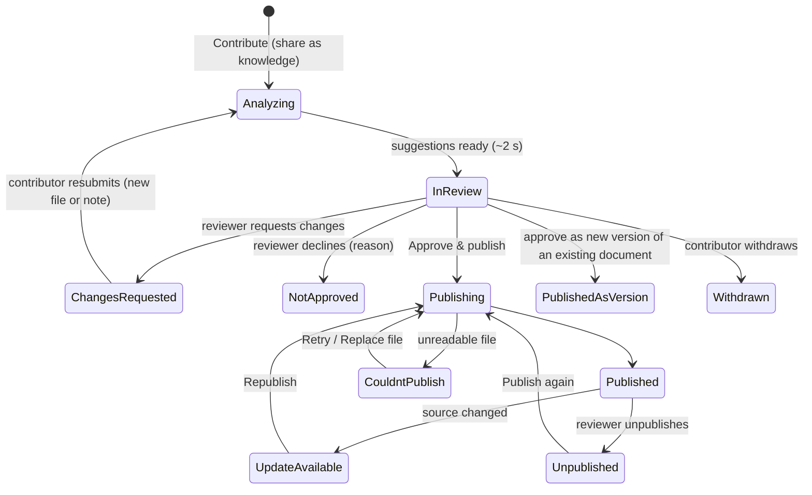

# Document lifecycle: contribute → curate → publish

How a document becomes trusted knowledge in BoMesh. This extends the Knowledge Hub ([KNOWLEDGE_HUB.md](KNOWLEDGE_HUB.md)): the Hub is where people *use* published knowledge. This document covers how knowledge *gets there*.

## Principles

1. **Sharing is easy, publishing is deliberate.** Contributing takes one file and one optional choice, the knowledge base. Nothing anyone uploads reaches search, the Reader, collections or the assistant until a reviewer approves it.
2. **Three steps, three places.** Contribute and track in **Knowledge** (contributors). Curate and publish in **Manage → Documents** (reviewers). Operate indexing in the **Platform console → Indexing** (platform admins). No screen mixes two of these jobs.
3. **The assistant does the busywork; people decide.** It reads each submission and suggests a type, topics (existing ones, or a proposed new one), the knowledge base and a summary. It also flags likely duplicates, new versions, personal data and unsearchable formats. Reviewers accept or edit. Only workspace admins change the taxonomy.
4. **Plain words.** People see *In review, Changes requested, Approve & publish, Publishing, Published, Couldn't publish*. Terms like "index", "embedding" or "pipeline" appear only in the platform console.
5. **Access never widens by accident.** A submission is visible only to its contributor and the reviewers of its target base. Approving publishes into that base, so its access rules decide who can read it, and the review screen states who that will be. Platform admins see job metadata, never titles or content.

## Lifecycle

| Label people see | `stage` · `status` | Who sees it | Next step |
| --- | --- | --- | --- |
| Analyzing → In review | `review` | Contributor, base reviewers | Reviewer decides |
| Changes requested | `changes` | Contributor, reviewers | Contributor revises and resubmits |
| Not approved | `rejected` | Contributor, reviewers | Contributor removes it (kept for the retention period) |
| Waiting to publish | `published` · `pending` | Reviewers | Publish now (synced files from trusted sources) |
| Publishing | `published` · `processing` | Reviewers, contributor | Automatic |
| Published | `published` · `ready` | Everyone who can read the base | Use it, or submit a new version |
| Couldn't publish | `published` · `failed` | Reviewers (contributor: "reviewers have been told") | Retry or Replace file |
| Update available | `published` · `outdated` | Reviewers (readers see *Review due*) | Republish |
| Published as new version | `merged` | Contributor | The original now shows the new version |
| Unpublished | `unpublished` | Reviewers | Publish again |

Private files (**My files**) skip review: only their owner can use them. *Share as knowledge…* moves a private file into review for a base without copying it.

Synced files follow their **source's policy**. *Publish automatically* suits trusted systems the admin connected, such as the regulations drive or the LMS. *Send to review first* suits untrusted or noisy feeds, such as the university website; it is the default for new sources. Under that policy, a changed file that is already published becomes a *new-version* submission, and the published copy keeps answering until a reviewer approves the change. Either way, adding a file and processing it stay separate steps, as `backend/docs_design` requires: approval or policy triggers the publishing run.

## Roles and permissions

| Capability | Contributor (`knowledge.contribute`) | Reviewer (owner of the base, `knowledge.manage`) | Workspace admin (`tenant.manage`, owns every base) | Platform admin (`platform.*`) |
| --- | --- | --- | --- | --- |
| Read published knowledge | Bases they can read | Same | All | Only through workspace membership |
| Contribute, track, revise, withdraw | ✓ (to bases they can read that accept contributions) | ✓ | ✓ | — |
| See a submission | Their own | Submissions to bases they own | All | Never (job metadata only) |
| Approve & publish, request changes, decline | — | Bases they own | All | — |
| Choose the base on approval | — | Among bases they own | Any | — |
| Unpublish, republish, retry, replace, archive | — | Bases they own | All | Retry jobs by workspace or error class (no content) |
| Accept, merge or dismiss proposed topics; edit the taxonomy | — | Read-only (sees every open proposal; titles of submissions only where they can see them) | ✓ | — |
| Source publishing policy | — | — | ✓ (`source.manage`) | — |
| Indexing policies, pause/resume a workspace's indexing | — | — | — | ✓ |

Finx: engineers contribute; Lê Thu Hà (Lead) reviews the Payments Platform and Engineering Handbook bases; Phạm Quốc Bảo (Analyst) reviews Data Platform & Analytics; Võ Thị Lan (Admin) reviews everything and owns the taxonomy. Northwind: members contribute; base owners and the admin review.

## Taxonomy and classification

| Concept | Answers | Example | Who sets it |
| --- | --- | --- | --- |
| Type | What is this file? | Policy, Procedure, Spec, Template | The assistant suggests; the reviewer confirms |
| Topic | What is it about? | Reliability & on-call, Metrics & definitions | Chosen from the workspace taxonomy. The assistant may *propose* a new topic; admins accept, merge or dismiss it |
| Knowledge base | Where does it live, and who can read it? | Payments Platform | The contributor picks it (or lets the assistant suggest); the reviewer confirms |
| Collection | Which documents belong in a reading list? | Payments on-call kit | Anyone, after publication. It never grants access |

How suggestions are made (prototype rules, deterministic):

- Distinctive title and note words are matched against topic names. Words shared by many topics, such as "engineering", count only with other evidence.
- Similar published documents contribute their topics.
- The target base's usual topics are used too. When nothing distinctive matches, the base's dominant topic is offered with low confidence.
- Proposed topics come from recognisable themes (Open banking, AI governance, Internships, Sustainability, Hybrid work) that have no topic yet. A proposal collects every submission that raised it. Accepting it creates the topic (and its domain if new) and tags those submissions.
- Flags:
  - *Duplicate*: ≥ 55 % title similarity to a published document.
  - *New version*: the contributor submitted it as one.
  - *Personal data*: CVs, salary documents, customer exports, card numbers, ID documents.
  - *Format*: images and archives can't be searched.

## Journeys

### Contributor
1. **Share.** Knowledge → *Contribute* (or ⌘K, or a base page) → drop a file → *Share as knowledge* is preselected → the knowledge base is "Let the assistant suggest" or a chosen base → optional note for reviewers → Submit. Toast: *Submitted for review · Track*.
2. **Track.** My library → *Contributions*: every submission with its lifecycle label and its latest event in words ("Lê Thu Hà asked for changes · 2 days ago"). Filters: Needs your action · In review · Published · Not approved. Home's *Pick up where you left off* lists your recent contributions too.
3. **Revise.** Inbox → *Changes requested* → the contribution drawer shows the reviewer's message in the timeline → attach a revised file and say what changed → *Resubmit*. It goes back to the reviewer, re-analysed.
4. **See it published.** Inbox → *Published* → open it in the Reader. Later, ⋯ → *Submit a new version…* sends an update to review while the current version stays published.

### Reviewer (base owner)
1. **Notice.** The sidebar badge on Manage → Documents, an Inbox item and a review line on Home say how many documents wait.
2. **Review.** The Review tab is a queue and a detail panel:
   - Preview of the first page.
   - The contributor's note.
   - The assistant's suggestions with confidence (type, topics, proposed topics, knowledge base with "who will see it", summary) and flags (Compare a duplicate; publish as a new version).
   - Decide: *Approve & publish*, *Request changes* (message required, quick replies), or *Decline* (reason required). The next item opens automatically. Undo is always offered. J/K move through the queue.
   - Bulk approve accepts the suggestions, skips anything flagged as personal data and says so.
3. **Fix publishing.** All documents → *Needs attention*: Retry, or Replace file for locked spreadsheets. Unpublish or republish with Undo.
4. **Keep quality.** Quality → due for re-verification · missing details · possible duplicates (merge keeps one and repoints collections, saved lists and recents).

### Workspace admin
Everything a reviewer does, across all bases, plus:
- **Topics:** accept, merge or dismiss proposed topics; add, rename or archive topics and domains.
- **Sources:** choose each source's publishing policy.
- **Overview:** surfaces documents waiting for review and failed publishes.

### Platform admin
Platform console → **Indexing**:
- Per-workspace queue, throughput, failure rate and status, with Pause/Resume and Retry failed jobs.
- Errors grouped by class.
- Recent jobs (id, workspace, file type, size, step, error class): no titles, no content.
- Platform policies: allowed types, max size, OCR for scanned PDFs, spreadsheet parsing, retention of declined submissions. "Uploads need review" is locked on.

## Decisions and why

| Decision | Why |
| --- | --- |
| One **Documents** page with Review · All documents · Quality · Topics replaces Knowledge health and the per-base inventory | Reviewers have one place to work; the knowledge-base page goes back to being about access and reading |
| Contributions live in **My library**, not a new nav item | It's personal and occasional; one more sidebar destination would add depth for everyone |
| The base picker defaults to "Let the assistant suggest" | Contributors shouldn't need to know the workspace structure; reviewers confirm the placement |
| Approval publishes (no separate "Publish" step after approval) | Reviewers think "is this right and should people see it?", which is one decision. Retry exists for failures |
| New versions go through review while the current version stays published | Knowledge never disappears during an update; the reviewer approves the change, not the whole document again |
| Topic proposals collect evidence across submissions and need an admin | Prevents taxonomy sprawl; admins see why a topic is wanted before creating it |
| Personal-data and duplicate flags never block, but bulk approve skips flagged items | Reviewers stay in control; bulk speed never publishes a transcript by accident |
| Platform admins see job metadata only | Operating infrastructure doesn't require reading confidential documents |

## Backend alignment and open decisions

- **Matches `backend/docs_design`:**
  - The Document is created before processing ("adding is not processing").
  - Ingestion runs are explicit: approval, source policy or Retry trigger them.
  - `items.status` / `index_status` map to *Waiting to publish → Publishing → Published / Couldn't publish*, and *outdated* to *Update available*.
- **Needs backend design:**
  - A review stage on Items (`review | changes | rejected | published | unpublished`) and its events, which are distinct from `status`.
  - Submission visibility (contributor + base owners) before publication.
  - Stored assistant suggestions.
  - Topic proposals.
  - Per-source publishing policy.
  - A platform indexing API that exposes job metadata without content.
