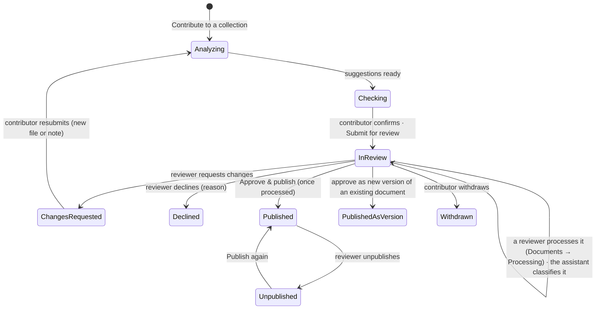

# Document lifecycle: contribute → process → review → publish

How a document becomes trusted knowledge in BoMesh. This extends the Knowledge Hub ([KNOWLEDGE_HUB.md](KNOWLEDGE_HUB.md)): the Hub is where people *use* published knowledge. This document owns the **per-document lifecycle** — contribute, process, review, publish, every state and label, the Review inspector's Classification fields, the drawer's steps and the workspace's classification schemes. The Knowledge Studio as a whole (Manage IA, Documents with All · Processing · Review, Classification with its scheme tabs · Suggestions, the Process dialog, setup order, sources and their publishing policies, first sync at scale) is in [KNOWLEDGE_STUDIO.md](KNOWLEDGE_STUDIO.md).

## Principles

1. **Sharing is easy, publishing is deliberate.** Contributing takes a file, a destination (*Contribute to a collection* or *Upload to My files*) and a check of what the assistant read. Nothing anyone contributes reaches search, the Reader or the assistant until a reviewer approves it.
2. **Three steps, three places.** Contribute in **Knowledge** and track in **Your work → My contributions** (contributors). Set up, review, publish and process in **Manage › Knowledge Studio** (collection owners, source admins and workspace admins). Operate indexing in the **Platform console → Indexing** (platform admins). No screen mixes two of these jobs.
3. **Publishing and processing are separate.** Publication decides who may see a document; processing (read → classify → index) decides whether search and the assistant can use it. Uploading processes nothing; processing happens only in an explicit run someone starts. A document is searchable only when it is published **and** processed.
4. **The assistant does the busywork; people decide.** When a document is contributed it suggests concepts in each classification scheme (existing ones only) with the evidence for each, the collection and a summary, and flags likely duplicates, new versions, personal data and unsearchable formats. The contributor confirms or edits before submitting; reviewers check and publish, and their classification changes are recorded as corrections that become label proposals. Only workspace admins change and publish the schemes.
5. **Plain words.** People see *In review, Changes requested, Declined, Approve & publish, Published, Unpublished*, and processing states *Not processed, Processing, Processed, Failed, Changed at the source, Not supported*. Terms like "embedding" appear only in the platform console.
6. **Access never widens by accident.** A submission is visible only to its contributor and the reviewers of its target collection. Approving publishes into that collection, so its access rules decide who can read it, and the review screen states who that will be. Platform admins see job metadata, never titles or content.

## Lifecycle

| Label people see | `stage` | Who sees it | Next step |
| --- | --- | --- | --- |
| Analyzing → Check the details (in the dialog, before submitting) | — | Contributor | Confirm or edit, then Submit for review |
| In review | `review` | Contributor, collection reviewers | A reviewer processes it (a new document), then decides |
| Changes requested | `changes` | Contributor, reviewers | Contributor revises and resubmits |
| Declined | `rejected` | Contributor, reviewers | Contributor reads the reason and removes it (kept for the retention period) |
| Published | `published` | Everyone who can read the collection (searchable once processed) | Use it, or submit a new version |
| Published as new version | `versioned` (target `submission.versionOf`) | Contributor | The original now shows the new version |
| Unpublished | `unpublished` | Reviewers | Publish again (Unpublish is immediate with Undo) |

Private files (**My files**, *Upload*) skip review: only their owner can use them. *Share as knowledge…* moves a private file into review for a collection without copying it.

Synced files follow their **source's publishing policy**: *Publish automatically* (trusted systems such as the regulations drive or the LMS; every sync publishes what it found), *Review only what's uncertain* (publishes clean files and holds only files flagged for personal data, a likely duplicate or a likely new version; the default above 1,000 files) or *Review everything* (untrusted or small feeds such as the university website; every new or changed file is a submission, and a changed published file becomes a *new-version* submission while the published copy keeps answering). Policies, their defaults and batches at scale: [KNOWLEDGE_STUDIO.md](KNOWLEDGE_STUDIO.md#configuring-a-source).

## Publication and processing

Every document has two independent states, as in the backend's Item (`backend/docs_design/item_model.md`):

| State | Backend field | Values people see | Changed by |
| --- | --- | --- | --- |
| Publication | `publicationState` (with the review stage) | In review · Changes requested · Published · Unpublished · Declined | Review decisions, a source's publishing policy, Publish / Unpublish |
| Processing | `indexingState` | Not processed · Processing · Processed · Failed · Changed at the source · Not supported | Explicit ingestion runs only |

Neither implies the other: a published document can be Not processed (people open it from its collection; search and the assistant can't use it), and a processed one can be Unpublished. **Searchable = published and processed.** A new document's submission is processed **before** it's reviewed (in review, Not processed until a reviewer processes it); a new version's is processed after it's approved. Document status chips (`status('doc')`) use the processing words; the lifecycle chip shows *Not processed*, *Processing*, *Processing failed* or *Changed at the source* for a published document that isn't searchable yet.

### Processing states

| State (`indexingState`) | Meaning | Fix (in Documents) |
| --- | --- | --- |
| Not processed (`PENDING`) | Not read, classified or indexed yet; search and the assistant can't use it | *Process* |
| Processing (`RUNNING`) | Being read, classified against the classification schemes and indexed | — (the processing strip offers Stop) |
| Processed (`SUCCEEDED`) | Read, classified and indexed; searchable once published | *Publish* if unpublished |
| Failed (`FAILED`) | Couldn't be read or indexed; listed in Processing | *Process again*, Replace file (uploads), Open source (password-protected synced files) |
| Changed at the source (`OUTDATED`) | Changed at the source since it was processed; answers use the previous version; listed in Processing | *Process the update* (re-reads from the source; never a file picker) |
| Not supported (`UNSUPPORTED`) | Images and archives; download only | — |

`PROCESSING` and `processingOf()` in `core/lifecycle.js` hold this vocabulary; `canProcess()` allows a run on published or unpublished documents and on new documents' submissions (`isCandidate`) that aren't running and aren't images or archives. `processingQueue()` is what Documents → Processing lists; `readyToReview()` what Review lists (a new document once processed, or in a format that can't be; a new version).

### What starts processing

Processing happens only through an explicit **ingestion run** (`X.processRun` in `features/documents.js`):

- **The Process dialog** over a selection in Documents → Processing or All (a page, or *Select all matching*): *Concepts the assistant may use* (*All* | *Selected*), whether the vision model reads text in images (off by default) and optional context for the AI, then *Process N documents* for checked rows, or *Process the matching documents* for *Select all matching* (a filter: no number, no time estimate). It never publishes. [Details](KNOWLEDGE_STUDIO.md#processing-a-selection).
- **Processing a submission before review.** A reviewer processes a new document's submission in Documents → Processing (its row's *Process*, or a selection). Its CLASSIFYING step matches the target collection's rules and the schemes' concepts against its title, note and text; the assignments it chooses and a summary replace the submission's suggestions (no confidence), and it moves to Review ("… is processed and ready for review · Review"). Approving never processes: the processed document keeps its index; an approved new version is Not processed and waits in Processing.
- **A row's fix**: *Process*, *Process again*, *Process the update*, from Processing, All or the document drawer.
- **A source's sync**: it processes the clean files it publishes under its policy, but never a file it holds for review as a submission: a synced new document waits in Documents → Processing like a member's contribution and moves to Review once processed (ApproveContribution needs a processed NEW_DOCUMENT candidate whatever its origin). The preview's first-sync batches (*Held back by a sync*) are counted, not listed, and publish as one decision.

Stopping a run (`X.stopProcessRun`) keeps what's done processed and returns the rest to Not processed.

| Origin | Classified (at processing) | Published |
| --- | --- | --- |
| Member contribution | Suggested on submit and confirmed or edited by the contributor; when a reviewer processes it, the assistant classifies it against the target collection (the contributor's confirmed concepts stay) and the reviewer checks that in the Review inspector | Documents → Processing, then Review |
| Source sync, *Review everything* | The assistant's suggestions on submit; once a reviewer processes it, what processing chose; the reviewer confirms | Documents → Processing, then Review |
| Source sync, *Review only what's uncertain* | The pipeline applies its matches; a file with a risk flag is a submission like a contribution | Flagged files in Review (*Held back by a sync*, batches by reason, at first-sync scale); the rest by the policy |
| Source sync, *Publish automatically* | The assistant classifies it in every scheme (marked *Assistant*); uncertain assignments are suggested (awaiting review) and a scheme it can't decide leaves the document Not classified, both listed in Classification → Suggestions. No confidence score shown | By the policy: "Not needed: {source} publishes automatically" |
| Editor upload into a collection | The concepts its editor gives; otherwise "Not classified" with *Add concept* | By the editor: "Not needed: added by an editor of the collection" |

**Who sees it after publishing is the collection's audience.** The Collection field's helper says who, e.g. "Everyone in Finx Workspace will see it" for a collection whose general access is Everyone. Making a document public to the workspace means publishing it into such a collection; there is no separate visibility flag.

**Review → Classification.** The suggestions are the Review inspector's form — Document name → Collection (who will see it) → Classification (one row per scheme) → Summary — under one provenance line. For a processed new document they are what the assistant chose while processing it: ✦ "The assistant filled in the fields below. Check them before publishing."; "Confirmed by the contributor." when the contributor confirmed details and it wasn't processed; a new version reads "Suggested from its name and note. A new version is processed after it's published.", a format that can't be processed "This file type can't be processed: suggested from its name and note." Each field has one status tag on its label row: *Suggestion* for the assistant's value (with its confidence when there is one, e.g. "Suggestion · 82%"), *Edited* once the reviewer changed it. Concept chips (`conceptTag`) are neutral, with the concept's icon in its top concept's colour, one row per classification scheme: a chosen one declines with ×, a declined suggestion (dashed) comes back with +, *+ Add…* adds any published concept of that scheme (the web picker searches every label). When the contributor confirmed the details, Collection shows *Chosen by the contributor* instead of a tag; a collection is needed to publish, and while none is chosen its helper says "Choose a collection to publish to", and each confirmed concept's evidence starts "confirmed by the contributor". Under each scheme's chips, each concept says why it matched (`conceptEvidence`): rule: documents in "Chargebacks" · matched "chargeback", "dispute" (any label, up to 3 words) · like example "{document}" · the title names it · like "{similar document}" · common in this collection. When the reviewer changes the suggested concepts, approving always records a **correction** (`recordCorrection`) and marks the concepts *Set by a person*; corrections whose titles share a phrase (two or more) become label proposals in Classification → Suggestions → *Learned from edits*.

**Document drawer → steps.** Under the lifecycle chip and its one note (the error, or the reviewer's message), a vertical stepper shows **Received · Processed · Reviewed · Published · Searchable**, each done, current, issue, skipped or to do, with one line: who and when ("Contributed by …", "Synced from …", "Uploaded by …"); for a submission "Not processed yet: process it so the assistant classifies it for review" (with *Process*) or "Classified for review · {concepts}", for a document "Not processed yet: search and the assistant can't use it", the error, or "Changed at the source · answers use the previous version"; "Once it's processed" (a submission waiting), "Approved by …", "Changes requested by …" or "Not needed: {source} publishes automatically"; "Searchable · Everyone in …". Publish and Process buttons sit on the step that needs them; Searchable needs both. History is a collapsed disclosure; Details follow.

## Roles and permissions

| Capability | Contributor (`knowledge.contribute`) | Reviewer (Owner of the collection) | Workspace admin (`tenant.manage`, owns every collection) | Platform admin (`platform.*`) |
| --- | --- | --- | --- | --- |
| Read published knowledge | Collections they can read, minus folders with their own access that don't name them | Same | All | Only through workspace membership |
| Contribute, track, revise, withdraw | ✓ (to collections they can read that accept contributions) | ✓ | ✓ | — |
| See a submission | Their own | Submissions to collections they own | All | Never (job metadata only) |
| Open Documents (All · Processing · Review) | — | Collections they own | All | — |
| Approve & publish, request changes, decline | — | Collections they own | All | — |
| Choose the collection on approval | — | Among collections they own | Any | — |
| Process, process again, unpublish, retry, replace, archive | — | Collections they own | All | Retry jobs (no content) |
| Collections: contents (folders, moving documents), sources (Knowledge Studio → Collections) | — | Collections they own or edit | All | — |
| Collections: access, a folder's own access, settings | — | Collections they own | All | — |
| Classification: import, export, edit concepts (labels, definitions, relations, mappings, rules), publish a scheme; accept or reject concept and label proposals | — | — (sees Suggestions read-only for proposals; confirms labels awaiting review in their collections; no scheme tabs) | ✓ (every scheme tab and Suggestions) | — |
| Sources, accounts, publishing policy (Knowledge Studio → Sources; `source.manage`) | — | — | ✓ | — |
| Indexing policies, pause/resume a workspace's indexing | — | — | — | ✓ |

Finx: engineers contribute; Lê Thu Hà (Lead) reviews the Payments Platform and Engineering Handbook collections; Phạm Quốc Bảo (Analyst) reviews Data Platform & Analytics; Võ Thị Lan (Admin) reviews everything and owns the classification schemes. Northwind: members contribute; collection owners and the admin review.

## Classification

| Field | Answers | Example | Who sets it |
| --- | --- | --- | --- |
| Format | What kind of file is it? | PDF, Word, Presentation, Spreadsheet | Derived from the file itself (PDF, Word, Presentation, Spreadsheet, Markdown, HTML, Plain text, Data, Image, Audio, Video, Archive, Other). Nobody sets or edits it and the assistant never suggests it; meaning lives in the classification schemes |
| Concepts (by scheme) | What is it about, what work is it for, what kind of document, for whom? | Lĩnh vực *Học vụ*, Nghiệp vụ *Tốt nghiệp*, Loại tài liệu *Quy định*, Đối tượng *Sinh viên* (UTE); Subject *Reliability & on-call* (Northwind, Finx) | The assistant classifies at processing time, one set of assignments per classification scheme; each is *accepted* or *suggested* (awaiting review). Reviewers and editors change them. The assistant never invents concepts: new concepts come from proposals that workspace admins accept in Classification → Suggestions. Publishing never waits for that decision |
| Document facts | Which official document is it? | Số hiệu 123/QĐ-ĐHSPKT, issued 01/09/2025, effective 15/09/2025, issued by Phòng Đào tạo, applies to K2022, supersedes an earlier decision | Read from the document at processing time; editors correct them in Edit details. Issuer and applicability use the reference lists (org units, programs) |
| Collection | Where does it live, and who can read it? | Payments Platform | The contributor chooses it in *Check the details* (pre-selected when contributing from a collection page, into the folder open there); the reviewer confirms |
| Folder | Where in the collection is it kept? | Runbooks › Gateway & cards | Editors, in the collection's Contents (move documents, make folders). A folder can have its own access, which then decides who reads it instead of the collection |

Classification runs **once per document, at processing time**, between reading and indexing (`document_profile.md`); a document that isn't processed isn't classified by the pipeline (a submission carries the suggestions made on submit until a reviewer processes it, which replaces them with what processing chose). Its summary goes into `contextual_rag.md` as a `<document_profile>` block before each indexed chunk; concept assignments live only in the index's metadata, so classifying again never needs re-indexing.

### Classification schemes

The workspace classifies by **schemes** (SKOS concept schemes; [item_model.md](../../../backend/docs_design/item_model.md) §4.13). UTE has four classification schemes — Lĩnh vực, Nghiệp vụ, Loại tài liệu, Đối tượng — plus two authority schemes used as reference lists (org units, programs); Northwind and Finx have one, *Subject*. The first classification scheme is what readers browse as pills and what Home's domain cards read. Workspace admins manage them in Knowledge Studio → **Classification** (`/studio?tab=taxonomy&view=<scheme id|suggestions>&node=<concept>`; `&conflicts=1` for label conflicts; these addresses are current, and former classification addresses fall into Documents → All).

- **Job:** the concept trees documents are classified under, and the labels that recognise each concept.
- **Layout:** one tab per classification scheme, then *Suggestions (N)* — the only tab with a count. A scheme tab is a **tree** (search over every label; a concept under a second parent shows "Also under …"; *Draft* and *Retired* badges) beside the concept **detail**: preferred label (click-to-edit), notation, Definition, Scope, Labels (preferred, alternative, hidden, by language), Relations (Broader, Related), Mappings, and Recognition patterns for document types. Concept ⋯: *Merge into…* (assignments move to the target), *Split…*, *Retire* (kept for old assignments, replaced by the concepts chosen).
- **Scheme ⋯:** *Export SKOS* · *Version history* · *Import CSV* (columns `scheme, notation, broader, pref_vi, pref_en, alt, hidden, definition, scope_note`; *Check the changes* before anything joins the working copy) · *Reference lists* (org units, programs) · *See how the assistant classifies* (read-only: rules and collection priors first, labels, examples, then the model step with the scheme's concepts by preferred label; no IDs, no confidence).
- **Publish:** edits collect as the scheme's unpublished changes; the single primary **Publish (k changes)** shows only while there are some. Its dialog lists blocking errors (each links to its concept), warnings, and the impact — *N assignments remapped, M documents classified again* — with no re-indexing. People's choices are never replaced. Classifying again is scoped: a merge remaps assignments without the model; a split's documents choose among its targets; a parent that gained narrower concepts re-ranks only its own documents among them (keeping the parent when none fits); a retired concept or a threshold change re-runs the whole scheme for the affected documents.
- **Duplicate labels (n):** a quiet link to the label-conflict screen: two concepts of the same scheme sharing a label are warnings with *Remove label* / *Move label*; the same label in different schemes is an informational list.
- **Suggestions** are not in the tree: labels awaiting review (grouped by concept, *Accept all* / *View*, plus the Not classified pool), new concept proposals (accept → a Draft in the tree; reject) and labels learned from reviewers' edits are in Classification → Suggestions ([details](KNOWLEDGE_STUDIO.md#suggestions)).

### How classification works

Prototype rules, deterministic, in `core/lifecycle.js` (`classifyDoc`, `conceptMatches`). Each assignment records its source:

| Source | Effect |
| --- | --- |
| Rule | Documents in a collection or from a source carry the concepts its rules imply (or make them likelier: a prior); a rule that implies settles that scheme without the model |
| Lexical | The concept's labels (preferred, alternative, hidden; accent-insensitive) matched against the title and text; document types also by their recognition patterns |
| Similar documents | Similar published documents contribute their concepts |
| Model | Used per the scheme's setting (always, as a fallback, or never), choosing only among the scheme's concepts |
| Person | Set or changed by a contributor, reviewer or editor; never replaced by the pipeline |

- Each assignment keeps its evidence (rule, label, pattern, similar document, common in this collection), shown as readable phrases to the contributor and the reviewer — no scores. An assignment the classifier isn't sure of is **suggested** (awaiting review); a scheme it can't decide leaves the document in that scheme's **Not classified** pool.
- Documents from auto-publish sources are classified the same way when their sync processes them; their suggested assignments and Not classified documents are listed in Classification → Suggestions → *Labels awaiting review*.
- Every change a person makes to machine-chosen concepts (approving with changed concepts, Edit details, Quality's *Add concept*) is recorded as a correction; corrections whose titles share a phrase (two or more) become label proposals (*Learned from edits*). The classifier never proposes concepts: **new concept proposals** come only from clustering the Not classified pool and from repeated corrections. Admins decide both in Classification → Suggestions.
- Flags (risks render as labelled chips, the rest as small icons with tips):
  - *Possible duplicate*: ≥ 55 % title similarity to a published document.
  - *New version*: the contributor submitted it as one.
  - *Personal data*: CVs, salary documents, customer exports, card numbers, ID documents.
  - *File type*: images and archives can't be searched.

## Journeys

### Contributor
1. **Share.** Knowledge → *Contribute* (or ⌘K, a collection page, My contributions or the Studio's Documents *Add documents*) → *Contribute to a collection* is preselected (or *Upload to My files* to keep it private; that and *Submit a new version* stay one step) → drop files → Continue.
2. **Analyzing.** A visible step: "Reading the file and matching it against {workspace}'s classification…".
3. **Check the details.** Per file: an editable title (it becomes the file name, extension kept), concepts by scheme as removable chips with their evidence plus *Add…*, the collection with "{who} will see it once published", a suggested summary ("{title}. Covers A, B and C."), personal-data and possible-duplicate warnings, and a note for reviewers. Back keeps your edits. *Submit for review* stores what you confirmed with the submission. Toast: *Submitted for review · Open* → `/contributions?open=id` (a reviewer submitting to a collection they review gets *Process*, or *Review now* for a new version).
4. **Track.** Your work → **My contributions** (`/contributions`; header *Contribute*): every submission with its lifecycle label and its latest event in words ("Lê Thu Hà asked for changes · 2 days ago"), *Revise* when changes were requested. Filters: All · Needs your action · In review · Published · Declined (counts only where there are items). A row (or `?open=id`) opens the drawer: a stepper **Submitted → Analyzed → In review → Approved → Published** (no status chip), the reviewer's message as an alert, *What you confirmed*, and a collapsed History. An approved contribution says *Approved · not processed yet*, *being processed* or *processing failed*; its Published step reads "Published · waiting to be processed" until it is. A collapsed Your work group shows a dot when changes are requested; Home's *Needs your attention* shows it too.
5. **Revise.** Inbox → *Changes requested* → the contribution drawer shows the reviewer's message in its alert → attach a revised file and say what changed → *Resubmit*. It goes back to the reviewer, re-analysed. A declined contribution shows the reason the same way, with *Withdraw*.
6. **See it published.** Inbox → *Published* → open it in the Reader. Later, for uploads, ⋯ → *Submit a new version…* sends an update to review while the current version stays published.

### Reviewer (collection owner)
1. **Notice.** The sidebar badge on Manage › Knowledge Studio (what keeps documents from people: submissions ready for review or waiting to be processed, batches held back by a sync, documents that failed or changed at the source), Inbox items ("n submissions are waiting to be processed · Process", "n documents are waiting for your review · Review") and *Needs your attention* on Home say how many documents wait.
2. **Process.** Knowledge Studio → Documents → **Processing** lists submissions first (*Submission · contributor → collection*, "Goes to Review once it's processed"), then what isn't processed, failed or changed at the source. Select them → **Process** → the Process dialog ("Submissions go to Review once they're processed."), or a row's *Process*. The assistant classifies each against the target collection; the toast offers **Review**. A submission that can't be processed (*Process again* fails) still gets an answer from its ⋯: *Request changes…* · *Decline…*.
3. **Review.** Knowledge Studio → Documents → **Review** is a workbench (list · document · inspector); *Held back by a sync* batches come first, then *Submissions* (processed new documents, formats that can't be processed, new versions):
   - The whole document, scrolling in its pane (*Open full preview* for zoom and find).
   - The contributor's note.
   - The form (✦ "The assistant filled in the fields below. Check them before publishing."): document name, collection with who will see it, concepts by scheme with the evidence for each ("matched “chargeback”, “dispute”"), summary; labelled risk chips (*Personal data*, *Possible duplicate* with Compare) and other flags (publish as a new version). Changing the concepts records a correction on approval.
   - Decide: *Approve & publish* (full width; it publishes only — a processed document is searchable at once, a new version waits in Processing), *Request changes* (message required, quick replies), or *Decline* (reason required) — two equal outline buttons under it. The next item opens automatically. Undo is always offered. Keyboard: J/K move, Enter opens, **A** approves & publishes, **R** requests changes.
   - Selecting several swaps the decision bar for the floating bulk bar; bulk approve accepts the suggestions, skips anything flagged as personal data and says so. First-sync batches are one decision each: [KNOWLEDGE_STUDIO.md](KNOWLEDGE_STUDIO.md#3-what-people-decide-minutes-not-months).
   - Empty: "Nothing to review", with *Go to Processing* while submissions wait to be processed.
4. **Fix what stopped.** Documents → **Processing** also lists what couldn't be processed or changed at the source (state pills *Failed* · *Changed at the source*); each row shows its fix — *Process again*, Replace file (uploads), *Process the update* (synced documents changed at the source), or Open source (password-protected synced files); select several to process them together. Every row opens the document drawer (chip, one note with the reason and fix, steps, History). Unpublish is immediate with Undo.
5. **Process what's waiting.** Documents → Processing → *Not processed* → select (or *Select all matching*) → **Process** → the dialog → the processing strip; [the 1,000-document flow](KNOWLEDGE_STUDIO.md#the-1000-document-flow).
6. **Quality.** Documents → All → **Quality** (`quality=reverify|details|duplicates`): Re-verification due (expired or never verified; Verify) · Missing details (owner, summary; Edit details) · Possible duplicates (Compare; merging keeps one document, moves every reference to it — saved, recent, space materials, shortcuts, conversation references — and archives the duplicate; Undo restores the duplicate only, the references stay on the kept document). Published documents left Not classified are in Classification → **Suggestions**.

### Workspace admin
Everything a reviewer does, across all collections, plus:
- **Import concepts and publish the scheme** (Northwind journey of that name). Classification → scheme ⋯ → *Import CSV* → drop the file (or *Try it with* the sample) → *Check the changes*: skipped rows with reasons, new, updated and retired concepts → *Import n changes* (they join the working copy) → **Publish (k changes)**: blocking errors link to their concepts, warnings, impact (*N assignments remapped, M documents classified again*) → Publish; the Review inspector now shows the new matches with their evidence.
- **Decide suggestions** in Classification → Suggestions (labels awaiting review: *Accept all* / *View*; Not classified; new concept proposals: accept as a Draft or reject; labels learned from edits); in a scheme tab edit a concept's labels, definition, scope, relations and mappings, *Merge into…*, *Split…* or *Retire* it, then publish; *Export SKOS* to hand the scheme to another system.
- **Teach classification from reviewers’ corrections** (Finx journey of that name). Classification → Suggestions → *Learned from edits*: reviewers moved 3 documents to *Reconciliation*, so the label "đối soát" is proposed → accept → **Publish (1 change)** → the dialog's impact says 1 document is classified again, with no re-indexing; *See how the assistant classifies* (scheme ⋯) shows what processing uses.
- **Choose what to process** (journeys *Choose which of 1,000 digitised records to process*, UTE, and *Choose which of 1,200 uploaded documents to process*, Finx): [KNOWLEDGE_STUDIO.md](KNOWLEDGE_STUDIO.md#the-1000-document-flow).
- **Set up and run sources:** collections → classification → sources in setup order (journey *Finish setting up knowledge*), publishing policies and the first sync at scale: [KNOWLEDGE_STUDIO.md](KNOWLEDGE_STUDIO.md).
- **Overview:** Knowledge health's metrics (Processing · Review · Classification suggestions · Quality · Verified) each link to their view; Needs attention covers sources, accounts, access and requests ([KNOWLEDGE_STUDIO.md](KNOWLEDGE_STUDIO.md#overview--knowledge-health)).

### Platform admin
Platform console → **Indexing**:
- Sidebar sub-rows **By workspace** (per-workspace queue, failure rate and status; a paused row's Resume, and a row ⋯ with only what applies — Retry failed jobs when a retry can succeed, Show jobs, Pause indexing; the workspace drawer adds throughput, median time and error classes; errors grouped by class) · **Jobs** (id, workspace, file type, size, step, error class: no titles, no content; a job drawer with Retry job) · **Policies** (available before any job has run).
- Platform policies: allowed types, max size, OCR for scanned PDFs, spreadsheet parsing, retention of declined submissions. "Uploads need review" is locked on.

## Decisions and why

| Decision | Why |
| --- | --- |
| One **Knowledge Studio** replaces Manage › Documents (and before it Knowledge health and the per-collection inventory); it holds Documents, Collections, Classification and Sources ([why](KNOWLEDGE_STUDIO.md#decisions-and-why)) | Contributions, synced files and uploads land in one place, and reviewers and admins have one place to run them |
| Sections named after resources: **Documents** (All · Processing · Review) and **Classification** (scheme tabs · Suggestions) ([why](KNOWLEDGE_STUDIO.md#decisions-and-why)) | Names follow domain resources; a workflow page with modes and a stage bar mixed publication and processing in one sequence |
| Publication and processing are two independent states, each with its own column; no stage bar | They change for different reasons and by different people; one bar implied an order that doesn't exist (a published document can be Not processed) |
| Processing is explicit: nothing is processed on upload | Matches the backend (`item_model.md`); with 1,000+ documents an admin chooses what to process, sees the estimate and can stop |
| A submission is processed before it's reviewed; approval never processes (`item_model.md` 4.7) | The reviewer decides on the assistant's classification of the file, not a guess from its title, and nothing is classified twice. The reviewer still chooses what to process — no automatic run on submit — so a file that will be declined costs nothing unless someone processes it |
| Classification = faceted schemes (SKOS): concepts people browse and filter by, known by their labels, each with several classification signals; no separate category list | The classification target is exactly what readers see as Browse pills and filters, so a document is never filed under something nobody can browse. Several schemes answer different questions (subject, work, document type, audience) instead of one overloaded tree; labels, rules, examples and patterns make classification explainable; publishing a scheme as a whole makes every change reviewable (errors, warnings, impact) |
| Reviewers' classification changes are recorded as corrections and proposed to admins as labels, never applied automatically | The people closest to the documents improve the rules; admins stay in charge of what the rules say |
| The contributor checks the details before submitting | The person who knows the file confirms concepts, collection and summary; reviewers check rather than fill in, and see what was confirmed |
| Audience is the collection's access ("Everyone in {workspace}"), not a new public flag | Access already lives on the collection. A second visibility switch could contradict it; the decision bar states the audience before publishing |
| Documents from auto-publish sources are classified by the assistant | They never pass a reviewer, yet must be findable. Assignments are applied as *Assistant* (people's choices stay); uncertain ones are suggested and a scheme the assistant can't decide leaves the document Not classified — both wait in Classification → Suggestions |
| Contributions are **My contributions** under Your work, not a Knowledge section | Tracking what you submitted is your work, like Recent and Projects; Saved and My files keep what you saved and own |
| The collection is chosen in *Check the details*, with the assistant's suggestion pre-filled and who will see it | Contributors needn't know the workspace structure, but they see the audience before submitting; reviewers confirm the placement |
| Approval publishes (no separate "Publish" step after approval) | Reviewers think "is this right and should people see it?", which is one decision. Processing comes before it, in Processing |
| New versions go through review while the current version stays published | Knowledge never disappears during an update; the reviewer approves the change, not the whole document again |
| Concept proposals collect evidence across documents, need a workspace admin, become Drafts and are only used once the scheme is published; they never hold publishing back | Prevents concept sprawl; admins see why a concept is wanted before creating it (Classification → Suggestions), and reviewers aren't blocked by a classification decision |
| Personal-data and duplicate flags never block, but bulk approve skips flagged items | Reviewers stay in control; bulk speed never publishes a transcript by accident |
| Platform admins see job metadata only | Operating infrastructure doesn't require reading confidential documents |

## Backend alignment and open decisions

- **Matches `backend/docs_design`:**
  - The Document is created before processing ("adding is not processing").
  - Nothing is processed on upload; ingestion runs are explicit (a selection, a row's fix, a source's sync), and approval never starts ingestion: a reviewer processes a NEW_DOCUMENT candidate first (`CreateIngestionRun` with the candidate in `items[]`; its CLASSIFYING step replaces the contribution's suggested concepts and summary), and ApproveContribution answers `CANDIDATE_NOT_PROCESSED` until it is (unsupported formats pass). A NEW_REVISION is processed by a run after approval.
  - `publicationState` and `indexingState` (PENDING / RUNNING / SUCCEEDED / FAILED / OUTDATED / UNSUPPORTED) are the Publication and Processing state columns; *OUTDATED* is Changed at the source in Processing.
  - Who can read a published document is the collection's role assignments (Everyone = `role_assignments.all_members`).
- **Needs backend design:**
  - A review stage on Items (`review | changes | rejected | published | unpublished`) and its events, which are distinct from `status`.
  - Submission visibility (contributor + collection owners) before publication.
  - Stored assistant suggestions, with per-concept evidence (`why`) on the contribution's suggested assignments.
  - Concept and label proposals.
  - Concept schemes, concepts (labels, notation, definition, scope, broader/related, mappings, state) and per-document assignments, as designed in [item_model.md](../../../backend/docs_design/item_model.md) §4.13 and [api_design.md](../../../backend/docs_design/api_design.md).
  - Scheme import (CSV) and export (SKOS), and scheme versions published as a whole (validate-only check step for errors, warnings and impact); version history (who, when, note, changes).
  - Document facts, concept assignments in index metadata (re-check, not re-index) and classification corrections: [KNOWLEDGE_STUDIO.md](KNOWLEDGE_STUDIO.md#backend-alignment-and-open-decisions). No classification threshold and no processing-state counts (both decided). Ingestion runs over a selection or filter with a classification context, Stop, processing a contribution's candidate before review and approval without ingestion are in the contract.
  - Auto-classification of documents from auto-publish sources at processing (assistant-applied assignments, flagged as assistant-applied; uncertain ones suggested).
  - Concept rules (collection and source priors), recognition patterns and examples ([KNOWLEDGE_STUDIO.md](KNOWLEDGE_STUDIO.md#backend-alignment-and-open-decisions)).
  - Contributor-confirmed metadata on CreateContribution (collection, concepts, summary), returned to reviewers as confirmed.
  - Re-classification of open contributions when a scheme is published (refresh their suggested assignments).
  - Per-source publishing policy with three values, including `REVIEW_EXCEPTIONS` ([KNOWLEDGE_STUDIO.md](KNOWLEDGE_STUDIO.md#backend-alignment-and-open-decisions)).
  - A platform indexing API that exposes job metadata without content.
