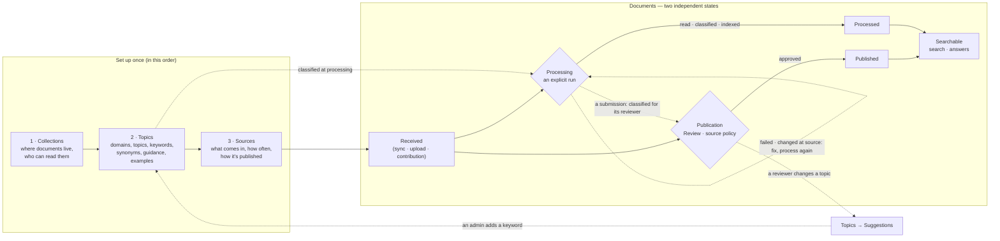
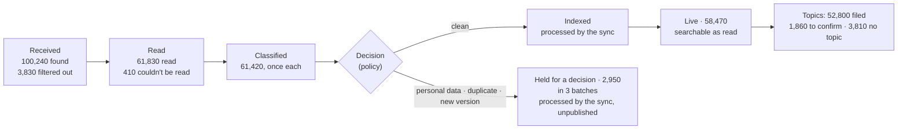

# Knowledge Studio: how knowledge gets in, gets processed and gets published

Knowledge Studio (Manage › Knowledge Studio, `/studio`) is the one place a workspace's knowledge is run. This document owns its concept: the information architecture of Manage and the Studio's sections — **Documents** (All · Processing · Review) and **Topics** (All · Suggestions) beside Collections and Sources — explicit processing, the order things are set up in, and how it behaves at scale (the 1,000-document flow and the 100,000-document first sync). The per-document lifecycle — contribute, process, review, publish, every state and label — is in [DOCUMENT_LIFECYCLE.md](DOCUMENT_LIFECYCLE.md). Reading and using published knowledge is in [KNOWLEDGE_HUB.md](KNOWLEDGE_HUB.md).

## The mental model

> Documents come in from **sources**, uploads and contributions and land in a **collection** (which decides who can read them). Each has two independent states: **publication** (may people see it?) and **processing** (has it been read, classified against the workspace's **topics** and indexed?). Uploading is not processing: an admin chooses what to process, and a document is **searchable** only when it is published **and** processed.



Processing happens only through an explicit **ingestion run**: the Process dialog over a selection in Documents → Processing (or All), a row's fix, or a source's sync (the sync is that source's explicit run). **A submission is processed before it's reviewed**: the reviewer processes it in Processing, the assistant classifies it against the target collection's topics, and the submission moves to Review with that classification — the assistant classifies, the reviewer decides. Approving never starts processing (`item_model.md` 4.7): a processed new document keeps its index; an approved new version is Not processed until someone processes it. Classification happens **once per document, at processing time**: its summary also becomes the `<document_profile>` block `contextual_rag.md` puts before each passage, and its topics live in the index's metadata only — so changing the topics re-files documents without re-indexing them.

## Principles

1. **One place for knowledge.** Everything about knowledge — sources and the accounts they read with, collections, topics, review, the document registry — is one destination. People, the assistant, audit and settings are the rest of Manage.
2. **Set up in the order intake needs it: where → how it's filed → what comes in.** A source needs a destination (a collection), and its documents should not be processed before the topics exist, or they are classified against nothing.
3. **Access is configured, never inferred.** Each source lands in exactly one collection, and that collection's access rules decide who reads its documents. Processing classifies; it never decides who can see something.
4. **Names follow domain resources.** Sections and views are named after what they hold — Documents, Topics, Collections, Sources; Processing, Review, Suggestions — not after a workflow metaphor.
5. **Publication and processing are two axes.** Publishing answers *should people see this?*; processing answers *can search and the assistant use it?* Neither implies the other, and no single bar mixes them.
6. **Uploading is not processing.** Nothing is processed on upload. With 1,000 uploaded documents an admin filters, selects and processes them, and sees what it costs before starting.
7. **Every origin converges.** Source syncs, editors' uploads (*Add documents*) and members' contributions land in the same Documents.
8. **At scale, people decide batches, not documents.** A 100,000-file sync produces a handful of review decisions — one per reason — each with a sample; *Select all matching* processes a filter in one action.
9. **Corrections teach, admins decide.** A reviewer's topic change is recorded as a correction and shown in Topics → Suggestions; it changes the topics only when a workspace admin turns it into a keyword or an example.
10. **An account is a source's credential, not a destination.** It is created inside the Add source wizard, reused when adding the next source, and fixed by *Reconnect* on the rows of the sources that use it when it expires.
11. **One badge, one landing.** The sidebar badge counts what Knowledge Studio opens on: what keeps documents from people (Review entries, plus submissions waiting to be processed and documents that failed or changed at the source), else what's broken in sources, else access requests an owner decides.
12. **Process, then review.** A submission's reviewer decides on what the assistant read in the file, not on a guess from its title: the Processing view comes before Review, and approval needs a processed new document (formats that can't be processed pass).

## Information architecture

```text
Manage
├── Overview            what needs you across the workspace; the next unfinished setup step (the full guide only in an empty workspace)
├── Knowledge Studio    /studio — sections are sidebar sub-rows under this row
│     Documents · Collections · Topics · Sources
│       ├ Documents views: All · Processing · Review
│       ├ Topics views:    All (workspace admins) · Suggestions
│       └ Sources views:   All · Sync history · Accounts
│     └── one collection: /studio/collections/:id ─ Contents · Access · Sources
├── People · Assistant · Activity · Settings
```

| Section | Decides | Who sees it | Top-row action |
| --- | --- | --- | --- |
| Documents | Every document's publication and processing state; what to review, process, fix and keep healthy | Reviewers (owners of a collection; workspace admins own all) | Add documents |
| Collections | Where documents live and who can read them (the access boundary) | Owners and editors of a collection; workspace admins | New collection |
| Topics | The topics documents are classified under at processing time; what the assistant and reviewers suggest | Topics: workspace admins. Suggestions: everyone who works documents (proposals read-only for non-admins) | Import (Topics) |
| Sources | What comes in, from which account, how often, into which collection, under which publishing policy; sync history; accounts | Source admins (`source.manage`) | Add source |

There is no tab bar for sections. While you're in the Studio (`/studio?tab=…`, or a collection page `/studio/collections/:id`, which marks Collections) and the sidebar is expanded (also off-canvas on tablet/phone), the Manage → Knowledge Studio row shows its sections as sub-rows — only the ones the caller may use (`X.studioTabs`, built by `X.studioNav()` in `features/curation.js`). Sub-rows render only when a row has ≥ 2 sections (`navKids` in `core/shell.js`): someone with only Collections (Finx engineer) sees no sub-rows and a page titled "Collections". On the collapsed icon rail the row is a button opening a menu to its right (`MENUS['nav-sub']`) with the sections, their counts and the current one checked; Esc returns focus to the rail button. ⌘K's Go to finds sections too. A new Studio feature adds one sidebar row or one view of an existing section, not a tab: the sidebar scales vertically, a tab bar does not ([DESIGN_SYSTEM.md](DESIGN_SYSTEM.md#layout--styleslayoutcss)).

The top-row title is the section name with the *Demo data* chip and the section's one action; no "Knowledge Studio" crumb. A collection page keeps its trail Knowledge Studio › Collections › name; the Reader for a submission is trailed Documents › title. *Add documents* opens the contribute dialog; editors' uploads land in the same Documents. The page opens on what needs the caller: Documents if a decision waits, else Sources if something is broken, else the first section. The Studio page is a workbench, wider than reading pages (`.page--studio`, up to 1680 px) with a tight header: title and action, no description (the sidebar says where you are).

**Counts.** Each sub-row counts what waits on the caller: Documents what keeps documents from people (Review's entries — submissions + open sync batches, each batch once — plus submissions waiting to be processed and documents that failed or changed at the source; accent), Collections access requests the owner decides, Topics the suggestions (the same number as the Suggestions tab), Sources broken sources and accounts (failed syncs + expired accounts; danger). While sub-rows show, the parent row's single badge is hidden. Otherwise (collapsed group, other pages, rail) the one badge counts those, else source problems, else access requests the owner decides.

## Documents

`/studio?tab=documents&view=all|processing|review`. Three views as page tabs, in the order work flows; the default is Review if it has entries, else Processing if something there waits on the caller (submissions, failures, changes at the source), else All. Processing counts what isn't processed (a quiet number), Review counts what waits for a decision (accent), All carries no count.

| View (`view=`) | What's in it | Decision |
| --- | --- | --- |
| All (`all`) | Every document in the collections the caller reviews, whatever its origin; the **Quality** filter (`quality=reverify|details|duplicates`) | Process · Publish · Unpublish · Archive, per row or in bulk; Quality rows keep their fixes (Verify, add details, Compare) |
| Processing (`processing`) | What isn't processed yet: new documents' submissions first, then documents Not processed, Processing, Failed or Changed at the source | **Process** (the Process dialog) for selected rows; each row's fix (*Process*, *Process again*, *Process the update*, Replace file, Open source) |
| Review (`review`) | Submissions ready to decide — processed new documents, formats that can't be processed, new versions — and what a sync held back (batches by reason) | One decision each; approving publishes only |

### All

The registry. Filters, shown once they would split the list: search, Collection, Publication, **Processing** (`?processing=`: Not processed · Processing · Processed · Failed · Changed at the source · Not supported), Origin (`?src=contrib` for contributions), Type, Topic. They are one dropdown each only where all six fit on one line beside search and Quality (a 1536 px-wide frame and up); otherwise one **Filters** button (a bottom sheet on phones) with removable chips for what's on, so the toolbar never wraps into a second row.

Columns: **Name** (collection › folder · origin: the source, the contributor, or the editor who uploaded it; a submission reads *Submission · contributor → collection*) · **Processing state** (a chip and one line — *Search can't find it*, *Goes to Review once it's processed*, *Reading, classifying, indexing…*, *Searchable · v2*, *Ready to publish*, *Ready for review*, the error, *The previous version answers*, *Download only*) · **Publication** · **Topics** (and who chose them: *Assistant*, *Suggested* for a processed submission, *Set by a person*, *Classified when processed*; no confidence) · Updated · a row fix (*Process*, *Process again*, *Process the update*, *Publish*) and ⋯. There is no Visibility column: who can read a document is its collection's (or folder's) audience. Each first sync at scale adds one counted row (*Operations archive · First sync — 2,950 documents held for a decision · Counted, not listed*) with *Open sync*.

**Bulk bar.** Selecting rows shows "N selected"; with the whole page selected, *Select all matching* (no number) extends the selection to every document the filters match, and the bar then reads *All matching selected*. Actions: **Process** (opens the Process dialog) · Publish · Unpublish · Archive, each with Undo where it can be undone.

**Quality.** A *Quality* menu button in the toolbar (with the number of items) switches the list to one of three lists that keep published knowledge right — **Re-verification due** (expired or never verified; *Verify* per row, *Verify selected*, *Ask owners*) · **Missing details** (owner or summary; *Edit details*) · **Possible duplicates** (rows open Compare; ⋯ *Keep newer, archive the other* · *Not duplicates*; merging keeps one document, moves every reference — saved, recent, space materials, shortcuts, conversation references — to it and archives the duplicate; Undo restores the duplicate only, the references stay on the kept document). The lists show as pills with their counts above the list (`quality=`), with *Show all documents* to clear the filter; the list itself is `X.gov.queue(part)` (`features/governance.js`). Nothing here holds a document back.

### Processing

Everything that isn't processed yet, for the collections the caller reviews (`processingQueue()` in `core/lifecycle.js`). **Submissions come first** — new documents contributed by people or held for review by a source's sync (a sync never processes: its new files wait here like a member's); their senders wait on a review that needs them processed — then documents nobody processed, that are processing, that failed or that changed at their source. Not listed: formats that can't be processed (images, archives), new versions waiting for review (processed once approved) and what is processed already.

- A one-line hint: "Select what to process: the assistant reads, classifies and indexes it. Submissions go to Review once they're processed."
- Search, a Collection filter (`?kb=`) and **state pills** (`?state=`; a select on phones): All · Not processed · Processing · Failed · Changed at the source, each shown only when something is in it. No counts per state (see below).
- Columns: **Name** (a submission reads *Submission · contributor → target collection*; a document its collection › folder · origin) · **State** (chip and one line: *Goes to Review once it's processed* for a submission, *Search can't find it*, *Reading, classifying, indexing…*, the error for a failure, *The previous version answers*) · Updated · the row's fix — *Process*, *Process again* (failed), *Process the update* (changed at the source), Replace file (password-protected uploads), Open source (password-protected synced files) — and ⋯ (a submission's adds *Request changes…* and *Decline…*, so one that can't be processed still gets an answer).
- Selecting rows, or the whole page and *Select all matching*, shows the bulk bar with **Process** (primary) → the Process dialog. The dialog adds "Submissions go to Review once they're processed." when the selection holds submissions.
- When the run ends, processed submissions are in Review: the toast reads *Processed N documents · M submissions ready for review* with **Review** (failures: *Show* → Processing filtered to Failed). Processing a single submission from its row toasts "*name* is processed and ready for review" with **Review**.
- Empty: **Everything is processed** — *Next: Review* when Review has entries, else *See all documents*.

### Review

Submissions ready to decide — new documents' submissions once processed (or in a format that can't be processed), whether a person contributed them or a sync held them for review, and new versions — and what a sync held back (batches by reason, *Held back by a sync* first), one decision each. The workbench fills the screen under the tabs (no page scroll), in three panes that each scroll on their own: the **list** · the **document** (every page at reading size, so the whole file is skimmed in place; its bar names the document, says how many pages and offers *Open full preview* — zoom, find and the side panel; the inspector beside it doesn't repeat the name) · the **inspector** (who sent it and when; the note to reviewers and what was found as compact rows — possible duplicate with Compare and the *Publish as a new version* switch, personal data, new version, can't be searched; the form — Document name → Collection → Topics → Summary, one field pattern (label with one status tag, control, helper) — with one provenance line; and the decision footer pinned at its bottom: Approve & publish across the width, then Request changes and Decline side by side). Keyboard: J/K or ↓/↑ move through the list; on a submission Enter opens the full preview, **A** approves and publishes, **R** requests changes. Without room for a readable document pane (Studio page under 1140 px) an eye button in the inspector header opens the preview. Phones show the list, then the inspector full screen with Back and a floating decision bar. A **batch** uses the same list and inspector without a document pane: why they were held, who would see them, a five-title sample, and the batch's two decisions. Bulk approve has Undo.

**Classification comes from processing.** For a processed new document, the form starts from what the assistant chose while processing it — topics matched against the target collection's rules and topics in its title, note and text, and a summary from the file's opening — and the provenance line ✦ "The assistant filled in the fields below. Check them before publishing." A new version reads "Suggested from its name and note. A new version is processed after it's published."; a format that can't be processed "This file type can't be processed: suggested from its name and note."

**Approving publishes only.** There is no processing step in the decision bar. A processed new document is published with its index (searchable at once: "Published *name* to *collection*"); a new version is appended Not processed and shows up in Processing ("Published v4 of *name*. Process it from Processing so search uses the new version."). Bulk approve says how many new versions wait to be processed.

**Empty.** **Nothing to review** — with submissions still waiting to be processed: "N submissions are waiting to be processed. Process them first: the assistant classifies them for your review." and **Go to Processing**; otherwise *See all documents*.

**Teaching the topics.** When a reviewer changes the topics the assistant suggested, *Use my change to improve classification* appears under them (on by default). Approving records a **correction** (`recordCorrection`: document, title, from → to, who, when) and marks the topics as set by a person; Undo removes it. Corrections appear in Topics → Suggestions and never change the topics by themselves.

### Processing a selection

**The Process dialog** asks for one decision and offers one optional input. It never publishes: people review, then publish. It is the same dialog from Processing and All.

- **Header:** "Process N documents" for checked rows, with a subtitle saying the AI reads each file and suggests topics, plus the estimate ("About X min for N pages; you can keep working"). For *Select all matching* (a filter, not a counted list) it reads "Process the matching documents", with no estimate.
- **Topics:** a segmented control, *All topics* | *Selected*, with one hint line under it ("The AI suggests from all 26 topics." / "…only from these 6 topics.").
  - *Selected* starts from the usual topics of the documents' collection (its listed topics, then those its documents carry most, at most eight), when the selection comes from a single collection.
  - *Use {collection}'s topics* adds them again in one click.
  - Chosen topics show as neutral chips, five at a time with "+N more". *Add topic…* also offers whole domains.
  - *Selected* with no topics shows an inline error when the person tries to process.
- **Images:** a switch *Read text in images*, off by default. On, the vision model reads the text in every picture (slides saved as images, diagrams, screenshots in Office files and typed PDF pages); it is slower (the estimate doubles) and billed per distinct picture. Scanned PDF pages are read either way. If the deployment has no vision model, processing with it on fails with "No vision model is set up for this deployment. Process without reading images, or ask a platform admin."
- **Context for the AI** (optional): a quiet *Add* link that opens a two-line field (e.g. "Scanned decisions and notices, 2015–2024").
- **Layout:** sections are separated by hairlines, with no nested boxes, step list or outcome summary. Footer: *Cancel* · **Process N documents** (**Process** for all matching).

Confirming starts one ingestion run with that classification context: `X.processRun(docs, { context: { topics, note } })` in `features/documents.js`.

- Only the chosen topics are candidates (`topicMatches(…, only)`), and the context is read with each title.
- Topics the assistant applied before are picked again within the context; topics a person chose stay.
- The context stays on each document (`classCtx`), so later topic changes re-check it within the same choices.
- The drawer's Processed step adds "among N topics chosen for its run · with context for the AI".
- The toast reads *Processing N documents · Show them*.

**The processing strip** sits above All and Processing while a run is in flight.

- It shows "Processing 1,000 documents · 400 processed · 3 in progress · 590 waiting · 7 failed · 41%" (from the documents' run tasks) and, for a run with a context, "Classifying against 6 topics you chose, with your context".
- It has a progress bar, **Show them** (on All only: on Processing the documents are the rows below) and **Stop** (`X.stopProcessRun`: what's done stays processed; the rest goes back to Not processed).
- A run left in flight by a reload picks up where it was.

**Each document's steps** (Processing rows, never a black box): a document in the run reads *Waiting* (in line for a free slot of the worker), *Processing* with a five-segment track and "Classify · step 2 of 5", *Processing failed* with "Failed at Embed: reason", or *Processed* (it stays listed until the run ends). The steps are the run task's phases grouped as people read them: Read the file (fetch, parse, OCR) · Classify · Add context · Embed · Index; a step the task went past without entering is *Skipped* with the reason. The track opens **Processing steps** (popover): each step, what it does, how long it took, and the error where it stopped, with the failure's fix. While it waits or runs a row has no fix button. The document drawer's *Processed* step shows the same steps ("Step 2 of 5").
- When the run ends, a toast reports the result; submissions it processed offer *Review*, failures *Show*.

**The document drawer** is titled with the document's name without its extension (the file icon says the format); for people who may edit its details (published or unpublished documents, not submissions) the title is **click-to-edit** — Enter or clicking away renames it at once with Undo (the file keeps its extension), Escape cancels, an empty title changes nothing; ⋯ keeps *Edit details…* for summary, topics, language and owner. It shows the document's progress as five steps — **Received · Processed · Reviewed · Published · Searchable** — each done, current, issue, skipped or to do, with one line (who and when; for a submission "Not processed yet: process it so the assistant classifies it for review", then "Classified for review · Guide · Cloud & infrastructure"; who approved, or "Not needed: {source} publishes automatically"; "Not processed yet: search and the assistant can't use it"). A submission's Reviewed step waits "Once it's processed"; otherwise publication and processing are independent, so either can be done while the other isn't; Searchable needs both. *Publish* and *Process* buttons sit on the step that needs them. Details: [DOCUMENT_LIFECYCLE.md](DOCUMENT_LIFECYCLE.md#publication-and-processing).

## Topics

`/studio?tab=topics&view=topics|suggestions`. The topics documents are classified under when they are processed.

- **Topics** (`view=topics`, workspace admins only): the domain → topic tree beside an editable detail, import/export and the classification prompt — described in [DOCUMENT_LIFECYCLE.md](DOCUMENT_LIFECYCLE.md#topics). Domains and topics show their **names only**: topic IDs are internal (generated when a topic is added, kept in `?node=` and API calls) and never shown or typed — no code chips in the tree, detail, forms, import check or Suggestions; search matches names, keywords and synonyms. Adding is one **New** menu (or a domain row's +) opening a small dialog — *New domain* (name, optional description, icon and color — pre-picked: the layers icon and the first `DOMAIN_COLORS` color no other domain uses) or *New topic* (name, domain, optional keywords) — and the new node opens selected. A domain's row shows its icon on a tile in its color, a topic's row its icon (its own, else its domain's) in that color; in the detail header the node's icon tile opens a compact grid of the shared `TOPIC_ICONS` (a topic adds *Use domain icon*), and a domain has a **Color** row of swatches — each applies at once with Undo, and Browse pills, document tags and Home follow; guidance, rules and examples wait in the detail's collapsed *Fine-tune classification (optional)*. Saving a topic, importing, or adding a keyword or example re-checks the processed documents the assistant tagged (`reclassifyPublished(before)`; people's choices stay); only documents whose result changes move. Toast: "Added "đối soát" to Reconciliation · 222 documents re-checked, 1 document changed topic. No re-indexing needed." with one Undo. There is **no classification threshold**: the assistant picks topics among the candidates and they're applied as assistant-applied; a document it gives none is listed in Suggestions. A topic's rules (**Always file here**) are *Documents in* a collection (its whole subtree) or *Documents from* a source; a document a rule matches gets exactly the matching rules' topics without asking the model. **Show the classification prompt** (header ⋯) opens what processing sends the model, compiled from the topics as they are now: the rules checked first without a model call (documents in a collection / from a source → topic), then `document_profile.md` (instructions, `<taxonomy>` with topic IDs as the model's codes, the `<document>` slot, the JSON output schema with topic IDs and no confidence), then the `<document_profile>` block; Copy prompt and a token estimate.

### Suggestions

`view=suggestions`, for everyone who works documents; the sidebar badge and the tab count are the same number. Four groups, all with Undo, none holding a document back:

- **Topics the assistant proposes** — Accept · Rename · Change domain · Merge into (adds the name as a synonym) · Dismiss; workspace admins decide, others see them read-only.
- **Keywords from reviewers' corrections** — one card per topic reviewers moved documents to: *Reviewers moved 3 documents to Reconciliation*, where the pipeline had filed them, and **Add as a keyword** chips for phrases two or more of their titles share (`correctionSuggestions()`: two-word phrases, single English words, acronyms; never a fragment of a stop phrase such as "giao dịch"). *Misled by "napas", a keyword of Payments & settlement* names the word that sent them astray. Also *Add as examples* · *Open topic* · *Dismiss*. One correction isn't a pattern: its card offers examples only.
- **Topics to confirm** — a first sync's topic groups (published with the topics the assistant applied, or without one): *Confirm topic* · *Move to another topic…*.
- **Without a topic** — processed documents the assistant gave no topic: *Add topic* (its menu starts with *Suggest topics*, whose picks show under the document's name). The list has no *Missing* column: its title already says what's missing.

## The 1,000-document flow

1. Documents → **Processing** → the **Not processed** pill.
2. Optionally narrow by Collection or search (e.g. a year); All's facets (Type, Topic) narrow further with its *Processing* filter.
3. Select the page checkbox, then **Select all matching**.
4. **Process** → the dialog → *Process the matching documents* → **Process**.
5. The processing strip shows progress; keep working, *Show them* or *Stop*.
6. A toast reports the result; failures stay in Processing as Failed (*Show*).

Seeds: UTE has 1,000 digitised records in Phòng Đào tạo › "Văn bản số hóa 2015–2024"; Finx has 1,200 in Banking Operations › "Archive upload 2016–2025". Both are Unpublished and Not processed. Journeys (`core/proto.js`): *Choose which of 1,000 digitised records to process* (UTE admin) and *Choose which of 1,200 uploaded documents to process* (Finx admin).

## Addresses and old routes

Addresses: `/studio?tab=documents&view=all|processing|review` (All adds `processing=`, the facets `kb`, `src`, `topic`, `q`, and `quality=reverify|details|duplicates`; Processing `state=pending|processing|failed|outdated` and `kb`; Review `sel=<submission or batch>` and `kb`); `/studio?tab=topics&view=topics|suggestions` (Topics adds `node=<topic or domain id>` and `show=bare`).

Old routes redirect: `/sources` → `/studio?tab=sources` (`?tab=history` → `&view=history`), `/connections` → `/studio?tab=sources&view=accounts`, `/bases` → `/studio?tab=collections`, `/bases/:id` → `/studio/collections/:id` (query kept), `/documents` and `/knowledge-health` → `/studio`. Older Studio addresses render as their current view and are rewritten in place (`legacyOf` in `features/curation.js`):

| Old address | New address |
| --- | --- |
| `tab=flow&mode=needs&queue=publish`, `tab=review`, `stage=decide`, `life=review|changes` | `tab=documents&view=review` |
| `view=issues`, `queue=problems|issues`, `life=attention`, `stage=issue` | `view=processing` |
| `view=quality&part=…`, `tab=quality&seg=…`, `queue=upkeep|reverify|details|duplicates` | `view=all&quality=…` (without a part: the first list with items) |
| `tab=taxonomy|master`, `mode=rules` | `tab=topics&view=topics` |
| `queue=classify|confirm`, `node=__learn` | `tab=topics&view=suggestions` |
| any other old flow, `all` or `library` address | `tab=documents&view=all` |

## Overview → Knowledge health

The Studio has no metrics tab. Overview shows one row of metrics for the collections the caller reviews — **Processing** (what isn't processed; warning tone while submissions or failures wait) · **Review** · Topic suggestions · **Quality checks** (All filtered to the first quality list with items) · Verified (share; All filtered to Re-verification due) — each a link to its view. Knowledge health and Knowledge gaps have no description lines. Overview's *Needs attention* covers what isn't a Studio view: sources, accounts, access, office requests and the next unfinished setup step, so each count lives in one place.

## Collections

The section opens with its toolbar and cards (no intro paragraph). Collection cards show documents, folders, top topics and, when documents from other collections are linked in without copies (`kb.links`, the backend's `item_links`), *n linked*. Contributions land in the same Documents. A collection's page has page tabs **Contents** · Access · Sources (views of that one collection; editors who don't own it get Contents · Sources) and an **Access requests** section for owners; workspace admins get *Open access requests* → People → Access requests. There is no Settings tab: owners **rename it on its title** (click the name or its pencil; Enter or clicking away applies at once with Undo, Escape cancels, an empty name changes nothing, a duplicate name errors under the field) and **describe it on the line under it** (same click-to-edit; empty shows a quiet *Add a description*; emptying it removes it, with Undo). Editors who don't own it read both. Its one primary action is **Add documents** (into the folder on screen; they land in Documents like every contribution); ⋯ holds *Open in Documents* (reviewers: All filtered to it), *Open in Knowledge*, *Add source* (opens the wizard with this collection preselected), *Copy link* and, for owners after a separator, *Archive collection* (at once, with Undo). The reviewers' notice above the tabs ends in *Process* / *See what failed* (Documents → Processing) and *Review n*.

### Contents: where things live, and who reads them

A collection is the top of a tree: folders (the backend's nested collections) and documents, the same tree the knowledge map draws. Contents (`?tab=contents&folder=`) is that tree beside the open folder — the Topics tree + detail pattern — and is the only place the structure is changed:

- **Tree** (left, sticky; above the list under 900 px): the collection, then its folders with each one's kind icon (the workspace's level vocabulary, as on the knowledge map) and the documents under it. The path to the open folder is expanded; a lock marks a folder with its own access.
- **The open folder** (right): its path, then its **name as a click-to-edit title** for the collection's editors (Enter or clicking away applies with Undo, Escape cancels, a sibling with the same name errors under the field) and ⋯ (Move to… · Remove folder), **New folder** beside them with a quiet ▾ (*Import folders…*); its **description** under the name (click-to-edit, *Add a description* when empty; Home shows it when someone selects the folder); its **kind** and counts — the kind (*Section ▾*) is a quiet menu of the workspace's map levels (*Shown on Home as*: its level's label by default, or another), applied at once with Undo; then one **access line** saying who reads what's here and where that's decided — *Everyone in Finx Workspace* (top level, *Manage access*), *Same as the collection: …* (*Restrict access*), *Own access: Risk & Compliance · Other readers of Security & Compliance don't see it* (*Manage access*), or, under a restricted folder, *Only people added to Controls · set there*. One table lists its folders first (kind · document count · *Own access* under the name; a row's ⋯ is Rename — it opens the folder with its title ready to type — · Move to… · Restrict / Manage access (owners) · Remove folder), then its documents (status chip, updated; the row opens the document drawer); selected documents get one bulk *Move to…*. Search, shown once a folder holds more than 12 items, looks through the whole collection and says where each match lives. An empty folder offers *Import folders…* in its empty state.
- **New folder** (dialog): name (unique among its siblings) and an optional description. New folders take their depth's kind; everything else is edited in place on the folder afterwards.
- **Import folders** (dialog, the Import topics pattern; for whoever may make folders here — the same people as New folder): builds a whole folder tree in the open folder (or the collection's top level) in one go — a university's ~100 faculty and course folders without a hundred New folder dialogs. Step 1: drop zone for a **JSON** file (`{"folders": [{"name", "description"?, "folders"?}…]}` or a bare list; unknown keys ignored), *Try it with* a sample built for this place, *Download template*; invalid JSON or a folder without a text `name` errors inline with the JSON path of the first bad one (`$.folders[0].folders[1]`). Step 2 *Check the changes*: the file, "n folders already there", skipped folders with their path and reason, **New folders** as an indented tree under the existing folder each branch starts in (with descriptions), and one access line *New folders use the access of <destination> · <who reads it>*; Back · Cancel · *Import n folders* → toast *Created n folders* with *Open*. Matching is the server's (`items/{item}:importCollections`): a name matches a folder you can read among its siblings, case- and space-insensitive (accents count); folders already there are kept and never renamed, moved, re-described or removed; new folders use their parent's access. Skipped, never half-imported: a name empty or over 512 characters, deeper than 8 levels, a path listed twice, a name more than one sibling shares, anything under a folder skipped for that, or a new folder inside a folder with its own access where you aren't an editor. At most 1,000 folders per file. Importing the same file again changes nothing.
- **Moving** documents and folders uses one destination tree (`X.move` in `features/documents.js`): the current collection first with its folders open, other collections you edit (their folders open once picked, or by searching), the current place disabled. Under the tree one line says who will see what moves — in the warning tone when that changes ("Who can see them changes: Everyone in Finx Workspace"). Folders move within their collection; documents move anywhere you edit. Undo on every move.
- **Removing a folder** never deletes documents: what's in it moves up a level, with Undo. A folder with its own access asks first, naming who will be able to read its contents afterwards.
- **Own access** (owners): *Restrict access* gives a folder its own people and groups with roles, starting from the collection's owners (and you), so whoever manages it keeps reading it. From then only they — and workspace admins — read the folder and everything under it; the collection's general access and its people don't reach inside, and a collection grant never overrides it. *Use the collection's access* undoes it. The collection's **Access** tab lists *Folders with their own access* under its people ("They reach every folder except the ones below").

Folder access is enforced where everything else is (`canReadFolder` in `core/catalog.js`, used by `readableResources`, `canOpenRes` and `curatedDocs`): Browse, search, the assistant, the knowledge map (a folder without readable documents isn't drawn) and Documents all leave a restricted folder out for people it doesn't name, exactly as if it weren't there. Every "who can see it" line — the document drawer, the reader's details, Review's *Publishes to*, the move dialog — names the folder that decides when one does ("Set on the folder Evidence 2026, not the collection").

**What moved and why**

| Before | Problem | Now |
| --- | --- | --- |
| Knowledge Studio, Collections, Sources and Connections were four sidebar items | One flow split across four places; an expired account showed on Sources (link) and Connections (fix); a collection's page repeated its sources and linked to the Studio for its documents | One sidebar item, Knowledge Studio. Collections and sources are its setup sections (sidebar sub-rows); the collection page lives under it |
| Connections page | Accounts were a destination nobody needs except to fix an expiry | Sources → Accounts view. The wizard signs in; a source row on an expired account carries Reconnect; Overview's item reconnects in place |
| Separate badges on Studio, Sources and Connections | Three counts for one area, two of them for the same root cause | One badge for the landing section; each section's sub-row counts its own work (Sources: failed syncs + expired accounts, danger) |
| No order | New admins didn't know to load topics before connecting a 100k-file drive | The setup guide: Create collections → Load your topics → Add sources → Check the first sync — in full only in an empty workspace, then one Needs attention row for the next step |
| Review, Documents and Taxonomy were three sections, then one pipeline page with a stage bar | Workflow names didn't match domain resources; one bar mixed publication and processing; uploads were processed implicitly, so 1,000 uploaded documents couldn't be chosen from | **Documents** (All · Processing · Review) and **Topics** (All · Suggestions), named after resources; publication and processing are two independent states; processing is an explicit run over a selection |
| Documents had four views — All · Review · Issues · Quality — and Review offered *Process it now* on approval | Reviewers decided on a guess from the title, then processing classified the document again after it was published; failures and quality checks were two more tabs to visit | **All · Processing · Review**: submissions are processed first (the assistant classifies them), then reviewed; failures and changes at the source sit in Processing with their fixes; quality checks are a filter in All |
| A sticky tab bar Review · Documents │ Collections · Taxonomy · Sources | A tab bar doesn't scale as features are added, and repeated the sidebar's job | Sections are sidebar sub-rows of Knowledge Studio, each with its own count |
| Master data tab with a topic drawer | Topics were a list of keywords; nothing explained or tested classification | Topics: a tree beside an editable detail with synonyms, examples, guidance, rules and a test box ([DOCUMENT_LIFECYCLE.md](DOCUMENT_LIFECYCLE.md#topics)), plus the prompt; what corrections suggest is in Suggestions |
| Reviewers' topic changes were lost | The same misfiling repeated on every sync; admins guessed keywords | Corrections are recorded at approval and turned into keyword candidates in Topics → Suggestions |
| A collection page with Access · Sources · Settings and *View documents* | Its structure (the folders Home draws) couldn't be seen or changed anywhere; editors who don't own a collection got a page with only its sources; Home's *Edit structure* led to cards | Contents first: the folder tree and the open folder's folders and documents, folder create · edit · move · remove, document moves, folders with their own access. Home's inspector has *Edit in Studio* for the box you selected |
| Move to a collection only, with a flat list | Documents couldn't be filed into a folder; the dialog said access "follows the new collection" without saying what that meant | One destination tree (collection › folders) for documents and folders, with who will see what moves and a warning when it changes |
| A collection's Settings tab (Name + Description form with a savebar, Archive card) and a folder's *Edit details…* dialog (name, description, kind) | Renaming meant a tab switch or a menu, a form and Save; the name was shown in one place and edited in another | The name is the title and click-to-edit, the description is click-to-edit under it, a folder's kind is a quiet menu in its meta line — each applies at once with Undo; Archive collection is in ⋯. The same click-to-edit title on the document and source drawers |

## The setup guide

The full four-step *Set up knowledge* checklist (`X.setupGuide()`, workspace admins) shows only on Overview of a workspace with nothing set up yet (the prototype's *Empty* state, where it is the whole Overview, every step to do). Once any step is done it is never a block on any page, Studio setup sections included, and there is no progress bar or "n of 4 done" line. Instead Overview → *Needs attention* shows one row for the next unfinished step (`X.setupNext`), with the step's action (New collection · Import topics · Add source · Open Sources). For the topics step the row is named by what's missing — "n topics without keywords · Documents aren't filed under a topic until it has words to recognise it by" — with **Add keywords** → `/studio?tab=topics&view=topics&show=bare` (Northwind: topics not loaded yet, so step 2 is next).

| Step | Done when | Why here |
| --- | --- | --- |
| 1 · Create collections | A shared collection exists | Every source and upload needs a destination, and the destination decides access. Make one per access boundary: a team, a function, the whole company (Everyone) |
| 2 · Load your topics | Imported once, or ≥ 80 % of topics have keywords | Documents are classified when they are processed; loading topics after a 100k sync means re-checking everything |
| 3 · Add sources | A source exists | Now each source has a collection to land in and topics to be filed under |
| 4 · Check the first sync | A source has synced | Look at what was held for review and what has topics to confirm, then let the schedule run |

## Configuring a source

The Add source wizard: **App → Account → Content → Destination**. Accounts are created here; Sources → Accounts lists them (Connect account; an account's ⋯ Test connection · *Add source with this account* · Disconnect) and an expired one carries **Reconnect** on its own row there, on the rows of the sources that use it, and in the Overview item. The views control counts only what needs someone: "Accounts · n expired" (no count on All or a healthy Accounts).

**Add source** is the one verb everywhere (Sources header, "No sources yet" empty states, a collection's Sources section, ⌘K). Once accounts are connected it is a menu: *Use a connected account* (each account → the wizard opens at Content with that account, and from a collection that collection, preselected) · *Connect another account…* (the wizard from the app). A collection never picks an existing source: a source is one connection + folders + **one** target collection, fixed at creation (`Source.targetCollection` is immutable, `backend/docs_design/api_design.md`), so it can't feed a second collection; what is reused is the account. In Content, folders or spaces another source already syncs are disabled with "In {collection}" (tooltip "{source} already syncs it"): their documents are already in that collection; to show a document elsewhere, link it rather than adding a second source.

| Setting | Options | Defaults and rules |
| --- | --- | --- |
| Account | An existing sign-in for the app, or sign in now | The account is saved for the next source; it's listed in Sources → Accounts |
| Content | Folders, spaces or pages in a tree | Select whole folders; the estimate updates live |
| Filters (disclosure on the Content step) | File types as chips (PDF, Word, Excel, PowerPoint, Email; Images & video off) · *Skip folders named* (default "Archive old, Personal", matched against any folder on the path) · *Only files changed since* (Any time / 2018 / 2020 / 2023) | Saved on the source as `{ types, exclude[], since }`, shown as one line under *What it syncs*, editable via *Change what's synced*. Estimate line: *About N files · M filtered out (reason n, …) · K to sync*; filters that leave nothing block Continue with an inline error. Above 10,000 files a *Large source* hint estimates the hours at 118 files/min, and the source starts with a first sync at scale |
| Collection | One collection (or create one) | One source → one collection. Content for different audiences = different sources |
| Schedule | Manual · daily · weekly, time, time zone | Daily at night by default |
| Publishing policy | Publish automatically · **Review only what's uncertain** · Review everything | Size-based default: *Review only what's uncertain* above 1,000 files to sync, *Review everything* otherwise; it follows the selection until the person picks one (*Suggested for a source this large/small*). Changing a source's policy later toasts with Undo |

**Publishing policies**

| Policy | Publishes | Holds for review | Use for |
| --- | --- | --- | --- |
| Publish automatically | Everything, after each sync | Nothing | Trusted systems an admin curates (policy library, LMS) |
| Review only what's uncertain | Clean, classified files; changed published files republish | New files with a risk flag — personal data, ≥ 0.55 similar to a published document (likely duplicate), a likely new version — as submissions; at scale grouped into batches by reason | Large or mixed sources; the default at scale |
| Review everything | Nothing until approved | Every new or changed file, one submission each | Small or untrusted feeds (a website, a shared inbox) |

Classification never holds a file back under any policy: a file the assistant gives no topic is published and listed in Topics → Suggestions. A sync processes what it brings in: the sync is that source's explicit ingestion run.

**The Sources list** (view **All** — like Documents' and Topics' first view, so it never repeats the page title) has no alert banners above it. Each row carries its own fix as its one visible row action, in priority: first sync *Pause*/*Resume* · *Cancel* (syncing) · **Reconnect** (account expired) · **Retry** (failed) · *Resume* (paused) · **Process n** (synced documents waiting to be processed: a processing run over them, toast "Processing n documents from {source}"; runs never publish) · a quiet *Sync now* icon (healthy). The row's ⋯ never repeats that fix (*Sync now* only where the row doesn't offer it and a sync can run — not while syncing, paused or expired): Edit schedule · Pause/Resume · Change what's synced · View sync history · Rename (opens the drawer with its title ready to type) · Disconnect. There is no *Process all* bulk action. **The source drawer**: its name is a click-to-edit title for source admins (Enter or click away applies with Undo, Escape cancels, a name another source already has errors under the field); Disconnect is the header's one icon (it confirms: documents stay, syncing stops) — no ⋯.

## The 100,000-document walkthrough

Finx Workspace's demo seeds this case: the source **Operations archive** (SharePoint → Banking Operations, policy *Review only what's uncertain*) in its first sync.

### 1. Before the sync

1. **Collection** — *Banking Operations* exists, general access *Everyone*: when its documents publish, everyone in Finx can find them.
2. **Topics** — imported with keywords per topic (*Banking Operations › Cards & disputes*: chargeback, dispute, card scheme…).
3. **Source** — the archive folders, filtered to PDF, Word, Excel, PowerPoint and email, skipping *Scans to sort* and *Personal*, changed since 2018. The wizard's estimate: about 100,240 files · 3,830 filtered out (2,900 images and videos, 930 not changed since 2018) · 96,410 to sync.

### 2. The first sync (backfill)

One ingestion run, counted per stage, never simulated file by file.

**Sources row.** The status cell shows a *First sync* chip, a progress bar and `read/total` (*62k/96k*); the row action is Pause, or *Resume* when paused. *Sync now* and *Cancel* are blocked meanwhile; disconnecting the account pauses it and reattaching resumes it. The collection's Sources section shows the same chip.

**Source drawer.** A *First sync* card: percent, files read, ETA, held for review, *View progress*. Next sync reads *After the first sync*; the footer is *Pause / Resume first sync*.

**Run drawer** (Sync history → the run): a progress card with throughput and ETA (remaining = found − filtered − read), then the pipeline:



- **Couldn't be read, by error class, each with its fix**: 120 password-protected (remove the password at the source), 210 scanned without text (OCR is a platform policy), 80 larger than 100 MB.
- **Classification split** as a stacked bar (filed under a topic · to confirm · no topic) with *Confirm topics* → `/studio?tab=topics&view=suggestions`.
- **Held for review**: the open batches by reason with *Open review* → `/studio?tab=documents&view=review`, plus a declined count once batches are declined. Both links close the drawer first.
- Footer: *Open source* · *Pause / Resume*; a paused run shows a *Paused* chip. Pause toggles run `paused`/`running` and source `paused`/`syncing`, with Undo.
- **Tick** (prototype): every 3 s, only while the Sources section or a source/run drawer is visible, about rate/20 files are added to read, classified, published and filed under a topic. Held batches and topics to confirm stay fixed so they keep matching the batches and topic groups. At the end the run completes, the source turns healthy and a toast says so.

Counters keep one invariant: **classified = published + review + declined**; topics (filed + to confirm + no topic) are counted for published files.

### 3. What people decide (minutes, not months)

**Documents → Review → Held back by a sync.** Each batch is one decision and counts once in the Documents sub-row, the sidebar badge, Knowledge health and the landing rule. Batches have no checkbox (each is already one decision); J/K moves through them. A batch's documents were processed by the sync (that source's ingestion run), so publishing a batch makes them searchable at once.

**Batch detail** (the inspector, beside the batch queue): reason, count, source → collection, when it was held, why they were held, the audience (*Everyone in Finx Workspace would see them once published*), five sample titles, and a decision footer per reason:

| Batch | Decisions | Counter change on `run.backfill` (Undo reverses) |
| --- | --- | --- |
| 2,140 possible duplicates | *Keep the published ones* (declined) · *Publish them too* | Decline: review −n, declined +n · Approve: review −n, published +n, topics.filed +n |
| 610 with personal data | *Keep unpublished* · *Publish anyway…* (dialog naming who would see them; still has Undo) | as above |
| 200 possible new versions | *Publish as new versions* (replace current) · *Keep current versions* | Replace: review −n, published +n (no topic count, so published ends slightly above the topic sum) · Keep: declined |

**Topics → Suggestions → Topics to confirm** is for editors and admins of the group's collection; its count is every document in open groups, including no topic.

| Card | Shows | Actions | Counter change |
| --- | --- | --- | --- |
| Topic group (Cards & disputes 940, Reconciliation 520, Payments & settlement 400) | Topic, domain, count, matched keywords, sample disclosure | *Confirm topic* (secondary) · ⋯ → *Move to another topic…* (same domain first), *Edit topic keywords…* (admins) | topics.confirm −n, topics.filed +n |
| No topic (3,810) | The assistant's recurring themes with keywords (Merchant onboarding 1,240, Branch operations 980) | *Create topic & tag* (workspace admins): creates the topic under Banking Operations with the keywords (its ID is generated), or reuses one of that name; then *N still without a topic — add keywords in Topics* | topics.none −n, topics.filed +n |

Every decision writes an audit entry, toasts with Undo, opens the next entry and updates the same counters everywhere (Sources row, run drawer, Review and Suggestions, Knowledge health, and All's counted row for the sync). A topic created this way shows *Unused* in Topics, because usage counts real documents.

### 4. After the first sync

Scheduled syncs read only changes and process what they bring in. A changed file that is already published becomes a *new version* (held only under *Review everything*, or when flagged); a changed file that isn't re-synced shows Changed at the source in Processing. All's Quality filter and Suggestions keep the long tail healthy: re-verification, missing details, duplicates, topics to confirm — and reviewers' corrections keep the topics improving.

## Decisions and why

| Decision | Why |
| --- | --- |
| Collections, Sources and Connections fold into Knowledge Studio | They are steps of one flow. One place, one badge, no alert that points elsewhere for its fix |
| Setup is ordered Collections → Topics → Sources | That is the dependency order: destination and access first, filing scheme second, intake last |
| Accounts are a view of Sources | An account only matters as what a source signs in with; it is created in the wizard and fixed from its sources' rows |
| A third policy, *Review only what's uncertain* | Reviewing 100,000 files one by one is impossible; publishing them all unchecked leaks personal data and duplicates. Holding only risky files, in batches, is both safe and finishable |
| Classification never blocks publishing | A wrong topic misfiles a document; it doesn't expose it. Access comes from the collection, so filing can be fixed afterwards, in bulk |
| One source → one collection; the AI never places documents | Placement is access. Mixing audiences in one source would make the assistant an access-control system |
| **Documents** (All · Processing · Review) and **Topics** (All · Suggestions) instead of a pipeline page with modes and a stage bar | Names follow domain resources. A stage bar mixed two axes (publication and processing); two independent states, each with its own column and filter, say where a document is without implying an order |
| Processing and Review count; the Quality filter and Suggestions don't block | Review and what waits in Processing (submissions, failures, changes at the source) keep documents from people; quality checks and Suggestions never hold anything back, so quality is a filter in All, not a view of its own. Batches sit with submissions in Review because both are publish decisions |
| Processing is explicit (the Process dialog, a row's fix, a sync) | Nothing is processed on upload (`item_model.md`). With 1,000+ documents an admin chooses what to spend processing on, sees the estimate first and can stop |
| Classify once per document, at processing time (`document_profile.md`) | One model call per document, not per passage; its summary gives every passage context (`<document_profile>` in `contextual_rag.md`) |
| Topics live in the index's metadata, never in passage text | Re-classifying after a rule change is a metadata update, not a re-index: the rules can improve every week at no indexing cost |
| Process a submission before reviewing it; approval publishes only (`item_model.md` 4.7) | The reviewer decides on the assistant's classification of the file, not a title guess, and the classification isn't redone after approval. The reviewer still chooses what to process (no automatic run on submit, so declined files cost nothing), and approval never starts a run |
| Corrections are suggestions, not rules | A reviewer's change fixes one document; a keyword changes thousands. Only workspace admins change the rules, with the effect stated and Undo |
| Batches by reason (Held back by a sync) and groups by topic (Topics to confirm) | Each answers one question with one decision; a sample makes the decision trustworthy |
| Folders are the collection's structure, managed in Contents | Collections and folders are one Item hierarchy (`item_model.md`); the tree people browse on the knowledge map is the tree editors manage, so there is no second "organisation" concept to keep in sync |
| A folder's own access replaces, never adds to, what's above it | That is the backend's `inheritAccess = false`. The UI states it where it's set and wherever access is shown, so nobody reads a collection grant as reaching into a restricted folder |
| Removing a folder keeps its documents | Deleting documents with a folder is irreversible and surprising; moving them up is what people expect, with Undo. Losing a folder's own access is the only risk, so that case asks first |

## Backend alignment and open decisions

- **Matches `backend/docs_design`:** Source → one target collection; `publishingPolicy` per source; nothing is processed on upload and ingestion runs are explicit, recording tasks per item with error classes; `indexingState` (PENDING / RUNNING / SUCCEEDED / FAILED / OUTDATED / UNSUPPORTED) is the processing state, independent of `publicationState`; approval never starts ingestion; topics are a two-level taxonomy; contextual chunk descriptions (`contextual_rag.md`) are generated per passage.
- **In the contract (`CreateIngestionRun`):** the Process dialog sends `selector {items[] | filter}` — *Select all matching* sends the ListItems filter the list shows — and `classification {topics[], note}` (empty topics = all), plus `readImages` (default false, kept by `:retry`; true without a vision model → 400 FAILED_PRECONDITION reason `VISION_MODEL_UNAVAILABLE`); a reviewer (`contributions.review` on the deciding collection) may name an open NEW_DOCUMENT contribution's candidate in `items[]`, and its CLASSIFYING step matches the target collection's rules and replaces the contribution's `suggestions.topics` / `suggestions.summary` (confidences cleared) and, with a model classification, `suggestions.title` — a clean name for a messy file name (`QD.BanhanhCTDT.Kythuatdulieu.2026 - Signed (5).pdf` → *Quyết định ban hành chương trình đào tạo ngành Kỹ thuật dữ liệu năm 2026*); runs never publish; Stop is `:cancel` (what's done stays processed, the rest returns to PENDING); *Process again* is `:retry`, which keeps the classification; ApproveContribution needs a NEW_DOCUMENT candidate SUCCEEDED, OUTDATED or UNSUPPORTED (`CANDIDATE_NOT_PROCESSED` otherwise) and never ingests. Review shows the title as the first row of the classification (*Document name*, NEW_DOCUMENT only; prefilled from `suggestions.title`, else the current displayName; *Suggested* / *Edited* badge; *Original name: … · Use original* when they differ); approving sends `ApproveContributionRequest.title` only when the trimmed name is set and differs from the current displayName — it becomes the published document's `displayName`, its `fileName` stays — and a blank name disables Approve (blank is INVALID_ARGUMENT). Bulk approval sends each item's draft name the same way, so suggested titles apply as suggested summaries do. The CLASSIFYING step runs inside contextual retrieval (`BOMESH_CONTEXTUALIZATION_MODEL`, `document_profile.md`): rules first, else one model call that picks topics and writes a summary and a title; **no threshold**, assistant-applied topics are `item_topics` rows without a creator (never in the index), people's topics are never replaced.
- **In the contract (Topics, `api_design.md` §5):** a topic's `keywords[]`, `synonyms[]`, `guidance`, `examples[]` (≤ 5 documents) and `rules[]` (`{collection}` subtree or `{source}`; a matching rule settles the topic without the model); `document.assistantTopics[]` (the *Assistant* label; the rest of `document.topics` is *Set by a person*); ListItems `NOT document.topics:*` (*Without a topic*) and `document.assistantTopics:"…"`; *Topics to confirm* → `topics/{topic}:confirmAssignments {filter}`; *Keywords from reviewers' corrections* → `topicCorrections` (List with `state`/`toTopics:`, `:dismiss`), recorded by ApproveContribution `recordCorrection` (the *Use my change to improve classification* checkbox) and by Edit details replacing the assistant's topics — phrase aggregation stays in the client; Import → `topics:import {rows[] {domain, topic?, name?, description, keywords[], synonyms[], guidance}, mode MERGE|REPLACE, validateOnly}` — rows name domains and topics by display name, `name` is the resource name an export writes (the client parses CSV/XLSX and exports from ListTopics); topic IDs are internal: the client shows names, never IDs; *Test classification* → `topics:testClassification` (unsaved changes as `topics[]`); *Show the classification prompt* → `topics:compileClassificationPrompt`.
- **Needs backend design** (the prototype doesn't change `backend/docs_design`):
  - **Classification output** beyond topics and summary: proposed topic and risk flags.
  - Rules beyond a collection subtree or a source (folder-path or file-type rules) are out of scope by decision: the preview and the contract have only these two kinds.
  - **No processing-state counts** (decided): the backend has no per-`indexingState` aggregation, so Processing's state pills, All's Processing filter and *Select all matching* carry no numbers, and the Process dialog says "Process the matching documents" for an all-matching selection ("Process N documents" only for checked rows). The processing strip keeps the run's own counts, which the run exposes.
  - `publishingPolicy` gains `REVIEW_EXCEPTIONS` (*Review only what's uncertain*): publish unless a risk flag is raised; flagged files open SOURCE contributions.
  - Source filters (file types, excluded paths, modified-since) and a validate-only estimate (`sources:estimate` or `validateOnly` on CreateSource).
  - Run stage counters at scale (found, filtered by reason, read, classified, indexed, published, held, declined) and error classes with counts; pause/resume of a run.
  - Held batches: grouping open SOURCE contributions of one run by flag, with bulk approve/reject (`contributions:batchApprove`-style custom methods).
  - Moving a first sync's topic group to another topic in bulk; proposals derived from untagged clusters.
  - Contributor-confirmed metadata on `CreateContribution`: the chosen collection plus the confirmed topics and summary (`confirmed`, `kbBy: CONTRIBUTOR`), so review shows what the contributor confirmed rather than re-running suggestions.
  - Studio aggregation: counts per Documents view (Processing, Review), per quality list and per Suggestions group, for the caller's collections — for the tabs, the badge and Overview → Knowledge health — one endpoint instead of client-side counting (not per processing state; see above).
  - Linked documents on a collection (`item_links`) surfaced as a per-collection count.
  - Folder fields the UI uses beyond the hierarchy: a folder's `description` and `level` (Kind) and its sibling `order` (already listed for Home); `inheritAccess = false` with its own IAM policy is in the design.
