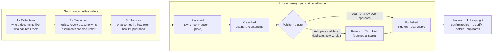
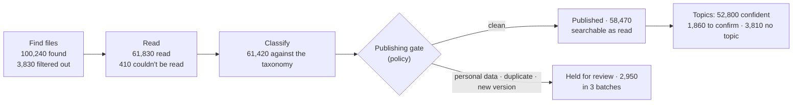

# Knowledge Studio: how knowledge gets in, gets filed and gets published

Knowledge Studio (Manage › Knowledge Studio, `/studio`) is the one place a workspace's knowledge is run. This document owns its concept: the information architecture of Manage and the Studio's sections, the Review queues, the order things are set up in, and how the flow behaves at scale (the 100,000-document walkthrough). The per-document lifecycle — contribute, review, publish, every state and label — is in [DOCUMENT_LIFECYCLE.md](DOCUMENT_LIFECYCLE.md). Reading and using published knowledge is in [KNOWLEDGE_HUB.md](KNOWLEDGE_HUB.md).

## The mental model

> Documents come in from **sources**, land in a **collection** (which decides who can read them), are **classified** against the workspace's **taxonomy**, pass the **publishing gate** (the source's policy or a reviewer), and are **indexed** so people and the assistant can use them.



## Principles

1. **One place for knowledge.** Everything about knowledge — sources and the accounts they read with, collections, the taxonomy, review, the document registry — is one destination. People, the assistant, audit and settings are the rest of Manage.
2. **Set up in the order the flow needs it: where → how it's filed → what comes in.** A source needs a destination (a collection) and should not start before the taxonomy exists, or tens of thousands of documents arrive unfiled.
3. **Access is configured, never inferred.** Each source lands in exactly one collection, and that collection's access rules decide who reads its documents. The assistant classifies; it never decides who can see something. Content with different audiences comes in through different sources.
4. **The publishing gate is about risk; classification is about findability.** Review answers *should this be published?* (personal data, duplicates, new versions, untrusted feeds). Classification answers *where do people browse it?* and is corrected after publishing without holding anything back.
5. **One workbench for everything that needs a person.** Review is the only place a person decides: publishing decisions and keeping published knowledge right are queues of one workbench, never separate sections. Overview shows the same counts as Knowledge health, each linking to its queue.
6. **Every origin converges.** Source syncs, editors' uploads (*Add documents* in Documents) and members' contributions enter the same flow: Review, then Documents.
7. **At scale, people decide batches, not documents.** A 100,000-file sync produces a handful of decisions — one per reason or per suggested topic — each with a sample.
8. **An account is a source's credential, not a destination.** It is created inside the Add source wizard, reused when adding the next source, and fixed by *Reconnect* on the rows of the sources that use it when it expires.
9. **One badge, one landing.** The sidebar badge counts what Knowledge Studio opens on: the decisions To publish, else what's broken in sources, else access requests an owner decides.

## Information architecture

```text
Manage
├── Overview            what needs you across the workspace; the next unfinished setup step (the full guide only in an empty workspace)
├── Knowledge Studio    /studio — sections are sidebar sub-rows under this row
│     daily work ─ Review · Documents
│     setup ────── Collections · Taxonomy · Sources        (in setup order, after a small gap)
│                    └ Sources views: Sources · Sync history · Accounts
│     └── one collection: /studio/collections/:id ─ Access · Sources · Settings
├── People · Assistant · Activity · Settings
```

Old routes redirect: `/sources` → `/studio?tab=sources` (`?tab=history` → `&view=history`), `/connections` → `/studio?tab=sources&view=accounts`, `/bases` → `/studio?tab=collections`, `/bases/:id` → `/studio/collections/:id` (query kept), `/documents` and `/knowledge-health` → `/studio`. Renamed tabs: `tab=all` and `tab=library` → `tab=documents`; `tab=master` and `tab=topics` → `tab=taxonomy`; `tab=quality[&seg=x]` → `tab=review&queue=x` (no segment → the first To keep right queue with items). Redirects chain, so `/documents?tab=all` lands on Documents; the Studio also aliases old tab ids (`tabOf`) for links the router doesn't see.

| Section | Decides | Who sees it | Top-row action |
| --- | --- | --- | --- |
| Review | Everything that needs a person, in queues: what to publish, and what to keep right after publishing | Reviewers (owners of a collection; workspace admins own all) | None (the decision bar is the primary) |
| Documents | The one administrative registry of every document whatever its origin: where it is in the flow and who sees it | Reviewers | Add documents (primary) |
| Collections | Where documents live and who can read them (the access boundary) | Owners and editors of a collection; workspace admins | New collection |
| Taxonomy | The topic tree documents are filed under and the words that recognise each topic: domains → topics with keywords and synonyms, descriptions, guidance for the assistant, optional rules and examples; proposed topics | Workspace admins | Import |
| Sources | What comes in, from which account, how often, into which collection, under which publishing policy; sync history; accounts | Source admins (`source.manage`) | Add source |

There is no tab bar. While you're in the Studio (`/studio?tab=…`, or a collection page `/studio/collections/:id`, which marks Collections) and the sidebar is expanded (also off-canvas on tablet/phone), the Manage → Knowledge Studio row shows its sections as sub-rows: Review · Documents, a small gap, then Collections · Taxonomy · Sources — only the ones the caller may use (`X.studioTabs`, built by `X.studioNav()` in `features/curation.js`). Sub-rows render only when a row has ≥ 2 sections (`navKids` in `core/shell.js`): someone with only Collections (Finx engineer) sees no sub-rows and a page titled "Collections". On the collapsed icon rail the row is a button opening a menu to its right (`MENUS['nav-sub']`) with the sections, their counts and the current one checked; Esc returns focus to the rail button. ⌘K's Go to finds sections too ("Taxonomy" · Knowledge Studio). A new Studio feature adds one sidebar row, not a tab: the sidebar scales vertically, a tab bar does not. People, Activity, Settings and the console's Indexing follow the same rule ([DESIGN_SYSTEM.md](DESIGN_SYSTEM.md#layout--styleslayoutcss)).

The top-row title is the section name (Review, Documents, Collections, Taxonomy, Sources) with the *Demo data* chip and the section's one action; no "Knowledge Studio" crumb. A collection page keeps its trail Knowledge Studio › Collections › name; the Reader for a submission is trailed Review › title. *Add documents* opens the contribute dialog; editors' uploads still go through Review. An empty Review queue offers *See all documents*. The page opens on what needs the caller: Review if a queue has items, else Sources if something is broken, else the first section. The Studio page is a workbench, wider than reading pages (`.page--studio`, up to 1680 px) with a tight header: title and action, no description (the sidebar says where you are).

**Counts.** Each sub-row counts what waits on the caller: Review the To publish decisions (submissions + open sync batches, each batch once, + publishing problems; accent), Collections access requests the owner decides, Taxonomy proposed topics, Sources broken sources and accounts (failed syncs + expired accounts; danger). While sub-rows show, the parent row's single badge is hidden. Otherwise (collapsed group, other pages, rail) the one badge counts the To publish decisions, else source problems, else access requests the owner decides. To keep right counts show only on the queue chooser (Topics to confirm counts documents).

## Review: one workbench, seven queues

A queue chooser (one row of pills with counts, the To publish and To keep right groups split by a hairline; a select on phones) picks the open queue with `?queue=`. The default is the first queue with items; a queue with nothing in it hides unless it's open, and the chooser hides when only one queue has anything. After the last decision you stay on the queue; its empty state offers *Next: {queue}*. *You're all caught up* shows only when every queue is empty.

**The Submissions workbench** fills the screen under the chooser (no page scroll), in three panes that each scroll on their own: the **queue** · the **document** (its first page at reading size, *Open full preview*) · the **inspector** (who sent it, where to and when · J/K; the note to reviewers and what the assistant found as compact rows — possible duplicate with Compare and the *Publish as a new version* switch, personal data, new version, can't be searched; the **Classification** fields, label above control; and the decision footer pinned at its bottom: "Publishes to {collection} · {audience}", Approve & publish, Request changes, Decline). Without room for a readable document pane (Studio page under 1140 px) the document pane gives way and an eye button in the inspector header opens the preview; a wide inspector puts its footer on one row. Phones show the queue, then the inspector full screen with Back and a floating decision bar. **Sync batches** use the same queue and inspector, without a document pane: why they were held, who would see them, a five-title sample, and the batch's two decisions.

| Group | Queue (`queue=`) | What's in it | Decision |
| --- | --- | --- | --- |
| To publish | Submissions (`submissions`) | Documents held for a person: member contributions, editors' uploads, review-first syncs | Workbench: queue · document · inspector (Classification editable inline), Approve & publish · Request changes · Decline; bulk approve with Undo |
| | Sync batches (`batches`) | First-sync files held by reason (duplicates, personal data, new versions) | One decision per batch, with a sample and Undo; no selection |
| | Publishing problems (`problems`) | Couldn't publish, changed at the source, waiting to publish | Each row shows its fix; selected rows get one bulk *Publish* (retries too; password-protected files are skipped with a message) |
| To keep right | Topics to confirm (`confirm`) | Published from a first sync with a low-confidence topic or none; grouped by topic | Confirm topic · Move · Create topic & tag, with Undo; counts documents |
| | Re-verification due (`reverify`) | Verification expired or never happened | Verify, in bulk |
| | Missing details (`details`) | No topic, owner or summary | Add the detail |
| | Possible duplicates (`duplicates`) | Near-identical documents that compete in answers | Compare, keep one, archive the other |

Selection and the floating bulk bar work wherever a list allows it; J/K moves through Submissions and Sync batches. Legacy links: `queue=quality` (and the old `seg=`, Knowledge health `tab=details|duplicates`) open the first To keep right queue with items.

## Documents: the registry

Every document in the collections the caller reviews, whatever its origin. A flow strip (In review › Publishing › Published · Needs attention · Not published) filters by stage; the table shows Name (with collection and topics), **Origin** (the source, Contributions or Uploads), Owner, Lifecycle, Updated and an actions column wide enough for the longest fix (*Publish update* + ⋯). There is no Visibility column: who can read a document is its collection's audience, shown on the collection. Filters, shown once they would split the list: Collection, Origin (`?src=contrib` for contributions), Type, Topic. Bulk Publish · Unpublish · Archive. A row opens the document drawer (Progress, History, Details with version). Fixing several problems at once happens in Review → Publishing problems.

## Overview → Knowledge health

The Studio has no metrics tab. Overview shows one row of seven metrics for the collections the caller reviews — Waiting for review (submissions + sync batches), Publishing problems, Topics to confirm, Re-verification due, Missing details, Possible duplicates, Verified (share) — each a link to its Review queue. Knowledge health and Knowledge gaps have no description lines. Overview's *Needs attention* covers what isn't a Review queue: sources, accounts, access, office requests and the next unfinished setup step, so each count lives in one place.

## Collections

The section opens with its toolbar and cards (no intro paragraph). Collection cards show documents, top topics and, when documents from other collections are linked in without copies (`kb.links`, the backend's `item_links`), *n linked*. Contributions converge into the same Review and Documents. A collection's page has page tabs Access · Sources · Settings (views of that one collection) and an **Access requests** section for owners; workspace admins get *Open access requests* → People → Access requests.

**What moved and why**

| Before | Problem | Now |
| --- | --- | --- |
| Knowledge Studio, Collections, Sources and Connections were four sidebar items | One flow split across four places; an expired account showed on Sources (link) and Connections (fix); a collection's page repeated its sources and linked to the Studio for its documents | One sidebar item, Knowledge Studio. Collections, taxonomy and sources are its setup sections (sidebar sub-rows); the collection page lives under it |
| Connections page | Accounts were a destination nobody needs except to fix an expiry | Sources → Accounts view. The wizard signs in; a source row on an expired account carries Reconnect; Overview's item reconnects in place |
| Separate badges on Studio, Sources and Connections | Three counts for one area, two of them for the same root cause | One badge for the landing section; each section's sub-row counts its own work (Sources: failed syncs + expired accounts, danger) |
| No order | New admins didn't know to load topics before connecting a 100k-file drive | The setup guide: Create collections → Load the taxonomy → Add sources → Check the first sync — in full only in an empty workspace, then one Needs attention row for the next step |
| Review, Documents and Quality were three work tabs; Overview repeated their counts with its own shortcuts | Publishing decisions and upkeep lived in different places; the same number showed in three | One Review workbench with To publish and To keep right queues; Documents is the registry; metrics moved to Overview → Knowledge health, each linking to its queue |
| A sticky tab bar Review · Documents │ Collections · Taxonomy · Sources | A tab bar doesn't scale as features are added, and repeated the sidebar's job | Sections are sidebar sub-rows of Knowledge Studio, each with its own count |
| Master data tab with a topic drawer | Topics were a list of keywords; nothing explained or tested classification | Taxonomy: a tree beside an editable detail with synonyms, examples, guidance, rules and a test box ([DOCUMENT_LIFECYCLE.md](DOCUMENT_LIFECYCLE.md#taxonomy-and-classification)) |

## The setup guide

The full four-step *Set up knowledge* checklist (`X.setupGuide()`, workspace admins) shows only on Overview of a workspace with nothing set up yet (the prototype's *Empty* state, where it is the whole Overview, every step to do). Once any step is done it is never a block on any page, Studio setup sections included, and there is no progress bar or "n of 4 done" line. Instead Overview → *Needs attention* shows one row for the next unfinished step (`X.setupNext`), with the step's action (New collection · Import taxonomy · Add source · Open Sources). For the taxonomy step the row is named by what's missing — "n topics without keywords · Documents aren't filed under a topic until it has words to recognise it by" — with **Add keywords** → `/studio?tab=taxonomy&show=bare` (Northwind: taxonomy not loaded yet, so step 2 is next).

| Step | Done when | Why here |
| --- | --- | --- |
| 1 · Create collections | A shared collection exists | Every source and upload needs a destination, and the destination decides access. Make one per access boundary: a team, a function, the whole company (Everyone) |
| 2 · Load the taxonomy | Imported once, or ≥ 80 % of topics have keywords | Classification happens as documents arrive; loading topics after a 100k sync means re-classifying everything |
| 3 · Add sources | A source exists | Now each source has a collection to land in and topics to be filed under |
| 4 · Check the first sync | A source has synced | Look at what was held for review and what has topics to confirm, then let the schedule run |

## Configuring a source

The Add source wizard: **App → Account → Content → Destination**. Accounts are created here; Sources → Accounts lists them (Connect account; an account's ⋯ *Add source with this account*) and an expired one is fixed by *Reconnect* on the rows of the sources that use it, or the Overview item. An expired account no source uses shows in the views control label: "Accounts · n expired".

**Add source** is the one verb everywhere (Sources header, "No sources yet" empty states, a collection's Sources section, ⌘K). Once accounts are connected it is a menu: *Use a connected account* (each account → the wizard opens at Content with that account, and from a collection that collection, preselected) · *Connect another account…* (the wizard from the app). A collection never picks an existing source: a source is one connection + folders + **one** target collection, fixed at creation (`Source.targetCollection` is immutable, `backend/docs_design/api_design.md`), so it can't feed a second collection; what is reused is the account. In Content, folders or spaces another source already syncs are disabled with "In {collection}" (tooltip "{source} already syncs it"): their documents are already in that collection; to show a document elsewhere, link it rather than adding a second source.

| Setting | Options | Defaults and rules |
| --- | --- | --- |
| Account | An existing sign-in for the app, or sign in now | The account is saved for the next source; it's listed in Sources → Accounts |
| Content | Folders, spaces or pages in a tree | Select whole folders; the estimate updates live |
| Filters (disclosure on the Content step) | File types as chips (PDF, Word, Excel, PowerPoint, Email; Images & video off) · *Skip folders named* (default "Archive old, Personal", matched against any folder on the path) · *Only files changed since* (Any time / 2018 / 2020 / 2023) | Saved on the source as `{ types, exclude[], since }`, shown as one line under *What it syncs*, editable via *Change what's synced*. Estimate line: *About N files · M filtered out (reason n, …) · K to sync*; filters that leave nothing block Continue with an inline error. Above 10,000 files a *Large source* hint estimates the hours at 118 files/min, and the source starts with a first sync at scale |
| Collection | One collection (or create one) | One source → one collection. Content for different audiences = different sources |
| Schedule | Manual · daily · weekly, time, time zone | Daily at night by default |
| Publishing policy | Publish automatically · **Review only what's uncertain** · Review everything | Size-based default: *Review only what's uncertain* above 1,000 files to sync, *Review everything* otherwise; it follows the selection until the person picks one (*Suggested for a source this large/small*). Changing a source's policy later toasts with Undo |

**Publishing policies**

| Policy | Publishes | Holds for review | Use for |
| --- | --- | --- | --- |
| Publish automatically | Everything, after each sync | Nothing | Trusted systems an admin curates (policy library, LMS) |
| Review only what's uncertain | Clean, classified files; changed published files republish | New files with a risk flag — personal data, ≥ 0.55 similar to a published document (likely duplicate), a likely new version — as submissions; at scale grouped into batches by reason | Large or mixed sources; the default at scale |
| Review everything | Nothing until approved | Every new or changed file, one submission each | Small or untrusted feeds (a website, a shared inbox) |

Classification confidence never holds a file back under any policy: a file filed with low confidence, or without a topic, is published and listed in Review → Topics to confirm.

**The Sources list** has no alert banners above it. Each row carries its own fix as its one visible row action, in priority: first sync *Pause*/*Resume* · *Cancel* (syncing) · **Reconnect** (account expired) · **Retry** (failed) · *Resume* (paused) · **Publish n** (synced files waiting) · a quiet *Sync now* icon (healthy). There is no *Publish all* bulk action. An expired account no source uses shows in the views control label ("Accounts · n expired").

## The 100,000-document walkthrough

Finx Workspace's demo seeds this case: the source **Operations archive** (SharePoint → Banking Operations, policy *Review only what's uncertain*) in its first sync.

### 1. Before the sync

1. **Collection** — *Banking Operations* exists, general access *Everyone*: when its documents publish, everyone in Finx can find them.
2. **Taxonomy** — imported with keywords per topic (`OPS-03 Cards & disputes: chargeback, dispute, card scheme…`).
3. **Source** — the archive folders, filtered to PDF, Word, Excel, PowerPoint and email, skipping *Scans to sort* and *Personal*, changed since 2018. The wizard's estimate: about 100,240 files · 3,830 filtered out (2,900 images and videos, 930 not changed since 2018) · 96,410 to sync.

### 2. The first sync (backfill)

One ingestion run, counted per stage, never simulated file by file.

**Sources row.** The status cell shows a *First sync* chip, a progress bar and `read/total` (*62k/96k*); the row action is Pause, or *Resume* when paused. *Sync now* and *Cancel* are blocked meanwhile; disconnecting the account pauses it and reattaching resumes it. The collection's Sources section shows the same chip.

**Source drawer.** A *First sync* card: percent, files read, ETA, held for review, *View progress*. Next sync reads *After the first sync*; the footer is *Pause / Resume first sync*.

**Run drawer** (Sync history → the run): a progress card with throughput and ETA (remaining = found − filtered − read), then the pipeline:



- **Issues by error class, each with its fix**: 120 password-protected (remove the password at the source), 210 scanned without text (OCR is a platform policy), 80 larger than 100 MB.
- **Classification split** as a stacked bar (confident · to confirm · no topic) with *Confirm topics* → `/studio?tab=review&queue=confirm`.
- **Held for review**: the open batches by reason with *Open review* → `/studio?tab=review&queue=batches`, plus a declined count once batches are declined. Both links close the drawer first.
- Footer: *Open source* · *Pause / Resume*; a paused run shows a *Paused* chip. Pause toggles run `paused`/`running` and source `paused`/`syncing`, with Undo.
- **Tick** (prototype): every 3 s, only while the Sources section or a source/run drawer is visible, about rate/20 files are added to read, classified, published and confident topics. Review and topics to confirm stay fixed so they keep matching the batches and topic groups. At the end the run completes, the source turns healthy and a toast says so.

Counters keep one invariant: **classified = published + review + declined**; topics (confident + to confirm + no topic) are counted for published files.

### 3. What people decide (minutes, not months)

**Review → Sync batches.** Each batch is one decision and counts once in the Review sub-row, the sidebar badge, Knowledge health and the landing rule. Batches have no checkbox (each is already one decision); J/K moves through them.

**Batch detail** (the inspector, beside the batch queue): reason, count, source → collection, when it was held, why they were held, the audience (*Everyone in Finx Workspace would see them once published*), five sample titles, and a decision footer per reason:

| Batch | Decisions | Counter change on `run.backfill` (Undo reverses) |
| --- | --- | --- |
| 2,140 possible duplicates | *Keep the published ones* (declined) · *Publish them too* | Decline: review −n, declined +n · Approve: review −n, published +n, topics.confident +n |
| 610 with personal data | *Keep unpublished* · *Publish anyway…* (dialog naming who would see them; still has Undo) | as above |
| 200 possible new versions | *Publish as new versions* (replace current) · *Keep current versions* | Replace: review −n, published +n (no topic count, so published ends slightly above the topic sum) · Keep: declined |

**Review → Topics to confirm** (`queue=confirm`) is for editors and admins of the group's collection; its count is every document in open groups, including no topic.

| Card | Shows | Actions | Counter change |
| --- | --- | --- | --- |
| Topic group (Cards & disputes 940, Reconciliation 520, Payments & settlement 400) | Topic, code, domain, count, confidence range, matched keywords, sample disclosure | *Confirm topic* (secondary) · ⋯ → *Move to another topic…* (same domain first), *Edit topic keywords…* (admins) | topics.confirm −n, topics.confident +n |
| No topic (3,810) | The assistant's recurring themes with keywords (Merchant onboarding 1,240, Branch operations 980) | *Create topic & tag* (workspace admins): creates the topic under Banking Operations with the next free code and the keywords, or reuses one of that name; then *N still without a topic — add keywords in Taxonomy* | topics.none −n, topics.confident +n |

Every decision writes an audit entry, toasts with Undo, opens the next entry and updates the same counters everywhere (Sources row, run drawer, Review queues, Knowledge health, the Documents flow strip, whose *In review* tooltip says first-sync batches are decided in Review and aren't listed). A topic created this way shows *Unused* in Taxonomy, because usage counts real documents.

### 4. After the first sync

Scheduled syncs read only changes. New and changed files go through the same gate; a changed file that is already published becomes a *new version* (held only under *Review everything*, or when flagged). Review's To keep right queues keep the long tail healthy: topics to confirm, re-verification, missing details, duplicates.

## Decisions and why

| Decision | Why |
| --- | --- |
| Collections, Sources and Connections fold into Knowledge Studio | They are steps of one flow. One place, one badge, no alert that points elsewhere for its fix |
| Setup tabs are ordered Collections → Taxonomy → Sources | That is the dependency order: destination and access first, filing scheme second, intake last |
| Accounts are a view of Sources | An account only matters as what a source signs in with; it is created in the wizard and fixed from its sources' rows |
| A third policy, *Review only what's uncertain* | Reviewing 100,000 files one by one is impossible; publishing them all unchecked leaks personal data and duplicates. Holding only risky files, in batches, is both safe and finishable |
| Classification never blocks publishing | A wrong topic misfiles a document; it doesn't expose it. Access comes from the collection, so filing can be fixed afterwards, in bulk |
| One source → one collection; the AI never places documents | Placement is access. Mixing audiences in one source would make the assistant an access-control system |
| One Review workbench with queues instead of Review + Quality tabs | A person decides in one place; counts appear once (chooser) and are summarised once (Knowledge health) |
| Sync batches and Publishing problems are their own queues | Submissions lists documents only; a batch is already one decision; problems share one fix (Publish) |
| Batches by reason (Sync batches) and groups by topic (Topics to confirm) | Each answers one question with one decision; a sample makes the decision trustworthy |

## Backend alignment and open decisions

- **Matches `backend/docs_design`:** Source → one target collection; `publishingPolicy` per source; ingestion runs are explicit and record tasks per item with error classes; approval never starts ingestion (the UI chains approve + run); topics are a two-level taxonomy.
- **Needs backend design** (the prototype doesn't change `backend/docs_design`):
  - `publishingPolicy` gains `REVIEW_EXCEPTIONS` (*Review only what's uncertain*): publish unless a risk flag is raised; flagged files open SOURCE contributions.
  - Source filters (file types, excluded paths, modified-since) and a validate-only estimate (`sources:estimate` or `validateOnly` on CreateSource).
  - Run stage counters at scale (found, filtered by reason, read, classified, published, held, declined) and error classes with counts; pause/resume of a run.
  - Review batches: grouping open SOURCE contributions of one run by flag, with bulk approve/reject (`contributions:batchApprove`-style custom methods).
  - Classification confidence per document and bulk topic confirmation/move; proposals derived from untagged clusters.
  - Topic `code` and `keywords[]`, taxonomy import/export (see DOCUMENT_LIFECYCLE.md).
  - Topic classification signals beyond keywords: `synonyms[]`, `rules[]` (source · folder path · file type; is/contains), `examples[]` (document ids) and free-text `guidance` for the assistant; import/export columns `synonyms, guidance`.
  - Contributor-confirmed metadata on `CreateContribution`: the chosen collection plus the confirmed type, topics and summary (`confirmed`, `kbBy: CONTRIBUTOR`), so review shows what the contributor confirmed rather than re-running suggestions.
  - Review queue aggregation: counts per queue (submissions, batches, publishing problems, topics to confirm, re-verification due, missing details, possible duplicates) for the caller's collections, for the chooser, the badge and Overview → Knowledge health — one endpoint instead of client-side counting.
  - Linked documents on a collection (`item_links`) surfaced as a per-collection count.
