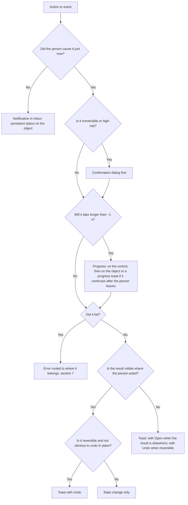

# Feedback design system

The single source of truth for **how BoMesh responds to what people do**: which feedback channel to use, how each behaves, how long it stays, how it updates, and how people recover. The words inside every message follow [product-language-guidelines.md](product-language-guidelines.md); translation mechanics follow [localization-standards.md](localization-standards.md). This document supersedes DESIGN_SYSTEM.md rules 4, 5, 8 and the Toast row, which now point here.

Grounding: current behavior is documented in [product-ux-audit.md](product-ux-audit.md) §3; external sources (Atlassian, Fluent 2, Polaris, Material 3, NN/g, WCAG/APG) are cited inline where a number comes from them.

## 1. Principles

1. **Feedback reflects the latest meaningful state, not every event.** A run that goes queued → running → 40% → done is one evolving surface, not four toasts.
2. **Quiet by default.** If the person can see the result where they acted, the visible change *is* the feedback. No toast.
3. **One channel per outcome.** An action ends in exactly one primary feedback surface (plus a screen-reader announcement). Never a toast *and* a banner *and* an inline message for the same thing.
4. **Never claim what hasn't happened.** Success appears after the server confirms, unless the interaction is a designed optimistic one with rollback (§6).
5. **Every problem has a way forward** (Try again, Open, Undo, Ask an owner). DESIGN_SYSTEM rule 7.
6. **Reversible beats confirmed.** Undo for reversible actions; confirmation only for irreversible or high-risk ones (§5).
7. **Feedback is accessible**: announced without stealing focus, never color-only, never gone before it can be read or acted on.

## 2. Channels

| Channel | What it is | Web implementation today | Preview |
| --- | --- | --- | --- |
| **None** | The action's effect is self-evident (opening, navigating, typing, filtering) | — | — |
| **State change** | The control or object changes in place: Save → Saved, toggle flips, chip changes, row moves | Component state | Same |
| **Inline message** | Text attached to a field, form, dialog, section, row or card: validation, section message, row status | `FieldError`, `Callout` (`components/ui/Callout.tsx`, `role="alert"` for danger, `status` otherwise) | `.field-error`, `alertBox()` |
| **Toast** | A transient note about an action's result, bottom-end, optionally with one action | `toast()` in `components/ui/Toast.tsx` over HeroUI/React Aria (max 3) | `toast()` in `scripts/core/overlays.js` |
| **Progress** | Pending, determinate or indeterminate progress on the control, region or object | `isPending` on Button, `SkeletonRows/Cards`, `ProgressBar`, Processing strip | `.skeleton`, `.proc-strip` |
| **Persistent status** | A status that lives on the object until it changes: processing state, sync state, "changed at the source" | `StatusChip`, `ProcessingSteps` | `lifeChip()`, `status()` |
| **Banner** | A page- or app-level condition that persists until resolved: offline, workspace paused/read-only, session about to expire | Page-level `Callout` (ad hoc) | `alertBox()` at page top |
| **Confirmation dialog** | A modal decision before an irreversible or high-risk action | `confirm()` (`components/ui/Confirm.tsx`) + `ConfirmDialog.tsx` | `cur-decide`-style modals |
| **Error state** | A region or page that couldn't load, replacing its content, with Try again | `ErrorState`, `NoAccess`, `NotFoundState`, `ModuleOff` | `errorState()` |
| **Notification** | An event that happened without the person's immediate action (someone approved, a run finished) | Inbox (`modules/inbox`) | Inbox |

## 3. Decision framework

Decide by five questions, in order. The first match wins.

### 3.1 Decision matrix

| Severity | Reversible | Duration | Needs attention | Channel | BoMesh examples |
| --- | --- | --- | --- | --- | --- |
| Trivial | — | Instant | No | None / state change | Filter, sort, open a document, expand a group, switch tab |
| Low | Yes, in place | Instant | No | State change | Save/unsave a document, pin a conversation, mark read, toggle a switch in Preferences |
| Low | Yes | Instant | No, but the effect leaves the screen | Toast + Undo | Archive a collection, remove a document from a space, move documents, delete a conversation, decide a contribution |
| Low | — | Instant | Result is elsewhere | Toast + Open | Contribute a document ("Open" its contribution), create a work item |
| Medium | — | 1–10 s | Yes, while waiting | Progress on the control → state change or toast | Save a settings form (save bar "Saving…" → "Saved"), upload one file, share a conversation |
| Medium | Stop | > 10 s or batch | Glanceable | Persistent progress (strip/row) + one completion toast if the person is elsewhere | Process 1,000 documents, sync a source, first sync |
| High | No | Instant | Yes, before | Confirmation dialog → toast | Delete permanently, remove your own access, archive a workspace |
| Failure (input) | — | — | Yes | Inline at the field | Missing title, invalid email, too long |
| Failure (action) | — | — | Yes | Inline where it happened, else persistent toast with Try again | Dialog submit fails, row action fails, upload fails |
| Failure (load) | — | — | Yes | Error state in the region | Documents didn't load |
| Condition | — | Ongoing | Yes | Banner | Offline, workspace paused, read-only, session expiring |
| External event | — | — | Depends | Notification + persistent status | Someone approved your contribution, a run finished, access request decided |

### 3.2 Things that never get a toast

- Navigation, opening, closing, selecting, filtering, sorting, searching.
- A change already visible where the person acted (Save → Saved, a toggled switch, a renamed title shown in place, a form with a save bar).
- Validation of input (it is inline).
- "Copied" when the copy control itself changes state (icon → check for 2 s). A toast "Copied" is allowed only when the control doesn't change.
- Undo itself: undo restores **silently** (the restored object is the feedback).
- Loading states.

## 4. Toasts

### 4.1 Tones

| Tone | Use | Icon | Default duration |
| --- | --- | --- | --- |
| `success` | A completed change the person caused | Check | 6 s |
| `accent` (info) | Neutral information about the action: "Already in Saved", "Processing started" | Info | 6 s |
| `warning` | The action completed with a caveat, or a recoverable problem the person should notice: "Moved 10 of 12 documents. 2 are in another run." | Alert | **Persistent** |
| `danger` | The action failed and the failure has nowhere inline to live | Alert | **Persistent** |

The current wrapper defaults (`Toast.tsx:36`: 4 s plain, 8 s with an action, danger also 4 s) change to the values above. Basis: Atlassian (8 s auto-dismiss, never for errors or warnings), Fluent (7 s), Polaris (5 s; ≥ 10 s with an action), M3 (4–10 s; actionable snackbars persist).

### 4.2 Content and actions

- Message: the success pattern or error pattern from [product-language-guidelines §4.9–4.10](product-language-guidelines.md#49-success-messages). ≤ 60 characters for the title; optional one-line description.
- **At most one action**: Undo, Open, Try again, or a specific verb ("Show sources"). Never OK, Got it, Dismiss (the close button already dismisses).
- Toasts with an action stay **10 s**, pause on hover/focus/background tab (HeroUI does this), and the action must also be **reachable elsewhere** (deleted items via *Show deleted* / undelete, versions via History, runs via Processing). If it can't be, the toast is persistent.

### 4.3 Placement, stacking and limits

- Bottom-end, 360 px wide; full width at the bottom on phones; above the composer on chat threads (current `ToastHost`, `components.css .toast-region`).
- **At most 3 visible**, newest on top. A fourth evicts the oldest *non-actionable* toast; toasts with Undo or Try again are not evicted while their window is open (**Change**: today the oldest is evicted regardless — `B5` in the audit).
- **Bulk results collapse into one toast**: "Moved 12 documents", never twelve "Moved …".

### 4.4 Deduplication and replacement (`key`)

Every toast about a subject carries a **key** (e.g. `run:{id}`, `doc:{id}:archive`, `chat:busy`). A new toast with the same key **replaces** the visible one in place (same position, timer restarted) instead of stacking.

| Situation | Behavior |
| --- | --- |
| The same action repeated quickly (double press, retry loop) | Replace; never two identical toasts |
| Loading → result | One toast that updates: "Uploading 3 files…" → "Uploaded 3 files" or → "2 of 3 files uploaded. 1 failed." with Try again |
| Undo of an action whose toast is visible | Close the toast; restore silently |
| A newer state supersedes an older one (archived then restored) | The latest state replaces the toast; obsolete Undo disappears |
| The same error from several parallel requests | One toast, counted when useful: "3 documents couldn't be moved. Try again." |

### 4.5 State-aware updates

A toast describes **current** state. If the subject changes after the toast appears (the run finished, the item was deleted by someone else, the person undid it), the toast updates via its key or closes. A toast never offers an action that is no longer valid (Undo after the window closed, Open on a deleted object).

### 4.6 Accessibility of toasts

- HeroUI v3 toasts are React Aria toasts: a `region` landmark, each toast `role="alertdialog"` with `role="alert"` content (verified in `node_modules/react-aria/dist/private/toast`). Every toast is announced assertively and is reachable with F6. This is the library's deliberate pattern; BoMesh keeps it and **compensates by keeping toast volume low** (§3.2) rather than forking the component.
- Success that is visible in place is announced through a polite live region on that surface (`role="status"`), not a toast.
- Toast actions are keyboard-reachable (F6 to the region, Tab to the action). Persistent toasts have a close button.
- When a focused toast closes, focus returns to where it was before (the preview moves it to `#main`; web inherits React Aria's restoration).

## 5. Destructive actions, Undo and confirmation

### 5.1 The rule

| Action class | Pattern | Examples |
| --- | --- | --- |
| Reversible (state can be restored) | **Act immediately + Undo toast.** No dialog. | Archive, Unpublish, Remove (from a space, a folder, a filter, a project), Delete (soft, restorable), Withdraw, Decline/Approve (inside the decision window), Suspend, Move, Restore a version, Disconnect an account when sources remain intact |
| Irreversible, or others depend on it, or it affects someone's access | **Confirmation dialog**, then a toast without Undo | Delete permanently, delete a collection with documents others cite, **remove a member from the workspace** (they lose access at once), remove your own access, remove the last admin path, archive a workspace (typed name) |
| Blocked | **Explain instead of confirming**: an inline message or a dialog whose single action resolves the block | "Disconnect *Drive*? 3 sources still use it" → the right pattern is an inline notice "Remove its sources first" with **Show sources** |

### 5.2 Undo mechanics

Two implementations exist and both stay; choose per action:

| Mechanism | When | How | Current example |
| --- | --- | --- | --- |
| **Commit then reverse** | The API has an inverse (undelete, unarchive, re-add, restore version) | Call the API, show the toast with Undo; Undo calls the inverse and restores silently | `knowledge/operations.ts`, `projects/actions.ts`, `curation/components/useDocOps.tsx` |
| **Hold then commit** | No inverse exists, or the commit notifies others (decisions, sends) | Apply locally, show Undo, commit when the window closes; **flush pending commits on `pagehide`**; a late Undo says "Already sent, so it can't be undone." (accent, not danger) | `curation/decisions.ts holdDecision` |

Rules:
- Undo window = the toast's 10 s, extended while hovered/focused.
- **Undo is silent** (no "Restored …" toast). If Undo fails: roll back the UI to the committed state and show one danger toast with Try again.
- Every hold-then-commit implementation flushes on `pagehide`, sending the requests with `keepalive` (a plain `fetch` started while the page unloads is cancelled, so a reload or closed tab inside the window lost the decision). The held part is one round of requests: nothing runs after the page is gone, so a step another step depends on is saved up front and reverted on Undo (e.g. a new domain for an accepted topic). (**Change**: `useContributionActions.ts remove` doesn't flush.)
- An Undo toast is never evicted by a newer toast (§4.3).

### 5.3 Confirmation dialog behavior

- Copy pattern: [product-language-guidelines §4.12](product-language-guidelines.md#412-confirmation-dialogs).
- `role="alertdialog"`, focus moves into the dialog; **initial focus on Cancel** for irreversible actions; Escape cancels; focus returns to the trigger.
- The confirm button shows `isPending` and the dialog stays open until the server answers; on failure the error appears **inside the dialog** (section message) and the dialog stays open.
- Only one confirmation at a time. A second request while one is open is queued, never silently cancels the first (**Change**: `ConfirmHost` resolves the previous one `false` — audit `B9`).
- Typed confirmation is reserved for workspace archive.

## 6. Optimistic updates and concurrency

### 6.1 Optimistic updates

Allowed **only** for low-risk, high-frequency toggles where the result is visible in place: Save/unsave, pin/unpin, mark read/unread, reorder, toggle a preference.

Requirements:
1. Update the cache in `onMutate`; snapshot the previous value.
2. On error: **roll back** to the snapshot, show one danger toast "Couldn't save “{title}”. Try again." with Try again.
3. On settle: invalidate to reconcile with the server.
4. **Never** show a success toast for an optimistic update.

Everything else waits for the server: the control shows pending; the result appears when confirmed.

### 6.2 Pending state and repeated actions

- Every button that starts a request shows `isPending` and ignores presses while pending (Rule 10 in DESIGN_SYSTEM). Audit `B14` lists actions without a guard.
- Creates pass `requestId` (the API supports AIP idempotency) so a retried or doubled create returns the same resource.
- Toggles are **latest-wins**: a rapid on/off/on sends at most one request in flight per object and settles on the last intent.
- A list refetch that returns after a newer mutation must not overwrite it: mutations cancel in-flight queries for the same key (`queryClient.cancelQueries`) before applying.
- Streaming chat: one answer at a time per conversation; a second send says "An answer is still being written. Wait for it or stop it." (accent, keyed `chat:busy`).

### 6.3 Conflicts and stale data

- `ABORTED` / etag mismatch → inline section message in the editor: "Someone else changed this. Reload to see their changes." with **Reload**. Never overwrite silently.
- An object deleted while open → the page becomes the Not found state; open toasts about it close.
- Cross-tab: language and session changes already sync (`storage` events). Data changes rely on refetch on focus; no toast for changes made in another tab.

## 7. Errors

### 7.1 Routing

| Where the failure belongs | Channel | Behavior |
| --- | --- | --- |
| One field | Inline field error | Appears on submit (or on blur after the field was touched), clears as the person types, `aria-invalid`, focus moves to the first invalid field on submit |
| A form or dialog submit | Section message at the top of the form/dialog | Dialog stays open, input kept, focus moves to the message; field errors also shown when the server returns `fieldViolations` |
| An action on a visible row or card | Inline status on that object (e.g. "Couldn't move") + Try again | A toast only if the object is off-screen |
| A region or page load | Error state replacing the region | Title + one-line reason + **Try again** (pending while retrying); keeps the rest of the page usable |
| A background or off-screen action (upload, processing, export, a toast-initiated action) | **Persistent** danger toast keyed to the subject, with Try again or Open | Also reflected in the object's persistent status |
| The whole app (offline, server unreachable, session expired) | Banner or the session dialog | One at a time; persists until resolved |

### 7.2 What an error says

- Never the raw server `message`, provider text, internal IDs or status codes in the sentence ([language §4.10](product-language-guidelines.md#410-error-messages)).
- Messages come from an **error catalog** keyed by `google.rpc.ErrorInfo.reason` (and `errorClass` for processing failures), with a fallback per status family:

| Status family | Fallback message |
| --- | --- |
| `UNAVAILABLE`, network | "We couldn't reach BoMesh. Check your connection and try again." |
| `PERMISSION_DENIED` | "You don't have permission to do this. Ask a workspace admin." |
| `NOT_FOUND` | "This item isn't available. It may have been moved or deleted." |
| `FAILED_PRECONDITION` | The reason's message; else "This can't be done right now." |
| `ABORTED` | "Someone else changed this. Reload to see their changes." |
| `INVALID_ARGUMENT` | Field errors inline; else "Check the highlighted fields." |
| `RESOURCE_EXHAUSTED` | "Too many requests. Wait a moment, then try again." |
| `UNAUTHENTICATED` | Session dialog (existing `ShellGate`) |
| anything else | "Something went wrong. Try again." |

The raw message is logged (console in development, telemetry if added) for diagnosis.

### 7.3 Retry

- Reads (queries) retry automatically with backoff (React Query default) and then show the error state with **Try again**.
- Mutations **never** retry automatically, except idempotent ones that carry `requestId`.
- Try again re-runs the same request with the same input, shows pending, and on success replaces the error with the result (the error disappears; no extra success toast unless the action normally has one).

## 8. Loading and progress

### 8.1 Thresholds

| Elapsed or expected | Feedback | Basis |
| --- | --- | --- |
| ≤ 100 ms | Pressed/pending state on the control only | NN/g 0.1 s |
| Still pending at ~400 ms | Spinner on the control, or a skeleton in the region (a design midpoint between M3's 200 ms and NN/g's 1 s) | M3, NN/g |
| Expected > 5 s, or a batch | Determinate progress: "3 of 12", percent, or named steps | M3 > 5 s; NN/g batches |
| Expected > 10 s | Add **Stop/Cancel**, and say the person can leave: "You can leave this page. Processing continues." | NN/g 10 s |

### 8.2 Which indicator

| Situation | Indicator |
| --- | --- |
| A button's own request | Button `isPending` (spinner inside, label unchanged); the region stays interactive |
| First load of a list or page | Skeleton shaped like the content (`SkeletonRows`/`SkeletonCards`) — never a centered spinner over a blank page, never the text "Loading…" alone |
| Refetch of loaded data | Keep showing the data; at most a subtle progress line; never a skeleton flash |
| One long operation with known size | `ProgressBar` with "N of M" |
| A background run (processing, sync, first sync) | **Persistent status**: the Processing strip and each row's step track (`ProcessingSteps`), updated in place; Stop available |
| Assistant answer | Streaming text with the work line ("Searched your knowledge"); Stop answering |
| Uploads | Per-file progress in the dialog; if the dialog closes, one keyed progress toast that resolves to the result |

One indicator per group: a batch shows one progress, not one per row plus a global one, except the Processing strip, which summarizes rows the person can also inspect.

### 8.3 Background tasks and completion

- A run started here shows its progress here (strip + rows). If the person is still on the page when it finishes, the strip's final state is the feedback (no toast).
- If the person left, completion is a **notification** in the Inbox only when the run took longer than ~1 minute or had failures (**Proposal**; requires a notification type — see [implementation-plan.md](implementation-plan.md) open decisions).
- Failures inside a run are persistent statuses on the affected documents with their reason and the fix action ("Process again", "Process with Read text in images").

## 9. Banners and section messages

- **Banner** (page or app top): conditions, not events — offline, workspace paused or read-only, session expiring, a deployment-wide incident. One at a time; persistent; dismissible only if the condition is informational; always has the resolving action when one exists.
- **Section message** (inside a page, dialog or drawer): explains a state of that section ("Ingestion is paused for this workspace. New documents wait until it resumes.") or a failed submit.
- Never use a banner for success, upsell or tips.

## 10. Inline feedback and state change

- **Save bar** for multi-field forms: "Unsaved changes" · Discard · Save → "Saving…" → "Saved" (2 s) → hidden. No toast. Errors appear in the save bar and at the fields.
- **Instant settings** (switches, selects that apply immediately): the control's state is the feedback; a toast only when the change affects other people and is reversible ("Spaces turned off for everyone" + Undo).
- **Row actions**: the row reflects the new state (chip, moved, faded with "Archived"); the toast carries Undo when the row leaves the view.
- **Copy**: the icon changes to a check for 2 s with tooltip "Copied"; no toast (**Change**: five copy toasts today).

## 11. Accessibility requirements

| Requirement | Rule | Reference |
| --- | --- | --- |
| Status messages are announced without focus | In-place results use `role="status"`; errors use `role="alert"` (Callout already does) | WCAG 2.2 SC 4.1.3 |
| Live regions exist before content changes | Mount polite/assertive regions once in the shell; update their text | MDN live regions |
| No duplicate announcements | Don't add `aria-live` to elements with `role="alert"` | MDN |
| Actionable feedback is not time-limited | Actions in toasts are also reachable elsewhere; error/warning toasts persist; timers pause on hover/focus | WCAG 2.2 SC 2.2.1 |
| Errors are identified and suggest a fix | Field errors in text with `aria-invalid` + `aria-describedby`; fix-oriented copy | WCAG 3.3.1 / 3.3.3 |
| Dialog focus | Focus in, trapped, Escape closes, returns to trigger; least destructive action focused for irreversible actions | APG dialog / alertdialog |
| Never color alone | Every tone has an icon and words | DESIGN_SYSTEM rule 9 |
| Reduced motion | Toast and progress animations respect `prefers-reduced-motion` | DESIGN_SYSTEM Accessibility |
| Progress | `ProgressBar` has a localized accessible name ("Processing progress"), value text "3 of 12" | — |

## 12. Feedback budget per common action

The reference for reviews: if an implementation produces more feedback than this, it is noise.

| Action | Feedback |
| --- | --- |
| Save / unsave a document | Icon state (optimistic) |
| Edit document details (dialog) | Dialog Save pending → dialog closes → updated details visible. No toast |
| Archive a collection | Toast "Archived “Policies”" + Undo |
| Delete a conversation | Row leaves Recent; toast "Conversation deleted" + Undo |
| Contribute a document | Dialog closes; toast "Submitted for review" + Open |
| Upload to My files | Per-file progress in the dialog → row appears in My files. Toast only if the dialog was closed during upload |
| Process 1,000 documents | Process dialog closes; Processing strip shows progress; rows update; no completion toast if still on the page |
| Approve & publish a submission | Next submission opens; toast "Published “X”" + Undo |
| Add people | Dialog closes; toast "Added 3 people" + Open |
| Change language | Interface switches; toast with Undo (existing preview behavior) |
| Copy link | Icon → check, tooltip "Copied" |
| Assistant answer fails | Inline failed state on the answer with Try again; no toast |
| Settings form | Save bar only |
| Sign in fails | Inline error above the form; field errors where applicable |
