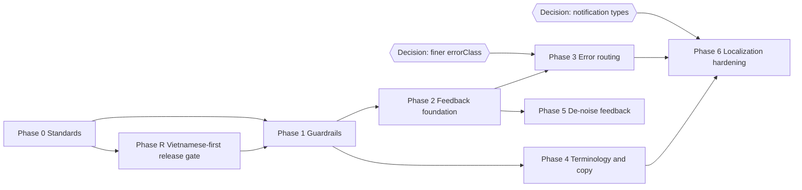

# Product language and feedback: implementation plan

How BoMesh adopts the [product language guidelines](product-language-guidelines.md), the [feedback design system](feedback-design-system.md) and the [localization standards](localization-standards.md), fixing what the [audit](product-ux-audit.md) found, without a rewrite. This file owns architecture decisions, phases, affected files, acceptance criteria and the QA checklist; it never restates rules (it cites them as **PL**, **FB**, **LS**).

## Where each requested deliverable lives

| Section | Document |
| --- | --- |
| A. Executive summary | [product-ux-audit.md §2](product-ux-audit.md#2-executive-summary) |
| B. UX audit | [product-ux-audit.md](product-ux-audit.md) |
| C. Product language guidelines | [product-language-guidelines.md](product-language-guidelines.md) |
| D. Feedback design specification | [feedback-design-system.md](feedback-design-system.md) |
| E. Localization architecture | [localization-standards.md](localization-standards.md) |
| F. Component and engineering standards | this file, §2 |
| G. Migration strategy | this file, §3 |
| H. Implementation roadmap | this file, §4 |
| I. QA checklist | this file, §6 |

## 1. Architecture decisions

| # | Decision | Alternatives rejected | Consequence |
| --- | --- | --- | --- |
| ADR-1 | **Vietnamese-first typed message catalog** (`apps/web/src/i18n/messages/`), default language Vietnamese, server-rendered via the `bomesh.lang` cookie; the legacy English-keyed DOM translator stays only for unmigrated strings (LS §3). *Supersedes the earlier "keep the translator" decision (2026-11-22 review: derived Vietnamese reads like a translation)* | Keep the translator; next-intl / react-i18next / react-intl now | No new dependency; Vietnamese written natively; English typed against Vietnamese keys. next-intl remains the revisit option |
| ADR-2 | **Feedback policy lives in the existing `toast()` / `confirm()` / `ErrorState` components**, extended — not a new notification service | A global feedback service/event bus | One change point; every call site benefits from defaults (durations, tones, dedupe) immediately |
| ADR-3 | **Errors are described by a client-side catalog keyed by `ErrorInfo.reason`** (and processing `errorClass`), with status-family fallbacks; `errorMessage()` becomes catalog-backed | Translating backend messages server-side; showing raw messages | Server text stays English for API clients/logs; UI is fully localized; the backend's job is to attach a reason to every user-facing failure (49 distinct reasons exist today across 268 raise sites) |
| ADR-4 | **A small `useAction()` hook** standardizes pending state, success feedback, Undo and error routing for mutations | Converting everything to React Query `useMutation` (only 16 uses today); a heavy command framework | Incremental: call sites adopt it when touched |
| ADR-5 | **The terminology registry is PL §2 (Vietnamese first) plus the catalog and automated checks** — glossary terms live once in the catalog's `nav`/`state`/`action` areas | Free-text terms per screen | A term change is one catalog line + a retired-term entry |
| ADR-6 | **Preview first** (AGENTS.md): every visible wording or feedback change lands in `apps/ux_preview` (script + `vi.js`) before or with the web change | Web-only fixes | Preview stays the canonical review surface |
| ADR-7 | **No API or schema change for wording.** Contract changes only where text is server-authored: notification type/parameters and finer `errorClass` values | Renaming domain fields to match UI words | Contract work is limited to two additive decisions (§5) |

## 2. Component and engineering standards

### 2.1 `toast()` (extend `components/ui/Toast.tsx`, mirror in `apps/ux_preview/scripts/core/overlays.js`)

```ts
export interface ToastOptions {
  tone?: "success" | "accent" | "warning" | "danger";
  /** Subject key: a toast with the same key replaces the visible one (FB §4.4). */
  key?: string;
  action?: { label: string; onPress: () => void };
  undo?: () => void;
  description?: string;
  /** Override only with a reason; defaults follow FB §4.1. 0 = persistent. */
  duration?: number;
}

const DEFAULT_MS: Record<ToastTone, number> = { success: 6000, accent: 6000, warning: 0, danger: 0 };
const ACTION_MS = 10_000;
const open = new Map<string, string>(); // key → HeroUI toast id

export function toast(message: string, o: ToastOptions = {}): string {
  const tone = o.tone ?? "success";
  const action = o.undo ? { label: "Undo", onPress: o.undo } : o.action;
  if (o.key && open.has(o.key)) heroToast.close(open.get(o.key)!);
  const timeout = o.duration ?? (tone === "warning" || tone === "danger" ? 0 : action ? ACTION_MS : DEFAULT_MS[tone]);
  const id = heroToast(message, { variant: tone, description: o.description, timeout, /* … existing indicator/actionProps … */ });
  if (o.key) open.set(o.key, id);
  return id;
}
```

Acceptance tests (node test on a pure `toastPolicy()` helper extracted from the wrapper): durations per tone/action; same key replaces; Undo label is "Undo"; danger without explicit duration is persistent.

### 2.2 Error catalog (`lib/errors.ts`, new; replaces raw text in `lib/api/client.ts errorMessage`)

```ts
type Described = { message: string; title?: string; action?: "retry" | "reload" | "signIn" | "requestAccess" };

/** English source sentences; the translator localizes them (vi entries in i18n/vi/errors.ts). */
const BY_REASON: Record<string, (m: Record<string, string>) => Described> = {
  NOT_WORKSPACE_MEMBER: () => ({ message: "This person isn’t an active member of this workspace." }),
  LAST_ADMIN: () => ({ message: "Make another person a workspace admin first." }),
  VISION_MODEL_UNAVAILABLE: () => ({ message: "No vision model is set up for this deployment. Process without reading images, or ask a platform admin." }),
  INVALID_CREDENTIALS: () => ({ message: "The email or password is incorrect." }),
  MODEL_STREAM_ERROR: () => ({ message: "The assistant couldn’t answer. Try again.", action: "retry" }),
  // … one entry per reason in backend/docs_design (49 today)
};

const BY_STATUS: Record<string, Described> = {
  UNAVAILABLE: { message: "We couldn’t reach BoMesh. Check your connection and try again.", action: "retry" },
  PERMISSION_DENIED: { message: "You don’t have permission to do this. Ask a workspace admin." },
  NOT_FOUND: { message: "This item isn’t available. It may have been moved or deleted." },
  ABORTED: { message: "Someone else changed this. Reload to see their changes.", action: "reload" },
  RESOURCE_EXHAUSTED: { message: "Too many requests. Wait a moment, then try again." },
};

export function describeError(error: unknown): Described {
  if (error instanceof ApiError) {
    const byReason = error.reason ? BY_REASON[error.reason]?.(error.metadata) : undefined;
    if (!byReason && process.env.NODE_ENV !== "production") console.warn("[errors] no catalog entry", error.status, error.reason, error.message);
    return byReason ?? BY_STATUS[error.code] ?? { message: "Something went wrong. Try again.", action: "retry" };
  }
  if (error instanceof ApiUnreachableError) return BY_STATUS.UNAVAILABLE;
  return { message: "Something went wrong. Try again.", action: "retry" };
}

/** Kept for existing call sites; now catalog-backed (never the raw server message). */
export const errorMessage = (e: unknown) => describeError(e).message;
```

`ErrorState` uses `describeError()` instead of the server message. Processing failures use a parallel `describeProcessingFailure(errorClass)` (after §5 decision 2).

### 2.3 `useAction()` (new, `lib/useAction.ts`)

```ts
const archive = useAction({
  key: (c: Collection) => `collection:${c.name}:archive`,
  run: (c) => archiveItem(ws, c.name),
  success: (c) => ({ message: `Archived “${c.displayName}”`, undo: () => unarchiveItem(ws, c.name) }),
  // errors: "toast" (default, persistent, keyed, with Try again) | "inline" (returns the Described for a Callout/FieldError)
});
<Button isPending={archive.isPending} onPress={() => archive.run(collection)}>Archive collection</Button>
```

Behavior: ignores presses while pending (FB §6.2); success toast only when `success` is given (FB §3.2); Undo silent, rollback + error toast on Undo failure (FB §5.2); errors via `describeError`; `inline` mode for dialogs keeps them open with the message (FB §7.1).

### 2.4 Confirmation (`components/ui/Confirm.tsx`, `ConfirmDialog.tsx`)

- Queue requests instead of resolving the previous one `false` (`Confirm.tsx:46`).
- New option `action: () => Promise<void>`: the dialog stays open while it runs (confirm button pending), shows a `Callout` inside on failure, closes on success.
- Initial focus on Cancel when `tone: "danger"` and the action is irreversible.
- Label defaults removed: `confirmLabel` required (PL §4.12 — never "Confirm").

### 2.5 Inline feedback primitives

- `CopyButton` (new, `components/ui`): icon → check for 2 s, tooltip "Copied", polite status announcement; replaces the five copy toasts.
- `ProgressBar` requires a `label` (accessible name).
- Save bar: shows "Saving…" → "Saved" (2 s) → hidden; the settings toasts are removed.
- A shell-level polite live region (`role="status"`) with a `announce(text)` helper for in-place results that have no visible text change.

### 2.6 Localization tooling (`apps/web/src/i18n/messages`, `apps/web/tests`, `apps/web/src/lib/i18n.ts`)

- `messages/vi.ts` (source) and `messages/en.ts` typed `Messages`; `useMessages()`; `LanguageProvider` fed by the `bomesh.lang` cookie in the root layout; default `vi`.
- `tests/i18n-terms.test.mts`: no retired Vietnamese term (PL §2.7) in the catalog, the legacy `i18n/vi.ts` or the preview `vi.js`; placeholder parity and curly quotes in the legacy dictionary.
- `tests/copy-terms.test.mts`: retired English terms (PL §2.7) absent from JSX text and string literals in `src/modules` and `src/components` (allow-list for comments/identifiers).
- `lib/i18n.ts`: dev-only `reportMissing(text, attr?)` collecting English strings that reach the legacy translator unmatched in Vietnamese sessions; the workspace-names guard from the preview until the translator is removed.

## 3. Migration strategy

1. **Central defaults first, call sites second.** Changing `toast()` durations, `errorMessage()` and `ErrorState` improves all 425 toasts and 157 raw error sites in one change; call-site work then removes what shouldn't be a toast at all.
2. **Seed before switching.** Before `errorMessage()` stops returning server text, generate the reason inventory from `backend/bomesh` (49 reasons) and write catalog entries + VI for all of them; run the app with the dev warning to catch missing reasons on core flows.
3. **Preview first per screen** (ADR-6). Each copy change PR touches `apps/ux_preview` (script + `vi.js`), then `apps/web` (component + `vi.ts`), then tests.
4. **Module by module** for call-site migration, P1 findings first: People → Knowledge/Contribute → Studio → Chat → Work/Requests/Spaces → Settings/Platform/Auth.
5. **Backwards compatible APIs**: `toast(message, options)` keeps its signature; `confirm()` keeps its promise; `errorMessage()` keeps its name.
6. **Behavior-visible changes are announced in release notes** (longer error persistence, removed confirmations replaced by Undo).
7. **No flag days**: every phase ships independently and leaves the product consistent.

## 4. Roadmap



### Phase R — Vietnamese-first release gate (before release)

| Work | Files |
| --- | --- |
| Standard terminology review of every Vietnamese string (≈ 6,300 keys across web and preview), applied to both dictionaries with web/preview parity | `apps/web/src/i18n/vi.ts`, `apps/ux_preview/scripts/i18n/vi.js` |
| Default language Vietnamese (web and preview) | `apps/web/src/lib/i18n.ts`, `apps/ux_preview/scripts/core/i18n.js` |
| Catalog foundation + tranche 1 (navigation, shell, states, Studio and People sections) | `apps/web/src/i18n/messages/*`, `lib/navigation.ts`, `components/shell/*`, `knowledge/model.ts`, `curation/lifecycle.ts` |
| Homographs that one English key can't express resolved in the catalog / preview `inLang`, or by changing the English (PL §2.8 table) | `messages/*`, `features/curation.js`; English renames still open: Open source, Joined, Clear, Lead |
| Retired-term tests: catalog (`messages.test.mts`) and both legacy dictionaries with placeholder and web/preview parity checks (`i18n-terms.test.mts`) | `apps/web/tests/` |

Status: dictionaries, default language, catalog tranche 1, preview homographs and both tests are done. Open before release: the English renames above, the strings listed under "not migrated" (dynamic verification notes, Studio document filters, page descriptions — still translated by the dictionary) and the fluent-reviewer sign-off.

Acceptance: the retired-term test passes on all three Vietnamese sources; a fresh browser (no cookie) opens in Vietnamese with server HTML already Vietnamese for migrated areas; sidebar, Quản trị tài liệu and status chips use PL §2 terms; a fluent reviewer signs off the core flows (§6.2) in Vietnamese.

### Phase 0 — Standards

- Deliverables: the five documents; DESIGN_SYSTEM.md Vocabulary, Language, Rules 4/5/8 and the Toast row point to them.
- Acceptance: each rule has exactly one home; no contradiction between DESIGN_SYSTEM.md and the new documents.

### Phase 1 — Guardrails (no visible change)

| Work | Files |
| --- | --- |
| Dictionary and copy-term tests with baseline allow-lists | `apps/web/tests/i18n-dictionary.test.mts`, `copy-terms.test.mts` |
| Missing-string reporter (dev) | `apps/web/src/lib/i18n.ts` |
| Stale-key and parity report | `apps/web/scripts/i18n-report.mjs` |
| Backend reason inventory | script output committed to `apps/web/src/lib/errors.ts` as the catalog skeleton |

Acceptance: `npm test` fails on a new straight-quote key, placeholder mismatch, retired term, or glossary VI violation; the baseline allow-list is checked in and only shrinks. Outcome: missing strings on the core flows (§6.2) listed.

### Phase 2 — Feedback foundation

| Work | Files |
| --- | --- |
| Toast policy (durations, keys, persistent errors, non-evicted actionable toasts) | `components/ui/Toast.tsx`; preview `scripts/core/overlays.js` (add warning tone, `role="alert"` for danger) |
| Error catalog; catalog-backed `errorMessage`; `ErrorState` uses it | `lib/errors.ts`, `lib/api/client.ts`, `components/ui/ErrorState.tsx`, `i18n/vi/errors.ts` |
| Confirmation queue, in-dialog errors, Cancel focus | `components/ui/Confirm.tsx`, `ConfirmDialog.tsx` |
| `useAction`, `CopyButton`, live-region `announce` | `lib/useAction.ts`, `components/ui/CopyButton.tsx`, shell |
| `ProgressBar` label required | `components/ui/ProgressBar.tsx` + call sites |

Acceptance: no danger/warning toast auto-dismisses; actionable toasts last ≥ 10 s and aren't evicted; a repeated keyed toast replaces instead of stacking; no UI path renders `ApiError.message` (grep + test); all 49 reasons have EN + VI; confirm button pending while its action runs and errors render inside the dialog. Outcome: raw server text in UI 157 sites → 0.

### Phase 3 — Error routing (by module)

| Work | Audit IDs | Files (examples) |
| --- | --- | --- |
| Validation toasts → inline | FB-04, WK-02 | `work/components/WorkItemPage.tsx`, `people/components/useMemberActions.ts`, `workspace-settings/components/SettingsPage.tsx` |
| Chat failures inline on the answer | FB-15, CH-02 | `chat/components/ChatThread.tsx`, `ThreadMessages.tsx`; backend `services/conversations/chat.py` (never forward provider text) |
| Backend messages without IDs; reasons on every user-facing failure | PE-04, AU-02 | `backend/bomesh/iam/policy.py`, `services/collaboration/members.py`, `…/requests.py`, `identity/*` |
| Processing failure reasons | L-04, L-06, KN-12 | `curation/components/ProcessingSteps.tsx`, `knowledge/library/components/FilesSection.tsx`; backend `services/ingestion/executor.py _error_class`, `services/knowledge_items/file_content.py` (after decision 2) |
| Undo failure rollback | FB-12 | listed files |

Acceptance: every error appears where FB §7.1 routes it; no message contains an ID, status code or provider text; failed processing rows read fully in Vietnamese.

### Phase 4 — Terminology and copy (preview first)

| Work | Audit IDs |
| --- | --- |
| P1 wording | SH-04, KN-01, CH-01, PE-01, PE-02, L-01, L-02, L-03 |
| Verbs: Remove/Delete/Unlink/Withdraw, Decline, Try again/Retry/Read again | KN-04, WK-05, ST-14, WK-01 |
| States: Re-verification due, Verification facet, Analyzing → Processing, Processing failed VI, Outdated → Changed at the source, duplicates | KN-02, KN-03, KN-11, ST-08, ST-12, ST-13 |
| Assistant/internals: worker/slot, vision model, AI → assistant, confidence %, SLA, deployment configuration, ellipsis | ST-01–05, WK-03, WK-04, PE-05, PE-06 |
| Search/global: one ⌘K name; ShellGate next step; contribute wording and icon | SH-01, SH-02, KN-05–KN-08 |
| VI normalization: "Không … được", "Hãy", no "thất bại" — done in Phase R for the dictionaries; catalog entries follow LS §9 from the start | L-11 |
| Glossary cleanup in dictionaries (AI Chat, stale keys after review) | SH-03, L-10 |

Acceptance: copy-term and dictionary tests pass with the allow-list emptied for these terms; preview and web show identical labels for each state; Vietnamese review sign-off (§6.4).

### Phase 5 — De-noise feedback

| Work | Audit IDs |
| --- | --- |
| Remove duplicate success toasts (settings forms, copy) | FB-13, FB-14 |
| Reversible confirmations → act + Undo; blocked disconnect → inline notice | FB-07, FB-08, FB-09 |
| Silent Undo; `pagehide` flush for hold-then-commit | FB-06, FB-11 |
| Pending guards on request buttons | FB-17 |
| Inbox decision tone/wording | FB-16 |

Acceptance: the feedback budget (FB §12) holds for each listed action in a manual run; confirm sites only for irreversible/high-risk actions.

### Phase 6 — Localization hardening

| Work | Audit IDs |
| --- | --- |
| Fragments, ternaries, `toLowerCase`, verb injection | L-03, L-09, ST-06, PE-03 |
| Formatter bypasses; `fmtSize` decimals; locale-aware `fmtDuration` | L-08, L-15 |
| Workspace-names guard in web | L-13 |
| Migrate the remaining areas to the catalog (LS §3.3 order) and remove the legacy translator | L-16 |
| Notification localization (after decision 1) | L-07 |

Acceptance: missing-string reporter shows zero unmatched strings on the core flows in Vietnamese; no `toLocaleString("en-US")`; Inbox titles render in Vietnamese.

### Measurable outcomes

| Metric | Baseline (2026-11-22) | Target |
| --- | --- | --- |
| UI paths rendering raw server `message` | 157 toast sites + `ErrorState` | 0 |
| Danger/warning toasts that auto-dismiss | all | 0 |
| `confirm()` for reversible actions | ≥ 4 | 0 |
| Success toasts duplicating visible state | ~15 | 0 |
| Retired terms in source (PL §2.7) | ≥ 10 kinds | 0 |
| VI values with "thất bại" / failure "Không thể" | 21 / ~23 | 0 (allow-listed exceptions documented) |
| Unmatched strings on core flows (VI) | unknown (no reporter) | 0 |
| Notification text localized | No | Yes (after decision 1) |

## 5. Open decisions

| # | Decision | Owner | Options | Recommendation |
| --- | --- | --- | --- | --- |
| 1 | Localize Inbox notifications | Product + backend (`backend/docs_design`) | (a) add `type` + `parameters` to Notification and render client-side; (b) store a locale per recipient and render server-side | (a): additive contract change; keeps one catalog in the client |
| 2 | Finer processing `errorClass` | Backend | Today all `DocumentProcessingError`s become `UNSUPPORTED_FORMAT` (`services/ingestion/executor.py:452-459`). Add additive values: `NO_TEXT`, `PASSWORD_PROTECTED`, `TOO_LARGE`, `TRANSCRIPTION_FAILED`, `UNREADABLE` | Add them; document in `api_design.md` (IngestionTask `errorClass`) |
| 3 | Email invites for unknown addresses (PE-02) | Product + backend | The preview promises them (PRODUCT_FLOW journey 8); web says each person needs an account | Confirm whether the API supports it; if not, record the gap in `backend/docs_design` and keep the web copy truthful (PE-02 interim wording) |
| 4 | Completion notification for long processing runs (FB §8.3) | Product | Inbox notification when > 1 min or failures, vs none | Notify only on failures or when the person left the page |
| 5 | Space role name (WK-04) | Product | "manager" vs "lead" | "Space manager" (matches "manage this space") |

## 6. QA strategy and checklist

### 6.1 Strategy

- **Automated**: dictionary/copy-term tests (Phase 1), toast policy and error catalog unit tests (Phase 2), existing `npm test` and `tsc`.
- **Manual flow runs** in both languages on desktop and 390 px, using the preview for the canonical behavior and the web app for production behavior.
- **Accessibility**: VoiceOver (macOS) and NVDA (Windows) passes on the core flows; keyboard-only pass.
- **Vietnamese review**: a fluent reviewer signs off each phase that changes copy.

### 6.2 Core flows (run in EN and VI)

Sign in → choose workspace → Home → Browse/search → open a document → Save → Ask AI → answer with citations → Update answer → New chat → Contribute a document → Studio: process (with and without *Read text in images*) → review: Approve & publish / Request changes / Decline → Undo → Collections: archive → Undo → People: add people, remove a member → Settings: change and save → Inbox → sign out.

### 6.3 Checklist

**Language consistency**
- [ ] Every label, button, chip and tab on the core flows uses the PL §2 term; no retired term (PL §2.7) appears.
- [ ] Each state has the same label in the preview and web, in chips, filters and drawers.
- [ ] Buttons are verb-first and sentence case; confirmation buttons repeat the title's verb; no OK/Yes/No/Confirm.
- [ ] No "successfully", "please", "sorry", exclamation marks, ASCII `...` or straight quotes in UI text.
- [ ] Every error says what happened and what to do; no IDs, codes or English server text.
- [ ] Empty states have a title, one-sentence reason and at most one action.

**Localization**
- [ ] In Vietnamese, the core flows show no English except product names, file types and content.
- [ ] No sentence mixes Vietnamese and English (check processing failures, inbox, toasts with names).
- [ ] Names inside sentences ("You joined {space}") are never translated, including names equal to UI words ("Home", "Classification").
- [ ] Numbers, sizes, dates and relative times follow the locale (1.234 · 1,5 MB · 22 thg 11, 2026 · 5 phút trước).
- [ ] Short controls fit Vietnamese at 390 px without clipping; diacritics aren't cut.
- [ ] Switching language keeps unsaved form input and updates `<html lang>`.
- [ ] VI style: "bạn", "Hãy", "Không … được", "Đã …"; no "thất bại"; "Gỡ" vs "Xóa" correct.

**Feedback behavior**
- [ ] Trivial actions (open, filter, select, toggle, copy) produce no toast.
- [ ] Save bar forms show "Saving…" → "Saved" without a toast.
- [ ] Reversible actions act immediately with an Undo toast that lasts 10 s and pauses on hover/focus; Undo restores silently.
- [ ] Undo is still available after triggering three more toasts within its window.
- [ ] Irreversible actions confirm first; Cancel has initial focus; the dialog shows pending and keeps errors inside.
- [ ] Danger and warning toasts stay until dismissed.
- [ ] Repeating an action quickly shows one toast (replacement), never a stack of duplicates.
- [ ] A loading toast (upload) turns into its result instead of adding a second toast.
- [ ] Double-clicking a request button sends one request.
- [ ] Optimistic toggles roll back with one error toast when the server fails (simulate offline).
- [ ] Validation errors appear at the field, clear while typing, and focus moves to the first invalid field.
- [ ] Load failures show the region's error state with Try again (pending while retrying).
- [ ] Processing 1,000 documents shows one strip with "N of M", Stop works, finished documents stay processed.
- [ ] Leaving and returning to a running process shows current progress, not a replay of events.
- [ ] Session expiry shows the session dialog without losing the page.

**Accessibility**
- [ ] Results without a visible text change are announced politely; errors are announced assertively; nothing is announced twice.
- [ ] Toast actions are reachable by keyboard (F6, Tab) and readable by screen readers.
- [ ] Dialog focus is trapped, Escape closes, focus returns to the trigger.
- [ ] Status is never conveyed by color alone (icons + words on every tone and chip).
- [ ] Progress bars have meaningful, localized names and values.
- [ ] Reduced-motion users get no toast/progress animation.

**Edge cases**
- [ ] Offline during an action: one error with Try again; input preserved.
- [ ] Concurrent edit (etag conflict): "Someone else changed this" with Reload; nothing overwritten.
- [ ] Object deleted by someone else while open: Not found state; related toasts close.
- [ ] Permission removed while on a page: next action shows the permission message with who can help.
- [ ] Very long names in toasts and confirmations truncate with the full name in a tooltip/title.
- [ ] Zero, one and many counts read correctly in both languages ("No documents yet", "1 document", "3 documents" / "Chưa có tài liệu nào", "1 tài liệu", "3 tài liệu").
