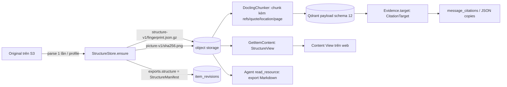

# Báo cáo triển khai: Structured Document và trích dẫn theo nội dung

Ngày: 2026-11-25. Đây là bản ghi lại một lần triển khai, không phải contract.
Nguồn sự thật vẫn là [`backend/docs_design`](../backend/docs_design): kiến trúc
nằm ở `document_contract.md` ("Structured Document"), `document_viewer.md`
("Content view: evidence, not the file") và `openapi.yaml` (`GetItemContent`,
`Citation`). Lý do thiết kế và số đo nằm trong
`rag_review/doc_arch/UNIFIED_DOCUMENT_DESIGN.md`.

Phạm vi theo quyết định của người dùng: chỉ chạy trên máy local, không giữ code
cũ, không shim, không migration. Database local được dựng lại bằng
`make db-reset qdrant-init`.

## 1. Vấn đề và quyết định

Trước đây mỗi nơi cần nội dung tài liệu (ingestion, trích dẫn, đọc tài liệu cho
agent, artifact rendition) đều parse lại file gốc thành các content part phẳng
(`TextPart`, `TablePart` …). Cách này làm mất cây cấu trúc của Docling. Trích
dẫn được tự dựng thành passage, offset và bounding box, lưu trong bảng
`citations`, rồi client phải tìm lại vị trí bằng cách dò text.

Quyết định: mỗi nội dung chỉ được parse **một lần cho mỗi parse profile** thành
một **Structured Document**, tức JSON Docling lưu trên object storage. Mọi bề
mặt khác đọc từ đó. Một trích dẫn chỉ là danh sách id block (`texts/31`,
`tables/0`, `groups/4` …) trỏ vào đúng tài liệu đó.

## 2. Lưu trữ

| Thành phần | Vị trí | Ghi chú |
| --- | --- | --- |
| Structured Document | `derived/{tenant}/{content_id}/structure-v1/{fingerprint}.json.gz` | gzip tất định, immutable, content type `MEDIA_TYPE` |
| Hình ảnh | `derived/{tenant}/{content_id}/picture-v1/{sha256}.png` | được tham chiếu theo tên, không nhúng base64 trong JSON |
| Manifest | `item_revisions.exports.structure` | `version, fingerprint, docling_schema, size_bytes, nodes, pictures, pages`; ghi cho mọi revision có cùng `content_id` |
| Fingerprint | `sha256(ParseProfile)[:16]` | profile gồm `parser_version`, `docling_schema`, `read_images`, `vision_model`; chunking và embedding cố ý không nằm trong profile nên re-index không làm hỏng trích dẫn |

Không có bảng mới. Bảng `citations` bị xoá. `message_citations` đổi cột thành
`item_id, revision_number, structure_version char(16), refs text[], quote,
location, page`. Lý do của từng cột được ghi trong `item_model.md` §5 (dòng 35
và 36).

## 3. Backend

### Package mới `bomesh/document_structure/` (thuần, không có I/O)

| File | Trách nhiệm |
| --- | --- |
| `identity.py` | `NodeRef`, `ParseProfile.fingerprint()`, `StructureRef.key/.picture_key`, `StructureManifest`, `CitationTarget` (`to_json/from_json/key`), `clip` |
| `tree.py` | `DoclingTree`, `block_ref`: quy một node Docling (ví dụ inline group) về block mà người đọc nhìn thấy |
| `nodes.py` | Phép chiếu của BoMesh: `ContentNode`, `ContentRun`, `ContentCell`, `ContentImage`, `ContentWindow`, `NodeKind` |
| `view.py` | `StructureView`: đọc thẳng từ JSON (không validate thành `DoclingDocument`), dàn body thành luồng block, cung cấp `window`, `window_around`, `outline` |
| `codec.py` | `encode` / `decode_json` / `decode_document` |
| `pictures.py` | `externalize_pictures`: chuyển `data:` URI thành PNG đặt tên theo sha256 |

### Service

- `services/knowledge_items/structure_store.py`: lớp `StructureStore` với các
  phương thức `profile`, `ensure`, `document`, `view`.
  - Parse, tách hình và encode chạy trong worker thread.
  - Hình được ghi trước rồi mới tới document; cả hai đều immutable.
  - LRU giữ 8 document và 32 view; view có JSON lớn hơn 16 MiB không được
    cache.
  - `ensure(convert=False)` không gọi Gotenberg.
- `services/knowledge_items/original_parser.py`: `OriginalParser`,
  `StoredTranscripts`. File này thay `file_content.py`.
- `connector/processing/chunking.py`: `DoclingChunker` cắt trực tiếp từ
  Structured Document. Mỗi `Chunk` mang `refs` (ít nhất 1), `quote` (plain
  text), `location` và `page`.
- `services/knowledge_items/indexing.py`: `process_document` gọi `ensure`, sau
  đó chunk và index. Strategy là `line` cho `.jsonl/.log/.sql/.tsv`, còn lại là
  `hybrid`.
- `document_index`: `INDEX_SCHEMA_VERSION = 12`. Payload chứa `refs, quote,
  location, page, revision_number, structure_version`. Point thiếu các trường
  này sẽ bị bỏ qua.
- `knowledge` / `agent`: `Evidence.target: CitationTarget`.
  - Annotation `bomesh:document_citation` lấy toàn bộ dữ liệu từ evidence; model
    chỉ được chọn `ref_N` đã được cấp.
  - Thẻ nguồn (`tool_completed.sources`) dùng cùng hình dạng.
- `conversations`, `artifacts`, `collaboration`: lưu và đọc bằng
  `CitationTarget`. Trích dẫn được coi là "outdated" khi revision hiện tại lớn
  hơn revision được trích.
- Agent `read_resource` (`item_resource_resolver.py`): đọc Structured Document
  đã lưu rồi export ra Markdown, không parse lại file gốc.
- `PARSER_VERSION = "docling-2.121-r3"`.

### Đã xoá

`connector/protocol/citation.py`, `connector/protocol/content.py`,
`connector/processing/mapper.py`, `services/knowledge_items/citations.py`,
`services/knowledge_items/file_content.py`, `services/artifacts/rendition.py`,
ORM `Citation`, `ProcessedFile`, `CanonicalDocumentContent`,
`StoredFileContent`, `StoredCitation`, `passage_name` / `parse_passage_name`,
`retriever.source_reference`.

## 4. API (`/api/v1`)

- **Mới**: `GetItemContent`, `GET workspaces/{w}/items/{i}/content`
  (`x-permission: items.get`, áp dụng reviewer exception).
  - Tham số `revision`, `version`, `anchor`, `view` (`FULL` | `OUTLINE`),
    `pageSize` (mặc định 40, tối đa 200), `pageToken`.
  - Một lần đọc PostgreSQL và nhiều nhất một lần đọc object. Không đọc index,
    không tải file gốc, không parse.
  - Header `ETag` và `Cache-Control: private, no-cache`.
  - Lỗi:
    - `CONTENT_NOT_PROCESSED`: revision chưa có Structured Document.
    - `CONTENT_VERSION_UNAVAILABLE`: không còn object cho `version`.
    - `INVALID_ARGUMENT`: anchor sai, token sai, hoặc gửi cả anchor lẫn
      pageToken.
    - `NOT_FOUND`: revision không tồn tại.
  - Item artifact được đọc theo quy tắc đọc của chính artifact.
- **`Citation`**: `{item, revision, structureVersion, refs, quote, location,
  pageNumber?, displayName, available, outdated, updateTime}`. Khi không đọc
  được, response chỉ có `{available: false}`.
- **Search**: `SearchItemsResult.references` (`ContentReference`) thay cho
  `passages`.
- **Artifact snapshot**: bỏ `rendition`, thêm `structureVersion`.
- **Đã xoá**: `ListPassages`, `GetPassage`, `ItemPassage*`,
  `SearchItemsPassage`, `ItemRendition`.

## 5. Client

### UX preview (`apps/ux_preview`), làm trước

- File mới `scripts/features/content.js` và `styles/pages/content.css`.
- Bấm vào trích dẫn sẽ mở **Content View**:
  - các block được trích được tô sáng và cuộn tới;
  - có thanh đọc để đi qua từng trích dẫn;
  - có nút "Xem phần trước / Xem phần sau";
  - có ghi chú "Nội dung trích xuất — có thể khác bố cục bản gốc".
- "Bản gốc" là nút chuyển. Trình xem bản gốc chỉ được tải sau khi bấm.
- Có 5 trạng thái: loading, chưa xử lý, phiên bản không còn, không có quyền,
  không hỗ trợ.
- Tài liệu trong `apps/ux_preview/docs/` đã được cập nhật (9 file).

### Web (`apps/web`)

- Module mới `modules/knowledge/content/`:

  | File | Trách nhiệm |
  | --- | --- |
  | `api.ts`, `queries.ts` | gọi GetItemContent và cache query |
  | `ContentView.tsx` | hiển thị cửa sổ nội dung |
  | `DocumentRenderer.tsx` | vẽ cây block |
  | `ViewToggle.tsx` | chuyển Nội dung / Bản gốc |
  | `blocks.ts`, `highlight.ts`, `scroll.ts` | xử lý block, tô sáng, cuộn |
  | `open.ts`, `reference.ts` | mở trích dẫn, đọc reference |

  Ngoài ra có `modules/chat/open.ts`.
- Một trích dẫn chỉ gọi GetItemContent một lần, với `anchor = refs[0]`. Không
  gọi GetItemPreview và không nạp pdf.js cho tới khi người dùng bấm "Bản gốc".
- Trong bản gốc, `quote` được đánh dấu như một cụm trên text layer. Nếu không
  tìm thấy, giao diện báo rằng đoạn này không được đánh dấu trong bản gốc. Quy
  tắc này đã được ghi vào `document_viewer.md`.
- Trang Reader `/doc/{id}?rev=&ver=&ref=…` có outline và nút chuyển sang bản
  gốc.
- Đã xoá `reader/rendition.ts` và `tests/rendition.test.mts`.

## 6. Tài liệu thiết kế đã cập nhật

`openapi.yaml`, `api_design.md`, `design.dbml`, `item_model.md` §5,
`database_architecture.md`, `document_contract.md`, `document_viewer.md`,
`conversation_loop.md`; `tests/docs_design/test_api_contract.py` (thêm
`content` vào `SINGLETONS`).

## 7. Kiểm chứng

| Kiểm tra | Kết quả |
| --- | --- |
| Backend `tests/**` chạy từng nhóm trên `bomesh_test` | 2140 passed, 11 skipped, 0 failed |
| `tests/docs_design` | 16 passed |
| `dbml2sql --postgres design.dbml` | OK |
| `apps/web`: `bun run typecheck`, `bun run test` | pass, 266/266 |

Smoke test trên stack local (API, ingestion worker, web dev):

- **Trước khi xử lý**: tải lên một file DOCX có heading, chữ đậm, bảng và hình.
  Lúc này `GetItemContent` trả `CONTENT_NOT_PROCESSED`.
- **Sau khi chạy ingestion**: bước parse thành công và Structured Document được
  lưu.
- **GetItemContent**: trả 9 block, outline có 4 heading. Cửa sổ quanh anchor và
  phân trang đúng. Hình được tải qua signed URL (PNG). Các mã lỗi đúng như
  contract.
- **Web `/doc/{id}`**:
  - Mở thường thì hiện bản gốc.
  - Chuyển sang "Nội dung" thì vẽ đúng heading, bảng, hình và outline.
  - Với `?rev=1&ver=…&ref=groups/0&ref=tables/0`, đúng 2 block được tô sáng và
    focus vào block đầu. Không có lỗi console.
- **UX preview**: bấm trích dẫn trong chat mở Content View có block được tô
  sáng; bản gốc chỉ xuất hiện sau khi bấm nút chuyển. Không có lỗi console.

**Chưa kiểm chứng end to end**: chuỗi hỏi đáp → trích dẫn → search references.
Provider đang cấu hình từ chối request
(`embedding provider rejected the request (HTTP 400): Request path cannot be
relayed`), nên ingestion dừng ở bước `EMBEDDING`. Theo `AGENTS.md`, không đổi
model. Các đường này mới chỉ được kiểm bằng backend test.

## 8. Việc còn mở

1. **Mã lỗi truy cập của `GetItemContent`**: người ngoài, hoặc viewer của một
   tài liệu đã xoá, hiện nhận 403 giống `GetItemPreview`. Contract yêu cầu
   `NOT_FOUND`. Muốn sửa phải đổi item check dùng chung.
2. **Phụ thuộc giữa package**: `knowledge_items/content.py` import từ
   `services/artifacts/support.py` để đọc item artifact. Có thể giữ nguyên hoặc
   tách sang một module chung.
3. **Nhãn trên UI**: "Mở bản gốc" (mở ở hệ thống nguồn) đứng cạnh nút chuyển
   "Bản gốc" (bản xem trước của file gốc). Hai nhãn dễ gây nhầm.
4. **Sửa provider**: cần kiểm tra key hoặc relay của `EMBEDDING_MODEL` và
   `OPENROUTER_MODEL`, sau đó Retry tài liệu smoke "Quy định học phí 2025
   (smoke)" trong workspace hcmute (đang ở trạng thái FAILED).
