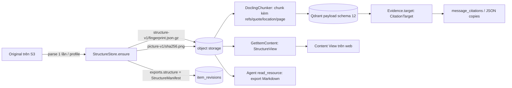

# Báo cáo triển khai: Structured Document và trích dẫn theo nội dung

Ngày: 2026-11-25. Đây là bản ghi lại một lần triển khai, không phải contract.
Nguồn sự thật vẫn là [`backend/docs_design`](../backend/docs_design): kiến trúc
nằm ở `document_contract.md` ("Structured Document"), `document_viewer.md`
("Content view: evidence, not the file") và `openapi.yaml` (`GetItemContent`,
`Citation`). Lý do thiết kế và số đo nằm trong
`rag_review/doc_arch/UNIFIED_DOCUMENT_DESIGN.md`.

Phạm vi theo quyết định của người dùng: chỉ chạy trên máy local, không giữ code
cũ, không shim, không migration. Database local được dựng lại bằng
`make db-reset qdrant-init`.

## 1. Vấn đề và quyết định

Trước đây mỗi nơi cần nội dung tài liệu (ingestion, trích dẫn, đọc tài liệu cho
agent, artifact rendition) đều parse lại file gốc thành các content part phẳng
(`TextPart`, `TablePart` …). Cách này làm mất cây cấu trúc của Docling. Trích
dẫn được tự dựng thành passage, offset và bounding box, lưu trong bảng
`citations`, rồi client phải tìm lại vị trí bằng cách dò text.

Quyết định: mỗi nội dung chỉ được parse **một lần cho mỗi parse profile** thành
một **Structured Document**, tức JSON Docling lưu trên object storage. Mọi bề
mặt khác đọc từ đó. Một trích dẫn chỉ là danh sách id block (`texts/31`,
`tables/0`, `groups/4` …) trỏ vào đúng tài liệu đó.



## 2. Lưu trữ

| Thành phần | Vị trí | Ghi chú |
| --- | --- | --- |
| Structured Document | `derived/{tenant}/{content_id}/structure-v1/{fingerprint}.json.gz` | gzip tất định, immutable, content type `MEDIA_TYPE` |
| Hình ảnh | `derived/{tenant}/{content_id}/picture-v1/{sha256}.png` | được tham chiếu theo tên, không nhúng base64 trong JSON |
| Manifest | `item_revisions.exports.structure` | `version, fingerprint, docling_schema, size_bytes, nodes, pictures, pages`; ghi cho mọi revision có cùng `content_id` |
| Fingerprint | `sha256(ParseProfile)[:16]` | profile gồm `parser_version`, `docling_schema`, `read_images`, `vision_model`; chunking và embedding cố ý không nằm trong profile nên re-index không làm hỏng trích dẫn |

Không có bảng mới. Bảng `citations` bị xoá. `message_citations` đổi cột thành
`item_id, revision_number, structure_version char(16), refs text[], quote,
location, page`. Lý do của từng cột được ghi trong `item_model.md` §5 (dòng 35
và 36).

## 3. Backend

### Package mới `bomesh/document_structure/` (thuần, không có I/O)

| File | Trách nhiệm |
| --- | --- |
| `identity.py` | `NodeRef`, `ParseProfile.fingerprint()`, `StructureRef.key/.picture_key`, `StructureManifest`, `CitationTarget` (`to_json/from_json/key`), `clip` |
| `tree.py` | `DoclingTree`, `block_ref`: quy một node Docling (ví dụ inline group) về block mà người đọc nhìn thấy |
| `nodes.py` | Phép chiếu của BoMesh: `ContentNode`, `ContentRun`, `ContentCell`, `ContentImage`, `ContentWindow`, `NodeKind` |
| `view.py` | `StructureView`: đọc thẳng từ JSON (không validate thành `DoclingDocument`), dàn body thành luồng block, cung cấp `window`, `window_around`, `outline` |
| `codec.py` | `encode` / `decode_json` / `decode_document` |
| `pictures.py` | `externalize_pictures`: chuyển `data:` URI thành PNG đặt tên theo sha256 |

### Service

- `services/knowledge_items/structure_store.py`: lớp `StructureStore` với các
  phương thức `profile`, `ensure`, `document`, `view`.
  - Parse, tách hình và encode chạy trong worker thread.
  - Hình được ghi trước rồi mới tới document; cả hai đều immutable.
  - LRU giữ 8 document và 32 view; view có JSON lớn hơn 16 MiB không được
    cache.
  - `ensure(convert=False)` không gọi Gotenberg.
- `services/knowledge_items/original_parser.py`: `OriginalParser`,
  `StoredTranscripts`. File này thay `file_content.py`.
- `connector/processing/chunking.py`: `DoclingChunker` cắt trực tiếp từ
  Structured Document. Mỗi `Chunk` mang `refs` (ít nhất 1), `quote` (plain
  text), `location` và `page`.
- `services/knowledge_items/indexing.py`: `process_document` gọi `ensure`, sau
  đó chunk và index. Strategy là `line` cho `.jsonl/.log/.sql/.tsv`, còn lại là
  `hybrid`.
- `document_index`: `INDEX_SCHEMA_VERSION = 12`. Payload chứa `refs, quote,
  location, page, revision_number, structure_version`. Point thiếu các trường
  này sẽ bị bỏ qua.
- `knowledge` / `agent`: `Evidence.target: CitationTarget`.
  - Annotation `bomesh:document_citation` lấy toàn bộ dữ liệu từ evidence; model
    chỉ được chọn `ref_N` đã được cấp.
  - Thẻ nguồn (`tool_completed.sources`) dùng cùng hình dạng.
- `conversations`, `artifacts`, `collaboration`: lưu và đọc bằng
  `CitationTarget`. Trích dẫn được coi là "outdated" khi revision hiện tại lớn
  hơn revision được trích.
- Agent `read_resource` (`item_resource_resolver.py`): đọc Structured Document
  đã lưu rồi export ra Markdown, không parse lại file gốc.
- `PARSER_VERSION = "docling-2.121-r3"`.

### Đã xoá

`connector/protocol/citation.py`, `connector/protocol/content.py`,
`connector/processing/mapper.py`, `services/knowledge_items/citations.py`,
`services/knowledge_items/file_content.py`, `services/artifacts/rendition.py`,
ORM `Citation`, `ProcessedFile`, `CanonicalDocumentContent`,
`StoredFileContent`, `StoredCitation`, `passage_name` / `parse_passage_name`,
`retriever.source_reference`.

## 4. API (`/api/v1`)

- **Mới**: `GetItemContent`, `GET workspaces/{w}/items/{i}/content`
  (`x-permission: items.get`, áp dụng reviewer exception).
  - Tham số `revision`, `version`, `anchor`, `view` (`FULL` | `OUTLINE`),
    `pageSize` (mặc định 40, tối đa 200), `pageToken`.
  - Một lần đọc PostgreSQL và nhiều nhất một lần đọc object. Không đọc index,
    không tải file gốc, không parse.
  - Header `ETag` và `Cache-Control: private, no-cache`.
  - Lỗi:
    - `CONTENT_NOT_PROCESSED`: revision chưa có Structured Document.
    - `CONTENT_VERSION_UNAVAILABLE`: không còn object cho `version`.
    - `INVALID_ARGUMENT`: anchor sai, token sai, hoặc gửi cả anchor lẫn
      pageToken.
    - `NOT_FOUND`: revision không tồn tại.
  - Item artifact được đọc theo quy tắc đọc của chính artifact.
- **`Citation`**: `{item, revision, structureVersion, refs, quote, location,
  pageNumber?, displayName, available, outdated, updateTime}`. Khi không đọc
  được, response chỉ có `{available: false}`.
- **Search**: `SearchItemsResult.references` (`ContentReference`) thay cho
  `passages`.
- **Artifact snapshot**: bỏ `rendition`, thêm `structureVersion`.
- **Đã xoá**: `ListPassages`, `GetPassage`, `ItemPassage*`,
  `SearchItemsPassage`, `ItemRendition`.

## 5. Client

### UX preview (`apps/ux_preview`), làm trước

- File mới `scripts/features/content.js` và `styles/pages/content.css`.
- Bấm vào trích dẫn sẽ mở **Content View**:
  - các block được trích được tô sáng và cuộn tới;
  - có thanh đọc để đi qua từng trích dẫn;
  - có nút "Xem phần trước / Xem phần sau";
  - có ghi chú "Nội dung trích xuất — có thể khác bố cục bản gốc".
- "Bản gốc" là nút chuyển. Trình xem bản gốc chỉ được tải sau khi bấm.
- Có 5 trạng thái: loading, chưa xử lý, phiên bản không còn, không có quyền,
  không hỗ trợ.
- Tài liệu trong `apps/ux_preview/docs/` đã được cập nhật (9 file).

### Web (`apps/web`)

- Module mới `modules/knowledge/content/`:

  | File | Trách nhiệm |
  | --- | --- |
  | `api.ts`, `queries.ts` | gọi GetItemContent và cache query |
  | `ContentView.tsx` | hiển thị cửa sổ nội dung |
  | `DocumentRenderer.tsx` | vẽ cây block |
  | `ViewToggle.tsx` | chuyển Nội dung / Bản gốc |
  | `blocks.ts`, `highlight.ts`, `scroll.ts` | xử lý block, tô sáng, cuộn |
  | `open.ts`, `reference.ts` | mở trích dẫn, đọc reference |

  Ngoài ra có `modules/chat/open.ts`.
- Một trích dẫn chỉ gọi GetItemContent một lần, với `anchor = refs[0]`. Không
  gọi GetItemPreview và không nạp pdf.js cho tới khi người dùng bấm "Bản gốc".
- Trong bản gốc, `quote` được đánh dấu như một cụm trên text layer. Nếu không
  tìm thấy, giao diện báo rằng đoạn này không được đánh dấu trong bản gốc. Quy
  tắc này đã được ghi vào `document_viewer.md`.
- Trang Reader `/doc/{id}?rev=&ver=&ref=…` có outline và nút chuyển sang bản
  gốc.
- Đã xoá `reader/rendition.ts` và `tests/rendition.test.mts`.

## 6. Tài liệu thiết kế đã cập nhật

`openapi.yaml`, `api_design.md`, `design.dbml`, `item_model.md` §5,
`database_architecture.md`, `document_contract.md`, `document_viewer.md`,
`conversation_loop.md`; `tests/docs_design/test_api_contract.py` (thêm
`content` vào `SINGLETONS`).

## 7. Kiểm chứng

| Kiểm tra | Kết quả |
| --- | --- |
| Backend `tests/**` chạy từng nhóm trên `bomesh_test` | 2140 passed, 11 skipped, 0 failed |
| `tests/docs_design` | 16 passed |
| `dbml2sql --postgres design.dbml` | OK |
| `apps/web`: `bun run typecheck`, `bun run test` | pass, 266/266 |

Smoke test trên stack local (API, ingestion worker, web dev):

- **Trước khi xử lý**: tải lên một file DOCX có heading, chữ đậm, bảng và hình.
  Lúc này `GetItemContent` trả `CONTENT_NOT_PROCESSED`.
- **Sau khi chạy ingestion**: bước parse thành công và Structured Document được
  lưu.
- **GetItemContent**: trả 9 block, outline có 4 heading. Cửa sổ quanh anchor và
  phân trang đúng. Hình được tải qua signed URL (PNG). Các mã lỗi đúng như
  contract.
- **Web `/doc/{id}`**:
  - Mở thường thì hiện bản gốc.
  - Chuyển sang "Nội dung" thì vẽ đúng heading, bảng, hình và outline.
  - Với `?rev=1&ver=…&ref=groups/0&ref=tables/0`, đúng 2 block được tô sáng và
    focus vào block đầu. Không có lỗi console.
- **UX preview**: bấm trích dẫn trong chat mở Content View có block được tô
  sáng; bản gốc chỉ xuất hiện sau khi bấm nút chuyển. Không có lỗi console.

**End to end (2026-11-25, stack local sau `make reset-all`)**: OpenRouter chặn
IP mạng hiện tại (`Request path cannot be relayed`); request HTTPS ra ngoài đi
qua Cloudflare WARP ở chế độ proxy (`HTTPS_PROXY=http://127.0.0.1:40000`
trong `.env`). DOCX, XLSX, PPTX và PDF đều qua run `SUCCEEDED` (4 tài liệu,
13,8 s). Search trả `references` đúng block (DOCX "09/12/2022" là `texts/10`,
location "13. Ngày phê duyệt lần đầu"). Hỏi đáp có trích dẫn, mỗi trích dẫn mở
được bằng GetItemContent. Process lại khi profile không đổi thì không parse
(PARSING < 0,1 s). Trích dẫn cũ vẫn mở được phiên bản cũ sau khi bump parser.

## 8. Việc còn mở

1. **Mã lỗi truy cập của `GetItemContent`**: người ngoài, hoặc viewer của một
   tài liệu đã xoá, hiện nhận 403 giống `GetItemPreview`. Contract yêu cầu
   `NOT_FOUND`. Muốn sửa phải đổi item check dùng chung.
2. **Phụ thuộc giữa package**: `knowledge_items/content.py` import từ
   `services/artifacts/support.py` để đọc item artifact. Có thể giữ nguyên hoặc
   tách sang một module chung.
3. **Nhãn trên UI**: "Mở bản gốc" (mở ở hệ thống nguồn) đứng cạnh nút chuyển
   "Bản gốc" (bản xem trước của file gốc). Hai nhãn dễ gây nhầm.
4. **Classification mỗi lần process lại**: đã xử lý. Câu trả lời được lưu ở
   `workspaces/{code}/files/{content_id}/classification-v1/{key}.json` và dùng
   lại khi model, taxonomy, note và nội dung không đổi (CLASSIFYING 3,5–6,2 s
   xuống 0,02–0,03 s mỗi tài liệu).

## 9. Sửa sau test end to end

- **PDF text layer**: heading nhận theo font size của PDFium (median có trọng
  số theo ký tự), không theo chiều cao glyph theo dòng; heading lồng cấp theo
  cỡ chữ. Trước đó PDF ngắn có heading "Điều 1…" bị coi là đoạn thường, nên
  location chỉ là tiêu đề tài liệu.
- **Chunk spreadsheet**: peer merge của Docling không vượt qua sheet. Trước đó
  hai sheet nhỏ gộp thành một chunk, location chỉ là sheet đầu, và câu hỏi về
  sheet sau trả nhầm tài liệu khác.
- **Quote của chunk hỗn hợp** có cả dòng bảng ("row, column = value"), không
  chỉ phần text.
- `PARSER_VERSION = "docling-2.121-r4"`, `CHUNKER_VERSION = "docling-hybrid-line-v2"`.

## 10. Bố cục object storage mới và dọn phần legacy

Bảng §2 ở trên ghi bố cục cũ (`derived/{tenant}/…`). Bố cục hiện tại nằm trong
`database_architecture.md` "Object storage":

```text
workspaces/{code}/files/{content_id}/original
workspaces/{code}/files/{content_id}/preview-v1 | thumbnail-v2 | structure-v1/{fp}.json.gz | images-v1/{sha256}.png | ocr-v1/…
workspaces/{code}/branding/{logo|map-background}/{id}
workspaces/{code}/exports/{operation_id}.csv
platform/exports/{operation_id}.csv
```

- `Workspace.code` bất biến sau khi tạo (UpdateWorkspace: `code` trong
  `updateMask` → `INVALID_ARGUMENT`); Settings chỉ hiển thị địa chỉ web.
- `Item.workspace_code`, `Operation.workspace_code` là column_property; purge
  xoá cả thư mục `files/{content_id}/`.
- Xoá pipeline ảnh trang WebP của artifact (`KnowledgePreview`, `pageAssets`,
  `ItemPageAsset`, `exports.preview`): revision artifact dạng tài liệu hiển thị
  bằng Content View.

## 11. Bảng tính dạng biểu mẫu

Thử với `Tổng hợp số lượng Cựu SV tham gia KS (Tuần 3).xlsx` (bộ `ute_docs`):
quốc hiệu, tiêu đề gộp ô, header 2 tầng, cột số thứ tự, ghi chú cuối trang.
Trước khi sửa, Docling lấy tiêu đề làm header cột và số thứ tự làm nhãn dòng,
nên agent trả lời sai ("Khoa Xây dựng 45 SV, 53,33%"; đúng là 132 SV, tuần 3
73, tuần 4 79, 59,85%).

- `connector/processing/spreadsheet.py` (parse, `PARSER_VERSION` r5): bỏ ô
  trang trí (`¾¾¾`), định dạng số theo `number_format` của workbook, khối ghi
  chú và khối quốc hiệu thành đoạn văn, dòng tiêu đề/ghi chú đầu bảng thành
  đoạn văn, header band nhiều tầng, cột tên (không phải số) làm row header.
- `connector/processing/table_text.py` (chunk, `CHUNKER_VERSION` v3): mỗi dòng
  bảng là một dòng `Khoa Xây dựng: Số lượng SV tốt nghiệp = 132; … – Tuần 3
  (19-23/10/2020) = 73; …`; bỏ ô trống; bảng dài tách giữa các dòng.
- Sau khi sửa: cả hai câu hỏi trả lời đúng, trích dẫn `tables/0` với quote là
  đúng dòng Khoa Xây dựng.

## 12. Benchmark 20 tài liệu đầu của `Khoa Xây dựng`

Chạy bằng `python -m eval ingest` (`evaluation.md` "Ingestion benchmark"),
worker chạy trong container `ingestion-worker` (`make worker`, API chạy
`main.py --api-only`), 4 tài liệu song song.

- **Lỗi tìm thấy và đã sửa:**
  - parse xlsx dạng phiếu khảo sát rất chậm (`02.K.CKM.xlsx` mất 87 s): mỗi
    bảng đọc lại sheet bằng openpyxl read-only, mỗi lần xoá bảng duyệt lại cả
    tài liệu. Sửa: đọc mỗi sheet một lần, xoá một lượt; còn 4 s, Structured
    Document giữ nguyên;
  - sheet thưa (ô "1" rải rác) sinh chunk nêu tới 355 block, vượt giới hạn 64
    ref của `CitationTarget`: mọi câu hỏi trúng chunk đó làm search lỗi. Sửa:
    chunk bị cắt để nêu tối đa 64 block (`MAX_CHUNK_REFS`, `CHUNKER_VERSION`
    v4);
  - harness `eval` không còn chạy được với retriever hiện tại
    (`editable_collection_ids`, user thật): thêm `run --reader`.
- **Thời gian:** run 150 s, 8 tài liệu/phút, p50 19,5 s/tài liệu; CHUNKING
  (ngữ cảnh hoá bằng LLM) 44 %, EMBEDDING 31 %, PARSING 9 %. PDF scan được OCR
  trong PARSING, khoảng 13 s cho 3 trang.
- **Độ chính xác** (28 câu: 20 đơn, 4 multi-hop, 4 không trả lời được): final
  Hit@6 0,79, Recall@6 0,77; agent đúng 16/24 câu trả lời được, từ chối đúng
  4/4 câu không trả lời được, 0 rò rỉ quyền. Ba câu sai là câu hỏi mơ hồ
  sinh từ một dòng của một người trả lời trong phiếu khảo sát.

## 13. Sheet thưa, `.xls` và benchmark nhiều định dạng

- **Sheet khảo sát thưa:** Docling đọc cả bảng, rồi đọc lại mỗi ô "1" không
  chạm ô nào thành một bảng riêng (`02.K.CKM.xlsx`: 1.133 bảng). Bảng nằm
  trong khung một bảng lớn hơn bị bỏ; dòng quá dài cho một chunk được cắt giữa
  các giá trị, mỗi phần mở đầu bằng tên dòng và giá trị đầu (`Công nghệ chế
  tạo máy: STT = 1; …`).
- **`.xls`:** chuyển sang `.xlsx` bằng `xlrd` + `openpyxl` (giá trị, định dạng
  số/ngày, ô gộp) rồi đi đúng luồng bảng tính, thay cho PDF của Gotenberg.
  Thêm: quốc hiệu dính liền bảng và tiêu đề gộp nhiều dòng thành đoạn văn, lỗi
  công thức (`#REF!`) bị bỏ, ngày hiển thị `dd/mm/yyyy`.
- **Ô DOCX nhiều đoạn** đọc thành văn bản thuần, không còn `**` Markdown.
- **Ghi Qdrant theo lô 256 điểm:** một tài liệu 1.176 chunk vượt giới hạn 32
  MiB của một request, làm hỏng cả lô 3 tài liệu ("interrupted").
- `PARSER_VERSION` r6, `CHUNKER_VERSION` v5.

Benchmark 20 file nhiều định dạng của batch `022-wave3-240` (2 pptx, 5 docx,
5 doc, 5 pdf gồm 2 scan, 2 xls, 1 xlsx): 20/20 thành công, run 99 s, 12 tài
liệu/phút. Độ chính xác 28 câu: final Recall@6 0,81 (fused) / 0,90 (rerank);
agent đúng 19/24 câu trả lời được, từ chối đúng 3/4, 0 rò rỉ quyền.
