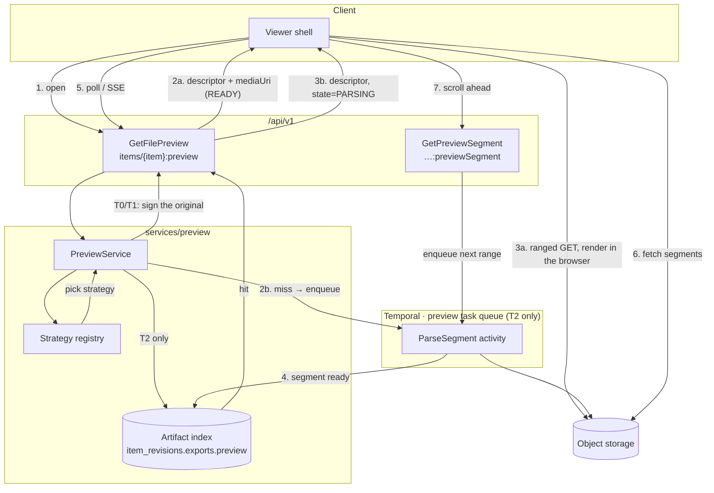
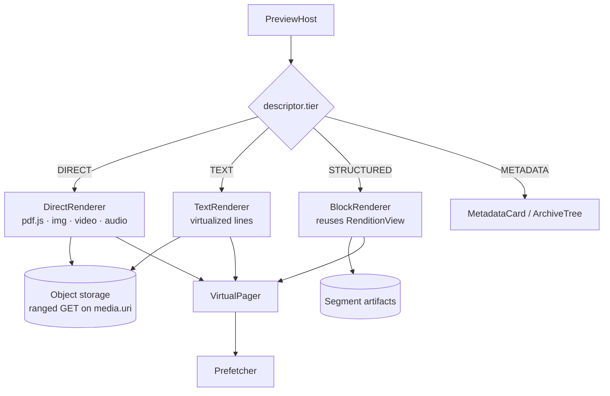

# Universal File Preview — architecture design

Status: **proposal**. Nothing here is implemented yet.
Scope: how BoMesh turns *any* stored file into something a person can look at
in the browser. Audience: backend, web, infra.

Related contracts (authoritative for what exists today):
`backend/docs_design/document_viewer.md` (current rendition design),
`document_contract.md` (formats, upload, archives),
`item_model.md` §4.8 (revision exports), `api_design.md` §5.

---

## 0. The thesis

**Storing a file and indexing a file are two independent decisions.**

BoMesh stores **every** file a user uploads. Whether that file is also parsed,
chunked and embedded into the vector database is a *separate* decision, made
later, by an explicit Ingestion Run — and it may be "no" forever without
making the file any less stored, browsable, shareable or viewable.

It follows that **preview and RAG ingestion are different products that happen
to parse the same bytes.**

Today they are one code path. `KnowledgePreview.generate()` is called *only*
from `ItemIngestionService.process_document` and
`ArtifactStore._generate_preview`, and it takes the already-parsed
`DocumentItem` as an argument. A file that is not an ingestable knowledge
format therefore has no preview at all, and a file whose ingestion fails has
no preview either — even when showing it is trivial (a PNG, a `.py` file, a
`.zip` listing).

That coupling is the root cause of every limitation below. The design
separates them:

| | Storage | Preview | Ingestion |
| --- | --- | --- | --- |
| Question | "Keep these bytes." | "What does this file look like?" | "What does this file mean?" |
| Applies to | **every upload** | every stored file | knowledge formats only |
| Decided at | upload | first view (lazy) | an explicit Ingestion Run |
| Output | the original object | page images / view model / the original | chunks, embeddings, passages |
| Failure | upload fails (rare) | fall back to download | document is not searchable |
| Cost model | bytes stored | per file *actually looked at* | per file indexed |

Preview and ingestion stay independent all the way down: separate artifacts,
separate storage prefixes, separate versioning, separate failure handling.
They share exactly one thing — `element_id`s — so a citation can point at a
spot in a preview.

**This is not a new rule; it is the backend's existing behaviour made
explicit.** `_check_format` accepts nearly anything, and `_processable`
independently decides what a run touches (see F9). What the codebase lacks is
the *client* and the *documentation* agreeing with it — and a preview pipeline
that covers the files this rule lets in.

---

## 1. Current architecture audit

### 1.1 What exists

```text
Upload ──► object storage (RustFS/S3)
             │
             └─ Ingestion Run (ingestion worker)
                   │
                   ├─ Docling parse ──► DocumentItem.content ──► chunks ──► Qdrant
                   │                          │
                   │                          └─ build_document_rendition() ──► document.json.gz
                   └─ KnowledgePreview.generate()
                          └─ PDF only ──► page WebPs
                                  │
                          preview manifest → item_revisions.exports.preview
                                  │
GetItemContent ──► elements + signed pageAssets + signed rendition
                                  │
web: useRendition() ──► fetch document.json.gz ──► RenditionView / PageImageView
```

Code references:

| Concern | Where |
| --- | --- |
| Storage protocol | `backend/bomesh/storage/__init__.py` (`DocumentStorage`, presign up/down) |
| S3 impl | `backend/bomesh/storage/aws_s3.py` |
| Preview generation | `backend/bomesh/services/knowledge_items/preview.py` (585 lines) |
| Rendition builder | `backend/bomesh/services/knowledge_items/rendition.py` (289 lines) |
| Parsers | `backend/bomesh/connector/processing/docling.py`, `pdf_text.py` |
| Preview limits | `backend/bomesh/services/__init__.py:88-95` |
| Artifact preview | `backend/bomesh/services/artifacts/artifact_store.py:192-210` |
| Web rendition load + cache | `apps/web/src/modules/knowledge/reader/rendition.ts:86-110` |
| Web viewers | `reader/components/{RenditionView,PageImageView}.tsx`, `artifacts/components/{DocView,SheetView}.tsx` |
| Accepted types (web) | `apps/web/src/modules/knowledge/model.ts:708` (`CONTRIBUTE_TYPES`) |

### 1.2 Findings

**F1 — Preview is a side effect of ingestion.** `preview.py` is reached only
through ingestion/artifact paths. Consequences: no preview for
non-knowledge formats; no preview when ingestion fails; every ingested file
pays rendering cost whether or not anyone opens it.

**F2 — Only PDFs get page images.**
`KnowledgePreview.supports()` (`preview.py:85-90`) returns true for
`application/pdf` and `.pdf` only. Everything else returns
`RenderedPreview(representation="original")`. DOCX, PPTX and XLSX — three of
the five Office formats BoMesh accepts — are shown as reflowed extracted
text, losing their layout. This was partly addressed on the web side
(`PageImageView.tsx`) but the backend still produces nothing to show for them.

**F3 — A silent 50-page ceiling.** `DEFAULT_PREVIEW_MAX_PAGES = 50`
(`services/__init__.py:91`), applied at `preview.py:106`. A 300-page document
renders 50 pages and sets `truncated`. The reader reports it as *"Showing the
first part of this file"*, so the user cannot read pages 51+ in the browser at
all. For a university lecture corpus this is a routine case, not an edge case.

**F4 — Eager full-document rendering.** All pages are rasterized up front, in
one activity, at up to 1600 px, WebP q80 (`services/__init__.py:91-94`), under
a **process-wide PDFium lock** (`pdfium_lock.py`, shared with Docling). Page
rendering is therefore serialized across the whole worker, and it is paid for
documents nobody opens.

**F5 — No format negotiation.** The manifest has `representation:
"pages" | "original"`. There is no notion of *which strategy* previewed a file,
no per-format renderer registry, and no way to add one without editing
`render()`'s if-chain (`preview.py:74-82`).

**F6 — Two parallel viewer stacks.** Knowledge uses
`reader/components/*`; artifacts use `artifacts/components/{DocView,SheetView}`
with their own `useVersionContent.ts`. Both consume the same rendition shape.
Divergence is already visible and will grow.

**F7 — Client-side caching is per-tab and tiny.** `rendition.ts:86` caches 8
documents in a module-level `Map`, lost on reload. Page images rely on HTTP
caching only; signed URLs change per content read
(`GetItemContent` re-signs), which **defeats the browser cache** — the same
page image is re-downloaded under a new query string every time the content
response is refetched.

**F7b — ~~A grid of N documents cost N content reads.~~ CLOSED 2026-11-08.**
Each `ResourceCard` called `useGlance` → `useItemContent`, so rendering 16
cards issued 16 `GetItemContent` requests purely to draw 16 pictures and a
"28 pages" chip. The Item already carried `document.thumbnailUri`; the card
now renders from the list response alone and fetches content only when
searching, where it must show the matching section. The page-count chip was
**deleted rather than optimized** — it is not an insight anyone acts on, and
the only ways to obtain it are a content read per document or a rasterizer
by-product. Measured: **17 cards, 9 covers, 0 content requests** (was 16).

**F8 — No virtualization.** `PageImageView` emits every page as an ``
with `loading="lazy"`. For a 300-page document that is 300 DOM nodes and 300
decoded images as the user scrolls; memory grows monotonically. Tables use
`content-visibility` (per `document_viewer.md`), images do not.

**F9 — The *client* refuses files the backend accepts.** `CONTRIBUTE_TYPES`
(`model.ts:708`) is a 16-extension allowlist enforced in the upload dialog.
The backend's own gate (`items.py:_check_format`, lines 1145-1167) is far
narrower: it rejects only *images as knowledge*, *attachments outside one's own
PERSONAL collection*, and *archives in a personal collection*. Everything else
is accepted. Verified by probe: `CreateItem` for `probe.py`
(`text/x-python`) returns `200` with an `uploadUri`, `documentType:
plain_text`, `indexingState: PENDING` — the API already stores a format it
cannot index. `_processable()` (`items.py:1170-1176`) then decides
*separately* whether a run touches it. **The storage/indexing separation this
design argues for is already implemented in the backend**; it is the web
allowlist and `document_contract.md` §Formats that contradict it.

**F11 — `documentType` conflates purpose with format, and the UI shows it raw.**
`item_store.document_type_for_content_type` maps a MIME type to a
`documentType`, but the values it produces (`plain_text`, `pdf`, `markdown`,
`image`, `audio`, `video`, `archive`) name a **format**, while the field's
real domain is what a document is *for* (`policy`, `lecture`, `thesis` —
`RESOURCE_KINDS` in `model.ts:63`). Every unrecognised MIME type falls through
to `plain_text`, so DOCX, PPTX and XLSX all land there. The web rendered
`kindMeta.label` directly, and `kindMeta` title-cases an unknown key — which
is how a 54-slide `.pptx` was labelled **"Plain text · 54 pages"**.
Fixed on the web side (`pickTypeLabel`): a purpose someone actually set still
wins, otherwise the card shows the format ("Slides", "Spreadsheet", "Code").
The backend conflation remains — a strategy registry (§2.4) keyed on a sniffed
`FileProbe` would remove the need for this field to carry format at all.

**F10 — Preview failure is invisible.** `generate()` raises
`PreviewGenerationError`; artifacts swallow it (`artifact_store.py:201`),
ingestion lets it fail the document. There is no per-file preview state the
API can report, so the web cannot distinguish "not previewable", "preview
failed", and "preview not built yet" — it shows one generic empty state.

### 1.3 Performance envelope today

| Dimension | Today | Problem |
| --- | --- | --- |
| Time to first page | Full ingestion run (seconds–minutes) | Nothing to show until *everything* is parsed |
| Pages rendered | All (≤50), eagerly | Wasted on unopened documents |
| Bytes stored & sent | **2.34× the original** (measured, §2.3) | Paying more to deliver less |
| Concurrency | 1 (global PDFium lock) | Rendering serializes the worker |
| Large file | ≤100 MB source, then `representation: original` | A 120 MB PDF = download link |
| Long file | Hard-truncated at 50 pages | Content unreachable |
| Browser memory | Unbounded (no virtualization) | Long documents degrade |
| Re-download | Per content read (URL re-signed) | Cache miss by construction |
| Zoom / select / `⌘F` | Impossible (it's a picture) | Worse than opening the file locally |

---

## 2. Recommended architecture

### 2.1 Principles

1. **Convert nothing you don't have to.** The browser renders PDF, images,
   video, audio and text natively. For those, preview is *authorization plus a
   URL* — no pipeline, no artifact, no CPU. Conversion is the exception, not
   the architecture.
2. **Lazy by default.** When a conversion *is* required (T2), it happens the
   first time someone asks to see the file, never during upload or ingestion.
3. **Tiered.** Serve the cheapest representation that is faithful. Most files
   need no conversion at all.
4. **Strategy registry, not an extension ladder.** A strategy declares what it
   handles and what it emits; adding a format is registering a strategy.
5. **Segmented artifacts.** Never one blob per document. Page ranges, so page
   1 is visible before page 300 exists.
6. **Stable, immutable artifact URLs.** Content-addressed keys + long-lived
   cache headers, so the browser and the CDN can actually cache.
7. **Preview never blocks ingestion, ingestion never blocks preview.**

> The first principle is the whole design. Everything else is how to behave
> for the minority of files it does not cover.

### 2.2 Flow



**The upper path (T0/T1) is the common one** and has no queue, no activity and
no artifact: the service signs a URL and the browser does the rest. Only T2
reaches the lower path.

### 2.3 Tiers

| Tier | Meaning | Server work per view | Examples |
| --- | --- | --- | --- |
| **T0 — Direct** | The browser renders the original bytes | **none** — one signed URL | PDF, PNG, JPEG, WebP, GIF, MP4/H.264, MP3, WAV |
| **T1 — Text** | The original is text; the client styles it | none — ranged reads | TXT, MD, CSV, JSON, YAML, XML, source code, logs |
| **T2 — Structured** | Parse once to a view model, render as DOM | one parse, cached | DOCX, PPTX, XLSX, HTML, EPUB, Notebook |
| **T3 — Metadata** | Cannot be shown; describe it | probe only | Archives (listing), binaries, encrypted, unknown |

**There is no rasterization tier.** The previous draft of this document kept
one ("T3 — Raster: fidelity requires pixels"). It is deleted: converting a
document to page images is the slowest, largest and lowest-fidelity way to show
it, and the measurements below say so outright.

#### Why not WebP page images

Measured on this workspace's own corpus — the stored original against the sum
of the WebP pages ingestion rendered from it:

| Document | Pages | Original | WebP pages | Ratio |
| --- | ---: | ---: | ---: | ---: |
| Bài giảng Nguyên lý máy | 28 | 1,040,972 | 1,639,018 | 1.57× |
| Đại số tuyến tính | 20 | 756,348 | 1,672,834 | 2.21× |
| Đồ họa máy tính | 20 | 498,200 | 1,099,954 | 2.21× |
| Phân tích & thiết kế giải thuật | 43 | 429,284 | 2,731,926 | **6.36×** |
| Pháp luật giải quyết tranh chấp | 20 | 575,626 | 1,563,552 | 2.72× |
| Thiết kế & điều hành chương trình DL | 10 | 652,220 | 691,864 | 1.06× |
| Cẩm nang định hướng nghề nghiệp IT | 20 | 867,242 | 2,462,102 | 2.84× |
| Đổi mới cơ chế quản lý vốn | 7 | 483,275 | 1,049,384 | 2.17× |
| Tài liệu tham khảo hỗ trợ khởi nghiệp | 10 | 766,704 | 1,267,620 | 1.65× |
| **Total** | **178** | **6,069,871** | **14,178,254** | **2.34×** |

Rasterizing costs **2.34× more bytes on average, up to 6.36×** — and that is
only the transfer. It also costs:

- **CPU at ingest**, serialized behind a process-wide `PDFIUM_LOCK` shared with
  Docling, paid for every document whether or not anyone opens it;
- **storage**, a second permanent copy 2.34× the size of the first;
- **fidelity** — the output is fixed at 1600 px, so zoom blurs, text cannot be
  selected, `⌘F` finds nothing and a screen reader sees an image;
- **a 50-page ceiling** (`DEFAULT_PREVIEW_MAX_PAGES`), past which pages simply
  do not exist.

A text-heavy PDF is a *vector* document a few hundred KB in size. Turning it
into 43 photographs of itself is strictly worse on every axis.

#### What replaces it: serve the original

The browser is already an excellent document renderer. Give it the file.

**All of this already works** — verified against the running system:

```text
GET /items/{item}?alt=media
  → 302 Location: https://storage/…/revisions/1/original?X-Amz-Signature=…

GET <that URL>
  → 200  content-type: application/pdf  bytes: 1,040,972

GET <that URL>  Range: bytes=0-1023
  → 206  content-range: bytes 0-1023/1040972   ← ranged reads work

OPTIONS/GET with Origin: http://localhost:3000
  → access-control-allow-origin: *
    access-control-expose-headers: ETag, Content-Length, Content-Range, Accept-Ranges
    accept-ranges: bytes                        ← CORS already exposes what pdf.js needs
```

`alt=media` is in `openapi.yaml` today, issues a short-lived signed URL after
the `items.get` check, and storage answers it with range support and the right
CORS headers. Nothing new is needed on the backend for T0.

So the whole of T0 is: **the API hands out one URL; storage streams the bytes;
the browser renders them.** Server cost per view is a signature computation.

| | Rasterize (today) | Serve the original (proposed) |
| --- | --- | --- |
| Bytes over the wire | 2.34× the original | 1× — and only the pages read |
| Server CPU per document | High, serialized | **Zero** |
| Extra storage | +2.34× | **None** |
| Time to first page | After full ingestion | ~300 ms |
| Page limit | 50 | None |
| Zoom | Blurs past 1600 px | Vector, any level |
| Text select / `⌘F` / a11y | Impossible | Native |

`pdf.js` renders page-by-page from ranged reads, so a 300-page PDF shows page 1
after a few tens of KB — it never downloads the whole file to display the
first screen. That answers the "download the whole original" objection in
`document_viewer.md`: with `Range`, it was never the whole original.

#### The one genuine exception

Office formats (DOCX, PPTX, XLSX) are the only things a browser cannot render
natively, and they are **T2, not raster**: parse once to a block model and
render as DOM. That keeps text selectable, searchable, accessible, reflowable
and small — a PPTX view model is kilobytes, where its slide images would be
megabytes. Ingestion already parses these files with Docling; T2 reuses that
parse rather than adding a second one.

A document that no strategy can render falls to **T3 — Metadata**: type, size,
page count and a download button. That is an honest answer, and a better one
than a blurry picture.

### 2.4 Strategy registry

```python
class PreviewStrategy(Protocol):
    name: str                      # "direct", "text", "office-ooxml", "metadata"
    tier: Tier
    def accepts(self, probe: FileProbe) -> int: ...   # 0 = no, higher = better
    async def describe(self, src: SourceRef) -> PreviewDescriptor: ...
    async def render(self, src: SourceRef, segment: SegmentRef) -> Segment: ...
```

T0 and T1 implement `describe` only — they have nothing to render, because the
client reads the original directly. Only T2 produces artifacts.

`FileProbe` is **sniffed, not trusted**: magic bytes first, then declared MIME,
then extension. A `.docx` that is actually a ZIP of something else must not
reach the OOXML strategy. This also fixes F11 at the root: the probe decides
the format, so `documentType` no longer has to carry one.

Selection is `max(accepts(probe))`, so a more specific strategy can outrank a
general one without editing either.

### 2.5 Artifacts

Only T2 has artifacts. T0 and T1 have none — the original *is* the artifact.

```text
tenants/{tenant}/items/{item}/preview/{strategy}/{content_hash}/
    descriptor.json          # pages, dimensions, outline, capabilities
    seg-00001.json.gz        # blocks for pages 1..N
```

- **`content_hash`** = SHA-256 of the original + strategy version. The key
  changes only when the bytes or the parser change, so every object is
  **immutable** → `Cache-Control: private, max-age=31536000, immutable`, and
  signed URLs can be long-lived without staleness risk.
- **Segments** default to 200 blocks.
- Artifacts live under `preview/`, renditions under `previews/document-v1/`
  (existing). Different prefixes, different lifecycles, independently
  deletable. Preview artifacts are **derived and disposable**: a lifecycle rule
  may expire them after N days of no access; the next view rebuilds them.

---

## 3. Backend API

Two new custom methods on the Item resource (AIP-136, read-only → `GET`):

```http
GET /api/v1/workspaces/{w}/items/{item}:preview?revision=&strategy=
```

A **T0/T1** response — the common case. One round trip, nothing queued:

```jsonc
{
  "name": "workspaces/w/items/i/preview",
  "revision": "…/revisions/3",
  "state": "READY",            // immediately: there is nothing to prepare
  "tier": "DIRECT",
  "strategy": "direct",
  "capabilities": ["search", "select", "outline", "print", "zoom"],
  "pageCount": 312,
  "media": {
    "uri": "https://storage/…/revisions/3/original?X-Amz-Signature=…",
    "mimeType": "application/pdf",
    "sizeBytes": "8412233",
    "acceptsRanges": true,     // the client may stream page by page
    "expiresAt": "2026-11-08T15:04:05Z"
  },
  "segments": [],              // none: the original is the artifact
  "unavailable": null
}
```

`media.uri` is the same signed URL `alt=media` already redirects to, inlined
so the viewer needs one request instead of two. The client opens it with
`pdf.js` (PDF), ``, `<video>` or a text reader as `mimeType` dictates.

A **T2** response, where a parse is involved:

```jsonc
{
  "state": "PARSING",          // PENDING | PARSING | READY | PARTIAL | UNAVAILABLE
  "tier": "STRUCTURED",
  "strategy": "office-ooxml",
  "capabilities": ["search", "select", "outline"],
  "pageCount": 54,
  "media": { "uri": "https://…/original?…", "mimeType": "…presentationml.presentation", "sizeBytes": "4201337" },
  "segments": [
    { "range": [1, 20], "state": "READY", "uri": "https://…/seg-00001.json.gz" },
    { "range": [21, 40], "state": "PENDING" }
  ],
  "outline": [ { "title": "…", "page": 4, "level": 1 } ],
  "unavailable": null
}
```

`media` is present on every tier, so "Download the original" always works —
including when `state` is `UNAVAILABLE`.

```http
GET /api/v1/workspaces/{w}/items/{item}:previewSegment?range=21-40
```
T2 only. Returns the segment descriptor, enqueuing its parse if absent.
Idempotent; concurrent callers coalesce onto one job.

Design notes:

- **`state` is explicit**, fixing F10. The web can say "preparing slides 21–40…"
  instead of a generic empty state. For T0/T1 it is `READY` on the first call.
- **`UNAVAILABLE` carries a reason** (`FORMAT_NOT_SUPPORTED`,
  `TOO_LARGE`, `ENCRYPTED`, `CORRUPT`, `PARSE_FAILED`) so the UI can offer the
  right next step (download, ask an admin).
- **`capabilities` drives the toolbar**, so no control is shown that the tier
  cannot honour.
- **`pageCount` lives here and only here.** `:preview` is called when someone
  opens one document, so the strategy is already looking at the file and the
  count is free. It is deliberately absent from the Item (`api_design.md`):
  putting it on a *list* would mean a read per row for a number nobody acts on.
- `GetItemContent` is **unchanged and still RAG-facing**. It keeps serving
  `elements` + the document rendition for citations. Preview does not touch it.
- Authorization is the existing `items.get` check; signed URLs are issued
  after it, exactly as today.
- **A 403 on a ranged read means the URL expired**, not that access was
  revoked: the client re-calls `:preview` for a fresh `media.uri` and resumes
  (see §10.7).

---

## 4. Rendering strategy matrix

| Family | Formats | Tier | Strategy | Server cost | Notes |
| --- | --- | --- | --- | --- | --- |
| PDF | `.pdf` (digital or scanned) | T0 | `direct` | **none** | `pdf.js` over ranged reads; text layer = search & select. A scanned PDF is already images — `pdf.js` draws them, nothing re-renders them |
| Images | png jpg webp gif avif | T0 | `direct` | **none** | `` on the signed URL |
| Images (exotic) | bmp tiff heic | T0 | `direct` | **none**¹ | ¹ transcode once *only if* the browser refuses it |
| Vector | svg | T0 | `svg-sandboxed` | sanitize | sandboxed iframe on a separate origin, never inline |
| Media | mp4 webm mp3 wav | T0 | `direct` | **none** | `<video>`/`<audio>`; ranged seeking for free |
| Text/code | txt md csv tsv json yaml xml log sql + source | T1 | `text-range` | **none** | ranged reads; highlight client-side |
| Office OOXML | docx pptx xlsx | T2 | `office-ooxml` | one parse | reuse the Docling parse; emit layout blocks |
| Office legacy | doc xls ppt | T2 | `office-legacy` | one parse | same block model via a pure-Python reader; **no rasterizer** |
| Web | html htm mhtml | T2 | `html-sandboxed` | sanitize | sandboxed iframe, CSP, no network |
| Notebook | ipynb | T2 | `notebook` | one parse | cells + outputs as blocks |
| E-book | epub | T2 | `epub` | one parse | chapter = segment |
| Spreadsheet data | csv tsv (large) | T2 | `tabular` | one parse | column types + windowed rows |
| Archives | zip tar gz 7z rar | T3 | `archive-listing` | list entries | browse the tree; preview a member on demand (recursing into its own tier) |
| Unknown/binary | * | T3 | `metadata` | probe | type, size, hashes, download |

**Coverage is the point.** Hundreds of formats collapse into ~12 strategies
because the tier, not the extension, decides the mechanism — and **six of them
cost the server nothing at all**, because the answer is a URL.

---

## 5. Technology trade-offs

### 5.1 PDF: the browser renders it, the server does not

Full measurements in §2.3. Summary:

| | Server raster (today) | Serve the original (proposed) |
| --- | --- | --- |
| Time to first page | after full ingestion | ~300 ms |
| Server CPU | high, serialized by `PDFIUM_LOCK` | **zero** |
| Storage | +2.34× the original, permanently | **none** |
| Bytes transferred | 2.34× (whole pages, eagerly) | 1×, and only the pages read |
| Text select / search | impossible | native |
| Zoom | fixed at 1600 px | vector, any zoom |
| Long documents | capped at 50 pages | unbounded |
| Cost | paid for every ingested file | paid per viewer |

Payload is ~350 KB gzipped for the viewer, loaded only on the preview route and
cached across every document thereafter — against 2.34× of *every document's*
bytes, forever. It pays for itself on the second file.

This **reverses** the "Parse the original in the browser" rejection in
`document_viewer.md`. That rejection was correct *for the rendition* — a second
parse could disagree with what the agent indexed. It is wrong for *preview*,
because preview has no indexing obligation. Separating the two concerns is
what makes the client parse safe: the rendition still comes from the server and
still owns citations.

It also answers that rejection's second objection — "the whole original file
downloaded on the client every time". Storage serves `Range` requests
(verified: `206`, `content-range: bytes 0-1023/1040972`), so `pdf.js` fetches
the cross-reference table and the pages on screen, not the file.

### 5.2 Office: parse to DOM, never to pixels

DOCX/PPTX/XLSX are the only formats a browser cannot open natively. The
previous draft proposed a LibreOffice sidecar to rasterize them. **Deleted** —
it reintroduces every cost in §2.3 for the formats that can least afford it:
a slide deck's text becomes unsearchable pictures, a spreadsheet gets
paginated into images of a grid.

Instead they are T2: parse once to a block model, render as DOM. The parse
already happens during ingestion (Docling), so T2 reuses it. A PPTX view model
is kilobytes; its slide images would be megabytes. Text stays selectable,
searchable and accessible, and the layout reflows on a phone.

What this gives up: pixel-exact fidelity for heavily designed slides. That is
the right trade for a knowledge platform, where documents are read and
searched rather than art-directed — and the original is always one click away
via `alt=media` for anyone who needs the real thing.

### 5.3 Rejected

- **Rasterizing anything, ever.** Measured at 2.34× the bytes (up to 6.36×),
  plus serialized CPU, plus permanent storage, in exchange for *worse* output:
  no text selection, no search, no accessibility, blurred zoom and a 50-page
  ceiling. There is no file type for which this is the best available answer.
- **A LibreOffice sidecar.** See §5.2 — it is rasterization with extra
  infrastructure.
- **Convert everything to PDF.** One pipeline, but the worst output for
  spreadsheets (wide sheets paginate badly), loses interactivity, and adds
  latency to formats that need none.
- **A third-party preview SaaS.** Enterprise knowledge would leave the tenant
  boundary. Incompatible with `AGENTS.md` ("Never return enterprise knowledge
  … without applying the required authorization filtering").
- **Thumbnail sprites.** Saves requests, but invalidates the whole sprite when
  one page changes and blocks per-page zoom.
- **Pre-rendering everything at upload.** The current model. Pays for files
  nobody opens; see F4.

---

## 6. Frontend architecture



- **One `PreviewHost`** replaces the two viewer stacks (F6). The Reader, the
  shared document preview modal and the chat file panel all mount it; they
  differ in chrome, not in rendering.
- **`DirectRenderer` reads the original**, not an artifact: `pdf.js` with its
  worker and `rangeChunkSize` for PDF, a plain ``/`<video>`/`<audio>` for
  everything else. The browser's own decoder is the renderer.
- **`VirtualPager`** keeps a window of ±2 pages mounted (fixes F8). Pages
  outside it become a sized placeholder, so the scrollbar stays honest.
  Measured target: < 150 MB heap on a 500-page document. With `pdf.js` the
  placeholder is cheap, because an unmounted page holds no bitmap at all.
- **`Prefetcher`** warms the next pages at 70 % scroll depth, and on
  `requestIdleCallback` during a pause. Never more than one in flight.
- **Rendering is pure.** A renderer receives a descriptor + source and emits
  DOM. No fetching policy inside renderers; `PreviewHost` owns IO. This is what
  makes renderers trivially testable and new formats cheap.
- **Caching:** Cache Storage API keyed by `content_hash`, surviving reloads
  (fixes F7). The in-memory `Map` in `rendition.ts` becomes the hot tier of a
  two-tier cache. For T0 the browser's HTTP cache already does most of this —
  the signed URL varies, so cache by object key, not by URL.
- **Expiry is invisible.** On a `403` from a ranged read, `PreviewHost`
  re-calls `:preview`, swaps `media.uri` and retries the range. The user sees
  nothing.

### 6.1 UX

One shell for every type, with the controls a type actually supports
(`capabilities` drives the toolbar — no dead buttons, per
`PRODUCT_DESIGN_RULES.md`):

```text
┌───────────────────────────────────────────────┐
│ ‹ icon  name.pdf   PDF · 8.4 MB · 312 pages  ⋯│
│         [search] [zoom −/+] [page 4/312] [↓]  │
├──────────┬────────────────────────────────────┤
│ outline  │                                    │
│  pages▾  │        the document itself         │
│  thumbs  │                                    │
└──────────┴────────────────────────────────────┘
```

- **Progressive**: skeleton at the right aspect ratio → first page → the rest.
  The layout never jumps, because `descriptor.pageCount` and page dimensions
  arrive before the pixels.
- **Honest states**: `PENDING` → "Preparing preview…", `PARTIAL` → the pages
  that exist plus an inline spinner, `UNAVAILABLE` → the reason and a
  download button. Never a blank canvas.
- **Type-adaptive**: a spreadsheet shows sheet tabs, a slide deck a thumbnail
  rail, a video a scrubber, an archive a file tree. Same shell, same spacing,
  same keyboard model (`j/k`, `⌘F`, `Esc`).
- **Everything is previewable.** Even T3: an unknown binary shows type, size
  and hash with a download button, which is a better answer than today's
  "This document couldn't be read".

---

## 7. Security

| Risk | Control |
| --- | --- |
| Malicious SVG/HTML (XSS) | Sanitize server-side; render in a `sandbox`ed iframe on a **separate origin**; CSP `default-src 'none'` |
| Zip bomb / decompression DoS | Cap entries, uncompressed size and ratio before expanding; stream, never buffer |
| Malformed file → RCE in a parser | T2 parsers run isolated: no network egress, read-only FS, CPU/memory/time bounded. T0/T1 parse nothing server-side — the browser's own sandbox is the boundary |
| Signed-URL leakage | Issue **after** the `items.get` check; scope to one object; short TTL for originals |
| Long-lived artifact URLs | Safe only because keys are content-addressed and unguessable; still private-ACL + signed |
| Cross-tenant artifact access | Tenant ID is in the key prefix; authorization is re-checked per request, never inferred from the key |
| Preview leaking unpublished content | Preview reuses the Item visibility rule verbatim (`item_model.md` §6) — no separate path |

The sandbox origin matters: an SVG or HTML preview rendered in the app origin
can read `localStorage['bomesh.session']`. It must not be same-origin.

---

## 8. Scalability & caching

```text
L1  browser memory      segments in flight          ~50 MB
L2  Cache Storage       content_hash keyed          ~500 MB, survives reload
L3  CDN / storage       immutable artifacts         months
L4  object storage      canonical artifacts         lifecycle-expired
```

- **Coalescing**: concurrent requests for the same T2 segment join one Temporal
  workflow keyed `preview:{item}:{hash}:{range}`. 100 students opening the same
  deck parse it once. T0/T1 need no coalescing — there is nothing to compute.
- **Backpressure**: preview has its own task queue and worker pool. A preview
  spike cannot starve ingestion, and vice versa — today they share a worker and
  a global lock.
- **Cost ceiling**: per-workspace parse-minutes budget; past it, T2 formats
  degrade to T3 (metadata + download) rather than queueing unboundedly.
  T0/T1 are never throttled: serving a URL has no budget to exceed.
- **Eviction**: artifacts are derived. Expire by last-access; rebuild on
  demand. Only the original is precious.

---

## 9. Migration

| Component | Action | Why |
| --- | --- | --- |
| `storage/` (`DocumentStorage`, presign) | **reuse as-is** | Clean abstraction, already correct |
| `GET /items/{item}?alt=media` | **reuse as-is** | Already the whole of T0: authorized 302 → signed original, with `Range` and CORS verified working |
| Item visibility / authorization | **reuse as-is** | Preview must not invent a second access path |
| `rendition.py` + `document.json.gz` | **keep, scope to RAG** | Stays the citation substrate; stops being the viewer's only input |
| `preview.py` `_render_pdf_pages` + `PDFIUM_LOCK` | **delete** | Rasterization is gone (§2.3). 2.34× the bytes for worse output |
| `PREVIEW_MAX_PAGES`, `PREVIEW_WEBP_QUALITY`, page-width config | **delete** | Configuration for a path that no longer exists |
| Stored `*.webp` page assets | **delete after P1** | ~14 MB per 6 MB of documents here; reclaim on the lifecycle rule |
| `document.pageCount` | **never add** | Not an insight anyone acts on; the only sources are a content read per document or a rasterizer by-product. The viewer numbers its own pages |
| `preview.generate()` call sites in ingestion | **remove** | Decouples the two pipelines (F1) |
| `PreviewManifest` | **extend** | Add `strategy`, `tier`, per-segment state (F5, F10) |
| `RenditionView.tsx` | **reuse** | Becomes the T2 `BlockRenderer` |
| `PageImageView.tsx` | **delete** | Written for server-rendered pages; `pdf.js` owns PDF rendering now |
| `artifacts/components/{DocView,SheetView}` | **replace** | Fold into `PreviewHost` (F6) |
| `rendition.ts` cache | **extend** | Becomes L1 of the two-tier cache (F7) |
| `CONTRIBUTE_TYPES` | **widen** | Decoupled from what is indexable (F9) |
| `document_type_for_content_type` | **replace** | Format comes from the sniffed `FileProbe`; the field stops carrying one (F11) |

The deletions are the point: this design removes more code than it adds.
The storage layer, the authorization model and the block renderer survive
unchanged.

### Roadmap

**P0 — Decouple (foundation).** Preview service + strategy registry; the
`:preview` method; lazy generation on first view; preview state in the API.
*Unblocks everything; no user-visible change yet.*

**P1 — Direct PDF.** `pdf.js` reading `alt=media` over ranged requests;
delete `_render_pdf_pages`, the `PDFIUM_LOCK` path, the WebP config and the
50-page cap; expire the stored page assets. *Fixes truncation, slow first page
and server cost at once, and removes 2.34× of stored bytes.*

**P2 — Universal shell.** `PreviewHost` + `VirtualPager` + two-tier cache;
fold the artifact viewers in; T0/T1/T3 strategies (images, text, code, media,
archives, unknown). *Every file in BoMesh becomes viewable.*

**P3 — Office as DOM.** `office-ooxml` emitting layout-preserving blocks for
DOCX/PPTX/XLSX, reusing the Docling parse; `office-legacy` for `.doc`/`.xls`
through a pure-Python reader. No rasterizer, no sidecar.

**P4 — Scale.** Job coalescing, prefetch tuning, budgets, artifact lifecycle.

Each phase ships independently and is useful alone. P0+P1 alone would resolve
F1–F4 and F10.

---

## 10. Open decisions

1. ~~**Does BoMesh store files it cannot index?**~~ **Resolved: yes.** BoMesh
   stores every uploaded file; indexing is a separate, later, optional
   decision (§0). The backend already behaves this way (F9); the work is to
   make the client and `document_contract.md` agree. See §11.
2. **Sandbox origin.** A second origin (or a signed storage subdomain) is
   needed for HTML/SVG. Infra work, must be settled before P2.
3. **`pdf.js` bundle budget.** ~350 KB on the preview route, cached across
   every document. Against 2.34× of every document's bytes, this is not a
   close call — but confirm the route split keeps it off the main bundle.
4. **Preview retention.** How long before an untouched T2 artifact expires?
   Suggested: 30 days. (T0/T1 have nothing to expire.)
5. ~~**Legacy Office demand — worth the sidecar?**~~ **Moot:** there is no
   sidecar. `.doc`/`.xls` are T2 like their modern counterparts.
6. **Upload size ceiling for non-indexed files.** Indexing caps at 20 MB
   (`docling.py:_DEFAULT_MAX_FILE_BYTES`) and preview at 100 MB. A stored-only
   file needs neither — what is the storage ceiling, and is it per workspace?
   Note the 100 MB preview cap also stops mattering for T0: serving a signed
   URL does not care how large the file is.
7. **Signed-URL lifetime vs. long reads.** `alt=media` signs for 300 s today.
   A reader open for an hour needs either a longer TTL or a quiet re-sign when
   a ranged request 403s. The latter is better — short TTLs stay short.

---

## 11. Consequence: the indexability contract

Making §0 explicit turns one implicit behaviour into a visible product
concept. A document needs a field that says *why* it is or is not indexed,
because "not in the vector DB" currently has three unrelated causes that the
UI renders identically.

### 11.1 Indexing intent

Add `document.indexingIntent` (input) alongside the existing output-only
`indexingState`:

| Intent | Meaning | Set by |
| --- | --- | --- |
| `AUTO` | Index when the format allows it (default) | system |
| `NEVER` | Store only — never embed, never retrievable by the agent | uploader / admin |
| `REQUESTED` | Index explicitly, even outside the default set | uploader / admin |

And widen `indexingState` with an honest terminal value:

| State | Meaning |
| --- | --- |
| `NOT_APPLICABLE` | **new** — stored on purpose, never to be indexed (`intent: NEVER`) |
| `UNSUPPORTED` | *(existing)* "kept but never processed" — the format has no parser. Now distinguishable from a deliberate `NEVER`. |
| `PENDING` / `RUNNING` / `SUCCEEDED` / `FAILED` / `OUTDATED` | *(existing, unchanged)* |

`UNSUPPORTED` already means *"kept but never processed"* in `openapi.yaml`,
which is exactly the storage/indexing split this design argues for — the
contract conceded the point before the product did. What it cannot express is
**intent**: a `.zip` is `UNSUPPORTED` because no parser exists, while a signed
contract would be `NOT_APPLICABLE` because someone decided it must never be
retrievable. Same absence from the index, opposite meanings, different
governance consequences.

This matters for governance, not just display: `NEVER` is how a workspace
stores a file that must **not** reach the agent — a signed contract, a
personnel record, a raw dataset. Today the only way to keep something out of
retrieval is to not upload it.

### 11.2 What changes

| Surface | Change |
| --- | --- |
| `CONTRIBUTE_TYPES` (`model.ts:708`) | Stop being an allowlist. Validate size and danger, not format. |
| Upload dialog | Say what will happen: *"PDF — will be indexed"* / *"ZIP — stored, not searchable"*. Honesty at the moment of choice. |
| `document_contract.md` §Formats | Rewrite: formats are an **indexing** matter, not an upload gate. The §Formats list becomes "what can be indexed". |
| `_check_format` | Keep as-is. It already encodes placement rules (images, attachments, archives), which stay. |
| Browse / My library | A stored-only file is a first-class row with its own icon and a "Not searchable" chip — not an error state. |
| Search | Unchanged: it only ever returned indexed content. |

### 11.3 Why this is separate from preview

Preview answers *"what does it look like"*; the indexability contract answers
*"should the agent see it"*. They are independent — a file can be previewable
and un-indexed (a scanned contract marked `NEVER`), or indexed and
un-previewable (a 400 MB CSV past the preview ceiling). Both follow from §0,
but they ship separately: the preview roadmap (§9) does not depend on
`indexingIntent`, and vice versa.

**Suggested sequencing:** ship `indexingState: NOT_APPLICABLE` + the client
allowlist removal with P0 (they are small and unblock "store anything"), and
`indexingIntent` separately once the governance need is confirmed with users.
