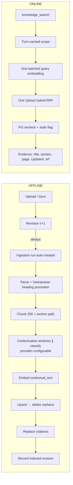
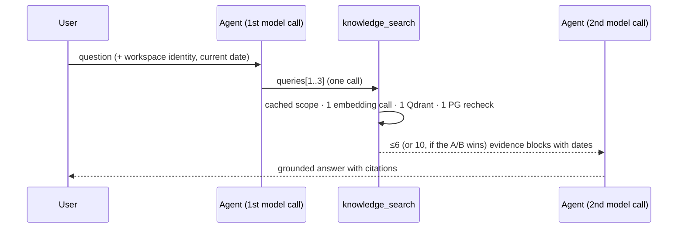
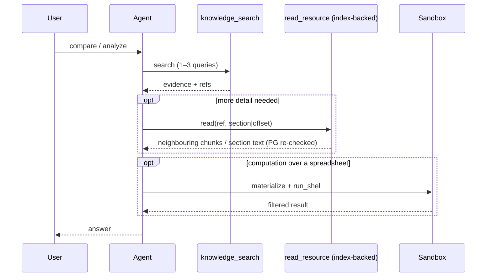

# BoMesh RAG and agentic retrieval: architecture review and optimization plan

Review date: 2026-11-25. Code: `dev/prototype` at `94095dd`. Deployment: homelab image `sha-881f702`.
This is a review only. No production source code, schema or index was modified.

**Evidence labels used in this document**

| Label | Meaning |
|---|---|
| **MEASURED** | Produced by a run in this review. Scripts are under `rag_review/experiments/`; raw outputs under `results/`. |
| **PROD-TRACE** | Taken from production Langfuse observations: 229 agent turns, 2026-10-26 to 2026-11-25. |
| **PROD-DATA** | Read-only queries against the production PostgreSQL and Qdrant, over an SSH tunnel. |
| **CODE** | Verified by reading the source, cited as `path:line`. |
| **PUB** | Published research or vendor documentation. Not measured on BoMesh. |
| **INFERENCE** | A reasoned estimate. Not measured. |
| **UNVERIFIED** | No evidence either way. |

**Reproduce**

| What | Where |
|---|---|
| Analysis summary | `python3 rag_review/experiments/analyze.py` → `results/analysis.txt` |
| Dataset | `rag_review/datasets/prod-2026-11-25/` |
| Experiment scripts | `rag_review/experiments/*.py`. Each docstring gives its command. |

**Limits of the evidence**

- **Dataset.** 94 questions: 80 answerable and 14 unanswerable, plus 10 behaviour probes.
  - Reviewer agents (Claude) wrote the questions from sampled production chunks. Every gold quote was checked as a verbatim substring.
  - No human verified the questions.
  - Questions written from chunk text overlap lexically with that text, which favours BM25.
  - With n = 80, differences under about 5 points are not significant. 95% bootstrap CIs are reported.
- **Agent runs.** They used `OPENAI_MODEL=gpt-5.6-luna` through OpenAI, because OpenRouter now rejects this network as well (Cloudflare HKG, "Request path cannot be relayed"). This is the same model the homelab agent uses.
- **Latencies.** Values measured on the Mac are relative only. Production latencies come from Langfuse.

---

## 13.1 Executive summary

**Maturity.** The online architecture is already close to the target "single agent + rich offline indexing + lean retrieval":
- One agent loop: no router, no rewrite model, no grader.
- One `knowledge_search` call, carrying up to 3 queries, served by one native Qdrant hybrid query (dense + BM25 + RRF).
- Authorization rechecked in PostgreSQL.
- Canonical evidence with stable citation refs.
- An offline contextual-retrieval stage.

Measured:
- **Fast path in practice.** Answerable questions take 2.05 model steps and 1.05 searches per turn. Only 10 of 312 turns searched twice.
- **Search decisions.** 17 of 18 should-not-search probes were answered without searching. All 42 unanswerable probes abstained.

**What limits quality today is not retrieval sophistication.** In order of user impact:

1. **Coverage and freshness (PROD-DATA).**
   - 14,734 of 14,936 live documents (98.6%) are `pending`; only 181 are `ready`.
   - They were bulk-uploaded on 2026-11-24, and the ingestion stages that call models are hard-wired to OpenRouter, which the server cannot reach.
   - Users therefore get "not found" for topics whose documents exist: 101 pending titles mention "học phí", 299 "tốt nghiệp", 6 "chuyển ngành".
   - The last failed run reports `embedding provider refused the request (HTTP 400)`.
2. **Index integrity on re-ingestion (CODE).** Five defects can serve stale or mismatched evidence once documents start changing:
   - the previous revision stays searchable until a run finishes;
   - tombstoned orphan chunks are resurrected by any payload sync;
   - points are tombstoned before the upsert;
   - citations are replaced before the index;
   - Confluence deletions are never applied.

   Production has only 2 multi-revision documents, so the impact is latent. It is certain once source sync runs.
3. **The evaluation harness is broken, so changes cannot be measured (MEASURED).**
   - `python -m eval run --stages retrieval` raises `TypeError` on every question, because the runner predates `editable_collection_ids`.
   - The agent stage calls every search with user `"bomesh-benchmark"`. That is not a UUID, so `UUID()` fails, every search returns "temporarily unavailable", and the agent abstains.
   - A benchmark run today would report a broken system as "safe abstention".
4. **The agent does not know which organization it serves (PROD-TRACE, MEASURED).** For questions about the organization it asks "which school?":
   - production: "mình là sinh viên năm 3, muốn chuyển ngành…" → "bạn đang học trường nào";
   - harness: neg-05, s1-22.

**Measured retrieval facts that justify keeping the current design:**

| Comparison | Recall@10 | Paired difference |
|---|---|---|
| Contextual hybrid vs raw hybrid | 0.863 vs 0.731 | **+13.1 pt**, 95% CI [+3.7, +22.5] |
| Contextual hybrid vs structural-only hybrid | 0.863 vs 0.775 | **+8.7 pt**, CI [+1.3, +16.9] |
| Hybrid vs dense-only | 0.863 vs 0.731 | **+13.1 pt** |
| Contextual BM25 vs raw BM25 | — | +8.7 pt |
| 50 candidates instead of 20 | — | no change |

**Decision: keep contextual retrieval and hybrid RRF.** The ingestion cost of contextualization is about $0.03 per 1M input tokens with the configured model.

**Reranking.**
- Measured gain: hit@6 0.800 → **0.912** (+11.3 pt, CI [+5, +18.8]); hit@1 0.475 → 0.85. It also returned empty for 10 of 14 unanswerables, with 1 of 80 false empties.
- Cost: **p50 3.4 s, p95 6.2 s added to every search**, and about 15k input tokens per call.
- Showing RRF top-10 instead of top-6 recovers most of the recall (hit@10 0.875) with no extra call.
- Reranking is also **unusable as wired**: OpenRouter only, and it sends `temperature=0`, which OpenAI rejects for the configured model.
- **Decision: stays optional and off; fix the wiring; A/B `final_top_k` first.**

**Unnecessary complexity / do not build:**
- a temporal knowledge engine, document families or supersede graphs;
- an intent classifier, query-rewrite model, evidence grader or answer verifier;
- parent-child or semantic chunking, KG or RAPTOR, sub-agents, compaction.

The measured workload does not need any of them. Turns use about 3k input tokens; the agent already makes sound search and abstention decisions; failures come from coverage, integrity and missing context.

**Recommended direction.** Keep the architecture. Spend effort on:
1. **P0:** ingestion availability and provider wiring, index integrity, and a working evaluation harness.
2. **P1:** cheap context fixes (organization identity, current date, dates in evidence, no internal IDs) and just-in-time reading of found documents from the index.
3. **P2:** evaluation-gated changes to `final_top_k`, reranking and Vietnamese heading detection.

---

## 13.2 Current implementation map

### Runtime configuration

Defaults are from `backend/config/env_config.py`. Deployment values are from homelab `env.yaml` and `stacks/bomesh/compose.yaml`.

| Setting | Default (CODE) | Deployed | Effect |
|---|---|---|---|
| `final_top_k` / candidates / context chars | 6 / 20 / 8,000 (`:460-462`) | defaults / `BOMESH_HYBRID_CANDIDATE_LIMIT=20` | Evidence size |
| `BOMESH_RERANKING_ENABLED` | false (`:465`) | false | RRF order only |
| Max model turns / tool rounds / tool calls | 8 / 4 / 6 (`:522-524`) | defaults | Loop bounds |
| `BOMESH_TOOL_TIMEOUT_SECONDS` | 30 | **150** | Outer timeout. Matters only for `read_resource`, which re-parses, and the sandbox (QueryDeepTrace §3) |
| Agent provider | openrouter | **openai** (`gpt-5.6-luna`) | Chat works from homelab |
| Embedding provider | openrouter | **openai** (from today, `sha-881f702`) | Search and ingestion embedding work |
| Contextualization / Docling VLM / reranker transport | **OpenRouter, hard-wired** (`runtime.py:286`, `:322`, `:404-411`) | OpenRouter (blocked from homelab) | **Ingestion cannot finish on homelab** |
| `BOMESH_CONTEXTUALIZATION_MODEL` | — | `qwen/qwen3.7-flash` ($0.03 / $0.13 per M tokens) | Ingestion cost |
| Qdrant image | `qdrant/qdrant:latest` (`deployment/compose.yml:23`) | 1.19.2 on homelab; **1.18.2 locally** | Local 1.18.2 **rejects** production BM25 options (`Invalid BM25 config … StemmingAlgorithm`, MEASURED) |

### A1. Ingestion (actual)

CODE references are in IngestionDeepTrace §1. All are verified `path:line`.

```mermaid
sequenceDiagram
  autonumber
  participant SRC as Upload / Source sync
  participant PG as PostgreSQL
  participant W as Worker (4 docs, run batches)
  participant OS as Object storage
  participant P as Parser (pdfium / Docling / VLM)
  participant LLM as Contextualizer LLM (OpenRouter)
  participant E as Embeddings API
  participant Q as Qdrant
  SRC->>PG: revision n+1, index_status=pending (old points stay live)
  Note over SRC,PG: Run auto-created only after a *scheduled* sync (worker.py:395,497)
  W->>PG: claim run, advisory lock per document (blocking, held for the whole document)
  W->>OS: download original (network)
  W->>P: parse in thread (CPU; VLM per scanned page, 2 concurrent)
  P-->>W: DoclingDocument → DocumentItem → chunks (256 approx tokens, no overlap)
  W->>PG: citations.replace_for_item (COMMIT)  ⚠ before index
  W->>Q: scroll previous live points (reuse contexts and vectors)
  W->>LLM: classify (0–2 calls), awaited before contextualization although not used by it
  par windows of ≤24 chunks / 14k chars, batches of 8 ids, ≤12 calls in flight per document
    W->>LLM: contextualize batch (JSON), temperature 0
  end
  W->>E: embed contextual_text, batches of 32, sequential
  W->>Q: set is_deleted=true on ALL points  ⚠
  W->>Q: upsert points (dense + server-side BM25 on contextual_text)
  W->>PG: _record_indexed: ready + indexed_revision_number (race guard)
  Note over PG,Q: Move/publish/delete → payload_dirty → set_payload on ALL points (un-tombstones orphans ⚠); reconcile every 60s
```

| Representation | Text | Used by |
|---|---|---|
| Original source text | the file | Object storage; `read_resource` re-parses it |
| Canonical chunk | `chunk_text` (≤768 UTF-8 bytes) | Answer evidence (clipped to 1,600 chars); citation text; UI |
| Structural context | `Document: {item_name}` and `Section: {a > b}` | Prefix of `contextual_text` |
| Generated context | `semantic_context` (LLM, about 50–100 tokens), else the document summary | `Context:` line of `contextual_text` |
| Search representation | `contextual_text` = structural + generated + chunk | **Dense embedding and BM25** (`index.py:119,128`; `_qdrant.py:127`); reranker |
| Citation source | PG `citations` rows keyed by positional `chunk_id` | Spans and pages |

The separation is correct. The answering model sees only canonical text (`include_contextual_text=False`), and generated context never reaches citations. **KEEP.**

**Corpus profile (PROD-DATA):**
- 6,561 live points across 181 documents in 31 collections and 1 tenant; median 13 chunks per document, max 578.
- Content types: 34% table chunks, 63% text.
- Median chunk is 512 chars. 70% of chunks have semantic context; 55% have a `section_path`.
- **Noise:** spreadsheet rows appear as section paths (for example `Section: 133 13145152 Chung Thế Luân …`). Some generated contexts restate the chunk instead of situating it (for example an exam-question chunk whose context is the same question).

**Throughput (PROD-DATA):**
- 9 successful runs processed 173 documents in 3,833 s, about **22 s per document**.
- [INFERENCE] Assuming the same chunks per document, the 14,734 pending documents would be about 530k chunks, about 66k contextualization calls and about 90 h at the observed rate.

### A2. Query and agent flow (actual)

```mermaid
sequenceDiagram
  autonumber
  participant C as Client
  participant S as Conversation service
  participant PG as PostgreSQL
  participant A as Agent loop
  participant M as Chat model (OpenAI)
  participant K as knowledge_search
  participant E as Embeddings
  participant Q as Qdrant
  C->>S: POST :converse
  S->>PG: authz, conversation, scope, settings (~12 sequential round trips, INFERENCE)
  par
    S->>PG: history ≤24 msgs
  and
    S->>PG: referenced resources
  end
  S->>PG: start_turn (insert user message)
  A->>M: step 1: instructions (~2.1k chars) + tools (~1k) + history + user  [LLM]
  alt no search (58% of production turns)
    M-->>C: answer stream (1 LLM call; prod p50 2.6 s)
  else search (42%)
    M-->>A: progress sentence + knowledge_search{queries: 1–3}
    K->>PG: scope: new Authorizer (~6–7 queries, recomputes request authz)
    par per query, LRU-cached
      K->>E: embed_query (one HTTP call per query, concurrent)
    end
    K->>Q: one query_points: 2×Q prefetch (dense + BM25), RRF, limit 20
    K->>PG: recheck facts (1–2 queries)
    opt reranking enabled (off)
      K->>M: listwise rerank (+3.4 s p50 MEASURED)
    end
    K-->>A: ≤6 evidence blocks ≤8k chars (title, Document ID, ref, section, page; no date)
    A->>M: step 2: same prefix + call + evidence (~+750 tokens p50) [LLM]
    M-->>C: answer with [[cite:ref_N]] → [n]
  end
  S->>PG: finish_turn: message + message_citations (shielded)
```

**Operation types and critical paths (production, PROD-TRACE):**

| Path | Model calls (sequential) | Other I/O | Prod latency p50 / p95 |
|---|---|---|---|
| 1. Direct answer | 1 | ~12 PG before the model | **2.6 s / 16.5 s** (134 turns) |
| 2. Normal knowledge question | 2 | +1 search: ≤3 parallel embedding calls, 1 Qdrant, ~8–9 PG | **8.5 s / 19.8 s** (79 turns); `knowledge.retrieve` **1.66 s / 3.16 s** |
| 3. Multiple queries | 2. Queries are batched in one call (2.9 per search on average, MEASURED) | same as 2 | same as 2 |
| 4. Complex (read, shell, ≥2 tools) | 3.05 on average | resource re-parse; sandbox | **13.3 s / 28.7 s** (37 turns) |

**Where the latency goes:**
- [MEASURED] The Qdrant hybrid query itself takes about 8 ms on the 6.5k-point scratch copy.
- [INFERENCE] Most of the 1.66 s of `knowledge.retrieve` is therefore query embedding (network) plus about 8 PG round trips. There is no per-stage span, so this split is UNVERIFIED.
- Model sampling: p50 2.55 s, p95 10.4 s per call. That is the dominant cost; the two sampling calls are the critical path.

**Context per request (PROD-TRACE):**
- Step 1: p50 1,001 input tokens (p95 1,567), with a cached share of 25%.
- Step 2: an evidence delta of p50 **753 tokens** (p95 1,770), with a cached share of 70%.
- Reasoning tokens: 0, because `reasoning={"effort":"none"}`.
- [INFERENCE at list price] Estimated cost per turn: p50 $0.0004.
- The context is small, so compaction or clearing would solve nothing.

### Evaluation framework (actual)

`backend/eval` has the right design: quote-based gold, Hit/Recall/MRR/nDCG, a leak probe and an agent stage. It is broken in two ways, both MEASURED:
- `runner.py:189-194`, `:274-278` and `:293-` call `search_item_content(...)` without `editable_collection_ids` → `TypeError`.
- `_BENCHMARK_USER = "bomesh-benchmark"` (`runner.py:55`) goes to `Principal(UUID(ctx.user_id))` (`knowledge/access.py:39`) → `ValueError`. This surfaces as `retrieval_failure`, so the agent answers "temporarily unavailable".

The committed dataset `ute-knowledge` refers to a corpus that exists nowhere today: 0 of its 80 gold document titles are in production.

---

## 13.3 Principle alignment matrix

| Principle | Current implementation | Verified gap | Recommended change | Priority |
|---|---|---|---|---|
| **Rich indexing** | Docling/pdfium parsing, structural prefix, windowed LLM context, contextual dense + BM25 (measured +13 pt recall@10 over raw) | (a) 98.6% of documents not indexed; ingestion's LLM stages hard-wired to an unreachable provider. (b) PDF and TXT have no heading hierarchy (9/12 clause chunks orphaned in the probe). (c) Spreadsheet rows used as sections. (d) Integrity defects on re-index | Provider-configurable ingestion transports; integrity fixes; heading detection evaluated on a regulation subset | **P0** (a, d), P2 (b, c) |
| **Lean retrieval** | One Qdrant hybrid call, RRF, candidates 20, PG recheck, no threshold, rerank off | Per-search authz recomputation (~6–7 PG queries); per-query embedding calls; no stage timings; reranker wiring broken; evidence header lacks date and leaks Document ID | Reuse the turn's scope; one batched embedding call; per-stage spans; fix reranker transport and params; header change | P1 |
| **Just-in-time context** | `knowledge_search` returns chunks; `read_resource` only for attachments (re-parse, first 12k chars) | Cannot open or expand a document found by search; no paging; read costs a full re-parse | Let `read_resource` (or a `section` argument) read **index chunks** of documents returned or cited this turn (`ItemIndex.get_item_content` exists, `index.py:240-256`), with offset paging | P1 |
| **Adaptive reasoning** | Prompt-driven tool use; measured good decisions; budgets 8/4/6 | Missing organization identity and current date; hard failure when the budget is hit; exact-JSON duplicate guard | Stable workspace identity in instructions; date in per-turn developer input; graceful budget exhaustion; normalized duplicate guard | P1 |
| **Evaluation-driven** | Harness with retrieval, leak and agent stages; LLM judge | Broken stages; stale dataset; no should-not-search type, multi-trial or as-of | Fix the harness; adopt `prod-2026-11-25` after human review; add `expect_search`, trials, pass^k | **P0** |

---

## 13.4 Findings

### Confirmed — P0 (incorrect, stale or unmeasurable)

**F1. Ingestion blocked: 98.6% of documents unsearchable** — Severity **Critical** (coverage)
- **Scenario.** "Học phí là bao nhiêu?" → search over 181 ready documents → partial or "not found" answer. 101 pending documents carry "học phí" in their title (PROD-DATA).
- **Evidence.**
  - `item_index_states`: 14,734 pending, 181 ready, 15 failed.
  - Run error: `embedding provider refused the request (HTTP 400)`.
  - Contextualization, VLM and reranker always use `OpenRouterTransport` (`runtime.py:286`, `:322`, `:404-411`). The homelab reaches OpenRouter through Cloudflare HKG, which answers "Request path cannot be relayed" (verified this morning; the Mac now gets the same 400).
- **Root cause.** Provider independence exists for the agent and embeddings only.
- **Minimal fix.** Add a provider selector for the contextualization transport, mirroring `BOMESH_EMBEDDING_PROVIDER`: `BOMESH_CONTEXTUALIZATION_PROVIDER=openai|openrouter`.
  - The *model* stays the configured one. Whether `qwen/qwen3.7-flash` is served by OpenAI is a user decision (AGENTS.md "LLM model usage").
  - Alternatives: an egress proxy or VPS (declined earlier), or `BOMESH_CONTEXTUALIZATION_ENABLED=false` temporarily. The latter costs −8.7 pt recall@10 (MEASURED, struct vs ctx).
- **Trade-offs.** None online. Ingestion cost: 66k calls × about 5k tokens × $0.03/M ≈ **$10** for the backlog [INFERENCE].
- **Validation.** A run over 50 pending documents completes; `ready` count grows; recall on new-document questions.

**F2. Previous revision served after a content change (C1)** — **High**
- **Scenario.** A Drive doc is edited from 100k to 200k → manual sync → `pending` → search still returns "100k". The UI card shows the new revision's file name and `updated_at`.
- **Evidence.** `item_store.py:753-754` only sets `pending`. `knowledge/access.py:83-109` joins `current_revision_id` but never compares `indexed_revision_number`. `worker.py:395,497-498` creates no run after a manual sync.
- **Minimal fix.** Choose one:
  - (a) Recheck: admit a hit only when `ItemIndexState.indexed_revision_number == ItemRevision.revision_number`. Cost: the document disappears from search until the run finishes. This is correctness-first.
  - (b) Keep serving the old points but return `stale=true` in `DocumentFacts` and print `Indexed version is older than the current document` in the evidence header.

  Recommend **(b) plus auto-creating a run after any sync**. (a) hides answers for hours while the backlog drains.
- **Latency.** 0 extra round trips; it is the same recheck query.
- **Validation.** PG test: index revision 1, append revision 2, search → stale flagged (b) or excluded (a).

**F3. Orphan chunks resurrected by payload sync (NEW-1)** — **High**
- **Scenario.** A revision shrinks from 40 to 30 chunks; points 30–39 are tombstoned. The doc is then moved or published → `set_item_payload` writes `is_deleted=False` to *all* points → old chunks 30–39 become searchable again.
- **Evidence.** `indexing.py:357-366`; `_qdrant.py:242-249` ("tombstoned ones included").
- **Fix.** Hard-delete points with `chunk_index >= len(records)` after a successful upsert. Payload sync never touches `is_deleted` of orphans (use a filter `chunk_index < live_count`, or delete orphans).
- **Validation.** Regression test with `tests/v1/fakes.py`: index 5, reindex 3, sync payload → live count 3.

**F4. Tombstone-before-upsert and citations-before-index (H4, NEW-2)** — **High**
- **Scenario.** An upsert fails → the document has 0 live points. PG citations already point at the new chunk spans while Qdrant serves old text, so highlights are misaligned. The retry has no reuse and pays every LLM call again.
- **Evidence.** `_qdrant.py:119-120`; `indexing.py:284` runs before `:286`; `_qdrant.py:213-218` reuses live points only.
- **Fix.** Upsert, then delete orphans; replace citations after a successful index write. Same model calls; no online impact.

**F5. Confluence deletions never applied (C3)** — **High** for Confluence tenants, latent today (production connector = `file` only).
- **Evidence.** `adapter.py:116-128` emits only `UPDATED`; `last_seen_at` is written (`source_sync.py:615`) but never read.
- **Fix.** After a full crawl, remove resources of the source with `last_seen_at < sync_started_at`.

**F6. Evaluation harness cannot run** — **High** (it blocks every P2 decision). MEASURED. See §13.2.
- **Fix.**
  - Pass `editable_collection_ids` (and scope) through the runner.
  - Make the benchmark caller a real UUID principal. A seeded benchmark member, or the scope's `ReadScope` injected directly, keeps authorization on.
  - Add a smoke test that runs 2 questions through both stages with fakes.
- **Why P0.** Without it, regressions in retrieval or agent behaviour are invisible, and a broken search looks like safe abstention.

### Confirmed — P1 (quality, latency, maintainability)

**F7. Agent lacks organization identity**
- **Evidence (PROD-TRACE).**
  - "mình là sinh viên năm 3, muốn chuyển ngành…" → asked "bạn đang học trường nào" (user: "trường ute").
  - "anh cần thông tin về cách quy đổi môn học" → clarification "tại trường ute".
  - MEASURED: neg-05 and s1-22 answers ask the user to name the school.
  - No workspace name or description reaches the model (`context_manager.py:249-262`).
- **Fix.** Add one stable line to `<workspace_instructions>`: workspace display name plus an admin-provided description. It is per workspace and identical across turns, so the prompt cache still holds.
- **Cost.** About 30–80 tokens. No calls.
- **Measure.** Clarification rate on organization questions (`mustsearch-*` probes).

**F8. No current date; evidence has no date**
- **Evidence.** `context_manager.py:250` ("never timestamps"); `context_builder.py:72-92`. `updated_at` is fetched (`access.py:92`) but shown only on UI cards.
- **Corpus.** Period-specific documents are separate items (HK2 2023–2024 vs HK2 2024–2025). The agent handled per-period questions correctly when the period was named (s3-19, s2-20), but cannot resolve "hiện nay" or "năm nay".
- **Fix.**
  - `<current_date timezone="Asia/Ho_Chi_Minh">YYYY-MM-DD</current_date>` in the per-turn developer message, never in `instructions`.
  - `Updated: YYYY-MM-DD` in the evidence header.
  - Drop `Document ID:`. It is an internal identifier, unusable by any tool (QueryDeepTrace §5), and contradicts `agent_base.md` response style.
- **Cost.** About 15 tokens per turn, about 10 per evidence block, then −36 chars per block once the ID is dropped. No calls.

**F9. No just-in-time access to found documents**
- **Evidence.** `read_resource` resolves only this turn's attachments and name-matched references (`context_manager.py:160-173`, `tools/__init__.py:107-111`). It re-parses the original (`item_resource_resolver.py:49-58` → `canonicalize`), returns the first 12k chars, and has no paging.
- **Fix.** Extend the existing `read_resource`; do not add a new tool.
  - Accept the `ref`, or a document handle, of any document returned by `knowledge_search` in this turn or cited in this conversation.
  - Read from the index (`ItemIndex.get_item_content`), with `section` or `offset` arguments and neighbour chunks around a hit.
  - PG re-checks visibility per call (`access.recheck`).
- **Cost.** 0 on the fast path. On the complex path, 1 Qdrant scroll and 1 PG recheck per read, replacing a full Docling re-parse (seconds).
- **Measure.** Multi-hop and "summarize the whole document" tasks; `read_resource` latency.

**F10. Reranker unusable as wired**
- **Evidence (MEASURED).**
  - Through OpenRouter: 94 of 94 calls failed with HTTP 400 (relay).
  - Through OpenAI: 94 of 94 failed with `Unsupported parameter: 'temperature'` (`semantic_reranker.py:57`).
  - It fails open, so the only effect is wasted latency.
- **Fix.** Route it through the agent transport (or a provider setting), and stop forcing `temperature` on models that reject it. The contextualizer has the same `temperature: 0` (`semantic_contextualizer.py:62`); it is fine for qwen.

**F11. Per-search recomputation and unbatched query embeddings**
- **Evidence.**
  - `ItemReadAccess.scope` builds a new `Authorizer` per search (`access.py:30-57`), about 6–7 queries, even though the request already authorized.
  - Query embeddings: one HTTP call per query (`index.py:208-209`).
  - Production retrieval p50 is 1.66 s against 8 ms for Qdrant.
- **Fix.**
  1. Add per-stage spans (embed / scope / qdrant / recheck) first.
  2. Cache `ReadScope` per turn. Revocation inside one turn is not a concern; the recheck still runs per hit.
  3. Use one `embed_documents(queries)` call.
- **Expected.** INFERENCE, 0.3–1 s off p50. Measure before and after.

**F12. Budget exhaustion is a hard failure; duplicate guard is exact-JSON**
- **Evidence.**
  - `turn.py:75-76`: a tool call after `tool_choice:none` fails the turn.
  - `orchestrator.py:252-253` hashes raw args.
- **Severity.** Low. MEASURED: only 10 of 312 turns made 2 searches, and none hit the budget.
- **Fix.**
  - Drop the extra call, append an observation "answer from the evidence you have", and sample once more.
  - Normalize `queries` (casefold, whitespace, sorted set) in the signature.

**F13. Qdrant version drift**
- **Evidence.** The image is `latest`; local 1.18.2 rejects the production BM25 options (MEASURED); production runs 1.19.2.
- **Fix.** Pin `qdrant/qdrant:v1.19.2` in `deployment/compose.yml` and the homelab stack.

**F14. read_resource DetachedInstanceError (production)**
- **Evidence (PROD-TRACE).** 31 of 37 `resource.resolve` calls failed between 2026-11-05 and 11-16 with "lazy load of attribute 'upload'" on a detached `Item`; 6 succeeded from 11-16 to 11-24.
- **Status.** Probably fixed by a later commit; which one is UNVERIFIED.
- **Action.** Add a regression test that reads an uploaded and a synced document through `ItemResourceResolver.read` with a fresh session. F9 removes the re-parse path anyway.

### Confirmed — P2 (evaluate first)

**F15. Evidence count vs reranking (MEASURED)**

| Option | Hit (gold in evidence) | Extra online cost |
|---|---|---|
| RRF top-6 (today) | 0.800 | — |
| RRF top-10 | **0.875** | +~500–700 tokens (INFERENCE from 753 tokens per 6 blocks); 0 calls |
| RRF top-20 → generative rerank → 6 | **0.912** (+11.3 pt, CI [5, 18.8]; 9 wins, 0 losses) | **+1 LLM call, +3.4 s p50 / +6.2 s p95**, ~15k input tokens (≈ $0.003 per search at list price, ≈ 5–8× the whole turn) |

Answerability: the reranker returned empty for 10 of 14 unanswerables, with 1 of 80 false empties. The agent already abstains on 42 of 42 unanswerables without it (MEASURED), so this signal adds little.

**Decision.** Run an agent-level A/B of `final_top_k` 6 vs 10. Keep the reranker off by default. Re-test it only if a cheap dedicated cross-encoder is available (PUB: about 100–200 ms in the Anthropic cookbook).

**F16. Vietnamese structure in PDF and TXT**
- **Evidence.**
  - PDF headings are detected by font size only, flat level 1 (`pdf_text.py:138`, `:363-366`). TXT has no headings (`docling.py:255`). PDF tables are flattened (`pdf_text.py:9-10`).
  - MEASURED probe: Markdown 0/12 orphan clauses, TXT 9/12.
- **Fix.** Pattern-based heading promotion (`^(Chương|Mục|Điều)\s+[IVXLC\d]+`) in the mapper, behind a parser version bump.
- **Measure.** Recall on a regulation subset (`huong_dan_thuc_hien_qui_che_dao_tao.pdf` etc.). Not done in this review.

**F17. BM25 tokenizer folds Vietnamese diacritics**
- **Evidence (MEASURED).** On Qdrant 1.19.2, "bán" and "bàn" score identically despite `ascii_folding: False`.

| BM25 tokenizer (hybrid, as written) | hit@5 | recall@10 | BM25-only recall@10, query without diacritics |
|---|---|---|---|
| `multilingual` (prod, folds) | 0.775 | 0.863 | 0.744 |
| `word` (keeps diacritics) | 0.812 | 0.881 | **0.263** |

- **Decision. KEEP `multilingual`.** The +1.8 pt from `word` is within noise; the robustness to unaccented typing is large. Document the behaviour; the option's name is misleading.

**F18. Contextualization quality**
- **Evidence.**
  - Some generated contexts restate the chunk (PROD-DATA examples).
  - The classifier is awaited before contextualization but its output is not used there (IngestionDeepTrace §2).
  - The window key includes the whole document's section list, so any heading change re-contextualizes every window.
- **Fix candidates.**
  - Run classification and contextualization in parallel: ingestion latency only, no quality risk. **P1.**
  - Prompt variant "situate, do not restate": A/B on recall. **P2.**

### Refuted or downgraded findings from `rag_review/REPORT.md`

| Prior finding | Now | Evidence |
|---|---|---|
| M1: agent searches out-of-domain questions | **Mostly refuted** | 1 of 3 trials searched "IPv4 subnetting"; production answered IPv4 and DHCP without search (MEASURED, PROD-TRACE) |
| H1 / B10: irrelevant evidence leads to fabrication via "general knowledge" | **Downgraded** to citation noise | 42 of 42 unanswerables abstained. Production per-diem query: the agent said results were unrelated. However, 69% of abstentions cite the unrelated sources ("results concern X [1][2]"). Prompt fix: do not cite sources that do not support a claim. |
| C2: temporal engine (effective_from, supersede) is Critical | **Downgraded to P1 (date context) + Deferred (engine)** | 2 multi-revision documents in production; period-specific documents are separate items and were handled; no temporal failures in 229 production turns |
| H3 PDF heading/table | **Confirmed**, impact unmeasured on QA | Probe only; agent table recall 0.94 on the dataset (Office/XLSX tables) |
| C1, C3, H4, M3, M4, M7, L1, L3 | **Confirmed** (Ingestion/QueryDeepTrace re-verification) | — |
| "Rerank off ⇒ no relevance gate is a risk" | **Partly refuted** | The agent itself is the relevance gate (abstention 100%, false abstention 8.7%); the reranker is not needed as a gate |

### Hypotheses / unverified

- Split of the 1.66 s retrieval latency (embedding vs PG vs Qdrant): needs spans.
- Real token counts per chunk: no tokenizer was run. The 256 approximate tokens may overcount English by about 25%.
- Effect of IDF shared across tenants: production has 1 tenant. PUB: Qdrant recommends `idf.corpus` filters (v1.19+).
- Qdrant memory at about 530k points × 1536 dims (about 3.3 GB float32 [INFERENCE]): consider scalar quantization when the backlog is indexed.
- History replay is not permission-rechecked (QueryDeepTrace §6): answer text from a now-unreadable document is replayed to the model. Low risk; same user.

---

## 13.5 Research-to-implementation mapping

| Pattern (source) | BoMesh status | Assessment |
|---|---|---|
| Contextual embeddings + contextual BM25 ([Anthropic Contextual Retrieval](https://www.anthropic.com/research/contextual-retrieval)). PUB: −35% / −49% failure@20 | **Implemented**, windowed (≤24 chunks) rather than whole document | MEASURED on BoMesh: recall@20 failure 0.169 → 0.106 (raw → ctx hybrid, **−37%**); dense-only raw → ctx 0.213 → 0.188 (−12%, n.s.). Direction consistent with PUB, smaller dense-only effect. Windowed context with an outline and document opening is a sound cost trade-off for long documents. |
| Prompt caching of the document prefix (PUB: $1.02 per M document tokens) | Implicit caching per window, `prompt_cache_key` | Adequate; the model is already very cheap |
| Rerank top-150 → top-20 (PUB: −67% failure@20) | Optional listwise LLM rerank, off, broken wiring | MEASURED +11 pt hit@6 but +3.4 s. PUB used a dedicated cross-encoder (100–200 ms). An LLM reranker is the wrong tool for the online fast path. |
| "Simplest solution… add complexity only when it demonstrably improves outcomes" ([Building effective agents](https://www.anthropic.com/research/building-effective-agents)) | Single agent loop, no workflow stages | **Aligned.** Keep. |
| Just-in-time retrieval, lightweight identifiers, progressive disclosure ([Context engineering](https://www.anthropic.com/engineering/effective-context-engineering-for-ai-agents)) | Search only; identifiers shown (`Document ID`) but not actionable | **Incomplete**: F9 makes identifiers actionable. Compaction and tool-result clearing are not needed at about 3k tokens per turn. |
| Meaningful identifiers instead of UUIDs; concise responses; actionable errors ([Writing tools](https://www.anthropic.com/engineering/writing-tools-for-agents)) | `ref_N` refs (good); raw UUID in evidence (bad); actionable empty/failure messages (good) | F8: drop the UUID. Use the `ref` as the handle for reads. |
| Balanced should/should-not-search sets, pass^k, read transcripts ([Demystifying evals](https://www.anthropic.com/engineering/demystifying-evals-for-ai-agents)) | Not in the harness | Added in `rag_review/datasets/prod-2026-11-25` and `run_agent.py` (3 trials); fold into `backend/eval` (F6) |
| Filter in an execution environment ([Code execution with MCP](https://www.anthropic.com/engineering/code-execution-with-mcp)) | Sandbox `run_shell` for spreadsheets and exact lookups | **Aligned** for complex tasks. Keep it off the fast path. |
| Title / heading chain on every chunk (RAGFlow `laws` hierarchy chunker; Onyx title prefix) | `Document:` + `Section:` prefix; hierarchy is flat or missing for PDF and TXT | F16 |
| Adjacent-chunk merge / neighbour expansion (Onyx section merge) | `get_item_content` exists, unused online | F9 (on demand, not by default) |
| Per-turn LLM query rewrite (Open WebUI default on; Onyx up to 4 secondary calls; RAGFlow `refine_multiturn`) | Agent writes 1–3 queries in its tool call | **Do not adopt.** The agent already writes 2.9 queries per search, and search recall is 0.817 vs 0.800 for the raw-question RRF top-6. |
| LLM metadata or time filters (Dify automatic filter, Onyx time filter) | None | **Defer.** If needed later, expose filters as tool arguments chosen by the agent (0 extra calls). |
| Score thresholds (Open WebUI 0.0, Dify off by default) | None | **Keep none.** MEASURED: the dense-cosine AUC for answerability is 0.86 and no threshold separates well (≥0.45 drops 5/14 negatives at the cost of 1/80 positives). RRF scores are rank-only (Qdrant k=2, [docs](https://qdrant.tech/documentation/search/hybrid-queries/)). |
| Parent-child (Dify), RAPTOR, KG (RAGFlow) | None | **Defer.** No measured failure that they solve. |

Open-source file references are listed in the research digest (`agent://ResearchPatterns`): Onyx `backend/onyx/indexing/chunker.py`, `document_index/opensearch/search.py`; RAGFlow `internal/ingestion/component/chunker/hierarchy.go`; Open WebUI `backend/open_webui/retrieval/utils.py`; Dify `api/core/rag/index_processor/processor/parent_child_index_processor.py`. Paths are on `main` as of 2026-11-25 and will drift.

---

## 13.6 Proposed target architecture

This modifies existing components only. There are no new services, agents or tables.



### Fast path (normal knowledge question)



### Complex task (just-in-time)



### Responsibility boundaries (unchanged owners)

| Owner | Responsibility |
|---|---|
| `services/knowledge_items` | Revisions and integrity |
| `document_index` | Representation and Qdrant |
| `knowledge` | Authorization-aware retrieval and evidence |
| `agent` | Decisions and context |
| `services/conversations` | Identity, date and history |
| `eval` | Measurement, never on the request path |

---

## 13.7 Evaluation and performance report

**Setup (MEASURED).**
- Corpus: production snapshot (6,561 points) copied into a scratch Qdrant 1.19.2 (`rr_ablation`).
- Dense vectors: production for ctx; re-embedded with the configured `text-embedding-3-small` for raw and struct.
- BM25: production options.
- Query: the question text as the single query.

### Retrieval ablation (80 answerable questions)

| Index representation × retriever | hit@1 | hit@5 | recall@10 | recall@20 | MRR | nDCG@10 |
|---|---|---|---|---|---|---|
| raw / dense | 0.400 | 0.600 | 0.700 | 0.787 | 0.490 | 0.524 |
| ctx / dense | 0.400 | 0.662 | 0.731 | 0.812 | 0.521 | 0.534 |
| raw / BM25 | 0.425 | 0.637 | 0.675 | 0.725 | 0.512 | 0.537 |
| ctx / BM25 | 0.525 | 0.725 | 0.762 | 0.850 | 0.608 | 0.623 |
| raw / hybrid | 0.438 | 0.675 | 0.731 | 0.831 | 0.549 | 0.578 |
| struct / hybrid | 0.475 | 0.700 | 0.775 | 0.838 | 0.586 | 0.607 |
| **ctx / hybrid (production)** | 0.463 | **0.775** | **0.863** | 0.894 | 0.614 | 0.648 |
| ctx dense + raw BM25 | 0.450 | 0.700 | 0.831 | 0.875 | 0.577 | 0.608 |
| ctx / hybrid, 50 candidates | 0.475 | 0.775 | 0.863 | 0.881 | 0.621 | 0.654 |

Paired 95% bootstrap CIs for recall@10:

| Comparison | Difference | 95% CI | Significant |
|---|---|---|---|
| ctx − raw (hybrid) | +0.131 | [0.037, 0.225] | yes |
| ctx − struct (hybrid) | +0.087 | [0.013, 0.169] | yes |
| struct − raw (hybrid) | +0.044 | [−0.031, 0.119] | **no** |
| hybrid − dense (ctx) | +0.131 | [0.056, 0.212] | yes |
| 50 − 20 candidates | 0.000 | — | no |

By question type (ctx hybrid, recall@10):

| Type | Recall@10 |
|---|---|
| factual | 1.00 |
| exact_code | 0.94 |
| table | 1.00 |
| English questions over Vietnamese content | 0.92 (struct: 0.58) |
| paraphrase | 0.75 |
| numeric | 0.75 |
| multi_hop | 0.50 (single query; the agent splits these) |

### Reranker (94 questions; same model via OpenAI with `temperature` stripped)

Shown in §F15.
- Latency per call: p50 3,379 ms, p95 6,177 ms.
- 2 of 94 calls exceeded the production 8 s timeout and would fall back to RRF.

### Agent baseline (MEASURED: production wiring, real member principal, 104 prompts × 3 trials = 312 turns, 0 failures)

| Group | n | Searched | Searches/turn | Steps | Latency p50/p95 | Input tokens p50 | Outcome |
|---|---|---|---|---|---|---|---|
| Answerable | 240 | 1.00 | 1.05 | 2.05 | 7.2 s / 10.6 s | 3,034 | Search recall **0.817**; pass^3 0.80; pass@3 0.85; cited 0.975; false abstention 0.087 |
| Unanswerable | 42 | 1.00 | 1.00 | 2.00 | 7.2 s / 9.8 s | 3,097 | **Abstained 1.00**; 0.69 cite unrelated sources |
| Should-not-search (greeting, thanks, arithmetic, translation, general, capability) | 18 | 0.06 | 0.06 | 1.06 | 2.3 s / 7.8 s | 674 | 17/18 correct; one trial searched "IPv4 subnetting" |
| Production must-search | 12 | 1.00 | 1.00 | 2.00 | 8.7 s / 11.5 s | 2,923 | Searched in every trial. Answers partial: the relevant documents are pending (F1). |

Search recall by type: exact_code 0.90, table 0.94, paraphrase 0.85, multi_hop 0.75, factual 0.71. The answer-quality judge (correctness, claim-level faithfulness) was **not run**: no independent judge was configured and the harness is broken (F6).

### Production (PROD-TRACE, 229 turns)

| Measure | Value |
|---|---|
| Turn latency | p50 6.1 s, p95 21.2 s |
| `model.sample` latency | p50 2.55 s, p95 10.4 s |
| `knowledge.retrieve` latency | p50 1.66 s, p95 3.16 s |
| Turns with no search / one search | 58.5% / 41.5% (never more than 1 search) |
| Retrieval outcomes | success 82, empty 4, failure 8 (provider) |
| Errors | 16 transport failures (OpenRouter relay, until the switch to OpenAI today); 31 `read_resource` errors (F14) |

### Not measured (blockers)

| Item | Blocker |
|---|---|
| TTFT of the final answer | The first text is the progress sentence (p50 0.75 s, MEASURED) |
| Claim-level faithfulness | Requires an independent judge |
| Ingestion parse quality on PDFs | No labelled set |
| Leak probes | Harness broken. The retriever's PG recheck is unit-tested (`tests/test_knowledge_search.py`). |
| Cost per answered question | Only an estimate at list price (≈ $0.0007 per turn mean) |

---

## 13.8 Prioritized implementation plan

Every item follows AGENTS.md: design docs first (`document_contract.md`, `conversation_loop.md`, `evaluation.md`, `item_model.md`), then code, tests, and docs sync.

### P0: correctness and reliability

| # | Task | Files | Approach | Regression tests | Acceptance | Runtime impact |
|---|---|---|---|---|---|---|
| P0-1 | Provider-configurable ingestion transports (contextualizer, VLM, reranker) | `runtime.py:286,322,370-384,404-411`, `config/env_config.py`, `.env.example`, `document_contract.md` | Mirror `BOMESH_EMBEDDING_PROVIDER`; the model ids stay those configured | Config validation tests; transport selection test | A homelab run completes 50 pending documents | Offline only |
| P0-2 | Revision-consistent evidence + auto-run after every sync | `knowledge/access.py:83-109`, `knowledge/context_builder.py`, `services/ingestion/worker.py:395,497` | `stale` flag in `DocumentFacts` (shown in header), or exclusion; run after manual sync | PG test: append revision → stale flagged | No hit shows text of a revision other than the indexed one without a flag | 0 extra round trips |
| P0-3 | Orphan-safe replace: upsert → delete orphans → citations | `document_index/_qdrant.py:105-140,242-249`, `services/knowledge_items/indexing.py:281-306,357-366` | Hard-delete `chunk_index ≥ N`; payload sync never resurrects | Fake-backend tests for NEW-1, H4, NEW-2 | Live count == current chunk count after reindex and payload sync | Offline only |
| P0-4 | Confluence deletion sweep | `services/ingestion/source_sync.py`, `connector/adapter.py` | `last_seen_at < sync_started_at` → `remove()` | Source sync engine test | A deleted page is gone after the next sync | Offline only |
| P0-5 | Repair the eval harness and adopt the production dataset | `backend/eval/runner.py`, `dataset.py`, `evaluation.md`; move `rag_review/datasets/prod-2026-11-25` into `backend/eval/datasets` after human review | Real principal; pass `editable_collection_ids`; add `expect_search`, `--trials`, pass^k; fold `run_agent.py` metrics into the agent stage | Smoke test with fakes for both stages | `eval run --stages retrieval,agent` reproduces the §13.7 numbers within CI | Never online |

### P1: high-value, low-complexity

| # | Task | Files | Acceptance / measure | Runtime impact |
|---|---|---|---|---|
| P1-1 | Workspace identity + current date in context | `services/conversations/conversations.py:493-499`, `agent/context_manager.py` (developer message), `conversation_loop.md` | Clarification on `mustsearch-*` → 0; prefix byte-identical across turns (`test_request_shaping.py`) | +~50 tokens per turn, 0 calls |
| P1-2 | Evidence header: `Updated:` (and `Stale` from P0-2); drop `Document ID`; prompt: cite only supporting sources | `knowledge/context_builder.py:72-92`, `agent_base.md` | Unanswerables citing unrelated sources: 0.69 → ≤0.1 | ≈0 tokens net |
| P1-3 | Index-backed, ref-addressable `read_resource` with paging | `agent/tools/read_resource.py`, `services/agent_runtime/item_resource_resolver.py`, `document_index/index.py:240-256`, `services/conversations/chat.py:253-265` | Multi-hop recall; reads under 300 ms; no re-parse | Complex path only |
| P1-4 | Retrieval spans; turn-cached scope; one batched query embedding | `knowledge/retriever.py`, `knowledge/access.py`, `document_index/index.py:200-215` | `knowledge.retrieve` p50 reduced (target −30%, verify) | Fewer round trips |
| P1-5 | Graceful budget exhaustion; normalized duplicate guard | `agent/turn.py:73-76`, `agent/tools/core/orchestrator.py:252-253` | Existing test `test_request_shaping.py:183-218` updated to a graceful answer | none |
| P1-6 | Reranker transport and parameter fix (stays off) | `runtime.py:404-447`, `knowledge/semantic_reranker.py:57` | Experiment runs without errors via config | none while off |
| P1-7 | Classification ∥ contextualization | `document_index/contextualization.py:133-177` | Per-document ingestion time | Offline |
| P1-8 | Pin Qdrant; regression test for `read_resource` on a detached item | `deployment/compose.yml`, homelab stack, tests | Local index build works | none |
| P1-9 | Remove dead or misleading pieces: `ANTI_FABRICATION_FLOW.md`; `retriever.source_reference` hash (overwritten by `ref_N`); duplicate "mark processing" transaction | as named | — | — |

### P2: only after a controlled experiment (one variable each, ≥3 trials, CI)

| # | Experiment | Hypothesis | Accept if |
|---|---|---|---|
| P2-1 | `final_top_k` 6 → 10 | Agent search-hit recall rises toward 0.875 | +≥4 pt answer correctness, latency +≤0.3 s |
| P2-2 | Dedicated multilingual cross-encoder (not an LLM) over 20 → 6 | Hit@6 near 0.91 at ≤300 ms | Beats P2-1 on correctness at p95 +≤0.5 s |
| P2-3 | Vietnamese heading promotion (PDF/TXT) | Regulation-subset recall up | +≥5 pt on a labelled regulation set |
| P2-4 | Contextualizer prompt "situate, don't restate"; spreadsheet section noise | Paraphrase/numeric recall up | +≥3 pt recall@10, no loss elsewhere |
| P2-5 | Scalar quantization when >300k points | Memory −4× | Recall@10 within 1 pt |

### Deferred (not justified by the measured workload)

- Temporal or validity metadata engine, document families and supersede graphs, section-level amendments, translation links, contradiction detection.
- Intent classifier, query-rewrite model, evidence grader, answer verifier.
- Parent-child or semantic chunking, KG, RAPTOR.
- Context compaction, sub-agents.
- Tool-arg metadata filters (revisit when a measured scope or period failure appears).
- Per-tenant IDF (revisit with a second tenant).
- `word` BM25 tokenizer (F17).

---

## 13.9 Final decision matrix

| Component | Decision | Justification | Quality | Latency | Complexity |
|---|---|---|---|---|---|
| Single agent loop, prompt-driven tool use | **KEEP** | 17/18 no-search correct; 1.05 searches per answerable turn; 100% abstention on unanswerables | — | — | — |
| `knowledge_search` with 1–3 queries in one call | **KEEP** | 2.9 queries per call; search recall 0.817 | — | — | — |
| Contextual retrieval (windowed) | **KEEP** | +13.1 pt recall@10 vs raw, +8.7 pt vs structural | high | 0 online | existing |
| Contextual BM25 + dense, native RRF in one Qdrant call | **KEEP** | +13.1 pt vs dense-only; contextual BM25 better than raw BM25 | high | ~8 ms | existing |
| Candidates = 20 | **KEEP** | 50 adds nothing | — | — | — |
| `multilingual` BM25 tokenizer | **KEEP** (document folding) | Robust to unaccented queries | — | — | — |
| PG visibility recheck | **KEEP** + stale flag | Authorization invariant | correctness | 0 | small |
| Canonical evidence / `ref_N` citations | **KEEP** | Separation verified | — | — | — |
| Evidence header | **OPTIMIZE** | Add date and stale flag, drop UUID | + | 0 | small |
| Ingestion provider wiring | **OPTIMIZE (P0)** | 98.6% of documents not indexed | very high | 0 online | small |
| Revision/orphan/citation ordering | **OPTIMIZE (P0)** | Stale or misaligned evidence | high | 0 | medium |
| Eval harness | **OPTIMIZE (P0)** | Broken, stale dataset | enables all | — | small |
| Workspace identity + current date | **ADD (P1)** | Observed "which school?" clarifications | + | +50 tokens | trivial |
| Index-backed `read_resource` for found documents | **OPTIMIZE (P1)** | Just-in-time context is impossible today | + complex tasks | complex path only | medium |
| Per-search authz + unbatched embeddings | **SIMPLIFY (P1)** | Recomputes request authz; 1.66 s retrieval | — | −(measure) | smaller |
| Budget hard-fail, exact duplicate guard | **SIMPLIFY (P1)** | Rare but brittle | small | — | small |
| Generative reranker | **DEFER** (fix wiring, keep off) | +11 pt hit@6 but +3.4 s and ~5–8× cost; top-10 RRF gets 0.875 | + | +3.4 s | — |
| Dedicated cross-encoder | **DEFER → P2-2** | Only if it beats top-k=10 | ? | +0.1–0.3 s (PUB) | new model |
| Score thresholds on RRF / cosine | **REMOVE from consideration** | Uncalibrated (AUC 0.86 dense; RRF is rank-only) | — | — | — |
| `ANTI_FABRICATION_FLOW.md`, dead `source_reference` hash | **REMOVE** | Misleading or dead | — | — | − |
| Temporal engine, KG/RAPTOR, parent-child, query rewrite, classifiers, graders, sub-agents | **DEFER** | No measured failure they solve; each adds calls or tables | ? | + | + |

---

## 15. Final question: the simplest production-grade RAG architecture BoMesh needs

**The architecture it already has, with its data contracts made correct and its ingestion unblocked.**

- **Keep.** One agent that decides whether to search and writes up to three queries in one `knowledge_search` call. One query embedding batch, one native Qdrant hybrid (dense + BM25, RRF) query and one PostgreSQL visibility recheck. Canonical chunk evidence with `ref` citations. Contextual retrieval offline. The sandbox for computation-heavy work.
  - The measurements support each piece: contextual hybrid is +13 pt recall@10 over raw and +13 pt over dense-only. The agent already makes 1 search per answerable question, skips search for small talk and abstains on every unanswerable probe.
- **Change.**
  1. Make ingestion provider-independent, so the 14.7k-document backlog can be indexed. Coverage is today's dominant failure.
  2. Make every served chunk belong to the indexed revision:
     - mark stale points;
     - upsert, then delete orphans;
     - write citations after the index;
     - apply deletions.
  3. Give the model the two facts it lacks: which organization it serves, and today's date. Show `Updated:` on evidence, and drop the internal UUID.
  4. Let the agent read more of a document it found, from the index, on demand.
  5. Repair the evaluation harness. Then decide `final_top_k` (6 vs 10) and any reranker by measured answer quality and latency.
- **Remove.** Stale design documents and dead code paths. Also drop the idea of score thresholds on uncalibrated RRF or cosine scores.
- **Deliberately do not build.** None of these solves a failure observed in 229 production turns or in 312 measured agent turns, and each would add sequential model calls, tables or operational surface:
  - an intent classifier, query-rewrite model, evidence grader or answer verifier;
  - a temporal or versioning knowledge engine, or supersede graphs;
  - a knowledge graph or RAPTOR;
  - parent-child or semantic chunking;
  - sub-agents or context compaction;
  - an LLM reranker on the default path.

Revisit any of them only when the repaired harness shows a specific failure that it fixes at an acceptable latency.

---

### Appendix: artifacts

| Path | Content |
|---|---|
| `rag_review/datasets/prod-2026-11-25/questions.jsonl` | 94 questions (80 answerable, 14 unanswerable) with verbatim gold quotes and chunk ids |
| `rag_review/datasets/prod-2026-11-25/eval_questions.jsonl`, `manifest.json` | The same questions plus 10 behaviour probes, in `backend/eval` format |
| `rag_review/experiments/export_points.py` | Read-only snapshot of live points |
| `rag_review/experiments/build_ablation_index.py`, `run_ablation.py` | Representation × retriever ablation |
| `rag_review/experiments/run_rerank.py` | Production reranker vs RRF |
| `rag_review/experiments/run_tokenizer_variant.py` | BM25 tokenizer variant |
| `rag_review/experiments/run_agent.py` | Multi-trial agent baseline, real principal |
| `rag_review/experiments/analyze.py`, `results/analysis.txt` | Recomputed summaries |
| `rag_review/experiments/results/*.json[l]` | Raw outputs. `agent_baseline.jsonl` contains answers derived from the corpus (names, student IDs): keep private. |
