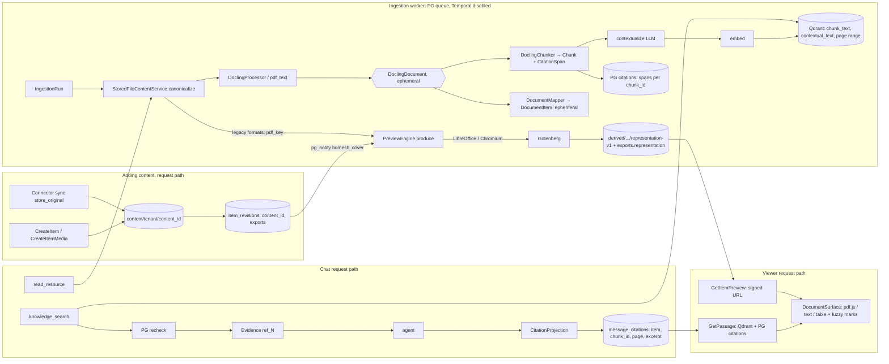
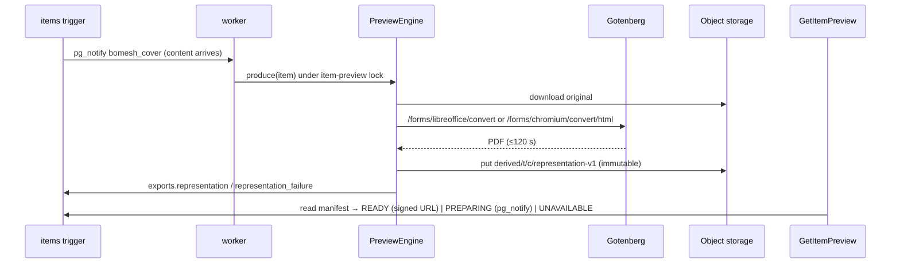
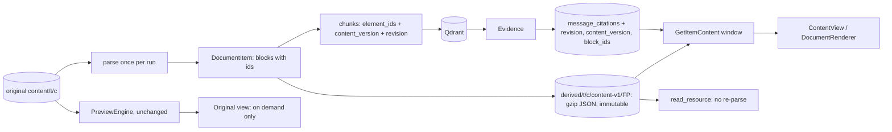
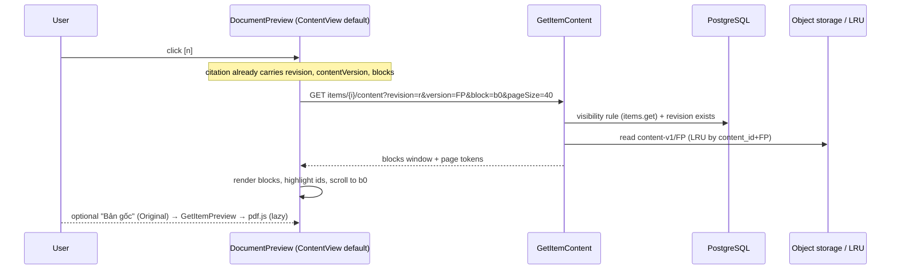

# BoMesh: unified document representation and content-first citations — architecture review

Review date: 2026-11-25. Code: `dev/prototype` at `94095dd`. Review only: no production source, schema,
index or design document was modified.

| Label | Meaning |
|---|---|
| **MEASURED** | Produced by a run in this review (`rag_review/doc_arch/probe_representation.py`, raw output in `results/`). Mac arm64; times are relative, not production. |
| **CODE** | Verified in source, cited as `path:line` (backend paths relative to `backend/`). |
| **DESIGN** | Stated in `backend/docs_design`. |
| **PUB** | Vendor or standards documentation; not measured on BoMesh. |
| **INFERENCE** | Reasoned, not measured. |

Reproduce: `cd backend && PYTHONPATH=. uv run python ../rag_review/doc_arch/probe_representation.py [--pdf converted.pdf]`.
The Gotenberg numbers came from a throwaway `gotenberg/gotenberg:8` container started with the
`deployment/compose.yml` flags.

Fixtures are generated, not production documents (the local database is empty; production was not
accessed). They are Vietnamese DOCX/XLSX/MD/HTML files containing the brief's example
(`13. Ngày phê duyệt lần đầu` → `09/12/2022`), plus a 2,730-block DOCX for the scale test.

---

## 17.1 Executive summary

**Verdict: adopt the direction, but as an extension of what exists. Do not build a new layer.**
BoMesh already has every piece of the proposed architecture. The pieces are not connected.

1. **The unified representation already exists, in memory.** Each ingestion run produces one `DocumentItem`
   (`connector/processing/mapper.py:44-82`). Its `ContentPart`s carry an `element_id`, and the chunker's
   `CitationSpan.element_id` uses the same values. **MEASURED:** 23/23 DOCX, 50/50 XLSX and 6/6 HTML span ids resolve to
   a block of the same parse. After chunking, the item is discarded (`services/knowledge_items/indexing.py:227-292`).
2. **The block contract and the renderer already exist, but only for chat artifacts.**
   - Backend: `build_document_rendition` (`services/artifacts/rendition.py:45-182`).
   - Frontend: `RenditionBlock` (`apps/web/src/modules/knowledge/reader/rendition.ts:7-58`) and `RenditionBlockView`
     (`apps/web/src/modules/artifacts/components/DocView.tsx:105-159`).
3. **Citations are tied to a mutable, positional chunk id with no revision.**
   - A chunk id is `"{item_id}:{index}"` (`connector/processing/chunking.py:143`).
   - `message_citations` stores `(item_id, chunk_id, page, excerpt)` (`db/models/assistant.py:177-188`).
   - Passages always resolve against the *current* `indexedRevision` (`services/knowledge_items/content.py:96-146`).
   - **MEASURED:** after one paragraph is inserted, 16 of 19 chunk ids point at different text. The old approval-date
     citation `item:17` now resolves to an unrelated paragraph, and nothing reports it.
4. **A citation click loads the whole visual pipeline.**
   - `DocumentPreview` mounts `DocumentSurface` immediately (`apps/web/src/modules/knowledge/preview/DocumentPreview.tsx:48-73`).
   - For a DOCX that means the Gotenberg PDF plus pdf.js. **MEASURED:** 552 KB of gzipped JavaScript on first use.
   - The DOCX passage has no page or box (**MEASURED:** 0/19 chunks), so the viewer scans every page's text layer and
     fuzzy-matches the passage (`reader/marks.ts:174-185,270-292`).

**Expected benefits.**
- Citation targets that survive rechunking, re-embedding and reprocessing.
- Evidence visible from one small JSON response, with no PDF and no pdf.js.
- The same text the model read is what the user sees highlighted.
- One renderer shared by knowledge documents and artifacts.
- No Docling or Gotenberg in the chat request path.

**Limits that must stay visible.**
- Content View shows *extracted* text: typed-PDF tables, multi-column layout, images, signatures and forms are not
  reproduced.
- Precision is honest:
  - **block** for most formats;
  - **table** for split table chunks, until P2 adds row ranges;
  - **document** for citations saved before the change.

**Risks.**
- **The direction partly reverses a recorded decision.** `document_viewer.md:43-46` rejected "a Docling rendition for
  Office" as the *file viewer*. That rejection stays valid: Content View is not a file viewer. It is an evidence view
  next to the unchanged six-representation preview engine. The design documents must say so explicitly, or the two
  views will compete.
- **Structure loss in the current mapper would surface as visible defects** once blocks are rendered. **MEASURED:**
  - one Markdown list item with bold and a link becomes 4 blocks (`Mục` / `một` / `có` / `liên kết`);
  - list items become paragraphs;
  - all headings render at level 1.

  P0 must fix these before any user sees Content View.
- **Typed PDFs are the weakest content source.**
  - Headings are heuristic and single-level, there are no tables, and text comes in stream order
    (`connector/processing/pdf_text.py:271-288`).
  - **MEASURED:** a DOCX written in the default Calibri font, converted by Gotenberg and read by that path,
    yields corrupted Vietnamese ("Thuốc đ c ch đ nh … ượ ỉ ị"). The legacy `.doc/.xls/.odt` path and some typed PDFs
    are affected. A Times New Roman version of the same text extracts correctly.

**Challenges to the brief.**
- **Do not persist DoclingDocument.** **MEASURED:** 2.4× the rendition for a long DOCX (4.31 MB vs 1.79 MB) and
  36× for XLSX (575 KB vs 16 KB). It would couple clients to docling-core. Its only plausible consumer, a re-parse
  cache, is not needed: re-parsing costs 0.06–7 s and needs no model; scanned pages are already cached as
  transcripts.
- **Do not create a database row per block, and do not segment storage.**
  - **MEASURED:** a 2,730-block document is one 1.79 MB object (gzip 28 KB on this repetitive fixture), loaded in
    3.6 ms.
  - The browser needs windowing (a 40-block window is about 26 KB). Storage does not.
- **Do not attempt highlighting in the original preview for DOCX, PPTX or HTML.** The preview shows a Gotenberg PDF of
  *other bytes* than the bytes that were parsed. A box drawn there would be fabricated precision. Only PDF content and
  legacy PDF-converted formats have trustworthy page and box provenance.

---

## 17.2 Current architecture (verified)

### 17.2.1 End-to-end overview



### 17.2.2 Stage table

| # | Stage | Code | Input → output | Persisted | Identity | Sync / when |
|---|---|---|---|---|---|---|
| 1 | Upload | `services/knowledge_items/items.py:179-245,433-484`, `item_store.py:602-640` | bytes → `item_revisions` #1 | `content/{t}/{content_id}` | `content_id` = uuid4 (`storage/keys.py:108-111`); no content hash | request |
| 2 | Connector | `connector/originals.py:37-74`; GDrive exports Docs→HTML, Sheets→XLSX | provider bytes → new revision | same | uuid5(connection, external_id, version) (`keys.py:114-124`) | worker sync |
| 3 | Run claim | `services/ingestion/worker.py:1-22,95-110`; `executor.py:432-438` | `ingestion_runs` row → `process_document` | run rows | advisory locks; Temporal commented out (`runtime.py:59,75,116`) | worker |
| 4 | Fetch | `knowledge_items/file_content.py:199-241` | revision → temp file; legacy formats → `PreviewEngine.pdf_key` → Gotenberg PDF | `derived/…/representation-v1` | `content_id` | worker (and API, see 17.2.5) |
| 5 | Parse | `connector/processing/docling.py:164-299,472-519`; `pdf_text.py:101-387` | file → `DoclingDocument` | only VLM transcripts `derived/…/transcript-v1/{fp}-p{a}-{b}.json` | per parse | worker, `asyncio.to_thread` |
| 6 | Map | `mapper.py:44-200` | `DoclingDocument` → `DocumentItem.content[ContentPart]` | **none** | `element_id = {p001\|doc}_{kind}_{seq}` (`mapper.py:176-184`) | worker |
| 7 | Chunk | `chunking.py:97-173` (HybridChunker, 256 approximate tokens, `repeat_table_header`) | `DoclingDocument` (a second traversal) → `Chunk` | — | `chunk_id = {item}:{index}` (`chunking.py:143`) | worker |
| 8 | Citation geometry | `knowledge_items/citations.py:22-48`; `indexing.py:281-284` | `Chunk.citation.spans` → rows | PG `citations(item_id, chunk_id UNIQUE, section_path, page_start/end, spans jsonb)`, **no revision** | `(item_id, chunk_id)` | worker, committed **before** indexing |
| 9 | Contextualize | `document_index/contextualization.py:72-86,280-379` | chunk windows → `contextual_text` | Qdrant payload (`semantic_context`, `context_key`) | reuse key includes `chunk_index` | worker, LLM |
| 10 | Embed + index | `document_index/index.py:86-185`; `_qdrant.py:105-140`; `payload.py:34-155` | `contextual_text` → dense + BM25 | point `uuid5(tenant:item:chunk_index)`; payload has `chunk_text`, `contextual_text`, `section_path`, `page_start/end`, **no element ids, revision or spans** | positional | worker |
| 11 | Retrieve | `knowledge/retriever.py:51-145`; `_qdrant.py:300-360` | queries → `Evidence` (`knowledge/__init__.py:63-79`) | — | `ref_N` per turn (`agent/models/__init__.py:51-90`) | chat request |
| 12 | Model context | `knowledge/context_builder.py:26-122` | evidence → raw `chunk_text` (≤ 1,600 characters per block); `contextual_text` never shown | — | `[[cite:ref_N]]` | chat request |
| 13 | Cite | `agent/citation_stream.py:26-312` | markers → `[n]` + `bomesh:document_citation` annotation (passage name, 280-character excerpt) | — | passage = `{item}/passages/{chunk_id}` | chat request |
| 14 | Persist | `services/conversations/chat.py:306-330`; `turn_store.py:142-151` | annotations → `message_citations` | `(message_id, position, item_id, chunk_id, page, excerpt)` | **no revision, no block** | end of turn |
| 15 | Citation API | `services/conversations/citations.py:57-66,154-185`; `api/dto/conversations.py:142-196` | rows → `Citation{passage, item, displayName, pageNumber, excerpt, available, outdated}` | — | readability re-checked per read | request |
| 16 | Passage API | `knowledge_items/content.py:88-160` | `chunk_id` → Qdrant text + PG spans | — | `revision` is always `indexed_revision_number` | viewer request |
| 17 | Preview API | `services/previews/engine.py:176-237`; `api/v1/knowledge_items.py:291-300` | item → signed URL of the representation | — | revision; never converts | viewer request |

### 17.2.3 Docling integration (Phase B)

**Versions (CODE, `pyproject.toml`, `uv.lock`).** docling 2.121.0, docling-core 2.92.0, docling-parse 7.15.0,
pypdfium2 5.13.0. `PARSER_VERSION = "docling-2.121-r2"` (`services/__init__.py:44`).

**Which parser handles which input (CODE):**
- **Declarative backends only:** `DocumentConverter(allowed_formats=[DOCX, PPTX, XLSX, HTML, MD, CSV])` with no
  format options (`docling.py:472-484`).
- **No layout model, TableFormer or local OCR.** The `do_ocr` and `do_table_structure` arguments are deleted on
  arrival (`docling.py:160-162`).
- **Typed PDFs** go to BoMesh's PDFium reader (`pdf_text.py`), not to Docling's PDF pipeline.
- **Scanned pages** (fewer than 20 characters plus an image) go to `VlmPipeline` through OpenRouter with
  `BOMESH_DOCLING_MODEL` (`docling.py:243-299,487-519`). Transcripts are cached per content.
- **Ignored policy flags:** `ocr_scanned_pdfs` and `parse_spreadsheets` are stored
  (`db/models/ingestion.py:376-377`) but read by nothing.

**What survives, and where it is lost:**

| Docling has | After `DocumentMapper` | After chunking | Persisted |
|---|---|---|---|
| `self_ref`, parent/children groups | `element_id` (positional); groups dropped | span `element_id` | `citations.spans` |
| Heading label and level | `TextPart` with no level; kind only inside `element_id`. **MEASURED:** the rendition gives every heading level 1 (it derives level from `len(section_path)`, `rendition.py:121-122`) | `section_path` | `citations.section_path`, Qdrant |
| List items, marker, nesting | plain `TextPart`. **MEASURED:** 3 DOCX list items → 3 paragraphs | text with `- ` markers | — |
| Inline groups (bold, link inside a sentence) | **one part per leaf. MEASURED:** `Mục **một** có [liên kết]` → 4 blocks | Markdown syntax in `chunk_text` (MEASURED) | Qdrant `chunk_text`, `message_citations.excerpt` |
| Table grid with spans | `TablePart{columns, rows}`; spans flattened (text repeated), row headers lost (`mapper.py:240-263`) | "row, column = value" triplets (MEASURED) | Qdrant |
| Picture + caption | `ImagePart` with caption/VLM text; **bytes never stored** | text | — |
| Provenance (page, bbox, charspan) | `prov[0]` only, normalized bbox | spans per provenance; offsets only when a chunk equals one whole item | `citations.spans` |

**Is there already an effective unified representation?** Yes. `DocumentItem` is provider-neutral: Docling types do
not leak (`mapper.py:41-42`). Every parser path (Docling backends, PDFium text layer, VLM) feeds it. Its ids already
join to chunk spans. What it lacks is persistence, heading and list semantics, inline-group merging, and a pinned
identity.

### 17.2.4 Citation construction and resolution

```mermaid
sequenceDiagram
  participant M as Model
  participant KS as knowledge_search
  participant Q as Qdrant
  participant PG as PostgreSQL
  participant CP as CitationProjection
  participant W as Web (DocumentPreview)
  KS->>PG: access.scope
  KS->>Q: hybrid (dense + BM25, RRF)
  KS->>PG: recheck(item_ids)
  KS-->>M: Evidence blocks, "Source reference: ref_N", raw chunk_text
  M-->>CP: "... [[cite:ref_3]]"
  CP-->>W: "[n]" + annotation {passage: item/passages/item:17, excerpt[280]}
  CP->>PG: message_citations(item, "item:17", page, excerpt)
  Note over W: later, possibly after reprocessing
  W->>PG: GetItem
  W->>Q: GetPassage item:17 (current index; positional id)
  W->>PG: citations spans for item:17 (current parse)
  W->>W: GetItemPreview → pdf.js → boxes or fuzzy text match
```

**Defects (CODE unless marked MEASURED):**
1. **Positional ids redirect silently.** A historical citation resolves against whatever the current parse put at
   that index (**MEASURED** above). This contradicts `document_viewer.md:292-293` ("a passage that no longer resolves
   is reported, not guessed").
2. **The DOCX approval-date citation works today only by accident of text search.**
   - **MEASURED:** the chunk is `item:17`, text `09/12/2022`, element `doc_para_031`, section path
     `[… , "13. Ngày phê duyệt lần đầu"]`, with no page or box.
   - The viewer shows the Gotenberg PDF and fuzzy-matches `09/12/2022` across all pages
     (`PdfView.tsx:165-184`, `marks.ts:174-185`). It marks the first match [INFERENCE].
3. **The excerpt leaks Markdown.** The excerpt is whitespace-collapsed `chunk_text` (`citation_stream.py:205-266`).
   **MEASURED:** Markdown sources carry `**…**`, `[…](…)`, `- ` and code fences.
4. **Spreadsheet locations are a sheet index only.** **MEASURED:** XLSX chunks have page = sheet index and a
   cell-unit bbox of the whole table. No row range or sheet name is carried. The client guesses rows by quoted-cell
   matching (`apps/web/src/modules/knowledge/reader/table.ts:112-150`).
5. **Several passages of one document** keep separate `(item, chunk)` rows (`chat.py:306-330`). The client rebuilds
   number → passage by parsing text order. An alias number opens passage 0 (`DocumentPreview.tsx:201`).
6. **Geometry and text can disagree.** `citations` rows commit before Qdrant indexing (`indexing.py:281-292`); if
   indexing fails, GetPassage mixes old text with new boxes.

### 17.2.5 Gotenberg flow (Phase H)



| Question | Answer |
|---|---|
| Supported formats | LibreOffice: doc/docx/odt/rtf/…, ppt/pptx/…, xls/ods, vsd/odg/pub. Chromium: html/htm/xhtml/mht/eml (`services/previews/formats.py:216-232`) |
| When | Eager, on content arrival, in the worker; a 10-minute sweep; a read that finds nothing sends `pg_notify` (`engine.py:176-237,300-327`; `worker.py:531-615`) |
| Persisted | `derived/{t}/{content_id}/representation-v1` plus `exports.representation`, reused across revisions that share `content_id` (`item_store.py:87,730-734`) |
| Repeated conversions | None per `content_id`. Identical bytes uploaded twice convert twice: there is no hash dedupe. **MEASURED:** output is not byte-deterministic (two conversions of one DOCX differ) |
| Revision-bound | Yes, through `content_id` |
| Do citation clicks convert? | Never inline. Opening an *older* indexed revision can enqueue a conversion (`engine.py:211-220`) |
| Does ingestion depend on it? | Only for legacy/OpenDocument formats (`file_types.py:64-78`, `file_content.py:203-241`). A failed conversion fails processing |
| Request-path violation | **Yes.** `read_resource` → `canonicalize` → `pdf_key` → Gotenberg runs synchronously in the chat path, without the item lock (`agent_runtime/item_resource_resolver.py:50-59`, `runtime.py:388-404`) |
| Boundary health | Correct for knowledge viewing. Gotenberg does conversion, not understanding, except for legacy formats, where it is the only route to text |

**MEASURED conversion times** (warm container): DOCX 0.09 s (0.37 s on the first request), XLSX 0.14 s, HTML through
Chromium 1.30 s. The 37 KB DOCX became a 49 KB, 3-page PDF.

### 17.2.6 Frontend rendering

```text
AppShell ─ DocumentPreviewHost (next/dynamic) ─ DocumentPreview (HeroUI Modal)
  ├─ LockedPreview (GetItem 403/404)
  ├─ ReadingBar (steps through passages)
  └─ PreviewDocument ─ usePassages (GetPassage ×n) + DocumentSurface (GetItemPreview)
        └─ lazy: PdfView (pdf.js) | TextView (react-markdown) | TableView | ImageView | MediaView | ArchiveView
ReaderPage /doc/[id] ─ same DocumentSurface variant="reader"
Artifacts FilePanel ─ separate stack: RenditionPage/RenditionBlockView, SheetView, MarkdownPage …
```

- **One knowledge viewer** (`reader/components/DocumentSurface.tsx`). It switches on `representation.kind` only,
  which is good.
- **Five ways to open a citation** (CODE, `FrontendViewerScout`):
  - chat `openCite`, duplicated in `ChatThread.tsx:244-258` and `SharedThread.tsx:66-77`;
  - work `citationHref` (`work/model.ts:75-82`);
  - DraftView with no passage;
  - RuleChecks;
  - MaterialsTab → Reader.
- **No shared helper for location labels.** At least 7 local formatters exist.
- **Four highlight implementations**, plus box overlays.
- `ItemPassage.elementIds` is returned by the API but never read by the web client.
- `apps/mobile` is empty.

**Request count for one cold PDF/DOCX citation click (CODE):**
1. the DocumentPreview chunk;
2. GetItem (cached for 30 s from the source chip);
3. GetPassage (waits for GetItem);
4. GetItemPreview;
5. the pdf.js module and worker (**MEASURED:** 156 KB + 396 KB gzip, pdfjs-dist 6.5.438);
6. the PDF: one GET under 4 MiB, otherwise 1 MiB ranges;
7. without boxes, `getTextContent` for every page, which reads roughly the whole file.

---

## 17.3 Representation inventory

| Representation | Producer | Storage | Consumer | Lifecycle | Problems |
|---|---|---|---|---|---|
| Original bytes | upload / connector | `content/{t}/{content_id}` | download, parse, preview | immutable; purged when unreferenced | no content-hash dedupe |
| Preview representation (PDF / TEXT / TABLE / ARCHIVE / IMAGE) | `PreviewEngine` | `derived/…/representation-v1` + `exports.representation` | `DocumentSurface` | per content; old versions kept until purge | DOCX/PPTX/HTML show different bytes from those parsed, so citation geometry is unaligned |
| `DoclingDocument` | `DoclingProcessor` | none (VLM transcripts only) | mapper, chunker | ephemeral | traversed twice; re-created per agent read |
| `DocumentItem` (parts) | `DocumentMapper` | none for knowledge | `get_text_content` (agent read), artifact rendition | ephemeral | heading level, lists and inline groups lost |
| Artifact rendition `document.json.gz` | `build_document_rendition` | `derived/…/preview-v1/document.json.gz` + `exports.preview` | `RenditionPage` (artifacts only) | version `sha256(content_id:"document-v1")` **ignores `PARSER_VERSION`** (`artifacts/preview.py:548-550`) | artifact-only; re-parses on every read after a failure (`artifact_store.py:223-241`) |
| Chunks | `DoclingChunker` | Qdrant payload | retrieval, GetPassage | replaced per run | positional ids; no element ids or revision |
| Contextual text | contextualizer | Qdrant payload | embedding / BM25 only | reused by key | correctly separate from source text |
| Citation geometry `citations` | `CitationService` | PG | GetPassage | soft-delete + upsert per run | duplicates span data; no revision; commits before the index |
| Message citation | `ChatTurn` | PG `message_citations` | Citation API | forever | no revision, content version or block; excerpt is raw `chunk_text` |
| Copies `{item_id, chunk_id, page}` | artifacts, requests | jsonb (`evidence_review_cells.citations`, `requests.assistant_context`) | Work, Requests | forever | same positional-id weakness |
| Cover | `PreviewEngine` | `exports.cover` + `cover-v2` | lists | per content | fine |
| Agent-read text | `canonicalize` → `get_text_content` | none | `read_resource` | per call | full re-parse each call; tables and headings flattened |

**Duplicates:**
- Plain text is computed four ways: `items.py:121`, `chunking.py:474`, `mapper.py:298` and `rendition._block`.
- Section path is stored three times: Qdrant, `citations`, and inside `contextual_text`.
- Page is stored twice: Qdrant and `citations`.

**Dead code** (CODE, no callers):
- `DoclingChunker.chunk_item` and `_document_from_item` (`chunking.py:81-96,176-188`);
- `StoredFileContentService.parse()`;
- `retriever.source_reference()` (`retriever.py:129-145`);
- `include_contextual_text` (never enabled);
- `ProcessedFile.text` (unused by indexing).

---

## 17.4 Format capability matrix

Precision is what a citation can honestly point at. "Content View" is the proposed view.

| Format | Parser | Headings | Tables | Images | Today's precision | Content View | Original preview (highlight) | Known limits / fallback |
|---|---|---|---|---|---|---|---|---|
| PDF (typed) | PDFium text layer | heuristic, level 1 only | ✗ (rows become lines) | VLM text only with `readImages` | page + block bbox (MEASURED 20/20) | ✓ block | pdf.js, **boxes reliable** (same bytes) | stream order: font-fallback glyphs reorder (MEASURED); multi-column interleaves [INFERENCE] |
| PDF (scanned) | VLM → Markdown → Docling | ✓ | ✓ (Markdown) | ✗ | page | ✓ block (labelled as transcription) | page only | OCR/VLM errors; label "machine transcription" |
| DOCX | Docling MsWord | ✓ (level lost) | ✓ (spans flattened) | caption/VLM text | element only, no page/bbox (MEASURED 0/19) | ✓ block | Gotenberg PDF, **no highlight** | `read_images` off ⇒ pictures absent |
| PPTX | Docling PPTX | title-like | ✓ | caption | slide + shape bbox [INFERENCE] | ✓ block | Gotenberg PDF, no highlight (other bytes) | slide layout not reproduced |
| XLSX / XLSM | Docling XLSX + banner lift | — | ✓ cells | — | sheet index + whole-table bbox (MEASURED 49/49) | ✓ table block (row window in P2) | TABLE grid; quoted-row match | no row range until P2 |
| CSV | Docling CSV | — | ✓ | — | element | ✓ | TABLE grid | — |
| TSV / JSONL / LOG / SQL | one text item per line; line chunker | — | ✗ | — | element (line) | ✓ paragraph per line | TEXT | TSV not a table |
| HTML / HTM (+ Confluence, GDoc) | Docling HTML | ✓ | ✓ | caption / remote URL (not loaded) | element | ✓ | Chromium PDF, no highlight | remote images never fetched (good) |
| MD | Docling MD | ✓ | ✓ | — | element | ✓ (after inline-group fix) | TEXT Markdown, text match | inline formatting split (MEASURED) |
| TXT / RST / JSON / XML / YAML | one text item | ✗ | ✗ | ✗ | whole document (`doc_para_001`) | ✓ single block; **document-level precision** | TEXT | large files: one block, so P2 offsets are needed |
| DOC / ODT / RTF / PPT / XLS / ODS … | Gotenberg PDF → PDFium | as PDF | ✗ | as PDF | page + bbox | ✓ block | pdf.js, boxes reliable (same PDF) | conversion failure ⇒ not processed; glyph order (MEASURED) |
| EML / MHT | none (viewable only) | — | — | — | not citable | — | Chromium PDF | not knowledge |
| Images | not knowledge | — | — | — | — | — | IMAGE | attachments only |
| ZIP | expanded into children | — | — | — | per child | per child | ARCHIVE list | — |

---

## 17.4b Representation options (Phase B decision)

| Criterion | A — persist `DoclingDocument` | B — new block contract | C — extend `DocumentItem` + existing rendition |
|---|---|---|---|
| Structural fidelity | highest (lossless) | as designed | sufficient after the P0 mapper fixes |
| Parser independence | ✗: the typed-PDF path builds a DoclingDocument by hand anyway, and clients would bind to docling-core 2.x | ✓ | ✓ (already provider-neutral, `mapper.py:41-42`) |
| Citation support | `self_ref` positional, same as today | needs a new join | ✓ (MEASURED: span ids join blocks) |
| Frontend | needs a docling-core-aware renderer | new renderer | ✓ `RenditionBlock` + `RenditionBlockView` exist |
| Storage (MEASURED, raw) | DOCX 31.7 KB, XLSX 575 KB, large DOCX 4.31 MB | ≈ C | DOCX 10.8 KB, XLSX 16 KB, large DOCX 1.79 MB |
| Migration | new artifact + renderer | new artifact + mapper + renderer | new storage location for an existing artifact; mapper fixes |
| Maintainability | tracks Docling schema churn | a second model next to `DocumentItem` | one model |
| Extensibility | whatever Docling adds | free | add fields to parts |

**Decision: C.** B is what C already is. A is rejected as a stored or public representation.

---

## 17.5 Target architecture

**One sentence:** each ingestion run persists the `DocumentItem` it already builds, as an immutable **content**
product keyed by `(content_id, content version)`. Chunks and citations carry its block ids. Citations pin
`(revision, content version, blocks)`. Content View reads a window of blocks. The preview engine stays the
"Original" view, loaded on demand.



**Content version `FP`** = `sha256(PARSER_VERSION, docling version, read_images, vision model or "none",
CONTENT_SCHEMA)[:16]`. It covers everything that changes blocks, and nothing that does not: chunker, embedding and
contextualization are excluded, so rechunking, re-embedding and re-contextualizing never invalidate a citation.
Parsing is deterministic (**MEASURED:** `reparse_deterministic: true`; gzip `mtime=0`), so concurrent or repeated
runs write identical bytes to the same key.

### Ingestion sequence (target)

```mermaid
sequenceDiagram
  participant W as worker (process_document)
  participant P as FileProcessor
  participant S as Object storage
  participant PG as PostgreSQL
  participant X as ItemIndex
  W->>P: canonicalize(revision) [unchanged]
  P-->>W: DocumentItem + Chunks (spans → block ids)
  W->>S: put derived/t/c/content-v1/FP if absent (immutable, idempotent)
  W->>PG: exports.content = {version, fingerprint, blockCount, sizeBytes, truncated}
  W->>X: index chunks; payload += element_ids, content_version, revision_number
  W->>PG: record indexed (unchanged)
```

### Citation-click sequence (target)



Original view highlighting:
- PDF and PDF-converted legacy formats: boxes from block bboxes, because they are the same bytes.
- Everything else: no highlight, and the UI says the cited location is shown in Content View.

---

## 17.6 Component decision matrix

| Component | Decision | Evidence / reason |
|---|---|---|
| `DocumentMapper` / `DocumentItem` | **OPTIMIZE** | Unified model already (`mapper.py:41-82`). Add heading level, list items and inline-group merge; guarantee unique ids (MEASURED defects) |
| `build_document_rendition` | **REUSE → move** to `services/knowledge_items/` | Block contract exists (`rendition.py:45-182`); used for knowledge content and artifacts |
| Artifact `preview-v1/document.json.gz` | **SIMPLIFY (P2)** | Same producer, one product; fixes the version bug that ignores `PARSER_VERSION` |
| `DoclingChunker` | **KEEP** (+ map spans to block ids; P2 offsets and row ranges) | HybridChunker and table-header repetition are measured to help retrieval (`rag_review/ARCHITECTURE_REVIEW.md`) |
| Contextualization, hybrid search | **KEEP** | Contextual text is already kept separate; the model sees raw text (`context_builder.py`) |
| Qdrant payload | **OPTIMIZE** | Add `element_ids`, `content_version`, `revision_number` (schema 11 → 12) |
| Chunk ids `{item}:{index}` | **KEEP for retrieval; DEFER content-addressing** | Once citations pin blocks, chunk ids are not a citation identity |
| PG `citations` table | **KEEP (P1) → REMOVE (P2)** | Its spans duplicate block provenance; it commits before the index |
| `message_citations` | **OPTIMIZE** | Add `revision_number`, `content_version`, `block_ids` |
| `Citation` / `SearchItemsPassage` DTOs | **OPTIMIZE** | Add `revision`, `contentVersion`, `blocks` |
| `GetPassage` / `ListPassages` | **KEEP** | Still the chunk view for Reader `?passage=`; geometry moves to blocks in P2 |
| `GetItemContent` | **ADD** | One windowed read; no viewer can do without it |
| PreviewEngine + Gotenberg | **KEEP** | Correct "Original" boundary. Eager conversion feeds covers |
| `pdf_key` in `read_resource` | **REMOVE** | Chat path converts synchronously (17.2.5) |
| `pdf_text.py` line assembly | **OPTIMIZE (P0)** | Stream-order corruption (MEASURED) |
| `item_resource_resolver.read` | **OPTIMIZE** | Read stored content; parse only when absent, then store it |
| `DocumentSurface` + six viewers | **KEEP** as OriginalPreviewView | Already one switch on kind |
| `RenditionBlockView` | **REUSE → shared `DocumentRenderer`** | Exists (`DocView.tsx:105-159`); add an `http(s)`/`mailto` allowlist for `href` |
| `marks.ts` fuzzy matching | **SIMPLIFY** | Stays for `?q=` search and Original text layers; citations use ids |
| Citation open paths (5) and location labels (7) | **SIMPLIFY** | One `openCitation` and one `locationLabel` helper |
| Dead code (17.3) | **REMOVE** | No callers |
| DoclingDocument persistence | **DEFER (reject)** | 2.4–36× size (MEASURED); no consumer |
| Per-block DB rows, storage segments | **DEFER** | 3.6 ms to load 1.8 MB (MEASURED) |
| Mobile renderer | **DEFER** | `apps/mobile` is empty; the API is mobile-ready |

---

## 17.7 Data and API contracts

All changes are designed first in `openapi.yaml` and `api_design.md`, then the DBML and models (AGENTS.md rules).

### Content product (object storage, no new table)

- **Key.** `derived/{tenant}/{content_id}/content-v1/{fingerprint}`. This follows the `transcript-v1/{fingerprint}`
  precedent (`database_architecture.md` "Object storage"). It is immutable,
  `Cache-Control: private, max-age=31536000, immutable`, and deleted with the content prefix.
- **Body.** The existing rendition envelope `{"schema":2,"truncated","blocks":[…]}`. Block:

```json
{"id":"doc_para_031","kind":"paragraph","text":"09/12/2022","page":null,
 "level":null,"bbox":null,"url":null,"columns":null,"rows":null,"language":null}
```

- **Block kinds:** `heading` (with `level`), `paragraph`, `list_item` (with `level`, `marker`), `table`, `code`,
  `image` (text only, marked "image not shown"), `link`.
- `bbox` is set only when the parsed bytes are the bytes the Original view shows: as-is PDF and legacy formats.
- Null fields are omitted.
- No `quote` kind: no current backend emits one.
- **Manifest.** `item_revisions.exports.content = {version:1, fingerprint, blockCount, sizeBytes, truncated}`. This
  extends the existing `exports` jsonb (`design.dbml:424`) and is reused across revisions that share a `content_id`,
  like `representation`.

### Chunk → block mapping

- `CitationSpan.element_id` becomes the **block id**: a span inside an inline group maps to its group block.
- The Qdrant payload gains `element_ids: [str]`, `content_version: str` and `revision_number: int`.
- A chunk that splits one long block keeps that block id. Precision is the block. P2 adds `start_offset/end_offset`
  within it, and `row_start/row_end` for tables.

### Message citation

Add to `message_citations`:

| Column | Type | Notes |
|---|---|---|
| `revision_number` | int | null for legacy rows |
| `content_version` | text | null for legacy rows |
| `block_ids` | text[] | empty for legacy rows |

- **Why a column, not a new table:** the identity and lifecycle are the message's. Justify it in `item_model.md` §5.
- Apply the same three fields to the `{item_id, chunk_id, page}` JSON copies in `artifacts.evidence_review`,
  `evidence_review_cells.citations` and `requests.assistant_context`.

### API: `Citation` and `SearchItemsPassage` gain

```yaml
revision:       { type: string, readOnly: true, description: "workspaces/{w}/items/{i}/revisions/{n} the answer read" }
contentVersion: { type: string, readOnly: true, description: "Opaque extracted-content version the blocks belong to" }
blocks:         { type: array, items: {type: string}, readOnly: true, description: "Block IDs of the cited passage; empty = location unknown (document-level)" }
```

### API: `GetItemContent` (new; Knowledge tag)

```yaml
/api/v1/workspaces/{workspace}/items/{item}/content:
  get:
    operationId: GetItemContent
    summary: Read a window of a document's extracted content.
    x-permission: items.get           # visibility rule; reviewer exception as GetItemPreview
    parameters: revision (int, default indexedRevision), version (string, default that revision's exports.content),
                block (string: anchor block ID), pageSize (int, default 40, max 200), pageToken (string)
    200: ItemContent
      name, revision, version, truncated,
      blocks[]  {id, kind: HEADING|PARAGRAPH|LIST_ITEM|TABLE|CODE|IMAGE|LINK, text, level, marker, uri, columns, rows, language, pageNumber}
      previousPageToken, nextPageToken
    errors: COLLECTION → INVALID_ARGUMENT; DELETED or unreadable → NOT_FOUND;
            revision never processed → FAILED_PRECONDITION CONTENT_NOT_PROCESSED;
            version not retained → FAILED_PRECONDITION CONTENT_VERSION_UNAVAILABLE;
            unknown block → INVALID_ARGUMENT
```

- **Window.** Starts `pageSize/4` blocks before `block`. Tokens encode the start index (AIP-158). A table block in a
  window is returned whole, up to the existing 10,000-row bound. Row windows come in P2.
- **Caching.** `ETag` = `{content_id}:{fingerprint}:{start}`, `Cache-Control: private, no-cache`. The browser
  revalidates and the server re-authorizes every read, so revocation takes effect at once (a signed URL would not).
- **Preview API.** No change. The client simply stops calling it until the user asks for the Original.

---

## 17.8 Implementation plan

Order: design documents → `apps/ux_preview` → backend → web, per AGENTS.md. Each task is one coherent change.

### P0 — source integrity and representation correctness

**P0-1 Mapper fidelity for rendering**

| Field | Value |
|---|---|
| Problem | MEASURED: inline groups split into word blocks; list items become paragraphs; all heading levels are 1; KeyValue/Form ids can collide (both `structured`, separate `self_ref` arrays, `mapper.py:176-199`) |
| Files | `connector/processing/mapper.py`, `connector/protocol/content.py`, `services/artifacts/rendition.py`, `connector/processing/chunking.py` (leaf → block id in `_citation_spans`) |
| Change | `TextPart.level`, `TextPart.list_marker`; merge `InlineGroup` children into one part (text joined; a link kept as `link` when it is the whole part); unique-id guard; spans map leaf refs to the owning block id |
| Dependencies | none |
| Migration | bump `PARSER_VERSION` → r3, so documents are OUTDATED and reprocessed on the next run |
| Resource | negligible (MEASURED: map ≤ 2 ms; rendition 14 ms for 2,730 blocks) |
| Tests | `tests/…/test_mapper_blocks.py`: the MD fixture gives one list-item block "Mục một có liên kết"; DOCX headings keep levels; ids are unique; every chunk span id is a block id |
| Accept | fixture block lists equal golden JSON; `span_element_ids_resolving_to_block` = 100% for every fixture |

**P0-2 PDF text-layer reading order**

| Field | Value |
|---|---|
| Problem | MEASURED: Calibri DOCX → Gotenberg PDF → `pdf_text` produces reordered Vietnamese diacritics; the same text in Times New Roman is correct; PDFium's raw `get_text_range` shows the same order, so the cause is stream order, not decoding |
| Files | `connector/processing/pdf_text.py:271-300` |
| Change | within each line, order characters by their char box x (boxes are already read at `:285`) before joining; keep stream order across lines |
| Dependencies | none |
| Migration | `PARSER_VERSION` bump (shared with P0-1) |
| Resource | O(n log n) per line; negligible |
| Tests | fixture: Calibri DOCX converted by Gotenberg (store the PDF fixture, no Gotenberg in CI), extracted text equals the native DOCX text after whitespace normalization |
| Accept | approval chunk text has no fallback-glyph reordering; existing PDF tests stay green |

**P0-3 Persist the content product per run**

| Field | Value |
|---|---|
| Problem | the parse that indexes is discarded (`indexing.py:227-292`); nothing can render or cite it later |
| Files | `services/knowledge_items/indexing.py`, new `services/knowledge_items/content_product.py` (moved rendition builder + fingerprint + key), `storage/keys.py`, `item_store.py` (`_CONTENT_EXPORTS` += `content`), `purge.py` (prefix already covers it) |
| Change | after `canonicalize`: `put` if absent, then record `exports.content`; failure to write fails the task (retryable) |
| Dependencies | P0-1 |
| Migration | none for the schema (`exports` jsonb); objects appear as documents are processed. PROD-DATA from the prior review: 181 `ready` documents to reprocess; the 14.7k pending get it on first processing |
| Resource | MEASURED: 0.85 KB (DOCX) to 28 KB gzip (2,730 blocks) per document; one PUT per run |
| Tests | processing a fixture twice writes one object and the same fingerprint; changing the chunker setting keeps the fingerprint; `read_images` changes it |
| Accept | `exports.content` present for every SUCCEEDED document processed after the change |

**P0-4 Pin citation identity**

| Field | Value |
|---|---|
| Problem | MEASURED: positional ids redirect old citations silently |
| Files | `document_index/payload.py` (+3 fields, schema 12), `knowledge/__init__.py` `Evidence`, `agent/citation_stream.py` (annotation `revision`, `contentVersion`, `blocks`), `services/conversations/{chat.py,turn_store.py,citations.py}`, `db/models/assistant.py`, `design.dbml`, `api/dto/conversations.py`, `openapi.yaml` `Citation`, artifact and request JSON copies |
| Change | the citation is resolved deterministically from the evidence the tool returned; the model still emits only `ref_N` |
| Dependencies | P0-3 |
| Migration | `make db-reset` locally; for persistent environments, a reviewed one-off script adds the nullable columns. Legacy rows keep empty `blocks` |
| Resource | +3 small payload fields; no extra query (fields ride on the evidence) |
| Tests | a turn citing ref_N stores the revision, version and blocks of that chunk; the model cannot inject a block id (the marker charset is unchanged and ids come only from evidence) |
| Accept | the brief's "rechunking" and "reprocessing" scenarios (17.9 #9, #10) pass |

**P0-5 Legacy-citation guard**

| Field | Value |
|---|---|
| Problem | old rows can only resolve through positional `chunk_id` |
| Files | `apps/web/src/modules/knowledge/preview/DocumentPreview.tsx`, `reader/queries.ts` |
| Change | when a citation has no `blocks`, mark the passage only if the stored `excerpt` (whitespace-collapsed) is a prefix of the passage text; otherwise show "cited location not available" plus the excerpt |
| Dependencies | none (ships first) |
| Migration | none |
| Resource | none |
| Tests | web unit test: a mismatched excerpt gives `unresolved` |
| Accept | no silent wrong highlight for legacy citations |

### P1 — unified content rendering and citation navigation

**P1-1 Contract and design documents**

| Field | Value |
|---|---|
| Problem | no content read exists; `document_viewer.md` describes viewing only |
| Files | `openapi.yaml`, `api_design.md` §5, `document_viewer.md` (new section "Content View: evidence, not the file"), `document_contract.md` "Formats" (correct the claim at :115-117), `conversation_loop.md:352-356` (stale), `database_architecture.md` (content-v1 row), `item_model.md` §5 (column justification) |
| Change | contracts from 17.7 |
| Dependencies | — |
| Migration | — |
| Resource | — |
| Tests | `cd backend && uv run python -m pytest ../tests/docs_design`; `dbml2sql` |
| Accept | contract tests green |

**P1-2 `GetItemContent`**

| Field | Value |
|---|---|
| Problem | — |
| Files | `api/v1/knowledge_items.py`, `api/dto/knowledge_items.py`, `services/knowledge_items/content.py` |
| Change | visibility check, then manifest, then object read through an in-process LRU (64 entries by `content_id:fp`), then slice |
| Dependencies | P0-3, P1-1 |
| Migration | — |
| Resource | MEASURED: 3.6 ms gunzip + parse for 1.8 MB; LRU memory ≤ 64 × object size |
| Tests | API tests for window, tokens, unknown block, unretained version, unreadable item → NOT_FOUND, reviewer exception |
| Accept | p95 < 50 ms locally for the 2,730-block fixture |

**P1-3 UX preview first**

| Field | Value |
|---|---|
| Problem | AGENTS.md: `apps/web` changes are represented in `apps/ux_preview` first |
| Files | `apps/ux_preview/scripts/features/{preview.js,reader.js}`, styles, `docs/KNOWLEDGE_HUB.md` |
| Change | Content View is the citation default: header, an "Extracted content" note, blocks with highlight, "show earlier/later", one secondary toggle "Bản gốc". Remove `injectQuote` faking (`reader.js:66-79`). Apply `PRODUCT_DESIGN_RULES.md` (one primary action: read the evidence) |
| Dependencies | P1-1 |
| Migration | — |
| Resource | — |
| Tests | manual review in `ux-preview.html` |
| Accept | user sign-off |

**P1-4 Web Content View**

| Field | Value |
|---|---|
| Problem | an eager PDF mount on every click |
| Files | new `knowledge/reader/components/{DocumentRenderer,ContentView}.tsx` (from `DocView.RenditionBlockView`), `DocumentPreview.tsx`, `chat/citations.ts`, `ChatThread.tsx`, `SharedThread.tsx`, `work/model.ts`, one `openCitation` and one `locationLabel` helper |
| Change | citations open ContentView; `DocumentSurface` mounts only after the toggle; highlight by `blocks`; ReadingBar steps through blocks; artifacts render through the same `DocumentRenderer`; `href` allowlist |
| Dependencies | P1-2, P1-3 |
| Migration | none |
| Resource | expected 1 request and roughly 1–30 KB, no pdf.js (17.10) |
| Tests | web tests: a click issues no `/preview` request and does not import pdf.js; the toggle loads it; ids highlight |
| Accept | scenarios 1, 2, 6, 7, 8 |

**P1-5 `read_resource` on stored content**

| Field | Value |
|---|---|
| Problem | a full parse (and Gotenberg) per agent read (`item_resource_resolver.py:50-59`) |
| Files | `item_resource_resolver.py`, `file_content.py` |
| Change | read `exports.content` of the current revision and serialize blocks (Markdown headings and tables); when absent (unprocessed attachment), parse, store the product and return. Legacy formats without a PDF answer "not processed yet" instead of converting in the request |
| Dependencies | P0-3 |
| Migration | — |
| Resource | removes a 0.06–7 s parse per read (MEASURED parse times) |
| Tests | the resolver test reads without invoking `FileProcessor` when the product exists |
| Accept | no `pdf_key` call reachable from the API process |

**P1-6 Search results in Content View**

| Field | Value |
|---|---|
| Problem | Search opens a preview without a passage (`SearchPage.tsx:204`) |
| Files | `SearchItemsPassage` (+`revision`, `contentVersion`, `blocks`), `BrowsePage`, `SearchPage` |
| Change | the same open helper |
| Dependencies | P0-4, P1-4 |
| Migration | — |
| Resource | — |
| Tests | — |
| Accept | a search hit opens at its block |

**P1-7 Dead code removal** (17.3 list), together with the touched files.

### P2 — loading optimization and format coverage

**P2-1 Table row ranges and spreadsheet locations**
- Problem: there is no row range (MEASURED). The fixture's 300-row sheet is one 16 KB block.
- Change: `_citation_spans` computes `row_start/row_end` by serializing rows with the chunker's own serializer
  (exact match, same code). Blocks carry `sheetName`. GetItemContent returns a row window for a table anchor. The
  label is "Sheet · rows a–b".
- Tests: an XLSX citation highlights the cited rows only.

**P2-2 Sub-block offsets.** When a chunk is a contiguous substring of one block (plain text), record its offsets and
highlight the sub-range. Otherwise stay at block level.

**P2-3 Remove the `citations` table.**
- Precondition: blocks carry `bbox` for PDF-sourced documents, and the payload carries `element_ids`.
- Change: GetPassage reads geometry from blocks. The table and `CitationService` are removed, which also removes
  defect 6 of 17.2.4.

**P2-4 One rendition producer.** Artifacts use `content-v1/{fp}`. Drop `preview-v1/document.json.gz` and its version
bug.

**P2-5 Outline.** `GetItemContent?view=OUTLINE` returns heading blocks only, for long documents.

**P2-6 Lazy Docling import in the API process** after P1-5.
- MEASURED: `import api.app` loads docling and torch: 553 MB RSS, 13.4 s; `docling.document_converter` alone
  337 MB, 3.6 s.
- [INFERENCE] about 225 MB per API replica saved, if nothing else imports it eagerly.

**P2-7 Measure before segmenting.** Export the size distribution of `exports.content.sizeBytes` in production.
Segment only if p99 exceeds 8 MB raw.

**P2-8 Fonts in Gotenberg** (Carlito/Caladea/Noto with Vietnamese coverage). This improves Original fidelity for
Calibri/Cambria documents. Measure visual differences before adopting.

### Deferred (not justified now)

- Persisting `DoclingDocument`.
- Image crops in content.
- Inline bold and italic.
- Sentence-level grounding.
- Runtime LLM claim verification. Use the offline evaluation in `evaluation.md` instead (block validity ≠ claim
  truth).
- Content-addressed chunk ids.
- Lazy Gotenberg conversion (it conflicts with page-1 covers).
- Full W3C annotation selectors.
- A mobile renderer: the content API is ready for one, but there is no app yet.

---

## 17.9 Regression scenarios

| # | Scenario | Layer / fixture | Assertion | Today |
|---|---|---|---|---|
| 1 | DOCX citation opens the right block | backend + web; `fixture.docx` | the stored citation has `blocks=["doc_para_031"]`; ContentView highlights exactly that block | chunk `item:17` → `doc_para_031` (MEASURED); viewer fuzzy-matches in the PDF |
| 2 | `09/12/2022` referenced and highlighted | same | the highlighted block text equals `09/12/2022`; the heading block `13. Ngày phê duyệt lần đầu` is the preceding block in the window | the content exists (MEASURED); highlight by text search only |
| 3 | No raw Markdown in snippets | backend; `fixture.md` | `excerpt` and block text contain no `**`, `](`, fences or leading `- ` | **fails** (MEASURED) |
| 4 | Spreadsheet location is meaningful | backend + web; `fixture.xlsx` | P1: label "Học phí 2025" + table block; P2: rows a–b | sheet index only (MEASURED) |
| 5 | Two passages of one document stay distinct | backend + web | two `message_citations` rows with different `blocks`; stepping highlights each | alias bug (`DocumentPreview.tsx:201`) |
| 6 | A click requests no original and mounts no PDF | web | no `/preview`, no signed-URL fetch, no pdf.js import before the toggle | **fails** (CODE) |
| 7 | Original only on request | web | the toggle triggers GetItemPreview, then the viewer | n/a |
| 8 | Large document opens cited content cheaply | API + web; 2,730-block fixture | response ≤ 200 blocks; browser receives ≤ 60 KB | n/a (MEASURED: 40-block window = 26 KB) |
| 9 | Rechunking keeps citations | backend | change `CHUNKER_VERSION`/`max_tokens`, reprocess: the old citation resolves to the same block text | **fails** (MEASURED 16/19 drift) |
| 10 | Reprocessing does not move targets | backend | bump `PARSER_VERSION`: the old citation still reads `content-v1/{old fp}`; a removed version reports `CONTENT_VERSION_UNAVAILABLE` | **fails** (silent redirect) |
| 11 | Revoked permission | API | after a role is removed: GetItemContent → NOT_FOUND, Citation `available:false`, GetItemPreview → NOT_FOUND | passes for preview reads (CODE); signed URLs stay valid ≤ 2 × 300 s |
| 12 | Unsupported content degrades honestly | API + web | a `.txt` citation has one block (document-level); image blocks say "image not shown"; a never-processed revision → `CONTENT_NOT_PROCESSED` → the UI offers the Original | n/a |
| 13 | Vietnamese PDF text integrity | backend; Calibri PDF fixture | extracted text equals the DOCX text | **fails** (MEASURED) |
| 14 | Agent read does not parse | backend | `read_resource` on a processed item makes zero `FileProcessor` calls | **fails** (CODE) |

---

## 17.10 Resource, storage and latency (Phase J)

| Quantity | Value | Label |
|---|---|---|
| `import docling.document_converter` | 3.6 s, 337 MB RSS (warm) | MEASURED |
| First `bomesh.connector.processing.docling` import in the probe | 42.0 s and 42.7 s (two runs) | MEASURED |
| `import api.app` | 13.4 s, 553 MB RSS; loads docling and torch | MEASURED |
| DOCX 37 KB: parse / map / chunk | 0.164 / 0.001 / 0.013 s (1.22 s first in process: converter initialization) | MEASURED |
| DOCX, 2,730 blocks: parse / chunk / rendition build | 7.04 / 0.61 / 0.014 s | MEASURED |
| Load a content object (1.79 MB raw) | 3.6 ms | MEASURED |
| Gotenberg DOCX / XLSX / HTML | 0.09 / 0.14 / 1.30 s (warm) | MEASURED |
| Content object vs original | DOCX 0.85 KB gz vs 37 KB; XLSX 2.4 KB vs 12.5 KB; MD 0.6 KB | MEASURED |
| DoclingDocument JSON vs content | 2.9× (DOCX), 36× (XLSX), 2.4× (large DOCX) | MEASURED |
| pdf.js first-use JavaScript | 156 KB + 396 KB gzip | MEASURED |
| Fixture PDF bytes per click (current) | 49 KB, plus a full text-layer scan for DOCX | MEASURED size, CODE behaviour |
| Content View bytes per click | fixture: whole doc 10.8 KB raw; dense doc: 26 KB per 40 blocks | MEASURED |
| Requests per cold citation click | current ≈ 7–8 (17.2.6) → target 2–3 (chunk, GetItem cached, GetItemContent) | CODE / INFERENCE |
| Time to visible evidence | not measured end to end. Expected to drop by the pdf.js load and parse plus the text-layer scan | INFERENCE |
| Extra LLM calls in RAG | none; citation identity is deterministic | DESIGN of the proposal |
| Extra storage | one object per (content, parser fingerprint); about 2–20% of the original on fixtures | MEASURED (fixtures) |
| Extra ingestion cost | one PUT plus about 15 ms per document | MEASURED |

Not measured: production latency, browser peak memory, cache hit rate, real conversion frequency. The local
database is empty and production was not accessed.

---

## 17.11 Security and correctness (Phase K)

- **Authorization.** `GetItemContent` uses the same `items.get` visibility path as `GetItemPreview`
  (`content.py:48-87,107-115`). The response is served inline, not by signed URL, so revocation is immediate.
  `Citation` keeps the per-reader re-check (`conversations/citations.py:154-185`). Shared threads and request
  contexts re-check the same way.
- **Revision access.** `revision` and `version` are validated against `item_revisions` of the readable item. A
  version is only read from that revision's own `content_id` prefix, so a citation cannot reach another item's
  content.
- **Untrusted content.**
  - Blocks are rendered as React text nodes; there is no `dangerouslySetInnerHTML` (CODE: the only one is
    `app/layout.tsx:26`).
  - Link `href` gets an allowlist (`http`, `https`, `mailto`). Today's `RenditionBlockView` lacks it
    (`DocView.tsx:144`).
  - Image blocks carry no URL, so no external fetch happens.
  - HTML is parsed by Docling, never rendered as HTML.
- **Provenance honesty.** The UI labels Content View as extracted, and VLM pages as transcriptions. Original-view
  boxes are shown only for bytes the parser read.
- **Existing risk, kept out of scope.** Originals are served with `Content-Disposition: inline` from the storage
  origin (`storage/keys.py:134-141`); HTML/SVG originals render there [INFERENCE: the risk depends on the bucket
  origin].

---

## 17.12 Design drift found

These are documents that disagree with the code, and the P1-1 fixes for them:
- **`document_contract.md:115-117`.** "Citations … point at the pages people see" holds only for the legacy formats.
  For DOCX, PPTX and HTML the preview is a PDF of other bytes.
- **`document_viewer.md:292-293`.** "Not guessed" is violated by positional ids.
- **`conversation_loop.md:352-356`.** "For Office … the cited passage itself is the source view" contradicts the
  PDF-preview design.
- **"Requests never convert"** (`openapi.yaml` ItemPreview) is violated by `read_resource`.
- **Ingestion policy flags** `ocr_scanned_pdfs` and `parse_spreadsheets` are not enforced.
- **`connector/README.md:83-87`** claims "stable chunk IDs".

---

## 19. Answers to the final questions

1. **What is the unified representation today?** `DocumentItem.content[ContentPart]`, the provider-neutral output of
   `DocumentMapper`. Every parser path feeds it, and chunk spans share its `element_id`s. It is never persisted for
   knowledge documents; only artifacts serialize it (`document.json.gz`).
2. **Is Docling structure or provenance discarded?** Yes:
   - heading levels, list structure and inline grouping (MEASURED);
   - group hierarchy, merged-cell spans, row headers, picture bytes, and provenance after the first;
   - the whole tree, after every run.

   Nothing of retrieval value is lost. Rendering value is.
3. **Can the existing model support a shared DocumentRenderer?** Yes, after P0-1. The renderer exists
   (`RenditionBlockView`); it needs moving and the mapper fixes.
4. **Can citations be independent of physical coordinates?** Yes. Block ids plus a pinned `(revision, content
   version)` are deterministic and coordinate-free. Coordinates become an optional property of PDF-sourced blocks.
5. **Can the content viewer reuse the RAG representation?** Yes. It is the same parse in the same run, so the model
   and the user see the same text. The fingerprint excludes chunking and embedding, so RAG changes do not break the
   view.
6. **Can original preview be fully decoupled from citation clicks?** Yes. Content View needs only `GetItemContent`.
   The preview engine is untouched and loads on the toggle. Today's coupling is one eager mount
   (`DocumentPreview.tsx:63-71`).
7. **What can be removed or simplified?**
   - the agent-path parse and Gotenberg call;
   - the artifact-only rendition pipeline (folded in);
   - the `citations` table (P2);
   - fuzzy matching for citations;
   - five citation-open paths and seven label formatters;
   - dead chunker/retriever code.
8. **What is the minimum migration?**
   - a `PARSER_VERSION` bump plus a payload schema bump, then reprocessing (181 ready documents per the prior
     review's PROD-DATA);
   - three nullable `message_citations` columns;
   - one new object product under the existing `derived/` prefix;
   - no new table.

   Legacy citations degrade to excerpt-guarded resolution.
9. **What are the trade-offs?**
   - Storage: about 2–20% extra per document (fixtures).
   - Ingestion: plus about 15 ms and one PUT.
   - Per click: one 1–30 KB response instead of pdf.js (552 KB of JavaScript once) plus the PDF plus a text scan.
   - API: a few milliseconds of decompression.
   - Fidelity: Content View is not the layout. PDFs with tables, columns or figures still need the Original.
   - End-to-end latency gains are expected, not measured.
10. **What is the simplest production-grade architecture?** Parse once per run, as today, and persist the parse as
    `content-v1/{fingerprint}`. Carry block ids through chunks into citations, and pin citations to `(revision,
    content version, blocks)`. Serve windows through one `GetItemContent`. Render with one shared
    `DocumentRenderer`, and keep the six-representation preview engine as the Original view behind a toggle. No new
    tables, frameworks or LLM calls.
