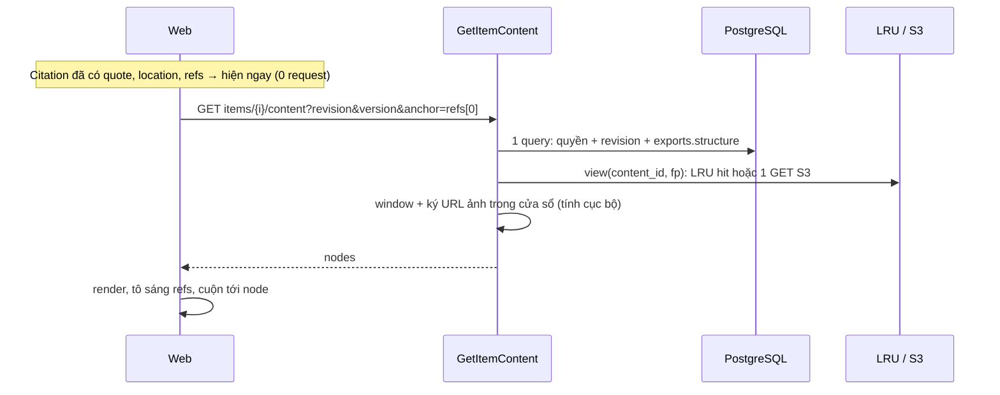

# BoMesh Structured Document: final design (v2)

Trạng thái: **đề xuất**, chưa phải `docs_design`. Sau khi được duyệt, nội dung chuyển vào
`document_contract.md`, `document_viewer.md`, `database_architecture.md`, `design.dbml`, `openapi.yaml` và
`api_design.md`.

Số liệu đo nằm trong `DOCUMENT_ARCHITECTURE_REVIEW.md` và `results/`. Môi trường đo là Mac arm64, nên các con số chỉ
dùng để so sánh tương đối.

**Nguyên tắc:** parse một lần, giữ nguyên cấu trúc, tham chiếu bằng định danh, hiển thị theo cấu trúc, chỉ tải bản gốc
khi người dùng cần.

**Nguyên tắc về độ trễ:** dữ liệu cần để *hiển thị* một trích dẫn đi kèm trích dẫn đó. Dữ liệu cần để *mở rộng ngữ
cảnh* chỉ tốn một request, một query PostgreSQL và tối đa một lần đọc object.

---

## 1. Khái niệm

| Khái niệm | Định nghĩa | Ai thấy |
|---|---|---|
| **Original** | Byte gốc của revision (`content/{t}/{content_id}`); nguồn có thẩm quyền | tải về, bản xem gốc, sandbox |
| **Structured Document** | JSON `DoclingDocument` (docling-core schema 1.x) của một content, ứng với một cấu hình parse. Bất biến, là nguồn nội dung duy nhất | chỉ backend |
| **Fingerprint** (`structureVersion`) | 16 ký tự hex định danh cấu hình parse | API (chuỗi opaque) |
| **Node / NodeRef** | Phần tử của Structured Document. Ref là `self_ref` bỏ tiền tố `#/`, ví dụ `texts/31` | API, web |
| **Picture** | Ảnh nằm ngoài JSON, đặt tên theo hash; JSON chỉ giữ `image.uri` | API (signed URL) |
| **Chunk** | Đơn vị retrieval **nội bộ** trong Qdrant, mang `refs`, `quote`, `location` | chỉ backend |
| **Citation** | `CitationTarget = (item, revision, fingerprint, refs, quote, location)` | API, web |
| **Original Preview** | Engine sáu representation hiện có, giữ nguyên, chỉ tải khi người dùng bấm | web |

---

## 2. Kiến trúc tổng thể

```mermaid
flowchart LR
  ORI[(S3 content/t/c)] -->|parse 1 lần cho mỗi fingerprint| PAR[Parser<br/>Docling · PDF text · VLM]
  PAR --> SD[(S3 derived/t/c/structure-v1/FP.json.gz)]
  PAR --> PIC[(S3 derived/t/c/picture-v1/sha256.ext)]
  SD -. image.uri .-> PIC
  PAR --> MAN[(PG item_revisions.exports.structure)]

  SD --> CHK[chunk + quote + location] --> QD[(Qdrant payload<br/>refs · quote · location · FP · revision)]
  QD --> RET[knowledge_search] --> CT[(PG message_citations<br/>CitationTarget)]
  SD --> API[GetItemContent<br/>dict view + LRU]
  SD --> AGT[read_resource]
  ORI --> PRV[Original Preview, chỉ khi bấm]
```

**Quy tắc phụ thuộc:**
- Chỉ `StructureStore` đọc hoặc ghi `structure-v1` và `picture-v1`.
- Chỉ `structure/view.py` biết schema Docling.
- Ngoài bước parse, không thành phần nào đọc Original để lấy nội dung.

---

## 3. Lưu trữ trên S3

### 3.1 Bố cục key

Bố cục dùng hàm `derived_key(tenant, content, product, version, part)` sẵn có (`storage/keys.py:70-86`), không đổi quy
ước. Thêm hai hằng số `STRUCTURE = "structure"` và `PICTURE = "picture"`.

```text
content/{tenant}/{content_id}                                    Original (giữ nguyên)
derived/{tenant}/{content_id}/structure-v1/{fingerprint}.json.gz Structured Document
derived/{tenant}/{content_id}/picture-v1/{sha256}.{png|jpg|webp} ảnh, dùng chung mọi fingerprint
derived/{tenant}/{content_id}/representation-v1                  Original Preview (giữ nguyên)
derived/{tenant}/{content_id}/cover-v2                           cover (giữ nguyên)
derived/{tenant}/{content_id}/transcript-v1/{fp}-p{a}-{b}.json   bản chép VLM, đầu vào của parse (giữ nguyên)
```

**Quyết định:**
- **Một object cho mỗi Structured Document.** Không chia theo trang hay đoạn. Tài liệu 2.700 đoạn chỉ 74 KB gzip, giải
  nén trong 2,1 ms.
- **Ảnh không nằm trong thư mục của fingerprint.** Byte ảnh không đổi khi parser đổi, nên parse lại không phải ghi lại
  ảnh, và ảnh trùng (logo trên mọi slide) chỉ là một object.
- **Không lưu bản sao nào khác** (markdown, HTML, text, page image). Agent hoặc web cần dạng nào thì serialize từ JSON.

### 3.2 Metadata của object

| Object | `Content-Type` | `Cache-Control` | Ghi chú |
|---|---|---|---|
| `structure-v1/{fp}.json.gz` | `application/vnd.docling.document+json` | `private, max-age=31536000, immutable` | byte là gzip (`mtime=0`, level 6); **không** đặt `Content-Encoding`, vì chỉ backend đọc và tự giải nén |
| `picture-v1/{sha256}.{ext}` | MIME của ảnh | như trên | client tải qua signed URL |

JSON được ghi bằng `model_dump_json(exclude_none=True)`. Ảnh đã tách ra (§3.4) và tọa độ được làm tròn 2 chữ số thập
phân.

### 3.3 Giao thức ghi (chỉ chạy trong worker)

```text
ensure(revision, config):
  fp = config.fingerprint()
  if revision.exports.structure.fingerprint == fp:          # cache hit, không parse
      return load(fp)
  doc = parse(Original)                                      # legacy format: dùng PDF representation như hiện nay
  for picture in doc.pictures with bitmap:                   # tách ảnh, đặt tên theo hash
      put picture-v1/{sha256}.{ext}                          # PUT ghi đè cùng byte; không HEAD
      picture.image = ImageRef(uri="picture-v1/{sha256}.{ext}", mimetype, size, dpi)
  put structure-v1/{fp}.json.gz                              # byte xác định, ghi lại vô hại
  UPDATE item_revisions SET exports = exports || {"structure": manifest}   # mọi revision cùng content_id
```

- **Idempotent, không cần lock.** Parse cho kết quả xác định (đã đo), gzip `mtime=0` và ảnh đặt tên theo hash. Hai run
  song song ghi cùng byte vào cùng key.
- **Thứ tự ghi:** ảnh, rồi JSON, rồi manifest. Manifest chỉ trỏ tới object đã có sẵn.
- **Thất bại giữa chừng** để lại object mồ côi nhưng vô hại; prefix `derived/` sẽ bị xoá khi purge.

### 3.4 Ảnh: lưu bằng tham chiếu

Cách làm theo `ImageRefMode.REFERENCED` của docling-core. Các backend Word, PowerPoint và Excel của Docling 2.121 trích
bitmap (`ImageRef.from_pil`), nên nếu serialize mặc định thì ảnh sẽ bị nhúng base64 vào JSON. Thiết kế này luôn tách
ảnh ra object riêng.

| Nguồn ảnh | Object ảnh | Trong JSON |
|---|---|---|
| Ảnh hoặc biểu đồ nhúng trong DOCX, PPTX, XLSX | ✅ `picture-v1/{sha256}.png` (cạnh dài ≤ 4096 px; ảnh < 32 px bị bỏ) | `image = {uri, mimetype, size, dpi}` |
| Ảnh trùng | ✅ một object | nhiều node cùng `uri` |
| HTML trỏ ảnh ra ngoài | ❌ không tải | chỉ caption |
| Hình trong PDF (text layer) | ❌ | `prov` (trang, bbox) của Original |
| Vượt giới hạn (500 ảnh hoặc 50 MB cho một tài liệu) | ❌ | `image = null` |

Không bao giờ lưu page image. SVG được raster hoá thành PNG.

### 3.5 Giao thức đọc

| Ai đọc | Cách đọc | Chi phí (đo) |
|---|---|---|
| API (`GetItemContent`) | `get` → `gunzip` → `json.loads` → `StructureView` (dict, **không** dùng pydantic) → LRU | DOCX 2.700 đoạn: 2,1 ms gunzip + 14 ms `json.loads`. Validate bằng pydantic tốn 135 ms nên tránh |
| Worker, agent (`read_resource`) | `DoclingDocument.model_validate_json` (cần serializer và chunker của Docling) | 3,4 ms (DOCX nhỏ) đến 135 ms (DOCX lớn) |

- **LRU** đặt trong mỗi process API, key là `(content_id, fingerprint)`. Object bất biến nên không cần invalidate.
- Giới hạn LRU: 64 mục và tổng 256 MB JSON thô. Tài liệu lớn hơn 32 MB thô không được cache.

### 3.6 Vòng đời

| Sự kiện | Tác động trên S3 |
|---|---|
| Process lại, chỉ đổi chunker, embedding hoặc context | không ghi gì; dùng lại `structure-v1/{fp}` |
| Đổi parser (`PARSER_VERSION`, docling-core, `read_images`, model thị giác) | thêm `structure-v1/{fp mới}.json.gz`; ảnh dùng lại; object cũ giữ cho trích dẫn cũ |
| Revision mới | `content_id` mới, prefix mới |
| Rollback hoặc approve dùng lại `content_id` | không ghi gì; manifest được copy theo `exports` (cơ chế `_CONTENT_EXPORTS` có sẵn) |
| Purge Item | `delete_prefix(derived/{t}/{c}/)` như hiện nay (`purge.py:54-57`) |
| Dọn fingerprint cũ | **hoãn**. Mỗi bản chỉ khoảng 2–20% Original (đo trên fixture). Nếu dọn sau này thì chỉ xoá fingerprint không có citation nào trỏ tới |

---

## 4. Mapping PostgreSQL

PostgreSQL chỉ giữ **định danh và manifest**. Nội dung nằm trên S3, vector và text tìm kiếm nằm trong Qdrant. Không có
bảng nào lưu từng node.

| Dữ liệu | Nơi lưu | Thay đổi |
|---|---|---|
| Original | S3 `content/` | không |
| Revision → content | `item_revisions(content_id)` | không |
| Manifest của Structured Document | `item_revisions.exports.structure` (jsonb sẵn có) | **thêm key**, không DDL |
| Manifest của revision hiện tại | `Item.structure`: `column_property` đọc `exports->'structure'` của `current_revision_id`, cùng cách `Item.cover` (`db/models/knowledge.py:424-428`) | **thêm** (0 query thêm) |
| Trạng thái index | `item_index_states(processed_version, indexed_revision_number)` | không. `processed_version` đã chứa phiên bản parser |
| Chunk, vector, refs, quote, location | Qdrant payload | **đổi** (§5) |
| Trích dẫn trong câu trả lời | `message_citations` | **đổi cột** |
| Bản sao trích dẫn dạng JSON | `evidence_review_cells.citations`, `artifacts.evidence_review.synthesis_citations`, `requests.assistant_context.citations` | **đổi shape** thành `CitationTarget` |
| Toạ độ trích dẫn theo chunk | bảng `citations` | **xoá bảng** |

### 4.1 `item_revisions.exports.structure`

```json
{"version": 1, "fingerprint": "a1b2c3d4e5f60718", "doclingSchema": "1.10.0",
 "sizeBytes": 75812, "nodes": 2730, "pictures": 4, "pages": null}
```

Viết bằng `UPDATE … SET exports = exports || jsonb_build_object('structure', :m) WHERE content_id = :c AND item_id =
:i`, theo cùng mẫu với `record_revision_preview`. Ghi manifest không đổi `updateTime` hay etag của Item.

### 4.2 `message_citations` (thay thế)

```dbml
Table message_citations {
  message_id uuid [not null]
  position int [not null, note: 'Thứ tự trích dẫn trong câu trả lời, từ 0']
  item_id uuid [not null, note: 'Document được trích; quyền đọc kiểm tra lại mỗi lần đọc']
  revision_number int [note: 'Revision câu trả lời đã đọc; null = trích dẫn trước thiết kế này']
  structure_version char(16) [note: 'Fingerprint của Structured Document; null = cũ']
  refs text[] [not null, default: `{}`, note: 'NodeRef (texts/31 …); rỗng = mức tài liệu']
  quote text [not null, default: '', note: 'Plain text từ các node, ≤280; ảnh chụp bất biến của đích bất biến']
  location text [not null, default: '', note: 'Nhãn vị trí tính lúc ingestion: mục, sheet, trang PDF']
  indexes {
    (message_id, position) [pk]
    item_id
  }
}
```

- **Bỏ cột:** `chunk_id`, `page`, `excerpt`.
- **Vì sao chép `quote` và `location`?** Đích trích dẫn bất biến, nên bản chép không bao giờ sai. Nhờ đó `ListMessages`
  không phải đọc S3 và không phải load Structured Document. Không chép tên tài liệu: tên vẫn đọc từ Item và kiểm tra
  quyền như hiện nay.
- **Lý do không thêm bảng mới:** trích dẫn không có định danh hay vòng đời riêng ngoài message. Lý do này cần ghi vào
  `item_model.md` §5.

### 4.3 Bảng `citations`

Xoá bảng, cùng với `CitationService` và `Ref: citations.item_id`. Toạ độ (khi có) lấy từ `prov` trong Structured
Document.

---

## 5. Qdrant payload (schema 11 → 12)

| Trường | Trạng thái | Ghi chú |
|---|---|---|
| `chunk_text`, `contextual_text`, `semantic_context`, `context_key`, `embedding_model`, `section_path`, các trường truy cập | giữ | retrieval không đổi |
| `refs: [str]` | **thêm** | NodeRef của chunk |
| `quote: str` | **thêm** | plain text ≤ 280, lấy từ text của node, không markdown |
| `location: str` | **thêm** | ví dụ "13. Ngày phê duyệt lần đầu", "Học phí 2025 · bảng 1", "Trang 12" |
| `structure_version`, `revision_number` | **thêm** | |
| `citation_anchor`, `page_start`, `page_end` | **xoá** | |

Point id và chunk id vẫn theo vị trí, nhưng chỉ dùng **nội bộ**. Trích dẫn không còn phụ thuộc vào chúng.

---

## 6. Base model (Python)

### 6.1 Bố cục module

```text
backend/bomesh/
  storage/keys.py                         + STRUCTURE, PICTURE (không đổi hàm)
  connector/processing/                   PARSE: Original → DoclingDocument (giữ nguyên)
    chunking.py                           DoclingDocument → Chunk (refs, quote, location)
  connector/protocol/chunks.py            Chunk (bỏ CitationInfo)
  services/knowledge_items/structure/
    models.py                             NodeRef, Fingerprint, ParseConfig, StructureRef, StructureManifest, CitationTarget
    store.py                              StructureStore: ensure / view / document; LRU
    view.py                               StructureView (dict, hàm thuần): window, outline, node, markdown
  services/knowledge_items/content.py     GetItemContent (thay ListPassages/GetPassage)
api/dto/knowledge_items.py                ItemContent, ContentNode, ContentRun, ContentCell, ContentImage
```

### 6.2 Định danh và manifest

```python
# services/knowledge_items/structure/models.py
from dataclasses import dataclass
from hashlib import sha256
from typing import Annotated, Literal
from uuid import UUID

from pydantic import BaseModel, ConfigDict, Field, StringConstraints

from bomesh.storage.keys import PICTURE, STRUCTURE, derived_key

NodeRef = Annotated[
    str, StringConstraints(pattern=r"^(texts|tables|pictures|groups|key_value_items|form_items)/\d{1,7}$")
]
Fingerprint = Annotated[str, StringConstraints(pattern=r"^[0-9a-f]{16}$")]


class Frozen(BaseModel):
    model_config = ConfigDict(extra="forbid", frozen=True)


class ParseConfig(Frozen):
    """Mọi thứ làm đổi Structured Document, và chỉ những thứ đó."""

    parser_version: str          # PARSER_VERSION
    docling_schema: str          # docling_core CURRENT_VERSION
    read_images: bool
    vision_model: str | None
    vision_prompt_version: int

    def fingerprint(self) -> str:
        return sha256(self.model_dump_json().encode()).hexdigest()[:16]


@dataclass(frozen=True, slots=True)
class StructureRef:
    tenant_id: UUID
    content_id: UUID
    fingerprint: str

    @property
    def key(self) -> str:
        return derived_key(self.tenant_id, self.content_id, STRUCTURE, 1, f"{self.fingerprint}.json.gz")

    def picture_key(self, name: str) -> str:          # name = "{sha256}.{ext}"
        return derived_key(self.tenant_id, self.content_id, PICTURE, 1, name)


class StructureManifest(Frozen):
    """item_revisions.exports.structure"""

    version: Literal[1] = 1
    fingerprint: Fingerprint
    docling_schema: str
    size_bytes: int = Field(ge=0)
    nodes: int = Field(ge=0)
    pictures: int = Field(ge=0)
    pages: int | None = None


class CitationTarget(Frozen):
    """Một model cho message_citations và mọi bản sao JSON của trích dẫn."""

    item_id: UUID
    revision_number: int
    structure_version: Fingerprint
    refs: tuple[NodeRef, ...]
    quote: str = Field(max_length=280)
    location: str = Field(max_length=200)
```

### 6.3 Chunk (thay `Chunk` + `CitationInfo` + `CitationSpan` + `BoundingBox`)

```python
# connector/protocol/chunks.py
class Chunk(Frozen):
    index: int = Field(ge=0)
    text: str = Field(min_length=1)            # bản serialize để embed và đưa model (giữ như HybridChunker hiện nay)
    refs: tuple[NodeRef, ...] = Field(min_length=1)
    section_path: tuple[str, ...] = ()
    content_type: Literal["text", "table", "image", "code", "structured", "mixed"]
    quote: str                                 # plain text từ node, ≤280
    location: str
```

### 6.4 Store và view

```python
# services/knowledge_items/structure/store.py
@dataclass(frozen=True, slots=True)
class ParsedStructure:
    ref: StructureRef
    manifest: StructureManifest
    document: DoclingDocument


class StructureStore:
    """Nơi duy nhất đọc hoặc ghi structure-v1 / picture-v1."""

    def __init__(self, storage: DocumentStorage, parser: FileProcessor, sessions: SessionFactory,
                 cache: StructureCache) -> None: ...

    async def ensure(self, revision: RevisionSource, config: ParseConfig) -> ParsedStructure:
        """Chỉ worker gọi. Parse khi fingerprint chưa có; ghi ảnh, JSON, rồi manifest."""

    async def view(self, ref: StructureRef) -> StructureView:
        """API gọi. get → gunzip → json.loads → StructureView; LRU theo (content_id, fingerprint)."""

    async def document(self, ref: StructureRef) -> DoclingDocument:
        """Worker hoặc agent gọi khi cần chunker hay serializer của Docling."""


# services/knowledge_items/structure/view.py
class StructureView:
    """Dict thô của DoclingDocument đã index một lần. Hàm thuần, không I/O."""

    def __init__(self, ref: StructureRef, data: dict) -> None:
        # một lần duyệt O(n): thứ tự node cấp cao nhất trong body, ref → vị trí cấp cao nhất, ref → node
        ...

    def window(self, anchor: NodeRef | None, size: int, start: int | None) -> Window: ...
    def outline(self) -> list[OutlineEntry]: ...
    def to_node(self, ref: NodeRef) -> ContentNode: ...      # projection BoMesh; ảnh trả về key, API ký URL
```

### 6.5 DTO API (projection BoMesh, không phải schema Docling)

```python
# api/dto/knowledge_items.py  (JSON lowerCamelCase theo proto3)
class ContentRun(Frozen):
    text: str
    bold: bool = False
    italic: bool = False
    uri: str | None = None          # chỉ http, https, mailto


class ContentCell(Frozen):
    text: str
    row_span: int = 1
    col_span: int = 1
    header: bool = False


class ContentImage(Frozen):
    uri: str                        # signed URL
    width: int
    height: int
    mime_type: str
    expire_time: datetime


class ContentNode(Frozen):
    id: NodeRef
    kind: Literal["HEADING", "PARAGRAPH", "LIST", "LIST_ITEM", "TABLE", "CODE", "FORMULA", "PICTURE", "CAPTION"]
    level: int | None = None
    marker: str | None = None
    runs: tuple[ContentRun, ...] = ()
    children: tuple["ContentNode", ...] = ()
    rows: tuple[tuple[ContentCell, ...], ...] = ()
    sheet: str | None = None
    caption: str | None = None
    image: ContentImage | None = None
    original_page: int | None = None   # chỉ khi byte đã parse chính là byte bản xem gốc hiển thị (PDF, legacy qua PDF)
    transcribed: bool = False          # văn bản do VLM hoặc OCR sinh ra


class ItemContent(Frozen):
    revision: str                   # workspaces/{w}/items/{i}/revisions/{n}
    version: Fingerprint
    nodes: tuple[ContentNode, ...]
    previous_page_token: str | None = None
    next_page_token: str | None = None
```

`Citation` (trong Message, Work, Request) = `CitationTarget` + `displayName`, `available`, `outdated`.

---

## 6.6 Định dạng theo mục đích: sinh khi cần, không lưu

JSON là nguồn duy nhất. Mọi định dạng khác là **view**, do serializer của docling-core sinh ra khi cần (bản 2.92 có
`export_to_markdown`, `export_to_text`, `export_to_html`, `export_to_doctags`, `export_to_element_tree`). Không định
dạng nào được lưu lại.

| Mục đích | Định dạng | Cách sinh | Ghi chú |
|---|---|---|---|
| Agent `read_resource` | Markdown | `export_to_markdown(from_element, to_element, image_mode=PLACEHOLDER)` | đọc theo **trang phần tử**, thay cho cắt theo số ký tự; ảnh là placeholder kèm `picture ref` để agent xin xem |
| Agent xem một hình | ảnh | `picture-v1/{sha}` → ảnh inline (`data:` URL, như attachment) | không đưa URL storage cho provider |
| Embed, BM25, model evidence | text của chunk | `HybridChunker` (serializer markdown/triplet hiện có) | không đổi, để giữ chất lượng retrieval đã đo |
| `quote` của trích dẫn | plain text | text của các node trong `refs` (`strict_text`) | không markdown |
| Phân loại, tóm tắt, contextualize | Markdown phần đầu và outline | `export_to_markdown(to_element=…)` cùng các heading | |
| Sandbox | — | dùng Original | tính toán chính xác cần file gốc |
| Web, mobile | `ContentNode` JSON | projection trong `view.py` | **không** dùng `export_to_html`: HTML từ nội dung không tin cậy cần `dangerouslySetInnerHTML` và không có ID node để tô sáng |
| Xuất file (Work, DOCX/MD) | Markdown hoặc HTML | serializer tương ứng | chỉ ở phía server |
| Evaluation, debug | DocTags, element tree | `export_to_doctags`, `export_to_element_tree` | công cụ nội bộ |

Hai giới hạn:
- **Bảng trong Markdown không biểu diễn được ô gộp** (`rowSpan`/`colSpan`). Agent dùng được, nhưng màn hình cho người
  đọc phải dùng `ContentNode`.
- **Serializer cần `DoclingDocument` đã validate** (tài liệu 2.700 đoạn: 135 ms load + 127 ms markdown). Worker và agent
  cache `DoclingDocument` bằng LRU; API web dùng dict thô (14 ms).

## 7. Luồng ingestion (ít bước hơn)

| # | Hiện tại | Mới |
|---|---|---|
| 1 | tải Original | `StructureStore.ensure`: cache hit chỉ là 1 GET; miss thì tải + parse + PUT |
| 2 | parse → `DoclingDocument` | — |
| 3 | `DocumentMapper` → `DocumentItem` (mất cấu trúc) | **bỏ** |
| 4 | chunker duyệt `DoclingDocument` lần 2 | chunk (refs, quote, location) |
| 5 | transaction ghi bảng `citations` | **bỏ** |
| 6 | contextualize | contextualize (đầu vào là doc) |
| 7 | embed + upsert Qdrant | embed + upsert Qdrant |
| 8 | ghi kết quả index | ghi kết quả index |

**Process lại** khi chỉ đổi chunker, embedding hoặc context: không tải Original, không parse. Đã đo: chunk lại từ bản
đã lưu mất 0,46 s, so với parse lại 7,0 s, và cho chunk giống hệt.

---

## 8. Luồng đọc và độ trễ

### 8.1 Bấm trích dẫn



| Bước | Hiện tại | Mới |
|---|---|---|
| Hiện đoạn trích dẫn | sau GetItem và GetPassage | **ngay lập tức** từ `Citation` |
| Request API | GetItem → GetPassage (chờ GetItem), GetItemPreview | 1 × GetItemContent (GetItem nếu cần thì chạy song song, thường đã có cache) |
| Lượt truy cập backend | PG + Qdrant scroll + PG `citations` + PG + presign | 1 PG + 0–1 GET S3 |
| Tải ở client | pdf.js 552 KB JS (lần đầu) + PDF + quét text layer mọi trang | ≤ 200 node JSON (đo: khoảng 26 KB cho 40 đoạn dày) |
| Tô sáng | so khớp chữ gần đúng | theo ID node |

**Ước lượng thời gian server** [INFERENCE, ghép từ các phần đã đo]:
- LRU hit: dưới 10 ms.
- LRU miss, tài liệu 2.700 đoạn: khoảng 30–80 ms (GET S3 + 2,1 ms gunzip + 14 ms `json.loads`).

### 8.2 Các đường đọc khác

| Đường | Hiện tại | Mới |
|---|---|---|
| `ListMessages` | PG (+ client gọi GetPassage cho từng trích dẫn khi mở) | PG; `quote` và `location` đã có trong row |
| Kết quả tìm kiếm | Qdrant + PG | Qdrant + PG; `refs`, `quote`, `location` lấy từ payload |
| Agent `read_resource` | PG + tải Original + parse (+ Gotenberg) + chunk + flatten | PG + LRU/GET + serialize markdown |
| Mở rộng ngữ cảnh ("Xem phần trước/sau") | — | GetItemContent với `pageToken` (thường LRU hit) |
| Bản gốc | như cũ | như cũ, chỉ khi bấm |

---

## 9. API

```yaml
GET /api/v1/workspaces/{workspace}/items/{item}/content        # GetItemContent, Knowledge
x-permission: items.get   # visibility rule; ngoại lệ reviewer như GetItemPreview
params:  revision (int, mặc định revision đã index) · version (mặc định exports.structure của revision đó)
         anchor (NodeRef) · view (FULL | OUTLINE) · pageSize (40, tối đa 200 node cấp cao nhất) · pageToken
200:     ItemContent
errors:
  COLLECTION → INVALID_ARGUMENT
  DELETED hoặc không đọc được → NOT_FOUND
  revision chưa xử lý → FAILED_PRECONDITION CONTENT_NOT_PROCESSED
  fingerprint không còn → FAILED_PRECONDITION CONTENT_VERSION_UNAVAILABLE
  anchor không tồn tại → INVALID_ARGUMENT
headers: Cache-Control: private, no-cache · ETag: {content_id}:{fp}:{window}
```

- **Xoá:** `ListPassages`, `GetPassage`, `ItemPassage`, tên tài nguyên `…/passages/{chunk}`.
- **Đổi:** `Citation` và `SearchItemsPassage` thành các trường của `CitationTarget`.
- **Giữ nguyên:** `GetItemPreview`, `GetItem ?alt=media`.

---

## 10. Viewer

```text
ResourceViewer
├── ResourceHeader       tên, icon, collection: helper dùng chung, dữ liệu lấy từ Citation hoặc Item
├── ContentView (mặc định)   quote/location ngay → GetItemContent → DocumentRenderer, tô sáng refs
│   └── DocumentRenderer     Heading · Paragraph(runs) · List · Table(span) · Code · Formula · Picture(lazy )
└── OriginalPreviewView      chỉ khi bấm "Bản gốc" (DocumentSurface hiện có); mở đúng trang khi có originalPage
```

Một helper `openCitation()` thay cho năm đường mở trích dẫn hiện có. Làm trong `apps/ux_preview` trước, rồi tới
`apps/web`.

---

## 11. Xoá bỏ

**Backend:**
- `connector/protocol/citation.py` (`CitationInfo`, `CitationSpan`, `BoundingBox`);
- content parts trong `connector/protocol/content.py`;
- `DocumentMapper` content;
- `mapper._element_id`;
- `services/knowledge_items/citations.py` và bảng `citations`;
- passage DTOs và routes;
- `services/artifacts/rendition.py` và `preview-v1/document.json.gz`;
- parse lại trong `read_resource`;
- code chết (`chunk_item`, `_document_from_item`, `StoredFileContentService.parse`, `source_reference`).

**Web:**
- `reader/rendition.ts`;
- `usePassages`;
- phần tô sáng trích dẫn trong `marks.ts` (giữ phần tìm `?q=` cho bản gốc).

---

## 12. Bảo mật

- Mọi đường đọc dùng chung visibility rule. Nội dung phản hồi trực tiếp qua API, nên thu hồi quyền có hiệu lực ngay.
  URL ảnh là URL ký ngắn hạn, cấp sau khi kiểm tra quyền.
- Key luôn suy ra từ `content_id` của đúng revision của Item đang đọc. Client không bao giờ gửi key.
- Nội dung là input không tin cậy:
  - render bằng text node của React;
  - `uri` chỉ cho `http`, `https`, `mailto`;
  - không tải ảnh ngoài;
  - SVG được raster hoá.
- JSON Docling không ra khỏi backend.
- Node do VLM hoặc OCR sinh ra có `transcribed: true`.

---

## 13. Chuyển đổi

1. Cập nhật `docs_design`, `openapi.yaml` và `design.dbml`; chạy `tests/docs_design` và `dbml2sql`.
2. Thêm `StructureStore` và manifest. Worker ghi Structured Document; chưa consumer nào đọc.
3. Chunker, phân loại và contextualization đọc từ store.
4. Đổi payload Qdrant (schema 12), `message_citations` và `CitationTarget`. Bump `PARSER_VERSION`, xử lý lại tài liệu.
   - Môi trường cần giữ dữ liệu chạy một upgrade script được review rồi xoá. Script giữ các row cũ ở mức tài liệu
     (`refs` rỗng; chép `excerpt` cũ sang `quote`).
5. Làm `GetItemContent`, rồi ux_preview, rồi `ResourceViewer` trên web.
6. `read_resource`, artifact viewer và cover dạng text đọc từ store.
7. Xoá các phần ở §11.

---

## 14. Kiểm thử bắt buộc

| # | Kịch bản | Kỳ vọng |
|---|---|---|
| 1 | Trích dẫn DOCX "09/12/2022" | `refs=["texts/31"]`, `location="13. Ngày phê duyệt lần đầu"`; ContentView tô đúng node |
| 2 | `quote` không có markdown | không có `**`, `](`, code fence |
| 3 | Bảng tính | `location` có tên sheet; bảng giữ `rowSpan`/`colSpan` |
| 4 | Hai trích dẫn trong một tài liệu | hai row, `refs` khác nhau, mỗi row mở đúng node |
| 5 | Bấm trích dẫn | đúng 1 request API; không `/preview`, không pdf.js, không Original |
| 6 | Process lại, chỉ đổi chunker | không GET Original, không parse; fingerprint giữ nguyên; trích dẫn cũ vẫn đúng |
| 7 | Đổi parser | fingerprint mới; trích dẫn cũ đọc phiên bản cũ; phiên bản đã purge → `CONTENT_VERSION_UNAVAILABLE` |
| 8 | Ảnh | JSON không có base64; ảnh trùng là một object; parse lại không ghi lại ảnh |
| 9 | Hai run song song | cùng byte, cùng key, một manifest |
| 10 | `ListMessages` | không GET S3 |
| 11 | Thu hồi quyền | `GetItemContent` → NOT_FOUND; `available: false` |
| 12 | Agent đọc tài liệu đã xử lý | không gọi parser, không gọi Gotenberg |
| 13 | Tài liệu lớn (2.700 đoạn) | `GetItemContent` p95 < 100 ms khi LRU miss ở môi trường local |
